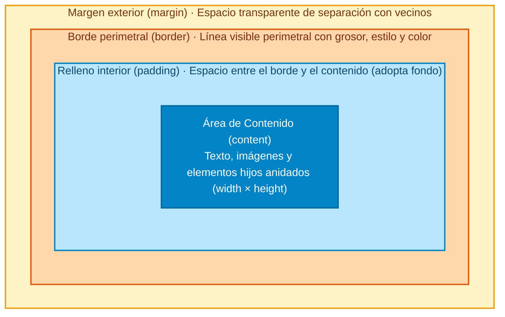
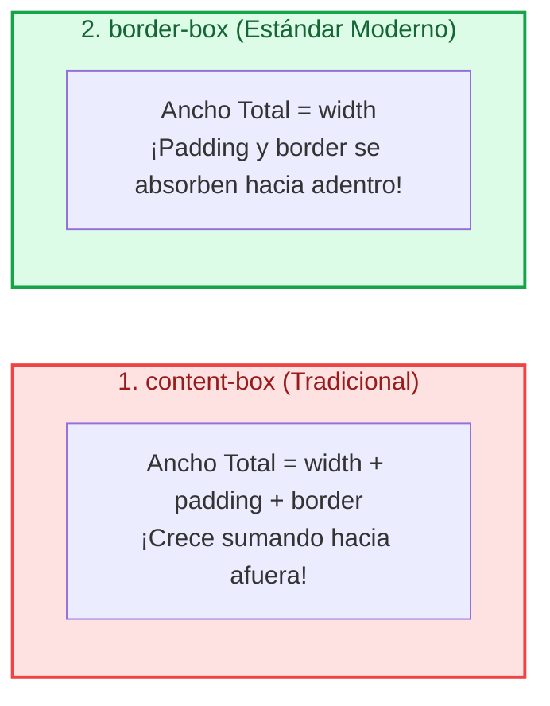
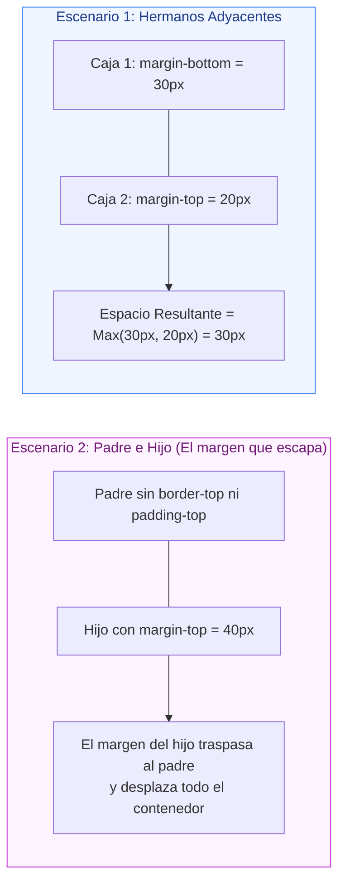

# Ejemplos de Código · Unidad 03: Modelo de Caja

<div class="badges">
  <span class="badge badge-css">CSS3 Moderno</span>
  <span class="badge badge-blue">Código Práctico</span>
  <span class="badge badge-green">Modelo de Caja</span>
  <span class="badge badge-ra">RA 2 / RA 3</span>
</div>

En este documento se desarrollan **ejemplos completos y funcionales de código HTML5 y CSS3** para cada uno de los elementos y propiedades del ==modelo de caja== estudiados en la **Unidad 03**.

!!! info "Estructura de cada sección"

    Cada apartado está estructurado de manera didáctica con:

    1. **Fundamento conceptual:** Explicación técnica de la propiedad y su impacto en el renderizado.
    2. **Código fuente interactivo:** Pestañas separadas para el marcado **HTML** y los estilos **CSS**.
    3. **Disección técnica paso a paso:** Análisis línea a línea de las reglas y comportamiento en pantalla.

---

## 1. Anatomía de la Caja: Las Cuatro Capas Concéntricas

### Fundamento Conceptual

Todo elemento renderizado en el navegador conforma una caja rectangular estructurada en **cuatro capas concéntricas** que se calculan desde el centro hacia el exterior:



Contenido (`content`)
:   Zona interior donde se dibuja el texto o los elementos hijos. Sus dimensiones directas se fijan con `width` y `height`.

Relleno (`padding`)
:   Espacio interior situado entre el contenido y el borde. Hereda el color o imagen de fondo (`background-color`) del elemento.

Borde (`border`)
:   Línea perimetral visible que rodea el padding y el contenido. Requiere obligatoriamente un estilo (`border-style: solid | dashed | dotted...`) para dibujarse.

Margen (`margin`)
:   Espacio exterior transparente que separa la caja de sus elementos colindantes en el flujo. Puede admitir valores negativos.

Propiedades accesorias sin alteración del layout
:   **`outline`:** Contorno dibujado fuera del borde. A diferencia del borde, ==no ocupa espacio en el layout== ni altera las medidas de la caja (ideal para anillos de foco accesible).  
    **`box-shadow`:** Sombra proyectada en la fase de pintura; tampoco desplaza a los elementos vecinos.

### Código de Ejemplo

=== "HTML"

    ```html title="01-anatomia-caja.html"
    <!DOCTYPE html>
    <html lang="es">
    <head>
      <meta charset="UTF-8">
      <meta name="viewport" content="width=device-width, initial-scale=1.0">
      <title>Anatomía de la Caja</title>
      <link rel="stylesheet" href="01-anatomia-caja.css">
    </head>
    <body>
      <main class="contenedor-padre">
        <!-- Elemento vecino previo para evidenciar el margen exterior -->
        <p class="vecino">Elemento vecino anterior (referencia de margen)</p>

        <!-- Caja de inspección con todas las capas visualizadas -->
        <article class="caja-inspeccion">
          <div class="area-contenido">
            <h3>Área de Contenido</h3>
            <p>Texto interior que ocupa exactamente el área de contenido (width × height).</p>
          </div>
        </article>

        <!-- Elemento vecino posterior -->
        <p class="vecino">Elemento vecino posterior (referencia de margen)</p>
      </main>
    </body>
    </html>
    ```

=== "CSS"

    ```css title="01-anatomia-caja.css"
    /* Reset básico */
    * {
      margin: 0;
      padding: 0;
      box-sizing: content-box; /* Se usa content-box para ver la suma tradicional */
    }

    body {
      font-family: system-ui, sans-serif;
      background-color: #f1f5f9;
      padding: 2rem;
      color: #0f172a;
    }

    .contenedor-padre {
      max-width: 600px;
      margin: 0 auto;
      background-color: #ffffff;
      padding: 1.5rem;
      border: 1px dashed #cbd5e1;
      border-radius: 8px;
    }

    .vecino {
      background-color: #e2e8f0;
      padding: 0.5rem 1rem;
      font-size: 0.85rem;
      color: #475569;
      border-radius: 4px;
    }

    /* Caja demostrativa con las 4 capas claramente diferenciadas */
    .caja-inspeccion {
      /* 1. Dimensiones de Contenido */
      width: 320px;
      height: 120px;

      /* 2. Relleno interior (padding) */
      padding: 24px;
      background-color: #bae6fd; /* Llena toda el área de padding */

      /* 3. Borde perimetral */
      border: 8px solid #0284c7;
      border-radius: 12px;

      /* 4. Margen exterior */
      margin: 30px auto; /* 30px vertical, auto horizontal para centrar */

      /* Propiedades exteriores que no alteran el modelo de caja */
      outline: 4px dashed #f59e0b; /* Contorno exterior sin ocupar espacio */
      outline-offset: 4px;        /* Separación de 4px respecto al borde */
      box-shadow: 0 10px 25px -5px rgba(2, 132, 199, 0.35);
    }

    .area-contenido {
      width: 100%;
      height: 100%;
      background-color: #0284c7;
      color: #ffffff;
      padding: 0.5rem;
      font-size: 0.85rem;
      border-radius: 6px;
    }

    .area-contenido h3 {
      font-size: 1rem;
      margin-bottom: 0.25rem;
    }
    ```

!!! tip "Disección técnica paso a paso"

    1. **Área de Contenido:** Fijada en `width: 320px` y `height: 120px`. El fondo azul oscuro de `.area-contenido` nos muestra visualmente hasta dónde llegan estas dimensiones de texto.
    2. **Padding (`24px`):** Genera una franja de respiro de 24 píxeles en los cuatro lados. El fondo azul claro (`#bae6fd`) tiñe todo el relleno interior.
    3. **Borde (`8px solid #0284c7`):** Dibuja una línea perimetral de 8px. Con `border-radius: 12px` se suavizan las esquinas exteriores e interiores.
    4. **Margen (`30px auto`):** Separa la caja 30px respecto a los párrafos vecinos y la centra horizontalmente en el contenedor.
    5. **Outline vs Border:** El `outline` ámbar discontinuo se dibuja por fuera de la caja con `outline-offset: 4px`. En las *DevTools* comprobarás que el outline **no añade ni un solo píxel al layout**.

!!! warning "Modifica el código:" 

    1. Ajusta los párrafos para que se ajusten al contenido. Después céntralos.
    2. Haz que el párrafo ocupe todo el ancho disponible. Centra el texto respecto a este.


!!! danger "Espacio desigual" 

    ¿Por qué el espacio azul claro no se ve por igual en las cuatro direcciones?
---

## 2. `box-sizing`: Comparativa Visual `content-box` vs `border-box`

### Fundamento Conceptual

La propiedad ==`box-sizing`== define la **ecuación matemática** con la que el motor de renderizado calcula el tamaño real de los elementos:



| Modelo | Ecuación de Ancho Total | Ejemplo con `width: 300px`, `padding: 25px`, `border: 10px` |
| :--- | :--- | :--- |
| **`content-box`** (default) | `Ancho = width + padding + border` | `300 + (25 × 2) + (10 × 2) = ` **370px** *(Desborde de 70px)* |
| **`border-box`** (recomendado) | `Ancho = width` | **300px** *(El contenido interior se encoge a 230px)* |

!!! warning "El clásico problema del 50%"

    En maquetación tradicional con `content-box`, si defines dos columnas al `50%` de ancho y a una le aplicas `padding: 10px` o un borde de `1px`, la suma superará el `100%` y la segunda columna **saltará a la siguiente línea**, rompiendo el diseño. Con `border-box` el ancho se mantiene estrictamente en el `50%`.

### Código de Ejemplo

=== "HTML"

    ```html title="02-box-sizing.html"
    <!DOCTYPE html>
    <html lang="es">
    <head>
      <meta charset="UTF-8">
      <meta name="viewport" content="width=device-width, initial-scale=1.0">
      <title>Comparativa box-sizing</title>
      <link rel="stylesheet" href="02-box-sizing.css">
    </head>
    <body>
      <main class="banco-pruebas">
        <h2>Comparativa de Dimensiones Reales (Ambas declaran width: 300px)</h2>

        <!-- Caso A: content-box -->
        <section class="caso">
          <h3>1. Caja con <code>content-box</code> (Tradicional)</h3>
          <p class="detalle">Declarado: width: 300px + padding: 25px + border: 10px</p>
          <div class="caja caja--content-box">
            <strong>Resultado real en pantalla: 370px</strong>
            <p>¡Se ha desbordado y mide 70px más de lo solicitado!</p>
          </div>
        </section>

        <!-- Caso B: border-box -->
        <section class="caso">
          <h3>2. Caja con <code>border-box</code> (Moderno recomendado)</h3>
          <p class="detalle">Declarado: width: 300px + padding: 25px + border: 10px</p>
          <div class="caja caja--border-box">
            <strong>Resultado real en pantalla: 300px</strong>
            <p>El relleno y borde se absorben dentro de los 300px.</p>
          </div>
        </section>

        <!-- Regla de referencia visual -->
        <div class="regla-referencia">
          <span>Marca exacta de 300 píxeles</span>
        </div>
      </main>
    </body>
    </html>
    ```

=== "CSS"

    ```css title="02-box-sizing.css"
    body {
      font-family: system-ui, sans-serif;
      background-color: #f8fafc;
      padding: 2rem;
      color: #1e293b;
    }

    .banco-pruebas {
      max-width: 650px;
      margin: 0 auto;
      background-color: #ffffff;
      padding: 2rem;
      border-radius: 12px;
      box-shadow: 0 4px 12px rgba(0, 0, 0, 0.05);
    }

    h2 {
      font-size: 1.25rem;
      margin-bottom: 1.5rem;
      color: #0f172a;
    }

    .caso {
      margin-bottom: 2rem;
    }

    .caso h3 {
      font-size: 1rem;
      margin-bottom: 0.25rem;
    }

    .detalle {
      font-size: 0.8rem;
      color: #64748b;
      margin-bottom: 0.75rem;
    }

    /* Estilos comunes para ambas cajas */
    .caja {
      width: 300px;
      height: 110px;
      padding: 25px;
      border: 10px solid;
      font-size: 0.85rem;
    }

    /* 1. Caja tradicional */
    .caja--content-box {
      box-sizing: content-box;
      background-color: #fee2e2;
      border-color: #ef4444;
      color: #991b1b;
    }

    /* 2. Caja moderna */
    .caja--border-box {
      box-sizing: border-box;
      background-color: #dcfce7;
      border-color: #16a34a;
      color: #166534;
    }

    /* Regla visual de 300px para evidenciar la diferencia */
    .regla-referencia {
      width: 300px;
      border-top: 3px dashed #0284c7;
      padding-top: 6px;
      font-size: 0.75rem;
      font-weight: bold;
      color: #0284c7;
      text-align: right;
    }
    ```

!!! tip "Disección técnica paso a paso"

    1. **Comportamiento en `content-box`:** Con `width: 300px`, el navegador asigna esos 300px exclusivamente al contenido. Al sumar `padding: 25px` por lado (50px en total) y `border: 10px` por lado (20px en total), el ancho final renderizado es de `370px` (300 + 50 + 20). La caja sobrepasa la guía azul en 70px.
    2. **Comportamiento en `border-box`:** El ancho especificado de `width: 300px` comprende el contenido, el relleno y el borde. El navegador comprime el área de contenido a `230px` (300 - 50 - 20), asegurando que el ancho exterior total sea estrictamente de 300px y encaje a la perfección con la regla azul.
    3. **Regla de Referencia (`.regla-referencia`):** Fijada en `width: 300px` con borde discontinuo superior para demostrar visualmente el desbordamiento imprevisto del modelo tradicional frente a la precisión del modelo moderno.

!!! example "Reset Universal Indispensable en Todo Proyecto Web"

    ```css title="reset.css" hl_lines="2"
    /* Reset universal aplicado en la industria y frameworks modernos */
    *, *::before, *::after {
      box-sizing: border-box; /* (1)! */
    }
    ```

    1. El selector universal `*` junto a los pseudo-elementos garantiza que todas las cajas de la web calculen su anchura de forma predecible sin sorpresas al añadir padding.

---

## 3. Dimensiones Intrínsecas: `min-content`, `max-content` y `fit-content`

### Fundamento Conceptual

En CSS moderno, además de valores fijos (`px`, `rem`, `%`), podemos indicar que el ancho de una caja se determine según la naturaleza intrínseca de su contenido:

`min-content`
:   La **anchura mínima posible** que la caja puede adoptar sin desbordar el texto ni cortar palabras. Su tamaño coincide con la palabra más ancha que contenga.

`max-content`
:   La **anchura máxima ideal** para mostrar todo el contenido en una sola línea horizontal continua, sin saltos de línea automáticos.

`fit-content`
:   El valor más inteligente y adaptable: equivale a `min(max(min-content, disponible), max-content)` &rarr; «lo justo». Utiliza todo el espacio necesario sin desbordar el contenedor padre.

### Código de Ejemplo

=== "HTML"

    ```html title="03-dimensiones-intrinsecas.html"
    <!DOCTYPE html>
    <html lang="es">
    <head>
      <meta charset="UTF-8">
      <meta name="viewport" content="width=device-width, initial-scale=1.0">
      <title>Palabras clave intrínsecas</title>
      <link rel="stylesheet" href="03-dimensiones-intrinsecas.css">
    </head>
    <body>
      <main class="contenedor-muestras">
        <h2>Palabras Clave Intrínsecas: min-content, max-content y fit-content</h2>

        <!-- min-content -->
        <div class="bloque">
          <span class="etiqueta">width: min-content</span>
          <div class="caja-intrinseca caja--min">
            Diseño Responsivo con CSS
          </div>
        </div>

        <!-- max-content -->
        <div class="bloque">
          <span class="etiqueta">width: max-content</span>
          <div class="caja-intrinseca caja--max">
            Diseño Responsivo con CSS
          </div>
        </div>

        <!-- fit-content -->
        <div class="bloque">
          <span class="etiqueta">width: fit-content</span>
          <div class="caja-intrinseca caja--fit">
            Diseño Responsivo con CSS
          </div>
        </div>
      </main>
    </body>
    </html>
    ```

=== "CSS"

    ```css title="03-dimensiones-intrinsecas.css"
    * {
      box-sizing: border-box;
      margin: 0;
      padding: 0;
    }

    body {
      font-family: system-ui, sans-serif;
      background-color: #f1f5f9;
      padding: 2rem;
      color: #0f172a;
    }

    .contenedor-muestras {
      max-width: 520px;
      margin: 0 auto;
      background-color: #ffffff;
      padding: 2rem;
      border-radius: 12px;
      border: 1px solid #e2e8f0;
    }

    h2 {
      font-size: 1.15rem;
      margin-bottom: 1.5rem;
    }

    .bloque {
      margin-bottom: 1.5rem;
      border-left: 3px solid #cbd5e1;
      padding-left: 1rem;
    }

    .etiqueta {
      display: block;
      font-family: monospace;
      font-size: 0.85rem;
      color: #0284c7;
      margin-bottom: 0.4rem;
      font-weight: 600;
    }

    .caja-intrinseca {
      padding: 0.75rem 1rem;
      border-radius: 8px;
      font-size: 0.95rem;
      font-weight: 500;
      color: #ffffff;
    }

    /* 1. min-content: se colapsa al ancho de la palabra más ancha ("Responsivo") */
    .caja--min {
      width: min-content;
      background-color: #ea580c;
    }

    /* 2. max-content: fuerza una sola línea sin saltos */
    .caja--max {
      width: max-content;
      background-color: #0284c7;
    }

    /* 3. fit-content: se ajusta al contenido exacto sin forzar desborde */
    .caja--fit {
      width: fit-content;
      background-color: #10b981;
    }
    ```

!!! tip "Disección técnica paso a paso"

    1. **`caja--min` (`width: min-content`):** La caja naranja se comprime al mínimo. La palabra más ancha es *"Responsivo"*; por tanto, la caja adopta exactamente el ancho de esa palabra y envía las demás a nuevas líneas.
    2. **`caja--max` (`width: max-content`):** La caja azul ignora los saltos de línea automáticos y se estira en una sola línea continua para abarcar todo el texto.
    3. **`caja--fit` (`width: fit-content`):** La caja verde adopta el comportamiento más equilibrado: ocupa únicamente el ancho que el texto necesita sin estirarse al 100% del contenedor ni forzar saltos innecesarios.

!!! danger "¿Qué diferencia hay entre las dos últimas cajas?" 

    Explica por qué las dos cajas se ven iguales. ¿Qué podemos hacer para que se van distintas?

---

## 4. Límites Dimensionales y Proporción: `min-width`, `max-width` y `aspect-ratio`

### Fundamento Conceptual

En diseño adaptable (*Responsive Web Design*), rara vez declaramos anchuras fijas en píxeles. En su lugar, combinamos **anchos fluidos porcentuales con límites dimensionales**:

`width: 100%`
:   Hace que el elemento sea fluido y se adapte al ancho disponible de su contenedor padre.

`min-width` y `max-width`
:   Fijan los topes de seguridad. En caso de contradicción matemática, ==`min-width` siempre tiene prioridad sobre `width`==.

`aspect-ratio`
:   Mantiene una proporción fija matemática entre anchura y altura (como `16 / 9` en vídeos o `1` en avatares cuadrados).  
    **Impacto en rendimiento:** Reserva el espacio exacto en el DOM antes de que la imagen o vídeo termine de descargarse de la red, eliminando el ==Cumulative Layout Shift (CLS)==.

### Código de Ejemplo

=== "HTML"

    ```html title="04-limites-y-aspect-ratio.html"
    <!DOCTYPE html>
    <html lang="es">
    <head>
      <meta charset="UTF-8">
      <meta name="viewport" content="width=device-width, initial-scale=1.0">
      <title>Límites y aspect-ratio</title>
      <link rel="stylesheet" href="04-limites-y-aspect-ratio.css">
    </head>
    <body>
      <main class="contenedor-fluido">
        <h2>Control de Límites y aspect-ratio Anti-CLS</h2>

        <!-- Tarjeta con ancho fluido y límites min/max -->
        <article class="tarjeta-adaptable">
          <!-- Marco multimedia con aspect-ratio 16:9 estricto -->
          <div class="marco-video">
            
          </div>

          <div class="tarjeta-adaptable__cuerpo">
            <h3>Desarrollo Web Profesional</h3>
            <p>
              Esta tarjeta tiene <code>width: 100%</code>, pero está acotada con 
              <code>min-width: 280px</code> y <code>max-width: 480px</code>.
            </p>
          </div>
        </article>
      </main>
    </body>
    </html>
    ```

=== "CSS"

    ```css title="04-limites-y-aspect-ratio.css"
    * {
      box-sizing: border-box;
      margin: 0;
      padding: 0;
    }

    body {
      font-family: system-ui, sans-serif;
      background-color: #f8fafc;
      padding: 2rem 1rem;
      display: flex;
      justify-content: center;
    }

    .contenedor-fluido {
      width: 100%;
      display: flex;
      flex-direction: column;
      align-items: center;
    }

    h2 {
      font-size: 1.2rem;
      margin-bottom: 1.5rem;
      text-align: center;
    }

    /* Tarjeta con control estricto de dimensiones */
    .tarjeta-adaptable {
      width: 100%;        /* Fluida por defecto en pantallas pequeñas */
      min-width: 280px;   /* Límite inferior: nunca se comprime a menos de 280px */
      max-width: 480px;   /* Límite superior: nunca se estira a más de 480px */
      background-color: #ffffff;
      border: 1px solid #e2e8f0;
      border-radius: 1rem;
      overflow: hidden;
      box-shadow: 0 10px 20px -5px rgba(0, 0, 0, 0.08);
    }

    /* Marco multimedia con proporción de aspecto fija */
    .marco-video {
      width: 100%;
      aspect-ratio: 16 / 9; /* Altura calculada = (ancho actual * 9) / 16 */
      background-color: #cbd5e1; /* Color placeholder mientras carga la imagen */
    }

    .marco-video__imagen {
      width: 100%;
      height: 100%;
      object-fit: cover; /* Recorta los bordes sobrantes sin deformar la foto */
      display: block;    /* Elimina el espacio fantasma de los elementos inline */
    }

    .tarjeta-adaptable__cuerpo {
      padding: 1.5rem;
    }

    .tarjeta-adaptable__cuerpo h3 {
      font-size: 1.1rem;
      margin-bottom: 0.5rem;
      color: #0f172a;
    }

    .tarjeta-adaptable__cuerpo p {
      font-size: 0.9rem;
      color: #64748b;
      line-height: 1.5;
    }
    ```

!!! tip "Disección técnica paso a paso"

    1. **Contenedor Elástico (`width: 100%` con límites):** La tarjeta utiliza `width: 100%` para fluir con el ancho de la pantalla, pero queda protegida por `min-width: 280px` (evita que los textos colapsen en pantallas diminutas) y `max-width: 480px` (previene que la tarjeta se deforme en monitores panorámicos).
    2. **Reserva de Espacio con `aspect-ratio: 16 / 9`:** El contenedor `.tarjeta-adaptable__marco-foto` reserva la proporción exacta de pantalla panorámica antes de que la imagen termine de descargarse por red, erradicando por completo el salto visual de maquetación (*Cumulative Layout Shift* o CLS).
    3. **Ajuste de la Imagen (`object-fit: cover`):** La etiqueta `` se configura con `width: 100%`, `height: 100%` y `display: block` (eliminando el espacio blanco inferior característico de los elementos inline). `object-fit: cover` escala y recorta la imagen proporcionalmente para llenar el marco sin deformar su relación de aspecto original.
    4. **Encapsulamiento del Borde Redondeado:** Al aplicar `overflow: hidden` y `border-radius: 12px` en la tarjeta padre, las esquinas superiores de la imagen quedan recortadas automáticamente con la misma curvatura.

---

## 5. Márgenes, Propiedades Lógicas y Colapso de Márgenes (*Margin Collapsing*)

### Fundamento Conceptual

El margen define la separación exterior entre cajas. Presenta dos particularidades esenciales:

1. **Propiedades Lógicas (`margin-block` y `margin-inline`):** Siguen la dirección del idioma (*i18n*). `margin-inline-start` se aplica a la izquierda en idiomas occidentales, pero cambia de forma automática a la derecha si la página se lee en árabe o hebreo (`dir="rtl"`).
2. **El Colapso de Márgenes Verticales (Margin Collapsing):** Cuando dos márgenes verticales se tocan en el flujo normal, **no se suman**: se funden en un único margen común con el valor del **más grande** de ambos.



!!! warning "Solución profesional al colapso: display: flow-root"

    Para evitar que el margen de un hijo se escape fuera de su contenedor padre, la solución canónica en CSS moderno consiste en declarar ==`display: flow-root`== en el padre. Esto crea un nuevo **Contexto de Formateo de Bloque (BFC)** que confina los márgenes en su interior de forma limpia.

### Código de Ejemplo

=== "HTML"

    ```html title="05-margenes-y-colapso.html"
    <!DOCTYPE html>
    <html lang="es">
    <head>
      <meta charset="UTF-8">
      <meta name="viewport" content="width=device-width, initial-scale=1.0">
      <title>Colapso de márgenes y BFC</title>
      <link rel="stylesheet" href="05-margenes-y-colapso.css">
    </head>
    <body>
      <main class="laboratorio">
        <h2>Demostración del Colapso de Márgenes</h2>

        <!-- Experimento 1: Colapso entre hermanos adyacentes -->
        <section class="seccion-prueba">
          <h3>1. Hermanos adyacentes: margin-bottom (30px) + margin-top (20px)</h3>
          <div class="caja-hermano caja-hermano--1">
            Caja A (margin-bottom: 30px)
          </div>
          <div class="caja-hermano caja-hermano--2">
            Caja B (margin-top: 20px)
          </div>
          <p class="nota">Separación real entre ambas cajas = Max(30px, 20px) = <strong>30px</strong> (¡No 50px!).</p>
        </section>

        <!-- Experimento 2: Colapso Padre-Hijo con y sin flow-root -->
        <section class="seccion-prueba">
          <h3>2. Colapso Padre-Hijo: El margen que escapa</h3>
          
          <div class="comparativa-grid">
            <!-- Padre defectuoso: sin BFC -->
            <div class="padre padre--colapso">
              <div class="hijo-rebelde">
                Hijo con margin-top: 40px<br>(El margen escapa y baja al padre)
              </div>
            </div>

            <!-- Padre protegido con display: flow-root -->
            <div class="padre padre--protegido">
              <div class="hijo-rebelde">
                Hijo con margin-top: 40px<br>(Protegido con display: flow-root)
              </div>
            </div>
          </div>
        </section>
      </main>
    </body>
    </html>
    ```

=== "CSS"

    ```css title="05-margenes-y-colapso.css"
    * {
      box-sizing: border-box;
      margin: 0;
      padding: 0;
    }

    body {
      font-family: system-ui, sans-serif;
      background-color: #f1f5f9;
      padding: 2rem;
      color: #0f172a;
    }

    .laboratorio {
      max-width: 680px;
      margin-inline: auto; /* Margen lógico horizontal centrado */
      background-color: #ffffff;
      padding: 2rem;
      border-radius: 12px;
    }

    h2 {
      font-size: 1.25rem;
      margin-block-end: 1.5rem; /* Margen lógico vertical inferior */
    }

    .seccion-prueba {
      margin-block-end: 2.5rem;
    }

    .seccion-prueba h3 {
      font-size: 0.95rem;
      color: #334155;
      margin-block-end: 0.75rem;
    }

    /* 1. Hermanos adyacentes */
    .caja-hermano {
      padding: 1rem;
      border-radius: 6px;
      font-weight: 600;
      font-size: 0.85rem;
    }

    .caja-hermano--1 {
      background-color: #bae6fd;
      color: #0369a1;
      margin-block-end: 30px; /* Margen inferior de 30px */
    }

    .caja-hermano--2 {
      background-color: #fed7aa;
      color: #c2410c;
      margin-block-start: 20px; /* Margen superior de 20px */
    }

    .nota {
      font-size: 0.8rem;
      color: #64748b;
      margin-block-start: 0.5rem;
    }

    /* 2. Escenario Padre-Hijo */
    /*.comparativa-grid {
      display: grid;
      grid-template-columns: 1fr 1fr;
      gap: 1.5rem;
    }*/

    .padre {
      background-color: #e2e8f0;
      min-height: 140px;
      border-radius: 8px;
      outline: 2px dashed #94a3b8; /* Usamos outline para no romper el colapso */
    }

    /* Padre con error: los márgenes se tocan y colapsan */
    .padre--colapso {
      /* Sin padding ni borde: el margen del hijo escapa */
    }

    /* Padre con solución BFC moderna */
    .padre--protegido {
      display: flow-root; /* Crea un nuevo BFC: confina los márgenes del hijo */
    }

    .hijo-rebelde {
      margin-block-start: 40px; /* Margen superior de 40px */
      background-color: #38bdf8;
      color: #0f172a;
      padding: 0.75rem;
      font-size: 0.8rem;
      font-weight: 600;
      border-radius: 4px;
      text-align: center;
    }
    ```

!!! tip "Disección técnica paso a paso"

    1. **Colapso entre Hermanos (`.caja-hermana--a` y `.caja-hermana--b`):** La primera caja tiene `margin-block-end: 30px` y la segunda `margin-block-start: 20px`. En lugar de sumarse (30px + 20px = 50px), ambos márgenes adyacentes colapsan adoptando el valor máximo: `max(30px, 20px) = 30px`.
    2. **Fuga de Margen Padre-Hijo (`.padre--colapso`):** Como el contenedor padre no tiene borde superior, ni relleno, ni un contexto de formato independiente, el margen de `40px` de `.hijo-rebelde` "atraviesa" al padre y desplaza hacia abajo a todo el contenedor exterior, dejando al hijo pegado a la parte superior de su caja padre.
    3. **Contención Moderna con `display: flow-root` (`.padre--protegido`):** Al declarar `display: flow-root`, el padre crea un nuevo Contexto de Formato de Bloque (BFC). Esto actúa como una barrera impenetrable que confina los márgenes del hijo dentro del padre, mostrándose la separación de 40px en el interior como se esperaba.
    4. **Propiedades Lógicas:** El uso de `margin-block-start` y `margin-block-end` en lugar de `margin-top` y `margin-bottom` garantiza que los espacios respeten automáticamente el eje de lectura vertical del documento.

---

## 6. Control de Desbordamiento: Valores de `overflow` y Truncado de Texto

### Fundamento Conceptual

Cuando el contenido supera los límites de altura o anchura asignados a una caja, la propiedad ==`overflow`== determina el comportamiento de recorte y desplazamiento:

| Valor | Comportamiento en Pantalla |
| :--- | :--- |
| **`visible`** (default) | El contenido se pinta fuera de la caja invadiendo los elementos vecinos. |
| **`hidden`** | Se recorta drásticamente el contenido sobrante; no hay barras de scroll. |
| **`auto`** | Comportamiento recomendado: añade barras de desplazamiento únicamente si el contenido desborda. |
| **`scroll`** | Muestra permanentemente barras de scroll vertical y horizontal, aunque no hagan falta. |
| **`clip`** | Alternativa de alto rendimiento a `hidden`: recorta sin crear un contenedor de scroll navegable por teclado. |

!!! tip "La tríada mágica del truncado ellipsis"

    Para cortar un texto largo en una sola línea terminando con puntos suspensivos (`...`), se requiere la combinación obligatoria de tres propiedades:

    ```css
    white-space: nowrap;      /* Impide que el texto salte a la siguiente línea */
    overflow: hidden;         /* Oculta el sobrante */
    text-overflow: ellipsis;  /* Pinta los '...' al final del texto visible */
    ```

### Código de Ejemplo

=== "HTML"

    ```html title="06-overflow-y-truncado.html"
    <!DOCTYPE html>
    <html lang="es">
    <head>
      <meta charset="UTF-8">
      <meta name="viewport" content="width=device-width, initial-scale=1.0">
      <title>Control de Overflow y Truncado</title>
      <link rel="stylesheet" href="06-overflow-y-truncado.css">
    </head>
    <body>
      <main class="galeria-overflow">
        <h2>Control de Desbordamiento (overflow)</h2>

        <div class="rejilla-muestras">
          <!-- 1. overflow: visible -->
          <div class="tarjeta-caja">
            <h4>1. overflow: visible</h4>
            <div class="caja-fija caja--visible">
              <p>Este texto es demasiado largo para caber en una caja de 90px de altura y se saldrá pintándose por fuera invadiendo a los vecinos.</p>
            </div>
          </div>

          <!-- 2. overflow: hidden -->
          <div class="tarjeta-caja">
            <h4>2. overflow: hidden</h4>
            <div class="caja-fija caja--hidden">
              <p>Este texto se recorta drásticamente en cuanto alcanza los límites de la caja sin ofrecer barras de scroll.</p>
            </div>
          </div>

          <!-- 3. overflow: auto -->
          <div class="tarjeta-caja">
            <h4>3. overflow: auto</h4>
            <div class="caja-fija caja--auto">
              <p>Este texto genera una barra de desplazamiento vertical cómoda y limpia solo cuando supera la altura permitida.</p>
            </div>
          </div>

          <!-- 4. text-overflow: ellipsis -->
          <div class="tarjeta-caja">
            <h4>4. Truncado ellipsis</h4>
            <div class="caja-fija caja--truncada">
              <p class="texto-truncado">usuario_con_un_nombre_de_archivo_extremadamente_largo_para_esta_columna.pdf</p>
            </div>
          </div>
        </div>
      </main>
    </body>
    </html>
    ```

=== "CSS"

    ```css title="06-overflow-y-truncado.css"
      /* 1. Selector universal con asterisco */
      * {
        box-sizing: border-box;
        margin: 0;
        padding: 0;
      }

      body {
        font-family: system-ui, sans-serif;
        background-color: #f8fafc;
        padding: 2rem;
        color: #0f172a;
      }

      .galeria-overflow {
        max-width: 700px;
        margin: 0 auto;
        background-color: #ffffff;
        padding: 2rem;
        border-radius: 12px;
      }

      h2 {
        font-size: 1.2rem;
        margin-bottom: 1.5rem;
      }

      /* 2. Forzamos a que las dos columnas no puedan superar el 50% con minmax(0, 1fr) */
      .rejilla-muestras {
        display: grid;
        grid-template-columns: minmax(0, 1fr) minmax(0, 1fr);
        gap: 1.5rem;
      }

      .tarjeta-caja {
        min-width: 0; /* Impide que la tarjeta estire la columna del grid */
      }

      .tarjeta-caja h4 {
        font-size: 0.85rem;
        color: #475569;
        margin-bottom: 0.4rem;
      }

      .caja-fija {
        height: 90px;
        border: 2px solid #cbd5e1;
        padding: 0.75rem;
        border-radius: 6px;
        background-color: #f8fafc;
        font-size: 0.8rem;
        line-height: 1.4;
      }

      /* 1. Visible */
      .caja--visible {
        overflow: visible;
        background-color: #fee2e2;
        border-color: #f87171;
      }

      /* 2. Hidden */
      .caja--hidden {
        overflow: hidden;
        background-color: #fef3c7;
        border-color: #fbbf24;
      }

      /* 3. Auto */
      .caja--auto {
        overflow-y: auto;
        background-color: #dcfce7;
        border-color: #4ade80;
      }

      /* 4. Truncado */
      .caja--truncada {
        height: 90px;
        display: flex;
        align-items: center;
        background-color: #e0f2fe;
        border-color: #38bdf8;
        min-width: 0; /* Clave en flexbox para habilitar el recorte del hijo */
      }

      .texto-truncado {
        white-space: nowrap;
        overflow: hidden;
        text-overflow: ellipsis;
        width: 100%;
        min-width: 0;
        font-family: monospace;
        font-size: 0.85rem;
        color: #0369a1;
      }
    ```

!!! tip "Disección técnica paso a paso"

    1. **Invasión con `overflow: visible`:** Al fijar una altura fija de `100px`, el texto que no cabe desborda por la parte inferior e invade el contenedor siguiente, ensuciando la interfaz.
    2. **Recorte Drástico con `overflow: hidden`:** Corta el texto sobrante en el límite exacto del borde. El usuario no puede leer el resto del texto ni desplazarse mediante scroll.
    3. **Scroll Inteligente con `overflow: auto`:** El navegador añade una barra de desplazamiento vertical solo cuando el contenido excede la altura asignada, manteniendo la accesibilidad del contenido sin mostrar barras inactivas si el texto cabe.
    4. **Regla de Oro del Truncado de Texto en 1 Línea (`.texto-truncado`):** Requiere exactamente tres propiedades trabajando al unísono:
        - `white-space: nowrap;` impide que el texto salte a una segunda línea.
        - `overflow: hidden;` oculta los caracteres que sobrepasen el ancho de la caja.
        - `text-overflow: ellipsis;` añade los puntos suspensivos (`...`) en el punto de corte.

---

## 7. Redimensionamiento Interactivo: Propiedad `resize`

### Fundamento Conceptual

La propiedad ==`resize`== permite al usuario final redimensionar un contenedor arrastrando un tirador situado en la esquina inferior derecha.

Valores de redimensionamiento
:   `both` (permite arrastre en horizontal y vertical), `horizontal` (solo en anchura), `vertical` (solo en altura), `none` (desactivado).

Requisito técnico mandatorio
:   Para que `resize` funcione en cualquier elemento que no sea un `<textarea>`, **la propiedad `overflow` debe tener un valor distinto de `visible`** (habitualmente `overflow: auto` o `overflow: hidden`).

### Código de Ejemplo

=== "HTML"

    ```html title="07-resize-interactivo.html"
    <!DOCTYPE html>
    <html lang="es">
    <head>
      <meta charset="UTF-8">
      <meta name="viewport" content="width=device-width, initial-scale=1.0">
      <title>Redimensionamiento Interactivo</title>
      <link rel="stylesheet" href="07-resize-interactivo.css">
    </head>
    <body>
      <main class="lienzo">
        <h2>Contenedor Redimensionable por el Usuario</h2>
        <p class="instruccion">Arrastra el tirador de la esquina inferior derecha para redimensionar el panel de notas:</p>

        <!-- Caja interactiva redimensionable -->
        <div class="panel-redimensionable">
          <div class="panel-cabecera">
            <span class="icono">📝</span>
            <h4>Notas del Alumno (2º DAW / DAM)</h4>
          </div>
          <p>
            Esta caja utiliza <code>resize: both</code> combinado con 
            <code>overflow: auto</code>. Tiene límites de seguridad para no romperse:
            <code>min-width: 250px</code>, <code>max-width: 500px</code>, 
            <code>min-height: 120px</code> y <code>max-height: 300px</code>.
          </p>
        </div>
      </main>
    </body>
    </html>
    ```

=== "CSS"

    ```css title="07-resize-interactivo.css"
    * {
      box-sizing: border-box;
      margin: 0;
      padding: 0;
    }

    body {
      font-family: system-ui, sans-serif;
      background-color: #f1f5f9;
      padding: 2rem;
      color: #0f172a;
    }

    .lienzo {
      max-width: 600px;
      margin: 0 auto;
      background-color: #ffffff;
      padding: 2rem;
      border-radius: 12px;
    }

    h2 {
      font-size: 1.2rem;
      margin-bottom: 0.5rem;
    }

    .instruccion {
      font-size: 0.85rem;
      color: #64748b;
      margin-bottom: 1.5rem;
    }

    /* Caja redimensionable interactiva */
    .panel-redimensionable {
      /* Dimensiones iniciales */
      width: 340px;
      height: 160px;

      /* Límites de seguridad */
      min-width: 250px;
      max-width: 520px;
      min-height: 120px;
      max-height: 320px;

      /* REGLAS OBLIGATORIAS PARA QUE RESIZE FUNCIONE */
      resize: both;     /* Permite arrastre en horizontal y vertical */
      overflow: auto;   /* Imprescindible para activar el tirador de redimensionamiento */

      background-color: #fefce8;
      border: 2px solid #facc15;
      border-radius: 8px;
      padding: 1.25rem;
      box-shadow: 0 4px 6px -1px rgba(0, 0, 0, 0.05);
    }

    .panel-cabecera {
      display: flex;
      align-items: center;
      gap: 0.5rem;
      margin-bottom: 0.75rem;
      border-bottom: 1px solid #fde047;
      padding-bottom: 0.5rem;
    }

    .panel-cabecera h4 {
      font-size: 0.95rem;
      color: #854d0e;
    }

    .panel-redimensionable p {
      font-size: 0.85rem;
      color: #713f12;
      line-height: 1.45;
    }
    ```

!!! tip "Disección técnica paso a paso"

    1. **Tirador de Redimensionamiento (`resize: both`):** Hace visible el asa estriada en la esquina inferior derecha del elemento, permitiendo al usuario redimensionar libremente la caja en los ejes X e Y simultáneamente.
    2. **El Requisito Ineludible (`overflow: auto`):** La especificación oficial de CSS exige que el elemento tenga un valor de `overflow` diferente de `visible` para habilitar `resize`. Sin esta propiedad, el navegador ignora por completo `resize`.
    3. **Límites de Seguridad (`min-*` y `max-*`):** Al permitir que el usuario altere el tamaño, es crítico establecer acotaciones. `min-width: 250px` y `min-height: 120px` impiden que el contenido colapse; mientras que `max-width: 520px` y `max-height: 320px` evitan que el usuario desborde o rompa la estructura de la página contenedora.

---

## 8. Patrones de Maquetación: Centrado y Legibilidad Ergonómica (`ch`)

### Fundamento Conceptual

El modelo de caja resuelve de forma óptima los patrones arquitectónicos más repetidos en interfaces de software:

1. **Centrado Horizontal con `margin-inline: auto`:** Al combinarse con un ancho máximo (`max-width: 800px`), el navegador calcula el espacio sobrante de la ventana y lo distribuye simétricamente a ambos lados.
2. **Centrado Absoluto con `inset: 0` y `margin: auto`:** Dentro de un contenedor con `position: relative`, un hijo absoluto con `inset: 0` y `margin: auto` se centra vertical y horizontalmente de manera automática sin recurrir a cálculos manuales ni `transform`.
3. **Legibilidad Tipográfica con Unidades de Caracteres (`max-width: 65ch`):** La unidad `ch` mide el ancho del carácter "0" de la tipografía activa. Acotar párrafos de lectura a un máximo de 65 caracteres previene la fatiga visual al saltar de línea (*movimientos sacádicos del ojo*).

### Código de Ejemplo

=== "HTML"

    ```html title="08-patrones-centrado.html"
    <!DOCTYPE html>
    <html lang="es">
    <head>
      <meta charset="UTF-8">
      <meta name="viewport" content="width=device-width, initial-scale=1.0">
      <title>Patrones de Modelo de Caja</title>
      <link rel="stylesheet" href="08-patrones-centrado.css">
    </head>
    <body>
      <!-- Patrón 1: Contenedor principal centrado con margin-inline: auto -->
      <main class="contenedor-centrado">
        
        <header class="cabecera">
          <h1>Patrones de Maquetación con Modelo de Caja</h1>
        </header>

        <!-- Patrón 2: Texto ergonómico acotado con unidad 'ch' -->
        <article class="articulo-prosa">
          <h2>Tipografía Ergonómica con max-width: 65ch</h2>
          <p>
            El ojo humano recorre las líneas de texto con movimientos sacádicos. Si una línea es demasiado 
            larga (más de 80 caracteres), al llegar al final cuesta encontrar el inicio del siguiente renglón. 
            Al utilizar la regla <code>max-width: 65ch</code>, la caja del artículo nunca supera los 65 caracteres 
            de ancho, optimizando la velocidad de lectura y reduciendo la fatiga visual del estudiante.
          </p>
        </article>

        <!-- Patrón 3: Marco para centrado absoluto bidireccional -->
        <section class="tarjeta-marco">
          <div class="caja-centrada-absoluta">
            ¡Centrado Absoluto Perfecto con inset: 0 y margin: auto!
          </div>
        </section>

      </main>
    </body>
    </html>
    ```

=== "CSS"

    ```css title="08-patrones-centrado.css"
    * {
      box-sizing: border-box;
      margin: 0;
      padding: 0;
    }

    body {
      font-family: system-ui, sans-serif;
      background-color: #f8fafc;
      color: #0f172a;
      padding: 2rem 1rem;
    }

    /* PATRÓN 1: Centrado horizontal fluido de la página */
    .contenedor-centrado {
      max-width: 800px;         /* Ancho máximo de la interfaz */
      width: 100%;             /* Fluido en pantallas estrechas */
      margin-inline: auto;     /* Reparte márgenes izquierdo y derecho por igual */
      background-color: #ffffff;
      padding: 2.5rem;
      border-radius: 1rem;
      box-shadow: 0 4px 12px rgba(0, 0, 0, 0.05);
    }

    .cabecera {
      margin-block-end: 2rem;
      border-bottom: 2px solid #e2e8f0;
      padding-bottom: 1rem;
    }

    .cabecera h1 {
      font-size: 1.5rem;
      color: #0284c7;
    }

    /* PATRÓN 2: Legibilidad ergonómica de lectura con 'ch' */
    .articulo-prosa {
      max-width: 65ch;         /* Limita el ancho a exactamente 65 caracteres */
      margin-block-end: 2.5rem;
    }

    .articulo-prosa h2 {
      font-size: 1.15rem;
      margin-block-end: 0.75rem;
      color: #334155;
    }

    .articulo-prosa p {
      font-size: 1rem;
      line-height: 1.65;
      color: #475569;
    }

    /* PATRÓN 3: Centrado absoluto bidireccional */
    .tarjeta-marco {
      position: relative;      /* Contenedor de referencia para el absolute */
      height: 180px;
      background-color: #f1f5f9;
      border: 2px dashed #94a3b8;
      border-radius: 8px;
    }

    .caja-centrada-absoluta {
      position: absolute;
      inset: 0;                /* top: 0; right: 0; bottom: 0; left: 0; */
      margin: auto;            /* El margen automático en las 4 direcciones centra la caja */
      width: fit-content;      /* Ocupa solo el ancho que necesite el texto */
      height: fit-content;     /* Ocupa solo el alto que necesite el texto */
      background-color: #0284c7;
      color: #ffffff;
      padding: 1rem 1.5rem;
      border-radius: 8px;
      font-weight: 600;
      font-size: 0.9rem;
      box-shadow: 0 8px 16px -2px rgba(2, 132, 199, 0.3);
    }
    ```

!!! tip "Disección técnica paso a paso"

    1. **Centrado Horizontal con `margin-inline: auto`:** Al establecer `max-width: 600px` y `margin-inline: auto`, el navegador calcula el espacio residual entre el ancho de la ventana y los 600px del contenedor, repartiéndolo equitativamente entre los márgenes izquierdo y derecho.
    2. **Ergonomía de Lectura (`max-width: 65ch`):** Acotar la longitud de las líneas de texto mediante la unidad `ch` (ancho del glifo "0") a entre 55 y 75 caracteres optimiza la cadencia de lectura y minimiza el esfuerzo ocular al descender a la siguiente línea.
    3. **Centrado Absoluto sin `transform` (`inset: 0` + `margin: auto`):**
        - El contenedor padre define `position: relative` para servir de marco contextual.
        - El hijo con `position: absolute` y la propiedad lógica `inset: 0` ancla sus 4 bordes a los límites del padre.
        - Con `width: fit-content` y `height: fit-content`, el elemento reduce sus dimensiones al tamaño de su contenido.
        - Al tener dimensiones definidas e `inset: 0`, `margin: auto` absorbe todo el espacio libre restante en ambos ejes de forma simétrica, logrando un centrado vertical y horizontal matemáticamente perfecto.

---

## 9. Checklist de Verificación de Competencias

!!! success "Lista de control para el aula (DAW / DAM)"

    - [x] **Anatomía de la caja:** Diferencio con precisión content, padding, border y margin en DevTools.
    - [x] **`box-sizing`:** Compruebo el cálculo del ancho total en `content-box` y en `border-box`.
    - [x] **Dimensiones intrínsecas:** Sé cuándo aplicar `min-content`, `max-content` y `fit-content`.
    - [x] **Límites y ratio:** Aplico `min-width`, `max-width` y `aspect-ratio` para eliminar el CLS.
    - [x] **Colapso de márgenes:** Explico los escenarios de colapso y aplico `display: flow-root` para crear un nuevo BFC.
    - [x] **`overflow`:** Domino `visible`, `hidden`, `auto`, `clip` y la combinación para truncar con elipsis.
    - [x] **`resize`:** Sé habilitar el tirador interactivo con `overflow` distinto de `visible`.
    - [x] **Patrones de caja:** Reproduzco el centrado con `margin-inline: auto` y la limitación ergonómica de caracteres (`ch`).
