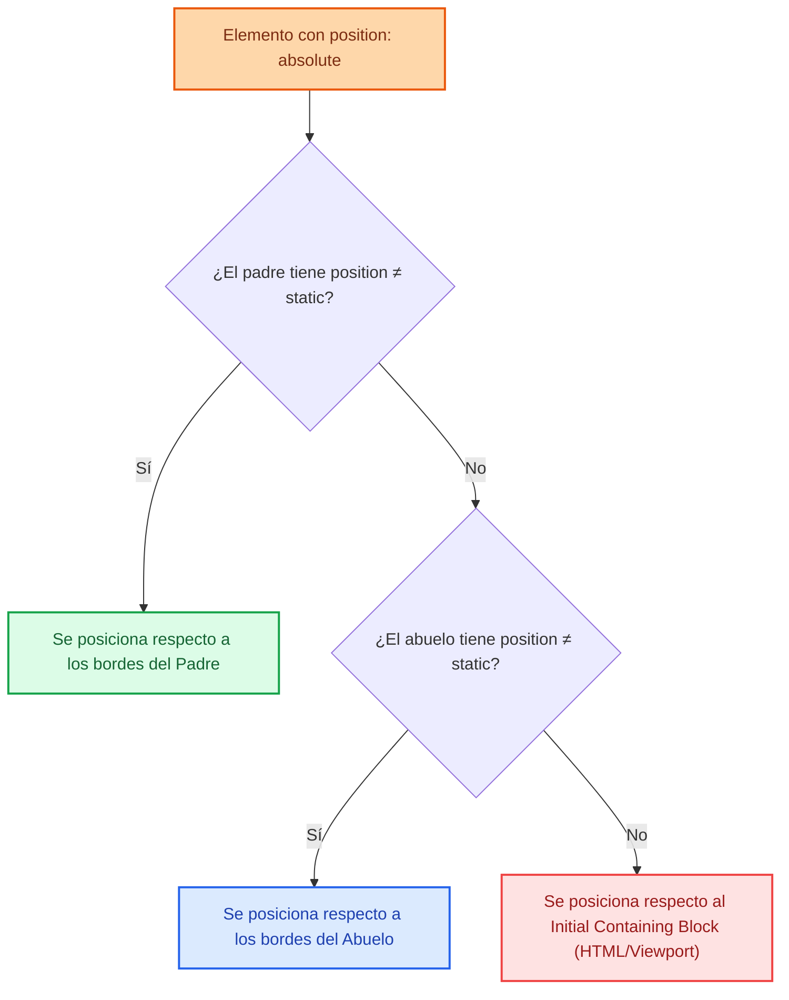
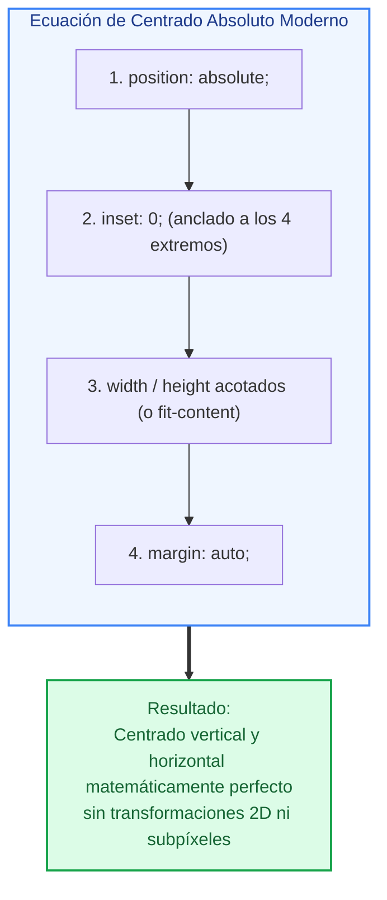
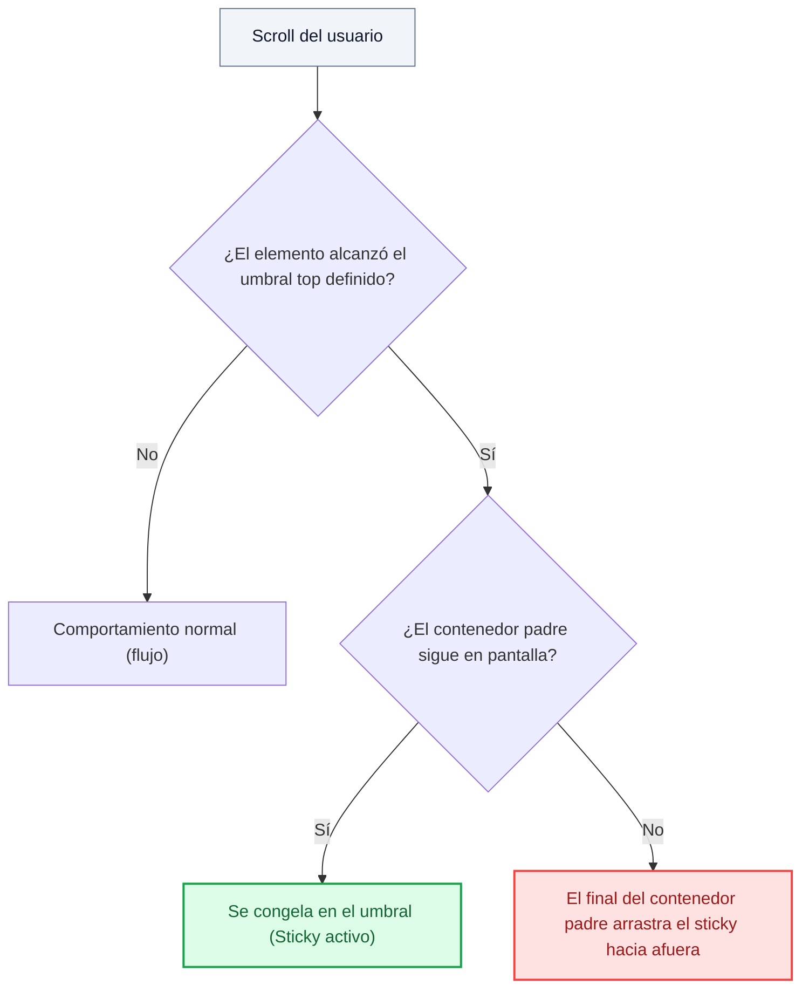
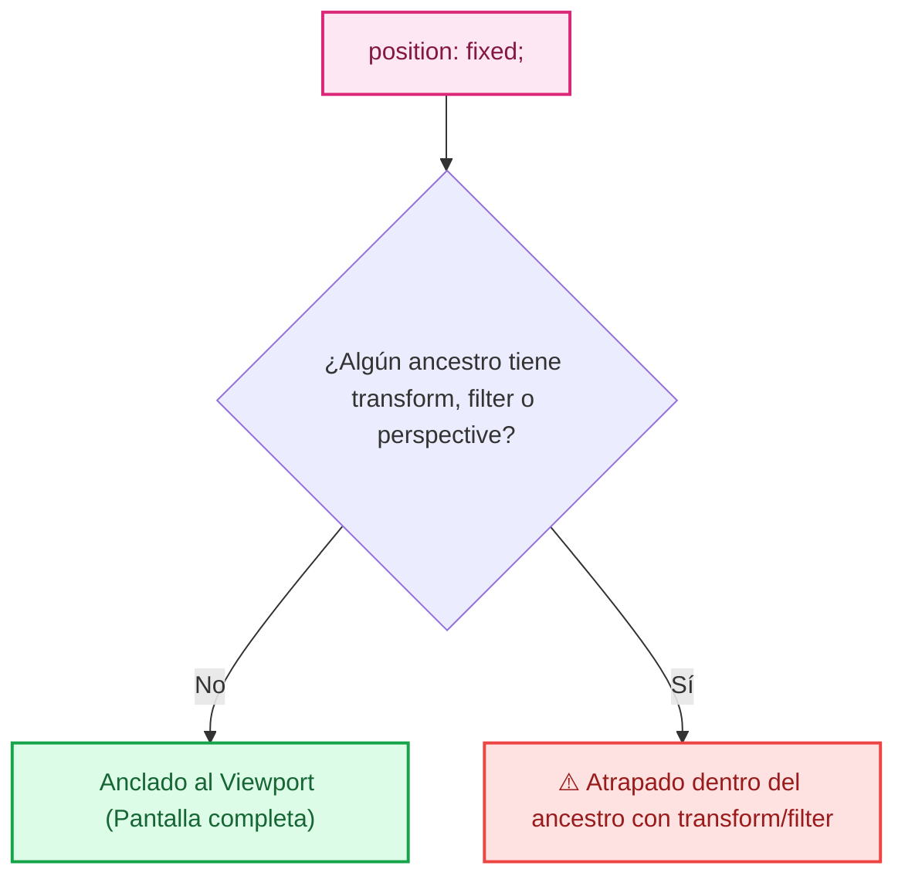
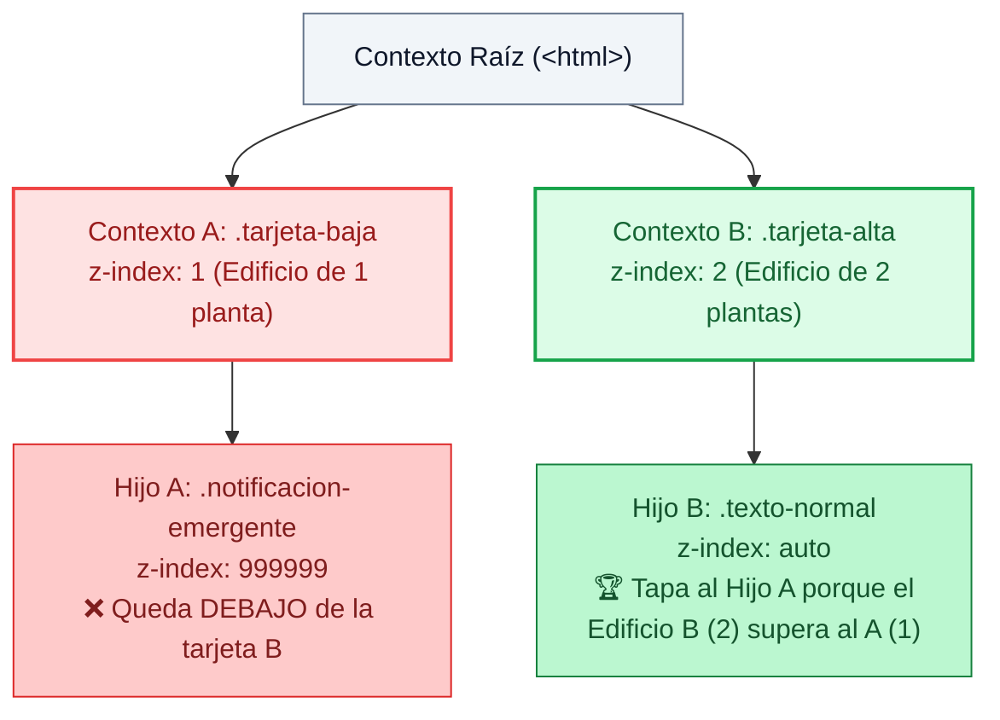

# Ejemplos de Código · Unidad 04: Posicionamiento y z-index

<div class="badges">
  <span class="badge badge-css">CSS3 Moderno</span>
  <span class="badge badge-blue">Código Práctico</span>
  <span class="badge badge-green">Posicionamiento y z-index</span>
  <span class="badge badge-ra">RA 2 / RA 3</span>
</div>

En este documento se desarrollan **ejemplos completos y funcionales de código HTML5 y CSS3** para comprender el flujo del documento, los cinco esquemas de posicionamiento (`static`, `relative`, `absolute`, `fixed`, `sticky`), el bloque contenedor (*containing block*), las propiedades lógicas y el atajo `inset`, el contexto de apilamiento (*stacking context*) y el control preciso del eje Z con `z-index` e `isolation`.

!!! info "Estructura didáctica de cada apartado"

    Cada ejemplo está organizado para que el alumno pueda copiar, probar y experimentar directamente:

    1. **Fundamento conceptual:** Explicación técnica de la regla, su impacto en el árbol de renderizado y diagramas visuales (Mermaid).
    2. **Código fuente interactivo:** Pestañas separadas para el archivo **HTML** completo y la hoja de estilos **CSS** con tokens semánticos.
    3. **Disección técnica paso a paso:** Análisis de las líneas críticas y comprobación en las herramientas de desarrollo (*DevTools*).
    4. **Retos y preguntas guiadas:** Propuestas de modificación para consolidar el aprendizaje en el aula.

---

## 1. Los Cinco Esquemas de Posicionamiento: Comparativa en Vivo

### Fundamento Conceptual

La propiedad ==`position`== determina el algoritmo con el que el navegador calcula las coordenadas espaciales de una caja rectangular y define si esta permanece dentro o es extraída del **flujo normal del documento**:

<div class="esquema-grid-2">
  <div class="esquema-panel esquema-panel--green">
    <div class="esquema-panel__header">
      <h4 class="esquema-panel__title">🟢 1. En el Flujo Normal</h4>
      <p class="esquema-panel__sub">El navegador reserva su espacio original intacto en la página.</p>
    </div>
    <div class="esquema-items">
      <div class="esquema-card">
        <div class="esquema-card__header">
          <code>static</code>
          <span class="tag tag--defecto">Por defecto</span>
        </div>
        <p>Sigue el flujo natural del documento. Ignora propiedades <code>top</code>, <code>right</code>, <code>bottom</code>, <code>left</code> y <code>z-index</code>.</p>
      </div>
      <div class="esquema-card">
        <div class="esquema-card__header">
          <code>relative</code>
        </div>
        <p>Se desplaza visualmente respecto a su propia posición inicial. Su hueco original se conserva vacío para no descolocar a sus vecinos.</p>
      </div>
      <div class="esquema-card">
        <div class="esquema-card__header">
          <code>sticky</code>
          <span class="tag tag--hibrido">Híbrido</span>
        </div>
        <p>Se comporta como <code>relative</code> durante el scroll hasta alcanzar un umbral fijado; a partir de ahí se ancla como <code>fixed</code> dentro de los límites de su contenedor padre.</p>
      </div>
    </div>
  </div>

  <div class="esquema-panel esquema-panel--rose">
    <div class="esquema-panel__header">
      <h4 class="esquema-panel__title">🔴 2. Fuera del Flujo Normal</h4>
      <p class="esquema-panel__sub">El espacio original colapsa a 0px. Los elementos vecinos suben y ocupan su lugar.</p>
    </div>
    <div class="esquema-items">
      <div class="esquema-card">
        <div class="esquema-card__header">
          <code>absolute</code>
          <span class="tag tag--alerta">Desacoplado</span>
        </div>
        <p>Se ancla respecto a los bordes de su ancestro posicionado más cercano (cualquiera con <code>position ≠ static</code>). Si no existe ninguno, toma como referencia el Viewport inicial.</p>
      </div>
      <div class="esquema-card">
        <div class="esquema-card__header">
          <code>fixed</code>
          <span class="tag tag--alerta">Inmutable</span>
        </div>
        <p>Se ancla rígidamente a la ventana del navegador (<em>Viewport</em>). Permanece siempre visible en las mismas coordenadas de pantalla aunque el usuario haga scroll.</p>
      </div>
    </div>
  </div>
</div>

| Valor | ¿Sale del flujo? | Elemento de Referencia | ¿Reserva espacio original? |
| :--- | :---: | :--- | :---: |
| **`static`** | **No** | Flujo secuencial HTML estándar | Sí |
| **`relative`** | **No** | Sus propias coordenadas originales | Sí (el hueco queda vacío) |
| **`absolute`** | **Sí** | Ancestro posicionado más próximo (`≠ static`) | No (los vecinos ocupan su lugar) |
| **`fixed`** | **Sí** | El *Viewport* del navegador | No |
| **`sticky`** | **Híbrido** | Flujo hasta umbral; luego contenedor padre | Sí |

### Código de Ejemplo

=== "HTML"

    ```html title="01-cinco-posiciones.html"
    <!DOCTYPE html>
    <html lang="es">
    <head>
      <meta charset="UTF-8">
      <meta name="viewport" content="width=device-width, initial-scale=1.0">
      <title>Comparativa de los 5 Valores de Position</title>
      <link rel="stylesheet" href="01-cinco-posiciones.css">
    </head>
    <body>
      <header class="barra-fija">
        <div class="contenido-barra">
          <strong>position: fixed</strong> · Anclada a la parte superior del Viewport
        </div>
      </header>

      <main class="lienzo-pruebas">
        <h1>Demostración Visual de <code>position</code></h1>
        <p class="intro">Haz scroll para observar el comportamiento de cada esquema respecto al flujo y al viewport.</p>

        <!-- 1. STATIC -->
        <section class="tarjeta-demostracion">
          <h2>1. Caja <code>static</code> (Por Defecto)</h2>
          <div class="caja-muestra caja-muestra--static">
            <strong>static</strong> (top: 20px no tiene efecto)
          </div>
          <p class="vecino">Párrafo vecino: sigue inmediatamente después de la caja static.</p>
        </section>

        <!-- 2. RELATIVE -->
        <section class="tarjeta-demostracion">
          <h2>2. Caja <code>relative</code> (Desplazamiento visual sin alterar el hueco)</h2>
          <div class="caja-muestra caja-muestra--relative">
            <strong>relative</strong> (top: 25px; left: 30px)
          </div>
          <p class="vecino">Párrafo vecino: no se mueve porque el hueco de <code>relative</code> se preserva intacto.</p>
        </section>

        <!-- 3. ABSOLUTE -->
        <section class="tarjeta-demostracion tarjeta-demostracion--ancla">
          <h2>3. Caja <code>absolute</code> (Contenedor con <code>position: relative</code>)</h2>
          <p class="vecino">Párrafo que sube a ocupar el hueco dejado por el elemento absoluto.</p>
          <div class="caja-muestra caja-muestra--absolute">
            <strong>absolute</strong> (top: 15px; right: 15px)
          </div>
        </section>

        <!-- 4. STICKY -->
        <section class="tarjeta-demostracion contenedor-sticky">
          <h2>4. Caja <code>sticky</code> (Se adhiere al llegar a 60px)</h2>
          <div class="caja-muestra caja-muestra--sticky">
            <strong>sticky</strong> (top: 60px) · Se pega mientras este contenedor esté en pantalla
          </div>
          <div class="contenido-largo">
            <p>Contenido scrollable dentro de la sección para apreciar el comportamiento de sticky.</p>
            <p>El elemento acompaña el scroll del usuario hasta que el borde inferior del contenedor padre lo expulsa.</p>
          </div>
        </section>
      </main>
    </body>
    </html>
    ```

=== "CSS"

    ```css title="01-cinco-posiciones.css"
    /* Tokens de diseño semánticos */
    :root {
      --color-fondo: #f8fafc;
      --color-superficie: #ffffff;
      --color-texto: #0f172a;
      --color-texto-mutado: #64748b;
      --color-primario: #0284c7;
      --color-exito: #16a34a;
      --color-alerta: #ea580c;
      --color-peligro: #db2777;
      --color-borde: #cbd5e1;
      --radio-sm: 6px;
      --radio-md: 10px;
      --espacio-xs: 0.5rem;
      --espacio-sm: 1rem;
      --espacio-md: 1.5rem;
      --espacio-lg: 2.5rem;
      --sombra-tarjeta: 0 4px 6px -1px rgba(0, 0, 0, 0.08);
      --z-fixed: 100;
      --z-sticky: 50;
    }

    * {
      box-sizing: border-box;
      margin: 0;
      padding: 0;
    }

    body {
      font-family: system-ui, -apple-system, sans-serif;
      background-color: var(--color-fondo);
      color: var(--color-texto);
      line-height: 1.6;
      padding-top: 60px; /* Compensa la barra fija superior */
      min-height: 180vh; /* Permite hacer scroll amplio para probar sticky y fixed */
    }

    /* BARRA SUPERIOR FIJA */
    .barra-fija {
      position: fixed;
      top: 0;
      left: 0;
      width: 100%;
      height: 50px;
      background-color: var(--color-texto);
      color: #ffffff;
      z-index: var(--z-fixed);
      box-shadow: 0 2px 10px rgba(0, 0, 0, 0.2);
    }

    .contenido-barra {
      max-width: 800px;
      height: 100%;
      margin: 0 auto;
      padding: 0 var(--espacio-sm);
      display: flex;
      align-items: center;
      font-size: 0.9rem;
    }

    .lienzo-pruebas {
      max-width: 800px;
      margin: var(--espacio-lg) auto;
      padding: 0 var(--espacio-sm);
    }

    .lienzo-pruebas h1 {
      font-size: 1.75rem;
      margin-bottom: var(--espacio-xs);
    }

    .intro {
      color: var(--color-texto-mutado);
      margin-bottom: var(--espacio-md);
    }

    .tarjeta-demostracion {
      background-color: var(--color-superficie);
      border: 1px solid var(--color-borde);
      border-radius: var(--radio-md);
      padding: var(--espacio-md);
      margin-bottom: var(--espacio-lg);
      box-shadow: var(--sombra-tarjeta);
    }

    .tarjeta-demostracion h2 {
      font-size: 1.15rem;
      margin-bottom: var(--espacio-sm);
    }

    .caja-muestra {
      padding: var(--espacio-sm);
      border-radius: var(--radio-sm);
      font-size: 0.9rem;
      font-weight: 600;
      display: inline-block;
    }

    .vecino {
      background-color: #f1f5f9;
      border-left: 4px solid var(--color-borde);
      padding: var(--espacio-xs) var(--espacio-sm);
      margin-top: var(--espacio-sm);
      font-size: 0.85rem;
      color: var(--color-texto-mutado);
    }

    /* 1. STATIC */
    .caja-muestra--static {
      position: static;
      top: 30px; /* Se ignora por completo en static */
      left: 30px; /* Se ignora */
      background-color: #e2e8f0;
      color: var(--color-texto);
      border: 2px dashed #94a3b8;
    }

    /* 2. RELATIVE */
    .caja-muestra--relative {
      position: relative;
      top: 25px;
      left: 30px;
      background-color: #e0f2fe;
      color: #0369a1;
      border: 2px solid var(--color-primario);
    }

    /* 3. ABSOLUTE */
    .tarjeta-demostracion--ancla {
      position: relative; /* Bloque contenedor para el hijo absolute */
      min-height: 140px;
    }

    .caja-muestra--absolute {
      position: absolute;
      top: 15px;
      right: 15px;
      background-color: #ffedd5;
      color: #c2410c;
      border: 2px solid var(--color-alerta);
    }

    /* 4. STICKY */
    .contenedor-sticky {
      background-color: #fffbeb;
      border-color: #fde68a;
    }

    .caja-muestra--sticky {
      position: sticky;
      top: 60px; /* Se ancla a 60px del borde superior de la ventana (debajo de la barra fija) */
      z-index: var(--z-sticky);
      background-color: #fef3c7;
      color: #92400e;
      border: 2px solid #d97706;
      width: 100%;
    }

    .contenido-largo p {
      margin-top: var(--espacio-md);
      color: #78350f;
    }
    ```

!!! tip "Disección técnica paso a paso"

    1. **`position: static`:** Las propiedades `top` y `left` no surten efecto. La caja sigue el ritmo natural del DOM y su vecino se ubica inmediatamente debajo.
    2. **`position: relative`:** La caja se desplaza visualmente `25px` hacia abajo y `30px` hacia la derecha. Observa en las *DevTools* que el párrafo vecino permanece en su posición original: el espacio original de la caja relative no se pierde.
    3. **`position: absolute`:** La caja sale del flujo. El párrafo vecino sube y ocupa el espacio libre superior. Al tener `.tarjeta-demostracion--ancla` la propiedad `position: relative`, `top: 15px; right: 15px` se calculan respecto a esa tarjeta y no a la ventana.
    4. **`position: fixed`:** La barra `.barra-fija` se ancla a las coordenadas `(0,0)` de la pantalla. Permanece estática durante el scroll sin importar cuántas páginas descienda el usuario.
    5. **`position: sticky`:** Inicia en su posición dentro del flujo y, al alcanzar el umbral `top: 60px`, se comporta como fija hasta que el contenedor padre finaliza su recorrido en pantalla.

!!! warning "Modifica el código:"

    1. Elimina `position: relative` de la clase `.tarjeta-demostracion--ancla`. Observa hacia qué esquina de la pantalla salta ahora la caja absoluta y explica por qué.
    2. En la caja relative, cambia `top: 25px; left: 30px` por valores negativos (`top: -15px; left: -10px`). ¿Qué ocurre con el contenido sobre el que se superpone?
    3. Copia las cajas 1, 2 y 3 debajo de la número 4. Observa qué ocurre cuando desplazamos la barra de navegación

---

## 2. El Bloque Contenedor (*Containing Block*) y el Atajo Moderno `inset`

### Fundamento Conceptual

Para que un elemento con `position: absolute` sepa desde dónde medir sus desplazamientos, el motor de renderizado busca recursivamente hacia arriba en el árbol DOM su **ancestro posicionado más próximo** (cualquiera con `position ≠ static`). Si ningún ancestro cumple este requisito, toma como referencia el *initial containing block* (el área visible del documento).



La propiedad moderna ==`inset`== actúa como shorthand para los cuatro offsets:

| Declaración | Equivalencia canónica tradicional |
| :--- | :--- |
| `inset: 0;` | `top: 0; right: 0; bottom: 0; left: 0;` |
| `inset: 1rem 2rem;` | `top: 1rem; bottom: 1rem; right: 2rem; left: 2rem;` |
| `inset-block: 10px;` | `top: 10px; bottom: 10px;` (propiedad lógica en eje de bloque) |
| `inset-inline: 15px;` | `left: 15px; right: 15px;` (propiedad lógica en eje en línea) |

### Código de Ejemplo

=== "HTML"

    ```html title="02-containing-block-inset.html"
    <!DOCTYPE html>
    <html lang="es">
    <head>
      <meta charset="UTF-8">
      <meta name="viewport" content="width=device-width, initial-scale=1.0">
      <title>Bloque Contenedor y Shorthand Inset</title>
      <link rel="stylesheet" href="02-containing-block-inset.css">
    </head>
    <body>
      <main class="contenedor-principal">
        <h2>Demostración de Containing Block</h2>

        <!-- CASO A: Padre posicionado con position: relative -->
        <article class="tarjeta-producto">
          <div class="tarjeta-imagen">
            <span class="badge-novedad">¡Oferta -20%!</span>
          </div>
          <div class="tarjeta-cuerpo">
            <h3>Curso de CSS3 Profesional</h3>
            <p>Aprende posicionamiento, arquitectura modular y maquetación responsiva.</p>
          </div>
          <!-- Capa de superposición con inset: 0 -->
          <div class="overlay-bloqueo">
            <span class="texto-overlay">Agotado temporalmente</span>
          </div>
        </article>

        <!-- CASO B: Sin ancestro posicionado (cae al viewport) -->
        <div class="alerta-escapada">
          ⚠️ Elemento sin bloque contenedor intermedio (escapa hacia el viewport)
        </div>
      </main>
    </body>
    </html>
    ```

=== "CSS"

    ```css title="02-containing-block-inset.css"
    :root {
      --color-primario: #4f46e5;
      --color-acento: #dc2626;
      --color-fondo: #f8fafc;
      --color-texto: #1e293b;
      --radio-tarjeta: 12px;
      --sombra: 0 10px 15px -3px rgba(0, 0, 0, 0.1);
    }

    * {
      box-sizing: border-box;
      margin: 0;
      padding: 0;
    }

    body {
      font-family: system-ui, sans-serif;
      background-color: var(--color-fondo);
      color: var(--color-texto);
      padding: 3rem 1.5rem;
    }

    .contenedor-principal {
      max-width: 600px;
      margin: 0 auto;
    }

    /* CASO A: La tarjeta define position: relative para acotar a sus hijos */
    .tarjeta-producto {
      position: relative; /* ¡CRUCIAL!: Establece el bloque contenedor */
      background-color: #ffffff;
      border-radius: var(--radio-tarjeta);
      overflow: hidden;
      box-shadow: var(--sombra);
      margin-top: 1.5rem;
      border: 1px solid #e2e8f0;
    }

    .tarjeta-imagen {
      position: relative; /* Segundo bloque contenedor local para el badge */
      height: 160px;
      background: linear-gradient(135deg, #4f46e5, #06b6d4);
    }

    /* Badge anclado con top/right a la imagen */
    .badge-novedad {
      position: absolute;
      top: 1rem;
      right: 1rem;
      background-color: var(--color-acento);
      color: #ffffff;
      font-size: 0.75rem;
      font-weight: 700;
      padding: 0.35rem 0.75rem;
      border-radius: 9999px;
      text-transform: uppercase;
      letter-spacing: 0.05em;
    }

    .tarjeta-cuerpo {
      padding: 1.5rem;
    }

    .tarjeta-cuerpo h3 {
      margin-bottom: 0.5rem;
    }

    /* Overlay que cubre exactamente el 100% de la tarjeta usando inset: 0 */
    .overlay-bloqueo {
      position: absolute;
      inset: 0; /* Sustituye a top: 0; right: 0; bottom: 0; left: 0; */
      background-color: rgba(15, 23, 42, 0.75);
      backdrop-filter: blur(4px);
      display: flex;
      align-items: center;
      justify-content: center;
    }

    .texto-overlay {
      color: #ffffff;
      font-weight: 700;
      font-size: 1.1rem;
      border: 2px solid #ffffff;
      padding: 0.5rem 1.25rem;
      border-radius: 8px;
    }

    /* CASO B: Sin bloque contenedor, se ancla al borde inferior derecho de la ventana */
    .alerta-escapada {
      position: absolute;
      bottom: 1rem;
      right: 1rem;
      background-color: #fef2f2;
      border: 1px solid #fecaca;
      color: #991b1b;
      padding: 0.75rem 1rem;
      border-radius: 8px;
      font-size: 0.85rem;
      box-shadow: 0 4px 6px rgba(0, 0, 0, 0.05);
    }
    ```

!!! tip "Disección técnica paso a paso"

    1. **`position: relative` en `.tarjeta-producto`:** Hace que todos los descendientes con `position: absolute` utilicen el perímetro de la tarjeta como origen `(0,0)`.
    2. **Atajo `inset: 0`:** La capa `.overlay-bloqueo` se expande instantáneamente por los cuatro costados, adoptando el ancho y alto exactos de la tarjeta sin tener que declarar `width: 100%; height: 100%`.
    3. **Anidamiento de bloques contenedores:** `.badge-novedad` está dentro de `.tarjeta-imagen`. Al tener esta última `position: relative`, el badge se coloca a `1rem` de la esquina de la imagen, no de la tarjeta completa.
    4. **Escape hacia el viewport:** `.alerta-escapada` no tiene ningún padre con `position ≠ static`, por lo que sus coordenadas `bottom: 1rem; right: 1rem` se computan respecto a la ventana del navegador.


!!! warning "Modifica el código:"

    1. ¿Cómo podemos hacer que "badge-novedad" se posiciones en la esquina de la página? No se pueden moficicar los estilos de dicho elemento.
    2. ¿Qué ocurre con overlay-bloqueo si cambias "tarjeta-producto" a position: static?

!!! danger "Pregunta de razonamiento:"

    Si añades a un contenedor la propiedad `transform: scale(1);` sin añadir `position: relative`, ¿se convierte en bloque contenedor para un hijo con `position: absolute`?  
    *Pruébalo en las DevTools y comprueba la especificación CSS.*

---

## 3. Centrado Absoluto Matemático: `inset: 0` + `margin: auto`

### Fundamento Conceptual

El método clásico para centrar un elemento absoluto consistía en declarar `top: 50%; left: 50%; transform: translate(-50%, -50%);`. Aunque funcional, este enfoque introduce transformaciones 2D que pueden desenfocar tipografías en pantallas de baja densidad y altera el stacking context.

La técnica moderna recomendada por los estándares aprovecha la resolución matemática de márgenes automáticos en cajas con restricciones dimensionales:



### Código de Ejemplo

=== "HTML"

    ```html title="03-centrado-absoluto.html"
    <!DOCTYPE html>
    <html lang="es">
    <head>
      <meta charset="UTF-8">
      <meta name="viewport" content="width=device-width, initial-scale=1.0">
      <title>Centrado Absoluto Moderno</title>
      <link rel="stylesheet" href="03-centrado-absoluto.css">
    </head>
    <body>
      <main class="contenedor">
        <h2>Centrado Absoluto Bidireccional</h2>

        <!-- Marco delimitador que sirve de bloque contenedor -->
        <div class="escenario-centrado">
          <div class="modal-notificacion">
            <span class="icono">🚀</span>
            <h3>Operación Completada</h3>
            <p>Elemento centrado en ambos ejes mediante <code>inset: 0</code> y <code>margin: auto</code>.</p>
          </div>
        </div>
      </main>
    </body>
    </html>
    ```

=== "CSS"

    ```css title="03-centrado-absoluto.css"
    :root {
      --color-primario: #0ea5e9;
      --color-texto: #0f172a;
      --color-fondo: #f1f5f9;
      --radio: 12px;
    }

    * {
      box-sizing: border-box;
      margin: 0;
      padding: 0;
    }

    body {
      font-family: system-ui, sans-serif;
      background-color: var(--color-fondo);
      padding: 2rem;
      color: var(--color-texto);
    }

    .contenedor {
      max-width: 650px;
      margin: 0 auto;
    }

    .escenario-centrado {
      position: relative; /* Bloque contenedor de referencia */
      height: 360px;
      background-color: #ffffff;
      border: 2px dashed #cbd5e1;
      border-radius: var(--radio);
      margin-top: 1.5rem;
    }

    /* REGLAS DEL CENTRADO ABSOLUTO MODERNO */
    .modal-notificacion {
      position: absolute;
      inset: 0;                 /* Ancla a los 4 bordes del padre */
      margin: auto;             /* Absorbe todo el espacio libre en X e Y */
      
      /* Dimensiones obligatorias para que margin: auto pueda calcular */
      width: min(90%, 340px);
      height: fit-content;

      background-color: #ffffff;
      padding: 2rem;
      border-radius: var(--radio);
      box-shadow: 0 20px 25px -5px rgba(0, 0, 0, 0.1), 0 8px 10px -6px rgba(0, 0, 0, 0.1);
      border: 1px solid #e2e8f0;
      text-align: center;
    }

    .icono {
      font-size: 2.5rem;
      display: inline-block;
      margin-bottom: 0.5rem;
    }

    .modal-notificacion h3 {
      font-size: 1.2rem;
      margin-bottom: 0.5rem;
      color: var(--color-texto);
    }

    .modal-notificacion p {
      font-size: 0.9rem;
      color: #64748b;
      line-height: 1.5;
    }
    ```

!!! tip "Disección técnica paso a paso"

    1. **`inset: 0`:** Estira los cuatro puntos de anclaje de la caja hacia los cuatro bordes del contenedor `.escenario-centrado`.
    2. **Dimensiones definidas (`width: min(90%, 340px)` y `height: fit-content`):** Si una caja tiene `inset: 0` pero no define dimensiones, se estiraría hasta ocupar el 100% del área. Al acotar el ancho y alto, se genera un sobrante de espacio libre en ambos ejes.
    3. **`margin: auto`:** Al haber espacio positivo restante en el eje horizontal y en el vertical, el algoritmo de layout distribuye dicho espacio de forma simétrica a izquierda/derecha y arriba/abajo, centrando la caja con precisión matemática.

!!! warning "Modifica el código:"

    1. Elimina `position: relative` de la clase `.escenario-centrado`. Observa que ocurre con "modal-notificación". ¿Por qué?

---

## 4. `position: sticky` en Profundidad: Cabeceras y la Trampa de `overflow`

### Fundamento Conceptual

==`position: sticky`== combina el comportamiento de `relative` y `fixed`. Mientras el elemento se encuentra dentro del rango de visualización, fluye de forma normal; cuando alcanza la distancia especificada en su offset (`top`, `bottom`, `left` o `right`), se «congela» en pantalla **únicamente mientras su contenedor padre continúe en el área visible**.



!!! danger "Las tres reglas de oro para que sticky funcione"

    1. **Requiere al menos un offset:** Escribir `position: sticky;` sin `top`, `bottom`, `left` o `right` anula el comportamiento adhesivo.
    2. **El contenedor debe tener altura suficiente:** Si el padre mide exactamente lo mismo que el elemento sticky, este no tendrá recorrido sobre el que desplazarse.
    3. **La trampa fatal de `overflow`:** Si **cualquier ancestro** en la cadena DOM tiene `overflow: hidden`, `overflow: auto` o `overflow: scroll`, dicho ancestro se convierte en el scroll portador y desactiva el sticky respecto a la ventana principal.

### Código de Ejemplo

=== "HTML"

    ```html title="04-sticky-profundidad.html"
    <!DOCTYPE html>
    <html lang="es">
    <head>
      <meta charset="UTF-8">
      <meta name="viewport" content="width=device-width, initial-scale=1.0">
      <title>Position Sticky y Lista de Contactos</title>
      <link rel="stylesheet" href="04-sticky-profundidad.css">
    </head>
    <body>
      <main class="contenedor-agenda">
        <h1>Agenda Telefónica (Cabeceras Sticky Alfabéticas)</h1>
        <p class="instruccion">Haz scroll dentro de la lista para ver cómo cada letra se adhiere y es relevada por la siguiente.</p>

        <div class="lista-agenda">
          <!-- GRUPO A -->
          <section class="grupo-contactos">
            <header class="cabecera-letra">A</header>
            <ul class="contactos">
              <li>Alejandro Morales <span>+34 600 111 222</span></li>
              <li>Ana Belén Ramos <span>+34 600 333 444</span></li>
              <li>Antonio Vivaldi <span>+34 600 555 666</span></li>
              <li>Ariadna Gil <span>+34 600 777 888</span></li>
            </ul>
          </section>

          <!-- GRUPO B -->
          <section class="grupo-contactos">
            <header class="cabecera-letra">B</header>
            <ul class="contactos">
              <li>Beatriz Luengo <span>+34 600 999 000</span></li>
              <li>Bernardo Silva <span>+34 600 222 333</span></li>
              <li>Borja Iglesias <span>+34 600 444 555</span></li>
            </ul>
          </section>

          <!-- GRUPO C -->
          <section class="grupo-contactos">
            <header class="cabecera-letra">C</header>
            <ul class="contactos">
              <li>Carlos Sainz <span>+34 600 666 777</span></li>
              <li>Carmen Maura <span>+34 600 888 999</span></li>
              <li>Clara Campoamor <span>+34 600 123 456</span></li>
              <li>Cristian Tello <span>+34 600 654 321</span></li>
            </ul>
          </section>
        </div>
      </main>
    </body>
    </html>
    ```

=== "CSS"

    ```css title="04-sticky-profundidad.css"
    :root {
      --color-primario: #2563eb;
      --color-fondo: #f8fafc;
      --color-superficie: #ffffff;
      --color-texto: #1e293b;
      --color-borde: #e2e8f0;
    }

    * {
      box-sizing: border-box;
      margin: 0;
      padding: 0;
    }

    body {
      font-family: system-ui, sans-serif;
      background-color: var(--color-fondo);
      color: var(--color-texto);
      padding: 2rem 1rem;
    }

    .contenedor-agenda {
      max-width: 500px;
      margin: 0 auto;
    }

    h1 {
      font-size: 1.4rem;
      margin-bottom: 0.5rem;
    }

    .instruccion {
      font-size: 0.85rem;
      color: #64748b;
      margin-bottom: 1.5rem;
    }

    .lista-agenda {
      background-color: var(--color-superficie);
      border-radius: 12px;
      border: 1px solid var(--color-borde);
      box-shadow: 0 4px 6px -1px rgba(0, 0, 0, 0.05);
      height: 380px;      /* Alto fijo para crear scroll interno */
      overflow-y: auto;   /* Scroll portador del sticky */
    }

    .grupo-contactos {
      position: relative; /* Delimita el final del recorrido de cada letra */
    }

    /* REGLA DEL ELEMENTO STICKY */
    .cabecera-letra {
      position: sticky;
      top: 0;             /* Se ancla al borde superior del contenedor scrollable */
      background-color: #eff6ff;
      color: var(--color-primario);
      font-weight: 800;
      font-size: 1.1rem;
      padding: 0.5rem 1.25rem;
      border-bottom: 2px solid #bfdbfe;
      z-index: 2;         /* Garantiza que tape a los nombres al hacer scroll */
    }

    .contactos {
      list-style: none;
    }

    .contactos li {
      padding: 0.85rem 1.25rem;
      border-bottom: 1px solid var(--color-borde);
      display: flex;
      justify-content: space-between;
      font-size: 0.9rem;
    }

    .contactos li span {
      color: #64748b;
      font-family: monospace;
    }
    ```

!!! tip "Disección técnica paso a paso"

    1. **Contenedor scrollable (`.lista-agenda`):** Al tener `height: 380px` y `overflow-y: auto`, actúa como el área portadora del scroll.
    2. **Padre delimitador (`.grupo-contactos`):** Cada sección contiene la letra y sus contactos correspondientes. La letra `A` se queda pegada arriba mientras el usuario lee los contactos de la `A`.
    3. **Relevo natural entre secciones:** En cuanto el scroll llega al grupo `B`, el borde inferior de la sección `A` empuja hacia arriba a su cabecera y la letra `B` toma el anclaje a `top: 0`.


!!! warning "Modifica el código:"

    1. Elimina `overflow-y: auto` de la clase `.lista-agenda`. Observa qué ocurre. ¿Por qué?
    2. ¿Cómo hacemos para que las letras suban a la vez de los número de teléfono? Ahora mismo se quedan "fijas" mientras se muestra algún teléfono de la letra correspondiente.

---

## 5. `position: fixed`: Botón Flotante (FAB), Modales y la Trampa de `transform`

### Fundamento Conceptual

Un elemento con `position: fixed` se posiciona de forma predeterminada respecto al **Viewport** (la pantalla física del navegador). Sin embargo, existe una excepción técnica crítica en la especificación CSS:

> Si **cualquier ancestro** del elemento fixed tiene aplicadas propiedades gráficas complejas como `transform`, `filter`, `perspective`, `backdrop-filter` o `contain: paint`, dicho ancestro **se convierte en su bloque contenedor**, rompiendo el anclaje a la ventana.



### Código de Ejemplo

=== "HTML"

    ```html title="05-fixed-y-trampa-transform.html"
    <!DOCTYPE html>
    <html lang="es">
    <head>
      <meta charset="UTF-8">
      <meta name="viewport" content="width=device-width, initial-scale=1.0">
      <title>Position Fixed y la Trampa de Transform</title>
      <link rel="stylesheet" href="05-fixed-y-trampa-transform.css">
    </head>
    <body>
      <main class="contenedor">
        <h1>Demostración de <code>position: fixed</code></h1>
        <p>Baja en la página para comprobar la persistencia de los elementos fijos.</p>

        <!-- Botón de acción flotante (FAB) anclado al viewport -->
        <button class="fab-soporte" aria-label="Abrir chat de soporte">
          💬
        </button>

        <!-- SECCIÓN CON TRAMPA DE TRANSFORM -->
        <section class="caja-transformada">
          <h2>Sección con <code>transform: translateY(0)</code></h2>
          <p>Esta tarjeta tiene aplicada una transformación gráfica CSS.</p>

          <!-- Modal hijo que pretendía ser fixed a toda la pantalla -->
          <div class="modal-atrapado">
            ¡Socorro! Soy <code>fixed</code> pero estoy atrapado dentro de esta tarjeta.
          </div>
        </section>

        <div class="espaciador-scroll">
          <p>Contenido extenso de relleno para habilitar el desplazamiento vertical...</p>
        </div>
      </main>
    </body>
    </html>
    ```

=== "CSS"

    ```css title="05-fixed-y-trampa-transform.css"
    :root {
      --color-primario: #0284c7;
      --color-texto: #0f172a;
      --color-fondo: #f8fafc;
      --z-fab: 900;
      --z-modal: 1000;
    }

    * {
      box-sizing: border-box;
      margin: 0;
      padding: 0;
    }

    body {
      font-family: system-ui, sans-serif;
      background-color: var(--color-fondo);
      color: var(--color-texto);
      padding: 2rem;
      min-height: 200vh; /* Permite scroll abundante */
    }

    .contenedor {
      max-width: 600px;
      margin: 0 auto;
    }

    /* BOTÓN FLOTANTE (FAB) CORRECTAMENTE ANCLADO AL VIEWPORT */
    .fab-soporte {
      position: fixed;
      bottom: 2rem;
      right: 2rem;
      width: 56px;
      height: 56px;
      border-radius: 50%;
      background-color: var(--color-primario);
      color: #ffffff;
      border: none;
      font-size: 1.5rem;
      cursor: pointer;
      box-shadow: 0 10px 15px -3px rgba(2, 132, 199, 0.4);
      z-index: var(--z-fab);
      display: grid;
      place-items: center;
      transition: transform 0.2s ease;
    }

    .fab-soporte:hover {
      transform: scale(1.1);
    }

    /* TRAMPA: Este ancestro crea un Containing Block para elementos fixed */
    .caja-transformada {
      margin-top: 3rem;
      padding: 2rem;
      background-color: #ffffff;
      border: 2px dashed #f43f5e;
      border-radius: 12px;
      position: relative;
      
      /* ¡LA PROPIEDAD QUE ROMPE EL FIXED! */
      transform: translateY(0); 
    }

    .modal-atrapado {
      position: fixed;
      top: 10px;
      right: 10px;
      background-color: #ffe4e6;
      color: #be123c;
      border: 1px solid #fda4af;
      padding: 0.75rem 1rem;
      border-radius: 8px;
      font-size: 0.85rem;
      font-weight: 600;
    }

    .espaciador-scroll {
      margin-top: 3rem;
      color: #94a3b8;
    }
    ```

!!! tip "Disección técnica paso a paso"

    1. **Botón FAB (`.fab-soporte`):** Se ancla a `bottom: 2rem; right: 2rem` de la ventana visible. Permanece fijo en la esquina inferior sin importar el scroll.
    2. **La Trampa de `transform`:** La clase `.modal-atrapado` declara `position: fixed; top: 10px; right: 10px;`. Sin embargo, en lugar de colocarse en la esquina superior derecha de la ventana, **se ubica dentro de la tarjeta discontinua**.
    3. **Diagnóstico profesional:** Cualquier propiedad que cree un nuevo contexto de coordenadas 2D/3D (`transform`, `filter`, `perspective`) fuerza a que todos sus hijos con `fixed` midan sus límites contra dicho elemento y no contra el viewport.

!!! warning "Modifica el código:"

    1. Elimina `transform: translateY(0)` de la clase `.caja-transformada`. Observa qué ocurre. ¿Por qué?

---

## 6. `z-index` y Contexto de Apilamiento (*Stacking Context*): El Problema del Rascacielos

### Fundamento Conceptual

El eje **Z** define la profundidad perceptual de la pantalla (perpendicular al plano X/Y). Para resolver conflictos de superposición, los navegadores no utilizan una simple lista global de números `z-index`, sino un **árbol jerárquico de Contextos de Apilamiento (*Stacking Contexts*)**.

#### La Analogía del Rascacielos

```text
Planta Raíz (html)
  ├── Edificio A (Contenedor con z-index: 1)
  │     └── Persona en una mesa altísima (Hijo con z-index: 999999)  <-- Atrapada en z=1
  └── Edificio B (Contenedor con z-index: 2)
        └── Persona parada en el suelo (Hijo con z-index: 1)          <-- GANA Y TAPA A LA OTRA
```



### ¿Qué factores crean un nuevo Contexto de Apilamiento?

1. Elemento posicionado (`position: relative | absolute | fixed | sticky`) con un `z-index` distinto de `auto`.
2. Elemento con opacidad reducida (`opacity < 1`).
3. Elemento con `transform`, `filter`, `perspective` o `clip-path`.
4. Elemento hijo de un contenedor Flexbox o Grid con `z-index` numérico.
5. Declaración explícita con la propiedad moderna: ==`isolation: isolate;`==.

### Código de Ejemplo

=== "HTML"

    ```html title="06-stacking-context-rascacielos.html"
    <!DOCTYPE html>
    <html lang="es">
    <head>
      <meta charset="UTF-8">
      <meta name="viewport" content="width=device-width, initial-scale=1.0">
      <title>Contexto de Apilamiento y z-index</title>
      <link rel="stylesheet" href="06-stacking-context-rascacielos.css">
    </head>
    <body>
      <main class="escenario">
        <h2>¿Por qué mi <code>z-index: 999999</code> no funciona?</h2>
        <p class="descripcion">
          Ambas tarjetas compiten en el eje Z. Observa cómo el botón rojo no puede salir del contexto impuesto por su padre.
        </p>

        <!-- EDIFICIO A: Padre con z-index: 1 -->
        <div class="edificio edificio--a">
          <h3>Edificio A (<code>z-index: 1</code>)</h3>
          <p>Este padre genera un contexto de apilamiento bajo.</p>
          
          <!-- Hijo con z-index gigantesco -->
          <div class="popup-gigante">
            ¡Tengo <code>z-index: 999999</code>! Pero quedo tapado por el Edificio B.
          </div>
        </div>

        <!-- EDIFICIO B: Padre con z-index: 2 -->
        <div class="edificio edificio--b">
          <h3>Edificio B (<code>z-index: 2</code>)</h3>
          <p>Al tener un z-index superior a nivel de padre, todo su contenido se dibuja por encima del Edificio A.</p>
        </div>
      </main>
    </body>
    </html>
    ```

=== "CSS"

    ```css title="06-stacking-context-rascacielos.css"
    :root {
      --color-fondo: #f8fafc;
      --color-texto: #0f172a;
    }

    * {
      box-sizing: border-box;
      margin: 0;
      padding: 0;
    }

    body {
      font-family: system-ui, sans-serif;
      background-color: var(--color-fondo);
      color: var(--color-texto);
      padding: 3rem 1.5rem;
    }

    .escenario {
      max-width: 650px;
      margin: 0 auto;
    }

    .descripcion {
      color: #64748b;
      margin-bottom: 2rem;
    }

    .edificio {
      position: relative; /* Activa la capacidad de recibir z-index */
      padding: 1.5rem;
      border-radius: 12px;
      margin-bottom: -40px; /* Provoca solapamiento intencionado entre ambos */
      box-shadow: 0 4px 6px -1px rgba(0, 0, 0, 0.1);
    }

    /* EDIFICIO A */
    .edificio--a {
      z-index: 1; /* Crea Contexto de Apilamiento con nivel 1 */
      background-color: #fee2e2;
      border: 2px solid #ef4444;
      height: 180px;
    }

    /* HIJO CON Z-INDEX ASTRONÓMICO */
    .popup-gigante {
      position: absolute;
      top: 60px;
      left: 60px;
      width: 280px;
      z-index: 999999; /* Inútil frente al Edificio B */
      background-color: #dc2626;
      color: #ffffff;
      padding: 1rem;
      border-radius: 8px;
      box-shadow: 0 10px 15px -3px rgba(0, 0, 0, 0.3);
      font-size: 0.85rem;
      font-weight: 600;
    }

    /* EDIFICIO B */
    .edificio--b {
      z-index: 2; /* Supera al nivel 1 del Edificio A */
      background-color: #dcfce7;
      border: 2px solid #16a34a;
      min-height: 140px;
    }
    ```

!!! tip "Disección técnica paso a paso"

    1. **Solapamiento intencionado:** El margen negativo `margin-bottom: -40px` fuerza a que el Edificio B coincida físicamente sobre el Edificio A.
    2. **El engaño de los números gigantes:** `.popup-gigante` declara `z-index: 999999`. Sin embargo, el Edificio B lo oculta parcialmente.
    3. **La causa técnica:** `.edificio--a` tiene `position: relative` y `z-index: 1`. Esto sella su contexto. Ningún hijo dentro de él puede competir contra un elemento que esté en un contexto de nivel 2 (`.edificio--b`).

!!! warning "Modifica el código:"

    1. Cambia el tamaño de la tarjeta en rojo central. Hazla más larga. ¿Qué ocurre?

---

## 7. Aislamiento Moderno con `isolation: isolate` y Escala de `z-index`

### Fundamento Conceptual

Para evitar la "guerra de números mágicos" (`9999`, `99999`, `!important`), la arquitectura CSS moderna se apoya en dos pilares fundamentales:

1. **Escala semántica de variables CSS:** Asignación centralizada y documentada de rangos numéricos.
2. **`isolation: isolate;`:** Fuerza a un componente a generar un nuevo contexto de apilamiento propio **sin requerir `position` ni `z-index`**, blindando sus capas interiores para que no interfieran con la página global.

| Token Semántico | Valor sugerido | Uso previsto en interfaz |
| :--- | :---: | :--- |
| `--z-fondo` | `-1` | Efectos decorativos y marcas de agua de fondo |
| `--z-normal` | `1` | Elementos de interacción en flujo |
| `--z-dropdown` | `100` | Menús desplegables y autocompletados |
| `--z-sticky` | `200` | Barras de navegación persistentes |
| `--z-modal-backdrop`| `300` | Fondos oscuros de bloqueo (*overlays*) |
| `--z-modal` | `400` | Diálogos y ventanas modales accesibles |
| `--z-toast` | `500` | Notificaciones flotantes prioritarias |

### Código de Ejemplo

=== "HTML"

    ```html title="07-escala-zindex-isolation.html"
    <!DOCTYPE html>
    <html lang="es">
    <head>
      <meta charset="UTF-8">
      <meta name="viewport" content="width=device-width, initial-scale=1.0">
      <title>Escala Semántica de z-index e Isolation</title>
      <link rel="stylesheet" href="07-escala-zindex-isolation.css">
    </head>
    <body>
      <main class="contenedor-app">
        <!-- Componente aislado con isolation: isolate -->
        <article class="tarjeta-aislada">
          <div class="tarjeta-decoracion-fondo"></div>
          <div class="tarjeta-contenido">
            <h3>Tarjeta Blindada con <code>isolation: isolate</code></h3>
            <p>El fondo decorativo utiliza <code>z-index: -1</code> sin desaparecer detrás del body de la página web.</p>
          </div>
        </article>

        <!-- Notificación Toast con token semántico -->
        <aside class="notificacion-toast" role="alert">
          <span class="punto-verde"></span>
          <span>Cambios guardados con éxito</span>
        </aside>
      </main>
    </body>
    </html>
    ```

=== "CSS"

    ```css title="07-escala-zindex-isolation.css"
    /* ESCALA SEMÁNTICA CENTRALIZADA DE Z-INDEX */
    :root {
      --z-fondo: -1;
      --z-base: 0;
      --z-dropdown: 100;
      --z-sticky: 200;
      --z-modal-backdrop: 300;
      --z-modal: 400;
      --z-toast: 500;

      --color-primario: #6366f1;
      --color-fondo: #f1f5f9;
      --color-texto: #0f172a;
    }

    * {
      box-sizing: border-box;
      margin: 0;
      padding: 0;
    }

    body {
      font-family: system-ui, sans-serif;
      background-color: var(--color-fondo);
      color: var(--color-texto);
      padding: 3rem 1.5rem;
    }

    .contenedor-app {
      max-width: 600px;
      margin: 0 auto;
    }

    /* COMPONENTE AISLADO */
    .tarjeta-aislada {
      isolation: isolate; /* ¡BLINDAJE!: Crea un Stacking Context local limpio */
      position: relative;
      background-color: #ffffff;
      border-radius: 12px;
      padding: 2rem;
      border: 1px solid #e2e8f0;
      box-shadow: 0 4px 6px -1px rgba(0, 0, 0, 0.05);
      overflow: hidden;
    }

    /* Elemento decorativo que se coloca DETRÁS del texto usando z-index negativo */
    .tarjeta-decoracion-fondo {
      position: absolute;
      top: -20px;
      right: -20px;
      width: 140px;
      height: 140px;
      background: radial-gradient(circle, rgba(99, 102, 241, 0.25) 0%, rgba(99, 102, 241, 0) 70%);
      border-radius: 50%;
      z-index: var(--z-fondo); /* z-index: -1 */
    }

    .tarjeta-contenido h3 {
      margin-bottom: 0.5rem;
    }

    .tarjeta-contenido p {
      color: #64748b;
      line-height: 1.5;
    }

    /* NOTIFICACIÓN TOAST (NIVEL MÁXIMO DE LA ESCALA) */
    .notificacion-toast {
      position: fixed;
      bottom: 2rem;
      left: 50%;
      transform: translateX(-50%);
      background-color: #1e293b;
      color: #ffffff;
      padding: 0.75rem 1.25rem;
      border-radius: 9999px;
      display: flex;
      align-items: center;
      gap: 0.5rem;
      font-size: 0.85rem;
      font-weight: 500;
      box-shadow: 0 10px 15px -3px rgba(0, 0, 0, 0.2);
      z-index: var(--z-toast); /* Usa el token semántico 500 */
    }

    .punto-verde {
      width: 8px;
      height: 8px;
      background-color: #22c55e;
      border-radius: 50%;
    }
    ```

!!! tip "Disección técnica paso a paso"

    1. **La paradoja histórica de `z-index: -1`:** Tradicionalmente, colocar `z-index: -1` a un decorador causaba que este cayera **detrás del fondo blanco del body**, volviéndose invisible.
    2. **El rescate con `isolation: isolate`:** Al declarar `isolation: isolate` en `.tarjeta-aislada`, el fondo del componente se convierte en el límite inferior absoluto del contexto. El decorador con `z-index: -1` se sitúa detrás del texto del párrafo pero **nunca sale por detrás de la propia tarjeta**.
    3. **Mantenibilidad mediante tokens:** En lugar de recordar si una modal lleva `999` o `9999`, se utiliza `var(--z-toast)` o `var(--z-modal)`.

!!! warning "Modifica el código:"

    1. Elimina la propiedad "isolation" de ".tarjeta-asilada". ¿Por qué ha desaparecido el elemento?


---

## 8. Patrones de Producción: Tooltip Anclado y Modal Accesible con Overlay

### Fundamento Conceptual

El posicionamiento absoluto y fijo es la base de componentes de interfaz omnipresentes en la web como:

- **Tooltips flotantes:** Anclados exactamente sobre su botón disparador con `top: calc(100% + offset)` o `bottom: calc(100% + offset)`.
- **Ventanas Modales con Overlay:** Bloqueo del fondo mediante `position: fixed; inset: 0` y tarjeta interior centrada.

### Código de Ejemplo

=== "HTML"

    ```html title="08-patrones-posicionamiento.html"
    <!DOCTYPE html>
    <html lang="es">
    <head>
      <meta charset="UTF-8">
      <meta name="viewport" content="width=device-width, initial-scale=1.0">
      <title>Patrones de UI: Tooltip y Modal</title>
      <link rel="stylesheet" href="08-patrones-posicionamiento.css">
    </head>
    <body>
      <main class="contenedor-demo">
        <h2>Patrones Avanzados de Interfaz</h2>

        <!-- PATRÓN 1: BOTÓN CON TOOLTIP ANCLADO -->
        <section class="tarjeta-ejemplo">
          <h3>1. Tooltip Anclado Dinámico</h3>
          <p>Pasa el ratón sobre el botón para mostrar el tooltip posicionado con precisión:</p>
          
          <div class="contenedor-tooltip">
            <button class="boton-accion">Pasa el ratón aquí</button>
            <div class="tooltip-globo" role="tooltip">
              ¡Guardado en el portapapeles!
              <span class="flecha-tooltip"></span>
            </div>
          </div>
        </section>

        <!-- PATRÓN 2: VENTANA MODAL CON FONDO BLUR -->
        <section class="tarjeta-ejemplo">
          <h3>2. Modal de Confirmación con Overlay Fijo</h3>
          <p>Estructura canónica de diálogo flotante centrado sobre toda la aplicación.</p>

          <div class="overlay-modal">
            <div class="dialogo-modal" role="dialog" aria-modal="true">
              <h4>¿Eliminar este registro?</h4>
              <p>Esta acción no se puede deshacer. Se borrarán permanentemente todos los datos asociados.</p>
              <div class="modal-acciones">
                <button class="btn btn--secundario">Cancelar</button>
                <button class="btn btn--peligro">Confirmar eliminación</button>
              </div>
            </div>
          </div>
        </section>
      </main>
    </body>
    </html>
    ```

=== "CSS"

    ```css title="08-patrones-posicionamiento.css"
    :root {
      --color-primario: #2563eb;
      --color-peligro: #dc2626;
      --color-texto: #0f172a;
      --color-superficie: #ffffff;
      --z-tooltip: 100;
      --z-modal-overlay: 400;
      --z-modal-dialog: 410;
    }

    * {
      box-sizing: border-box;
      margin: 0;
      padding: 0;
    }

    body {
      font-family: system-ui, sans-serif;
      background-color: #f8fafc;
      color: var(--color-texto);
      padding: 2rem;
    }

    .contenedor-demo {
      max-width: 650px;
      margin: 0 auto;
    }

    .tarjeta-ejemplo {
      background-color: var(--color-superficie);
      padding: 1.5rem;
      border-radius: 12px;
      border: 1px solid #e2e8f0;
      margin-top: 1.5rem;
    }

    .tarjeta-ejemplo h3 {
      margin-bottom: 0.5rem;
    }

    .tarjeta-ejemplo p {
      color: #64748b;
      margin-bottom: 1rem;
      font-size: 0.9rem;
    }

    /* PATRÓN 1: TOOLTIP */
    .contenedor-tooltip {
      position: relative; /* Bloque contenedor del tooltip */
      display: inline-block;
    }

    .boton-accion {
      background-color: var(--color-primario);
      color: #ffffff;
      border: none;
      padding: 0.6rem 1.25rem;
      border-radius: 8px;
      font-weight: 600;
      cursor: pointer;
    }

    .tooltip-globo {
      position: absolute;
      bottom: calc(100% + 10px); /* Se coloca 10px por encima del botón */
      left: 50%;
      transform: translateX(-50%); /* Centrado horizontal perfecto */
      background-color: #1e293b;
      color: #ffffff;
      padding: 0.4rem 0.8rem;
      border-radius: 6px;
      font-size: 0.75rem;
      white-space: nowrap;
      pointer-events: none;
      z-index: var(--z-tooltip);
      
      /* Control de visibilidad con hover */
      opacity: 0;
      visibility: hidden;
      transition: opacity 0.2s ease, transform 0.2s ease;
    }

    /* Flecha del tooltip construida con borde absoluto */
    .flecha-tooltip {
      position: absolute;
      top: 100%;
      left: 50%;
      transform: translateX(-50%);
      border-width: 5px;
      border-style: solid;
      border-color: #1e293b transparent transparent transparent;
    }

    .contenedor-tooltip:hover .tooltip-globo {
      opacity: 1;
      visibility: visible;
      transform: translateX(-50%) translateY(-4px);
    }

    /* PATRÓN 2: MODAL FIJO CON OVERLAY */
    .overlay-modal {
      position: fixed;
      inset: 0; /* Cubre toda la ventana */
      background-color: rgba(15, 23, 42, 0.6);
      backdrop-filter: blur(4px);
      z-index: var(--z-modal-overlay);
      display: flex;
      align-items: center;
      justify-content: center;
      padding: 1rem;
    }

    .dialogo-modal {
      background-color: var(--color-superficie);
      padding: 2rem;
      border-radius: 16px;
      max-width: 440px;
      width: 100%;
      box-shadow: 0 25px 50px -12px rgba(0, 0, 0, 0.25);
      z-index: var(--z-modal-dialog);
    }

    .dialogo-modal h4 {
      font-size: 1.2rem;
      margin-bottom: 0.5rem;
    }

    .modal-acciones {
      margin-top: 1.5rem;
      display: flex;
      justify-content: flex-end;
      gap: 0.75rem;
    }

    .btn {
      padding: 0.5rem 1rem;
      border-radius: 8px;
      font-weight: 600;
      font-size: 0.85rem;
      cursor: pointer;
      border: 1px solid transparent;
    }

    .btn--secundario {
      background-color: #f1f5f9;
      color: #475569;
      border-color: #cbd5e1;
    }

    .btn--peligro {
      background-color: var(--color-peligro);
      color: #ffffff;
    }
    ```

!!! tip "Disección técnica paso a paso"

    1. **Anclaje superior del Tooltip:** Al fijar `bottom: calc(100% + 10px)` e `left: 50%`, el tooltip se coloca exactamente arriba del botón sin importar la longitud de su texto.
    2. **Flecha con bordes CSS:** La pequeña flecha es un `span` absoluto con bordes transparentes salvo el superior, anclado a `top: 100%`.
    3. **Aislamiento de la Modal con Overlay:** `position: fixed; inset: 0` crea el telón de bloqueo de interacción con el resto de la página. El cuadro de diálogo interior se apila en el z-index 410, por encima del backdrop 400.

---

## 9. Checklist de Verificación de Competencias

!!! success "Lista de control para el aula (DAW / DAM)"

    - [x] **Cinco esquemas de posición:** Sé distinguir con precisión cuándo un elemento sale del flujo (`absolute`, `fixed`) y cuándo reserva su espacio (`static`, `relative`, `sticky`).
    - [x] **Bloque contenedor (*Containing block*):** Identifico cuál es el ancestro de referencia y aplico `position: relative` deliberadamente para acotar hijos absolutos.
    - [x] **Propiedad `inset`:** Utilizo el atajo moderno `inset: 0` o `inset-inline` / `inset-block` en sustitución de los cuatro offsets tradicionales.
    - [x] **Centrado absoluto moderno:** Domino la técnica matemática `inset: 0` + `margin: auto` con dimensiones acotadas.
    - [x] **`position: sticky`:** Aplico umbrales (`top`) y sé diagnosticar por qué un ancestro con `overflow` accidental desactiva la adherencia.
    - [x] **`position: fixed` en producción:** Conozco la interferencia de `transform` / `filter` en los ancestros y sé mitigarla.
    - [x] **Contextos de apilamiento (*Stacking Context*):** Resuelvo conflictos de superposición sin inflar números `z-index` de forma arbitraria.
    - [x] **`isolation: isolate`:** Aíslo componentes complejos para utilizar `z-index: -1` con seguridad sin perder capas detrás del lienzo de fondo.
