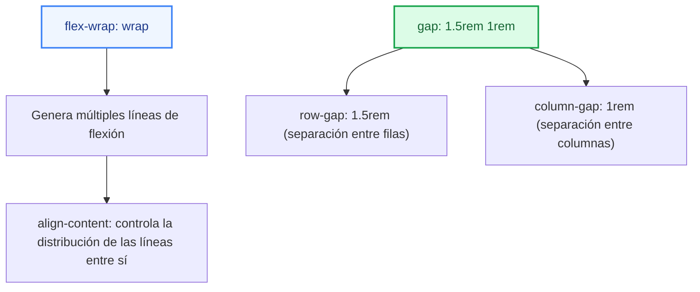
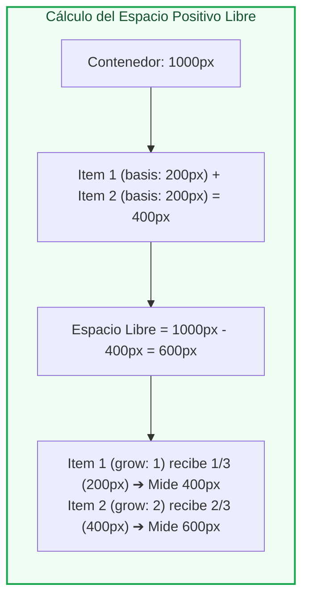
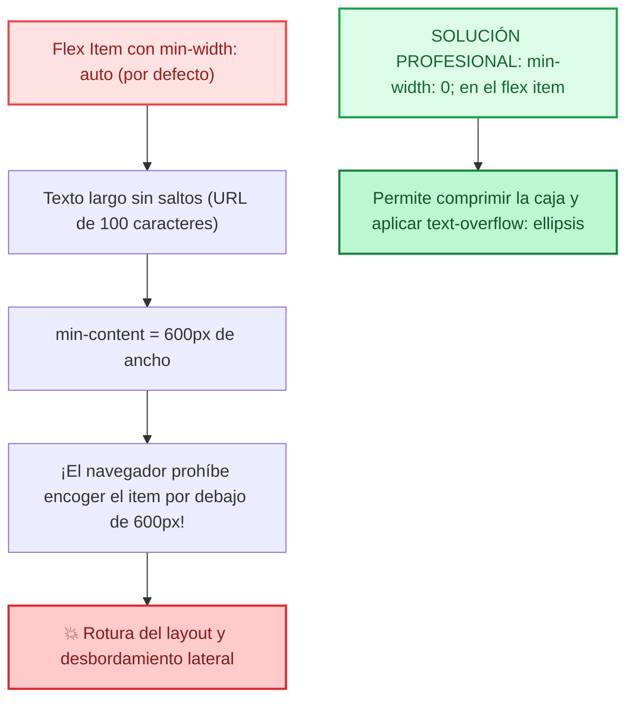
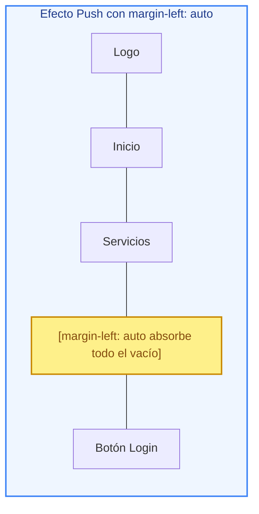

# Ejemplos de Código · Unidad 05: Flexbox

<div class="badges">
  <span class="badge badge-css">CSS3 Moderno</span>
  <span class="badge badge-blue">Código Práctico</span>
  <span class="badge badge-green">Flexbox</span>
  <span class="badge badge-ra">RA 2 / RA 3</span>
</div>

En este documento se desarrollan **ejemplos completos y funcionales de código HTML5 y CSS3** para dominar el modelo de maquetación en una dimensión (**Flexbox**): el eje principal (*main axis*) y transversal (*cross axis*), el reparto de espacio con `justify-content`, la alineación con `align-items` y `align-self`, el flujo envolvente con `flex-wrap` y `align-content`, el dimensionamiento matemático de items (`flex-basis`, `flex-grow`, `flex-shrink`), la resolución de la trampa clásica de `min-width: auto`, el efecto «push» de `margin: auto` y patrones de componentes de producción.

!!! info "Estructura didáctica de cada apartado"

    Cada sección está optimizada para que el alumnado experimente en su entorno de trabajo:

    1. **Fundamento conceptual:** Teoría técnica, esquemas de cálculo y diagramas Mermaid.
    2. **Código fuente interactivo:** Pestañas separadas para **HTML** semántico y **CSS** desacoplado con variables de diseño.
    3. **Disección técnica paso a paso:** Desglose pormenorizado de las propiedades y su repercusión en pantalla.
    4. **Retos y preguntas de aula:** Ejercicios de modificación para practicar en clase.

---

## 1. Anatomía del Flex Container y Orientación de los Ejes

### Fundamento Conceptual

Al declarar ==`display: flex`== (o `inline-flex`) en un elemento padre, este se transforma en un **flex container** y sus hijos directos pasan a ser **flex items**. 

A diferencia del flujo de bloque tradicional, Flexbox opera bajo un sistema de **dos ejes ortogonales dinámicos** cuya orientación depende exclusivamente de la propiedad `flex-direction`:

<div class="esquema-grid-2">
  <div class="esquema-panel esquema-panel--blue">
    <div class="esquema-panel__header">
      <h4 class="esquema-panel__title">➡️ flex-direction: row</h4>
      <p class="esquema-panel__sub">Modo por defecto: distribución horizontal en fila.</p>
    </div>
    <div class="esquema-items">
      <div class="esquema-card">
        <div class="esquema-card__header">
          <strong>Eje Principal (Main Axis) ➔ Horizontal</strong>
          <span class="tag tag--defecto">Left to Right</span>
        </div>
        <p>Define la dirección de lectura. El reparto de espacio libre se gestiona con <code>justify-content</code>.</p>
      </div>
      <div class="esquema-card">
        <div class="esquema-card__header">
          <strong>Eje Transversal (Cross Axis) ⬇ Vertical</strong>
          <span class="tag tag--defecto">Top to Bottom</span>
        </div>
        <p>Eje ortogonal perpendicular. La alineación geométrica se gobierna con <code>align-items</code>.</p>
      </div>
    </div>
  </div>

  <div class="esquema-panel esquema-panel--purple">
    <div class="esquema-panel__header">
      <h4 class="esquema-panel__title">⬇️ flex-direction: column</h4>
      <p class="esquema-panel__sub">Distribución en vertical: apilamiento de bloques.</p>
    </div>
    <div class="esquema-items">
      <div class="esquema-card">
        <div class="esquema-card__header">
          <strong>Eje Principal (Main Axis) ⬇ Vertical</strong>
          <span class="tag tag--hibrido">Top to Bottom</span>
        </div>
        <p>El flujo gira 90 grados. El reparto de espacio libre vertical pasa a controlarse con <code>justify-content</code>.</p>
      </div>
      <div class="esquema-card">
        <div class="esquema-card__header">
          <strong>Eje Transversal (Cross Axis) ➔ Horizontal</strong>
          <span class="tag tag--hibrido">Left to Right</span>
        </div>
        <p>Eje perpendicular. La alineación izquierda/derecha se gobierna ahora con <code>align-items</code>.</p>
      </div>
    </div>
  </div>
</div>

| `flex-direction` | Eje Principal (*Main Axis*) | Eje Transversal (*Cross Axis*) | Inicio / Fin del Eje Principal |
| :--- | :--- | :--- | :--- |
| **`row`** (defecto) | Horizontal (→) | Vertical (↓) | Izquierda → Derecha (en LTR) |
| **`row-reverse`** | Horizontal (←) | Vertical (↓) | Derecha → Izquierda |
| **`column`** | Vertical (↓) | Horizontal (→) | Arriba → Abajo |
| **`column-reverse`**| Vertical (↑) | Horizontal (→) | Abajo → Arriba |

### Código de Ejemplo

=== "HTML"

    ```html title="01-flex-container-ejes.html"
    <!DOCTYPE html>
    <html lang="es">
    <head>
      <meta charset="UTF-8">
      <meta name="viewport" content="width=device-width, initial-scale=1.0">
      <title>Flex Container y Ejes</title>
      <link rel="stylesheet" href="01-flex-container-ejes.css">
    </head>
    <body>
      <main class="laboratorio">
        <h1>Anatomía de los Ejes en Flexbox</h1>
        <p class="subtitulo">Observa cómo cambia la dirección del flujo y el papel de cada eje.</p>

        <!-- MODO 1: ROW (HORIZONTAL) -->
        <section class="tarjeta-demostracion">
          <h2>1. <code>flex-direction: row</code> (Eje Principal Horizontal)</h2>
          <div class="contenedor-flex contenedor-flex--row">
            <div class="item">Item 1</div>
            <div class="item">Item 2</div>
            <div class="item">Item 3</div>
          </div>
        </section>

        <!-- MODO 2: COLUMN (VERTICAL) -->
        <section class="tarjeta-demostracion">
          <h2>2. <code>flex-direction: column</code> (Eje Principal Vertical)</h2>
          <div class="contenedor-flex contenedor-flex--column">
            <div class="item">Item 1</div>
            <div class="item">Item 2</div>
            <div class="item">Item 3</div>
          </div>
        </section>

        <!-- MODO 3: ROW-REVERSE -->
        <section class="tarjeta-demostracion">
          <h2>3. <code>flex-direction: row-reverse</code> (Flujo Invertido)</h2>
          <div class="contenedor-flex contenedor-flex--row-reverse">
            <div class="item">Item 1</div>
            <div class="item">Item 2</div>
            <div class="item">Item 3</div>
          </div>
        </section>
      </main>
    </body>
    </html>
    ```

=== "CSS"

    ```css title="01-flex-container-ejes.css"
    :root {
      --color-fondo: #f8fafc;
      --color-superficie: #ffffff;
      --color-texto: #0f172a;
      --color-borde: #cbd5e1;
      --color-item-bg: #e0f2fe;
      --color-item-borde: #0284c7;
      --color-item-texto: #0369a1;
      --radio: 8px;
    }

    * {
      box-sizing: border-box;
      margin: 0;
      padding: 0;
    }

    body {
      font-family: system-ui, sans-serif;
      background-color: var(--color-fondo);
      color: var(--color-texto);
      padding: 2rem 1.5rem;
    }

    .laboratorio {
      max-width: 700px;
      margin: 0 auto;
    }

    h1 {
      font-size: 1.6rem;
      margin-bottom: 0.25rem;
    }

    .subtitulo {
      color: #64748b;
      margin-bottom: 2rem;
    }

    .tarjeta-demostracion {
      background-color: var(--color-superficie);
      border: 1px solid var(--color-borde);
      border-radius: var(--radio);
      padding: 1.5rem;
      margin-bottom: 1.5rem;
      box-shadow: 0 4px 6px -1px rgba(0, 0, 0, 0.05);
    }

    .tarjeta-demostracion h2 {
      font-size: 1.05rem;
      margin-bottom: 1rem;
    }

    /* ESTILO COMÚN DEL FLEX CONTAINER */
    .contenedor-flex {
      display: flex;
      background-color: #f1f5f9;
      padding: 1rem;
      border: 2px dashed #94a3b8;
      border-radius: var(--radio);
      gap: 1rem;
    }

    /* Items individuales */
    .item {
      background-color: var(--color-item-bg);
      color: var(--color-item-texto);
      border: 2px solid var(--color-item-borde);
      padding: 0.75rem 1.25rem;
      border-radius: 6px;
      font-weight: 700;
      text-align: center;
    }

    /* VARIACIONES DE DIRECCIÓN */
    .contenedor-flex--row {
      flex-direction: row;
    }

    .contenedor-flex--column {
      flex-direction: column;
    }

    .contenedor-flex--row-reverse {
      flex-direction: row-reverse;
    }
    ```

!!! tip "Disección técnica paso a paso"

    1. **`display: flex`:** Convierte al contenedor en un contexto flex. Automáticamente, los elementos `<div>` hijos (que por defecto son bloques de ancho 100%) se colocan en fila horizontal según su contenido.
    2. **Inversión con `row-reverse`:** El `Item 1` pasa a situarse al extremo derecho. Cuidado: esto cambia el orden visual, pero el DOM y la navegación por teclado (Tab) siguen el orden original del marcado HTML.
    3. **Modo `column`:** El eje principal pasa a ser vertical. En este modo, `justify-content` afectará a la distribución arriba/abajo y `align-items` a la alineación izquierda/derecha.

---

## 2. Distribución en el Eje Principal con `justify-content` y Alineación Segura

### Fundamento Conceptual

==`justify-content`== reparte el **espacio libre remanente** a lo largo del eje principal (*Main Axis*):

<div class="esquema-grid-2">
  <div class="esquema-panel esquema-panel--blue">
    <div class="esquema-panel__header">
      <h4 class="esquema-panel__title">📦 1. Alineación Agrupada</h4>
      <p class="esquema-panel__sub">Los elementos se empaquetan en bloque sin generar separación interna.</p>
    </div>
    <div class="esquema-items">
      <div class="esquema-card">
        <div class="esquema-card__header">
          <code>flex-start</code> / <code>start</code>
          <span class="tag tag--defecto">Por defecto</span>
        </div>
        <p>Empaquetados al inicio del eje principal (al borde izquierdo en flujo horizontal LTR).</p>
      </div>
      <div class="esquema-card">
        <div class="esquema-card__header">
          <code>center</code>
        </div>
        <p>Centrados en el eje principal. El espacio remanente se divide en partes iguales a los dos extremos.</p>
      </div>
      <div class="esquema-card">
        <div class="esquema-card__header">
          <code>flex-end</code> / <code>end</code>
        </div>
        <p>Empaquetados al final del eje principal (al borde derecho en flujo horizontal LTR).</p>
      </div>
    </div>
  </div>

  <div class="esquema-panel esquema-panel--green">
    <div class="esquema-panel__header">
      <h4 class="esquema-panel__title">📐 2. Reparto de Espacio Libre</h4>
      <p class="esquema-panel__sub">El espacio libre sobrante se distribuye entre y alrededor de los elementos.</p>
    </div>
    <div class="esquema-items">
      <div class="esquema-card">
        <div class="esquema-card__header">
          <code>space-between</code>
        </div>
        <p>Extremos pegados a los bordes. El espacio libre se divide en partes iguales exclusivamente entre los elementos intermedios.</p>
      </div>
      <div class="esquema-card">
        <div class="esquema-card__header">
          <code>space-around</code>
        </div>
        <p>Espacio idéntico a ambos lados de cada elemento. Los huecos en los extremos perimetrales miden la mitad que los huecos intermedios.</p>
      </div>
      <div class="esquema-card">
        <div class="esquema-card__header">
          <code>space-evenly</code>
        </div>
        <p>Separación 100% homogénea. Los espacios entre elementos y con los bordes exteriores son rigurosamente idénticos.</p>
      </div>
    </div>
  </div>
</div>

!!! warning "El peligro del centrado ciego y la solución: `safe center`"

    Cuando utilizas `justify-content: center` y el contenedor se estrecha tanto que los elementos no caben, el navegador centra el desbordamiento hacia ambos lados. Esto causa que el contenido desbordado por la izquierda quede **fuera del margen izquierdo de la pantalla**, volviéndose inaccesible incluso haciendo scroll.
    
    La palabra clave moderna **`safe`** (`justify-content: safe center;`) soluciona este fallo: centra si hay espacio, pero si se desborda, conmuta a `start` para que todo el contenido sea accesible con scroll.

### Código de Ejemplo

=== "HTML"

    ```html title="02-justify-content.html"
    <!DOCTYPE html>
    <html lang="es">
    <head>
      <meta charset="UTF-8">
      <meta name="viewport" content="width=device-width, initial-scale=1.0">
      <title>Distribución con justify-content</title>
      <link rel="stylesheet" href="02-justify-content.css">
    </head>
    <body>
      <main class="banco-pruebas">
        <h1>Distribución con <code>justify-content</code></h1>

        <!-- 1. flex-start -->
        <section class="caso">
          <h3>1. <code>flex-start</code> (Por defecto)</h3>
          <div class="caja-flex jc-start">
            <div class="cajita">A</div>
            <div class="cajita">B</div>
            <div class="cajita">C</div>
          </div>
        </section>

        <!-- 2. center -->
        <section class="caso">
          <h3>2. <code>center</code> (Centrado horizontal en fila)</h3>
          <div class="caja-flex jc-center">
            <div class="cajita">A</div>
            <div class="cajita">B</div>
            <div class="cajita">C</div>
          </div>
        </section>

        <!-- 3. flex-end -->
        <section class="caso">
          <h3>3. <code>flex-end</code> (Alineado al extremo)</h3>
          <div class="caja-flex jc-end">
            <div class="cajita">A</div>
            <div class="cajita">B</div>
            <div class="cajita">C</div>
          </div>
        </section>

        <!-- 4. space-between -->
        <section class="caso">
          <h3>4. <code>space-between</code> (Extremos pegados)</h3>
          <div class="caja-flex jc-between">
            <div class="cajita">A</div>
            <div class="cajita">B</div>
            <div class="cajita">C</div>
          </div>
        </section>

        <!-- 5. space-around -->
        <section class="caso">
          <h3>5. <code>space-around</code> (Bordes con medio espacio)</h3>
          <div class="caja-flex jc-around">
            <div class="cajita">A</div>
            <div class="cajita">B</div>
            <div class="cajita">C</div>
          </div>
        </section>

        <!-- 6. space-evenly -->
        <section class="caso">
          <h3>6. <code>space-evenly</code> (Espacios 100% idénticos)</h3>
          <div class="caja-flex jc-evenly">
            <div class="cajita">A</div>
            <div class="cajita">B</div>
            <div class="cajita">C</div>
          </div>
        </section>
      </main>
    </body>
    </html>
    ```

=== "CSS"

    ```css title="02-justify-content.css"
    :root {
      --color-fondo: #f8fafc;
      --color-superficie: #ffffff;
      --color-borde: #cbd5e1;
      --color-acento: #4f46e5;
    }

    * {
      box-sizing: border-box;
      margin: 0;
      padding: 0;
    }

    body {
      font-family: system-ui, sans-serif;
      background-color: var(--color-fondo);
      padding: 2rem 1.5rem;
    }

    .banco-pruebas {
      max-width: 650px;
      margin: 0 auto;
      background-color: var(--color-superficie);
      padding: 2rem;
      border-radius: 12px;
      border: 1px solid var(--color-borde);
      box-shadow: 0 4px 6px -1px rgba(0, 0, 0, 0.05);
    }

    h1 {
      font-size: 1.4rem;
      margin-bottom: 1.5rem;
    }

    .caso {
      margin-bottom: 1.5rem;
    }

    .caso h3 {
      font-size: 0.95rem;
      margin-bottom: 0.4rem;
      color: #334155;
    }

    .caja-flex {
      display: flex;
      background-color: #f1f5f9;
      border: 1px solid #cbd5e1;
      border-radius: 6px;
      padding: 0.75rem;
      min-height: 60px;
      align-items: center;
    }

    .cajita {
      background-color: var(--color-acento);
      color: #ffffff;
      width: 48px;
      height: 38px;
      border-radius: 4px;
      display: grid;
      place-items: center;
      font-weight: 700;
      font-size: 0.9rem;
    }

    /* REGLAS DE JUSTIFY-CONTENT */
    .jc-start   { justify-content: flex-start; }
    .jc-center  { justify-content: safe center; }
    .jc-end     { justify-content: flex-end; }
    .jc-between { justify-content: space-between; }
    .jc-around  { justify-content: space-around; }
    .jc-evenly  { justify-content: space-evenly; }
    ```

!!! tip "Disección técnica paso a paso"

    1. **`space-between`:** Ideal para barras de navegación. El elemento `A` se pega al borde izquierdo, el `C` al derecho y el `B` se sitúa en el centro exacto.
    2. **Diferencia entre `space-around` y `space-evenly`:** En `space-around`, cada elemento tiene un margen virtual idéntico a ambos lados, lo que provoca que el espacio entre `A` y `B` sea el doble que el espacio entre el borde exterior y `A`. En cambio, en `space-evenly`, la distancia entre bordes y entre elementos es exactamente la misma.

---

## 3. Alineación Transversal: `align-items`, `align-self` y `baseline`

### Fundamento Conceptual

Mientras que `justify-content` opera en el eje principal, la alineación en el **eje transversal (*Cross Axis*)** se gobierna mediante:

1. ==`align-items`==: Regla global declarada en el contenedor padre que afecta a todos los hijos directos.
2. ==`align-self`==: Regla individual declarada en un hijo específico para sobreescribir la directriz del padre.

| Valor de `align-items` | Comportamiento en pantalla |
| :--- | :--- |
| **`stretch`** (defecto) | Los items se estiran para ocupar el 100% de la altura del contenedor. |
| **`flex-start` / `start`** | Se alinean al borde inicial del eje transversal. |
| **`center`** | Se centran verticalmente en su línea. |
| **`flex-end` / `end`** | Se alinean al borde final del eje transversal. |
| **`baseline`** | Se alinean de modo que la **línea base tipográfica** del texto de todos los items coincida en una misma cota horizontal perfecta. |

### Código de Ejemplo

=== "HTML"

    ```html title="03-alineacion-transversal.html"
    <!DOCTYPE html>
    <html lang="es">
    <head>
      <meta charset="UTF-8">
      <meta name="viewport" content="width=device-width, initial-scale=1.0">
      <title>Alineación Transversal con Flexbox</title>
      <link rel="stylesheet" href="03-alineacion-transversal.css">
    </head>
    <body>
      <main class="laboratorio">
        <h1>Alineación Transversal: <code>align-items</code> y <code>baseline</code></h1>

        <!-- CASO 1: STRETCH (POR DEFECTO) -->
        <section class="caso">
          <h3>1. <code>align-items: stretch</code> (Estiramiento vertical automático)</h3>
          <div class="contenedor-flex ai-stretch">
            <div class="item">Texto corto</div>
            <div class="item">Texto con más contenido que expande la altura de la fila completa</div>
            <div class="item">Se iguala al más alto</div>
          </div>
        </section>

        <!-- CASO 2: BASELINE -->
        <section class="caso">
          <h3>2. <code>align-items: baseline</code> (Línea base tipográfica alineada)</h3>
          <div class="contenedor-flex ai-baseline">
            <div class="item fuente-grande">24€</div>
            <div class="item fuente-pequena">/ mes (IVA incluido)</div>
            <div class="item fuente-mediana">Plan Anual</div>
          </div>
        </section>

        <!-- CASO 3: ALIGN-SELF -->
        <section class="caso">
          <h3>3. Excepción individual con <code>align-self: flex-end</code></h3>
          <div class="contenedor-flex ai-center">
            <div class="item">Centrado (padre)</div>
            <div class="item item--excepcion">align-self: flex-end</div>
            <div class="item">Centrado (padre)</div>
          </div>
        </section>
      </main>
    </body>
    </html>
    ```

=== "CSS"

    ```css title="03-alineacion-transversal.css"
    :root {
      --color-fondo: #f8fafc;
      --color-superficie: #ffffff;
      --color-borde: #cbd5e1;
      --color-item-bg: #e0e7ff;
      --color-item-borde: #4338ca;
    }

    * {
      box-sizing: border-box;
      margin: 0;
      padding: 0;
    }

    body {
      font-family: system-ui, sans-serif;
      background-color: var(--color-fondo);
      padding: 2rem 1.5rem;
    }

    .laboratorio {
      max-width: 650px;
      margin: 0 auto;
    }

    .caso {
      background-color: var(--color-superficie);
      padding: 1.5rem;
      border-radius: 12px;
      border: 1px solid var(--color-borde);
      margin-bottom: 1.5rem;
    }

    .caso h3 {
      font-size: 0.95rem;
      margin-bottom: 0.75rem;
      color: #334155;
    }

    .contenedor-flex {
      display: flex;
      background-color: #f1f5f9;
      border: 1px dashed #94a3b8;
      border-radius: 8px;
      padding: 1rem;
      gap: 1rem;
      min-height: 120px; /* Altura suficiente para apreciar el movimiento transversal */
    }

    .item {
      background-color: var(--color-item-bg);
      border: 2px solid var(--color-item-borde);
      border-radius: 6px;
      padding: 0.75rem;
      color: #312e81;
      font-weight: 600;
      font-size: 0.85rem;
    }

    /* REGLAS DE ALINEACIÓN TRANSVERSAL */
    .ai-stretch  { align-items: stretch; }
    .ai-baseline { align-items: baseline; }
    .ai-center   { align-items: center; }

    /* Estilos para el test de baseline con fuentes dispares */
    .fuente-grande   { font-size: 2rem; font-weight: 800; }
    .fuente-pequena  { font-size: 0.8rem; color: #64748b; }
    .fuente-mediana  { font-size: 1rem; font-weight: 700; }

    /* Excepción individual con align-self */
    .item--excepcion {
      align-self: flex-end;
      background-color: #fef08a;
      border-color: #ca8a04;
      color: #854d0e;
    }
    ```

!!! tip "Disección técnica paso a paso"

    1. **`stretch` resuelve el problema histórico de columnas iguales:** Sin necesidad de trucos con tablas o JavaScript, Flexbox hace que todas las cajas de una fila midan exactamente la misma altura que la más alta de ellas.
    2. **Magia de `align-items: baseline`:** En el segundo caso, el precio de `24€` tiene un tamaño de fuente de `2rem` y el texto vecino tiene `0.8rem`. Con `center` o `flex-start` los textos quedarían descuadrados. Con `baseline`, las partes inferiores de las letras descansan en la misma línea imaginaria, logrando un resultado visualmente armónico y profesional.
    3. **`align-self` para romper la norma:** En el tercer contenedor, el padre impone `align-items: center`, pero el segundo elemento declara `align-self: flex-end` y se posiciona en el fondo del contenedor.

---

## 4. Salto de Línea con `flex-wrap` y la Propiedad Moderna `gap`

### Fundamento Conceptual

Por defecto, los contenedores Flex tienen `flex-wrap: nowrap`, lo que obliga a todos los elementos a comprimirse en una sola fila sin importar lo pequeños que se vuelvan.

Al activar ==`flex-wrap: wrap`==, si la suma de los anchos de los items excede el ancho disponible del contenedor, los sobrantes saltan a una **nueva fila o línea flex**.

Además, la propiedad estándar ==`gap`== (junto con `row-gap` y `column-gap`) establece el canalón de separación limpio entre celdas **sin necesidad de recurrir a márgenes exteriores o pseudo-selectores `:last-child`**.



### Código de Ejemplo

=== "HTML"

    ```html title="04-flex-wrap-gap.html"
    <!DOCTYPE html>
    <html lang="es">
    <head>
      <meta charset="UTF-8">
      <meta name="viewport" content="width=device-width, initial-scale=1.0">
      <title>Flex Wrap y Gap Moderno</title>
      <link rel="stylesheet" href="04-flex-wrap-gap.css">
    </head>
    <body>
      <main class="contenedor-general">
        <h1>Galería Flexible con <code>flex-wrap</code> y <code>gap</code></h1>
        <p class="instruccion">Redimensiona el ancho de tu navegador para comprobar cómo las tarjetas envuelven dinámicamente.</p>

        <section class="parrilla-tarjetas">
          <article class="tarjeta-modulo">
            <h4>Módulo 1</h4>
            <p>Lenguajes de Marcas y Sistemas de Gestión de Información.</p>
          </article>
          <article class="tarjeta-modulo">
            <h4>Módulo 2</h4>
            <p>Desarrollo Web en Entorno Cliente (JavaScript y DOM).</p>
          </article>
          <article class="tarjeta-modulo">
            <h4>Módulo 3</h4>
            <p>Desarrollo Web en Entorno Servidor (APIs y Bases de Datos).</p>
          </article>
          <article class="tarjeta-modulo">
            <h4>Módulo 4</h4>
            <p>Diseño de Interfaces Web (Accesibilidad y CSS Avanzado).</p>
          </article>
          <article class="tarjeta-modulo">
            <h4>Módulo 5</h4>
            <p>Despliegue de Aplicaciones Web y DevOps.</p>
          </article>
        </section>
      </main>
    </body>
    </html>
    ```

=== "CSS"

    ```css title="04-flex-wrap-gap.css"
    :root {
      --color-primario: #0284c7;
      --color-fondo: #f8fafc;
      --color-superficie: #ffffff;
      --color-texto: #0f172a;
      --color-borde: #cbd5e1;
      --espacio-fila: 1.5rem;
      --espacio-columna: 1rem;
    }

    * {
      box-sizing: border-box;
      margin: 0;
      padding: 0;
    }

    body {
      font-family: system-ui, sans-serif;
      background-color: var(--color-fondo);
      color: var(--color-texto);
      padding: 2.5rem 1.5rem;
    }

    .contenedor-general {
      max-width: 850px;
      margin: 0 auto;
    }

    h1 {
      font-size: 1.5rem;
      margin-bottom: 0.25rem;
    }

    .instruccion {
      color: #64748b;
      margin-bottom: 2rem;
      font-size: 0.9rem;
    }

    /* CONTENEDOR FLEX MULTILÍNEA CON GAP */
    .parrilla-tarjetas {
      display: flex;
      flex-wrap: wrap; /* Habilita el salto a nuevas líneas */
      
      /* Sintaxis moderna de gap: fila columna */
      gap: var(--espacio-fila) var(--espacio-columna);
    }

    /* TARJETA CON TAMAÑO BASE FLEXIBLE */
    .tarjeta-modulo {
      flex: 1 1 240px; /* Crece (1), encoge (1), base inicial de 240px */
      background-color: var(--color-superficie);
      border: 1px solid var(--color-borde);
      border-radius: 10px;
      padding: 1.5rem;
      box-shadow: 0 4px 6px -1px rgba(0, 0, 0, 0.05);
      border-top: 4px solid var(--color-primario);
    }

    .tarjeta-modulo h4 {
      font-size: 1.1rem;
      margin-bottom: 0.5rem;
      color: #0369a1;
    }

    .tarjeta-modulo p {
      color: #475569;
      font-size: 0.85rem;
      line-height: 1.5;
    }
    ```

!!! tip "Disección técnica paso a paso"

    1. **`flex-wrap: wrap`:** Permite que las tarjetas no se aplasten indefinidamente en una fila apretada. En cuanto no caben dos tarjetas de `240px` más el `gap`, la última salta a la siguiente fila.
    2. **Ventaja definitiva de `gap`:** Observa que los bordes perimetrales exteriores no tienen margen no deseado. Antes de `gap`, los desarrolladores tenían que lidiar con `margin-right` en los hijos y compensarlo con márgenes negativos en el contenedor padre.
    3. **`flex: 1 1 240px`:** Cada tarjeta pide al menos 240px de base. Al tener `flex-grow: 1`, si en la última fila sobra espacio, las tarjetas de esa fila se expanden de forma uniforme rellenando el ancho disponible.

---

## 5. La Tríada del Flex Item: `flex-basis`, `flex-grow` y `flex-shrink`

### Fundamento Conceptual

El atajo ==`flex: grow shrink basis`== rige el comportamiento elástico del item ante variaciones de espacio:

1. **`flex-basis` (Punto de partida):** Tamaño inicial solicitado antes de que comience el reparto o la compresión de espacio.
2. **`flex-grow` (El reparto del pastel sobrante):** Define la proporción con la que el item absorberá el **espacio positivo libre**.
3. **`flex-shrink` (El sacrificio ante la estrechez):** Factor con el que el item se comprime cuando el contenedor es menor que la suma de las bases (**espacio negativo**).



| Declaración atajo | Desglose formal | Comportamiento práctico |
| :--- | :---: | :--- |
| **`flex: initial`** | `0 1 auto` | Ajuste al contenido; no crece; sí encoge ante espacio negativo. |
| **`flex: 1`** | `1 1 0%` | **Reparto igualitario estricto**: todas las columnas miden exactamente lo mismo. |
| **`flex: auto`** | `1 1 auto` | Crece absorbiendo espacio, pero el que tiene más texto de partida siempre es más ancho. |
| **`flex: none`** | `0 0 auto` | Rígido: no crece ni mengua jamás (ideal para iconos o avatares). |

### Código de Ejemplo

=== "HTML"

    ```html title="05-triada-grow-shrink-basis.html"
    <!DOCTYPE html>
    <html lang="es">
    <head>
      <meta charset="UTF-8">
      <meta name="viewport" content="width=device-width, initial-scale=1.0">
      <title>Flex Grow, Shrink y Basis</title>
      <link rel="stylesheet" href="05-triada-grow-shrink-basis.css">
    </head>
    <body>
      <main class="laboratorio">
        <h1>Laboratorio de Reparto Matemático</h1>

        <!-- CASO A: REPARTO PROPORCIONAL DE GROW (1 frente a 2) -->
        <section class="caso">
          <h3>1. Proporción de Crecimiento: <code>flex-grow: 1</code> vs <code>flex-grow: 2</code></h3>
          <p class="detalle">Ambos parten de basis: 100px. El item B absorbe el doble del espacio libre sobrante.</p>
          <div class="contenedor-flex">
            <div class="item grow-1">Item A (grow: 1)</div>
            <div class="item grow-2">Item B (grow: 2)</div>
          </div>
        </section>

        <!-- CASO B: FLEX: 1 (COLUMNAS IDÉNTICAS) VS FLEX: AUTO -->
        <section class="caso">
          <h3>2. <code>flex: 1</code> (Base 0% estricta) vs Contenido Asimétrico</h3>
          <p class="detalle">A pesar de que el segundo item tiene mucho más texto, miden exactamente lo mismo.</p>
          <div class="contenedor-flex">
            <div class="item flex-uno">Corto</div>
            <div class="item flex-uno">Texto con una longitud significativamente mayor para poner a prueba la igualdad matemática de columnas</div>
          </div>
        </section>

        <!-- CASO C: FLEX-SHRINK: 0 (ELEMENTO RÍGIDO ANTE LA COMPRESIÓN) -->
        <section class="caso">
          <h3>3. <code>flex-shrink: 0</code> (Protección contra la deformación)</h3>
          <p class="detalle">El avatar circular tiene shrink: 0 para evitar que el texto lo aplaste.</p>
          <div class="contenedor-flex contenedor-estrecho">
            <div class="avatar-circular">👤</div>
            <div class="cuerpo-mensaje">Mensaje con texto largo que provoca compresión en el contenedor flex estrecho.</div>
          </div>
        </section>
      </main>
    </body>
    </html>
    ```

=== "CSS"

    ```css title="05-triada-grow-shrink-basis.css"
    :root {
      --color-fondo: #f8fafc;
      --color-superficie: #ffffff;
      --color-borde: #cbd5e1;
    }

    * {
      box-sizing: border-box;
      margin: 0;
      padding: 0;
    }

    body {
      font-family: system-ui, sans-serif;
      background-color: var(--color-fondo);
      padding: 2rem 1.5rem;
    }

    .laboratorio {
      max-width: 650px;
      margin: 0 auto;
    }

    .caso {
      background-color: var(--color-superficie);
      padding: 1.5rem;
      border-radius: 12px;
      border: 1px solid var(--color-borde);
      margin-bottom: 1.5rem;
    }

    .caso h3 {
      font-size: 1rem;
      margin-bottom: 0.25rem;
    }

    .detalle {
      color: #64748b;
      font-size: 0.85rem;
      margin-bottom: 1rem;
    }

    .contenedor-flex {
      display: flex;
      background-color: #f1f5f9;
      border: 1px dashed #94a3b8;
      border-radius: 8px;
      padding: 0.75rem;
      gap: 0.75rem;
    }

    .item {
      padding: 1rem;
      border-radius: 6px;
      font-size: 0.85rem;
      font-weight: 600;
    }

    /* CASO A: GROW 1 VS GROW 2 */
    .grow-1 {
      flex-grow: 1;
      flex-basis: 100px;
      background-color: #dbeafe;
      color: #1e40af;
      border: 2px solid #3b82f6;
    }

    .grow-2 {
      flex-grow: 2;
      flex-basis: 100px;
      background-color: #bfdbfe;
      color: #1d4ed8;
      border: 2px solid #2563eb;
    }

    /* CASO B: FLEX: 1 (IGUALDAD MATEMÁTICA) */
    .flex-uno {
      flex: 1; /* Equivalente a flex: 1 1 0% */
      background-color: #dcfce7;
      color: #166534;
      border: 2px solid #22c55e;
    }

    /* CASO C: PROTECCIÓN CON SHRINK: 0 */
    .contenedor-estrecho {
      max-width: 380px; /* Contenedor deliberadamente estrecho */
      align-items: center;
    }

    .avatar-circular {
      flex-shrink: 0; /* ¡VITAL!: Prohibido encogerse */
      width: 48px;
      height: 48px;
      background-color: #f43f5e;
      color: #ffffff;
      border-radius: 50%;
      display: grid;
      place-items: center;
      font-size: 1.25rem;
    }

    .cuerpo-mensaje {
      flex: 1;
      background-color: #ffffff;
      padding: 0.5rem 0.75rem;
      border-radius: 6px;
      font-size: 0.85rem;
      color: #334155;
    }
    ```

!!! tip "Disección técnica paso a paso"

    1. **Por qué `flex: 1` garantiza columnas iguales:** Al asignar `flex-basis: 0%`, los elementos no aportan tamaño previo al cálculo. Todo el ancho del contenedor es considerado "espacio libre", dividiéndose en partes matemáticas estrictamente exactas.
    2. **El poder de `flex-shrink: 0`:** Si no pones `flex-shrink: 0` en el avatar, el algoritmo de flexión comprimirá el círculo hasta deformarlo en una elipse aplastada para hacer hueco al texto. Con `flex-shrink: 0`, se garantiza que el círculo conserve sus 48px intactos.

---

## 6. La Gran Trampa de Flexbox: `min-width: auto` y Textos Desbordantes

### Fundamento Conceptual

Uno de los bugs más frustrantes en maquetación ocurre cuando un flex item contiene una cadena de texto sin espacios (como una URL kilométrica), un `<pre>`, una tabla o un input: **el contenedor flex desborda la pantalla horizontalmente**.

> **La Causa Técnica:** Por especificación W3C, todos los flex items tienen por defecto ==`min-width: auto`== (en lugar de `min-width: 0`). Esto significa que el navegador **se niega a encoger el item por debajo de su tamaño intrínseco mínimo (*min-content*)**.



### Código de Ejemplo

=== "HTML"

    ```html title="06-trampa-min-width-auto.html"
    <!DOCTYPE html>
    <html lang="es">
    <head>
      <meta charset="UTF-8">
      <meta name="viewport" content="width=device-width, initial-scale=1.0">
      <title>La Trampa de min-width: auto en Flexbox</title>
      <link rel="stylesheet" href="06-trampa-min-width-auto.css">
    </head>
    <body>
      <main class="laboratorio">
        <h1>Resolución de la Trampa <code>min-width: auto</code></h1>

        <!-- CASO 1: ERROR TÍPICO (DESBORDA LA TARJETA) -->
        <section class="caso">
          <h3>1. Comportamiento Roto por Defecto (<code>min-width: auto</code>)</h3>
          <div class="tarjeta-flex">
            <span class="icono">📎</span>
            <div class="item-con-url">
              <span class="url">https://www.dominiaacademy.com/cursos/desarrollo-web-profesional/css-avanzado/leccion-05-flexbox-completo-en-profundidad-paso-a-paso</span>
            </div>
          </div>
        </section>

        <!-- CASO 2: SOLUCIÓN PROFESIONAL CON MIN-WIDTH: 0 -->
        <section class="caso">
          <h3>2. Solución Profesional: <code>min-width: 0;</code> y Elipsis</h3>
          <div class="tarjeta-flex">
            <span class="icono">📎</span>
            <div class="item-con-url item-con-url--arreglado">
              <span class="url url--truncada">https://www.dominiaacademy.com/cursos/desarrollo-web-profesional/css-avanzado/leccion-05-flexbox-completo-en-profundidad-paso-a-paso</span>
            </div>
          </div>
        </section>
      </main>
    </body>
    </html>
    ```

=== "CSS"

    ```css title="06-trampa-min-width-auto.css"
    :root {
      --color-fondo: #f8fafc;
      --color-superficie: #ffffff;
      --color-borde: #cbd5e1;
    }

    * {
      box-sizing: border-box;
      margin: 0;
      padding: 0;
    }

    body {
      font-family: system-ui, sans-serif;
      background-color: var(--color-fondo);
      padding: 2rem 1.5rem;
    }

    .laboratorio {
      max-width: 500px; /* Contenedor con límite visual claro */
      margin: 0 auto;
    }

    .caso {
      background-color: var(--color-superficie);
      padding: 1.5rem;
      border-radius: 12px;
      border: 1px solid var(--color-borde);
      margin-bottom: 2rem;
    }

    .caso h3 {
      font-size: 0.95rem;
      margin-bottom: 1rem;
    }

    .tarjeta-flex {
      display: flex;
      align-items: center;
      gap: 1rem;
      background-color: #f1f5f9;
      padding: 1rem;
      border-radius: 8px;
      border: 2px dashed #94a3b8;
    }

    .icono {
      font-size: 1.5rem;
      flex-shrink: 0;
    }

    .item-con-url {
      flex: 1; /* Intenta ocupar el espacio restante */
    }

    .url {
      color: #0284c7;
      font-family: monospace;
      font-size: 0.85rem;
    }

    /* REGLA SALVADORA: Desactiva el min-width: auto intrínseco */
    .item-con-url--arreglado {
      min-width: 0; /* ¡LA CLAVE!: Permite al item encogerse por debajo de su texto */
    }

    .url--truncada {
      display: block;
      white-space: nowrap;
      overflow: hidden;
      text-overflow: ellipsis; /* Añade los puntos suspensivos elegantes */
    }
    ```

!!! tip "Disección técnica paso a paso"

    1. **El fallo del Caso 1:** A pesar de tener `flex: 1`, la tarjeta se estira y se sale de los 500px del contenedor principal. Esto ocurre porque la URL no contiene espacios en blanco y el navegador impone que el ancho no puede ser inferior a su tamaño de lectura.
    2. **El rescate con `min-width: 0`:** Al añadir `min-width: 0` en el flex item contenedor, se desbloquea el encogimiento. Ahora el item acepta comprimirse tanto como dicte la pantalla y la regla `text-overflow: ellipsis` corta limpiamente el texto con puntos suspensivos.

---

## 7. El Poder de `margin: auto` en Flexbox (Efecto Push)

### Fundamento Conceptual

En el modelo de caja tradicional, `margin: auto` solo servía para centrar horizontalmente bloques con ancho fijo (`margin-inline: auto`). En Flexbox, sin embargo, **los márgenes automáticos adquieren superpoderes**:

> Un margen automático en cualquier dirección (`margin-left: auto`, `margin-inline-start: auto` o `margin-top: auto`) **absorbe todo el espacio libre restante en ese eje**, empujando al elemento o al resto de elementos hacia el extremo opuesto.



### Código de Ejemplo

=== "HTML"

    ```html title="07-margin-auto-push.html"
    <!DOCTYPE html>
    <html lang="es">
    <head>
      <meta charset="UTF-8">
      <meta name="viewport" content="width=device-width, initial-scale=1.0">
      <title>Efecto Push con margin: auto en Flexbox</title>
      <link rel="stylesheet" href="07-margin-auto-push.css">
    </head>
    <body>
      <main class="laboratorio">
        <h1>Patrones de Empuje con <code>margin: auto</code></h1>

        <!-- PATRÓN 1: NAVBAR CON EMPUJE A LA DERECHA -->
        <section class="caso">
          <h3>1. Barra de Navegación (Empuje Horizontal)</h3>
          <nav class="barra-navegacion">
            <span class="logo">🚀 DominIA</span>
            <a href="#" class="enlace">Inicio</a>
            <a href="#" class="enlace">Cursos</a>
            <!-- El siguiente botón absorbe todo el espacio libre a su izquierda -->
            <button class="btn-push">Iniciar Sesión</button>
          </nav>
        </section>

        <!-- PATRÓN 2: TARJETAS CON BOTÓN ANCLADO AL PIE -->
        <section class="caso">
          <h3>2. Botón al Pie en Tarjetas Desiguales (<code>margin-top: auto</code>)</h3>
          <div class="rejilla-tarjetas">
            <article class="tarjeta-precio">
              <h4>Básico</h4>
              <p class="descripcion">Descripción breve de una sola línea.</p>
              <button class="btn-contratar">Seleccionar</button>
            </article>

            <article class="tarjeta-precio">
              <h4>Avanzado</h4>
              <p class="descripcion">
                Descripción mucho más extensa con detalles adicionales del curso, tutorías personalizadas y acceso ilimitado a proyectos prácticos.
              </p>
              <button class="btn-contratar">Seleccionar</button>
            </article>
          </div>
        </section>
      </main>
    </body>
    </html>
    ```

=== "CSS"

    ```css title="07-margin-auto-push.css"
    :root {
      --color-primario: #0ea5e9;
      --color-fondo: #f8fafc;
      --color-superficie: #ffffff;
      --color-texto: #0f172a;
      --color-borde: #cbd5e1;
    }

    * {
      box-sizing: border-box;
      margin: 0;
      padding: 0;
    }

    body {
      font-family: system-ui, sans-serif;
      background-color: var(--color-fondo);
      padding: 2.5rem 1.5rem;
    }

    .laboratorio {
      max-width: 700px;
      margin: 0 auto;
    }

    .caso {
      background-color: var(--color-superficie);
      padding: 1.5rem;
      border-radius: 12px;
      border: 1px solid var(--color-borde);
      margin-bottom: 2rem;
    }

    .caso h3 {
      font-size: 1rem;
      margin-bottom: 1rem;
    }

    /* PATRÓN 1: NAVBAR CON MARGIN-INLINE-START: AUTO */
    .barra-navegacion {
      display: flex;
      align-items: center;
      gap: 1.25rem;
      background-color: #0f172a;
      padding: 0.75rem 1.25rem;
      border-radius: 8px;
    }

    .logo {
      color: #ffffff;
      font-weight: 800;
      font-size: 1.1rem;
    }

    .enlace {
      color: #94a3b8;
      text-decoration: none;
      font-size: 0.85rem;
      font-weight: 500;
    }

    .enlace:hover {
      color: #ffffff;
    }

    /* BOTÓN QUE EMPUJA A LA DERECHA */
    .btn-push {
      margin-inline-start: auto; /* ¡MAGIA!: Absorbe todo el hueco libre restante */
      background-color: var(--color-primario);
      color: #ffffff;
      border: none;
      padding: 0.5rem 1rem;
      border-radius: 6px;
      font-weight: 600;
      font-size: 0.85rem;
      cursor: pointer;
    }

    /* PATRÓN 2: BOTÓN ANCLADO AL FONDO EN TARJETAS CON FLEXBOX VERTICAL */
    .rejilla-tarjetas {
      display: flex;
      gap: 1.5rem;
    }

    .tarjeta-precio {
      flex: 1;
      display: flex;
      flex-direction: column; /* Transforma la tarjeta en flex vertical */
      background-color: #f1f5f9;
      border: 1px solid var(--color-borde);
      border-radius: 8px;
      padding: 1.5rem;
    }

    .tarjeta-precio h4 {
      margin-bottom: 0.5rem;
    }

    .descripcion {
      font-size: 0.85rem;
      color: #475569;
      line-height: 1.5;
      margin-bottom: 1.5rem; /* Margen mínimo garantizado antes del botón */
    }

    /* EL BOTÓN SE PEGA SIEMPRE AL BORDE INFERIOR */
    .btn-contratar {
      margin-top: auto; /* Absorbe el espacio vertical y alinea los botones a la misma cota */
      background-color: #10b981;
      color: #ffffff;
      border: none;
      padding: 0.6rem;
      border-radius: 6px;
      font-weight: 700;
      cursor: pointer;
    }
    ```

!!! tip "Disección técnica paso a paso"

    1. **Navbar limpia sin subcontenedores:** Muchos desarrolladores noveles crean dos `<div>` intermedios y declaran `justify-content: space-between`. Con `margin-inline-start: auto` en el último botón, nos ahorramos envoltorios innecesarios.
    2. **Alineación de botones en tarjetas desiguales:** En el segundo ejemplo, la tarjeta "Avanzado" tiene 4 líneas más de texto que la básica. Gracias a que cada tarjeta es `display: flex; flex-direction: column;` y el botón tiene `margin-top: auto`, ambos botones quedan matemáticamente alineados en la parte inferior.

---

## 8. Patrones de Producción Reales con Flexbox

### Fundamento Conceptual

Para cerrar la unidad, este ejemplo reúne todos los conocimientos en un **componente de catálogo comercial completo**:

- Barra de herramientas superior con buscador elástico (`flex-grow: 1`), contadores fijos (`flex-shrink: 0`) y ordenación empujada al extremo.
- Cuadrícula responsiva que envuelve con `flex-wrap: wrap`.
- Tarjetas con contenido variable y botones al pie perfectamente alineados.

### Código de Ejemplo

=== "HTML"

    ```html title="08-catalogo-completo-flexbox.html"
    <!DOCTYPE html>
    <html lang="es">
    <head>
      <meta charset="UTF-8">
      <meta name="viewport" content="width=device-width, initial-scale=1.0">
      <title>Catálogo Completo con Flexbox</title>
      <link rel="stylesheet" href="08-catalogo-completo-flexbox.css">
    </head>
    <body>
      <main class="contenedor-app">
        <!-- 1. TOOLBAR FLEXIBLE CON GRUPOS -->
        <header class="toolbar-catalogo">
          <div class="grupo-busqueda">
            <span class="icono-lupa">🔍</span>
            <input type="search" placeholder="Buscar cursos de informática..." class="input-busqueda">
          </div>
          <div class="grupo-filtros">
            <span class="etiqueta-badge">6 Cursos Activos</span>
            <select class="selector-orden">
              <option>Más populares</option>
              <option>Precio: Menor a Mayor</option>
            </select>
          </div>
        </header>

        <!-- 2. CATÁLOGO DE TARJETAS MULTILÍNEA -->
        <section class="catalogo-grid">
          <article class="tarjeta-curso">
            <div class="tarjeta-cabecera">
              <span class="badge-tag">DAW / DAM</span>
              <span class="precio">Gratuito</span>
            </div>
            <h3>Desarrollo Web en Entorno Servidor</h3>
            <p>Construcción de microservicios con Node.js, Express y bases de datos relacionales PostgreSQL.</p>
            <div class="tarjeta-pie">
              <span class="duracion">⏱️ 120 horas</span>
              <button class="btn-inscribirse">Ver Temario</button>
            </div>
          </article>

          <article class="tarjeta-curso">
            <div class="tarjeta-cabecera">
              <span class="badge-tag">DIW</span>
              <span class="precio">95€</span>
            </div>
            <h3>Diseño de Interfaces Web y UX</h3>
            <p>Sistemas de diseño, prototipado accesible, responsive design y CSS moderno en profundidad.</p>
            <div class="tarjeta-pie">
              <span class="duracion">⏱️ 90 horas</span>
              <button class="btn-inscribirse">Ver Temario</button>
            </div>
          </article>

          <article class="tarjeta-curso">
            <div class="tarjeta-cabecera">
              <span class="badge-tag">LMH</span>
              <span class="precio">Gratuito</span>
            </div>
            <h3>Lenguajes de Marcas</h3>
            <p>Introducción rigurosa a la semántica web.</p>
            <div class="tarjeta-pie">
              <span class="duracion">⏱️ 60 horas</span>
              <button class="btn-inscribirse">Ver Temario</button>
            </div>
          </article>
        </section>
      </main>
    </body>
    </html>
    ```

=== "CSS"

    ```css title="08-catalogo-completo-flexbox.css"
    :root {
      --color-primario: #3b82f6;
      --color-fondo: #f1f5f9;
      --color-superficie: #ffffff;
      --color-texto: #0f172a;
      --color-texto-mutado: #64748b;
      --color-borde: #cbd5e1;
      --radio: 10px;
    }

    * {
      box-sizing: border-box;
      margin: 0;
      padding: 0;
    }

    body {
      font-family: system-ui, sans-serif;
      background-color: var(--color-fondo);
      color: var(--color-texto);
      padding: 3rem 1.5rem;
    }

    .contenedor-app {
      max-width: 950px;
      margin: 0 auto;
    }

    /* 1. TOOLBAR CON FLEXBOX */
    .toolbar-catalogo {
      display: flex;
      flex-wrap: wrap; /* En móvil salta a dos filas */
      align-items: center;
      gap: 1rem;
      background-color: var(--color-superficie);
      padding: 1rem 1.5rem;
      border-radius: var(--radio);
      border: 1px solid var(--color-borde);
      margin-bottom: 2rem;
      box-shadow: 0 4px 6px -1px rgba(0, 0, 0, 0.05);
    }

    .grupo-busqueda {
      flex: 1 1 280px; /* Absorbe el espacio disponible con base de 280px */
      display: flex;
      align-items: center;
      background-color: #f8fafc;
      border: 1px solid var(--color-borde);
      border-radius: 6px;
      padding: 0.4rem 0.75rem;
      gap: 0.5rem;
    }

    .input-busqueda {
      border: none;
      background: transparent;
      width: 100%;
      outline: none;
      font-size: 0.9rem;
    }

    .grupo-filtros {
      display: flex;
      align-items: center;
      gap: 1rem;
      margin-inline-start: auto; /* Empuja los filtros al extremo derecho */
    }

    .etiqueta-badge {
      background-color: #e0f2fe;
      color: #0369a1;
      font-size: 0.75rem;
      font-weight: 700;
      padding: 0.35rem 0.75rem;
      border-radius: 9999px;
    }

    .selector-orden {
      padding: 0.45rem 0.85rem;
      border-radius: 6px;
      border: 1px solid var(--color-borde);
      background-color: #ffffff;
      font-size: 0.85rem;
      color: var(--color-texto);
    }

    /* 2. CATÁLOGO CON FLEX-WRAP */
    .catalogo-grid {
      display: flex;
      flex-wrap: wrap;
      gap: 1.5rem;
    }

    .tarjeta-curso {
      flex: 1 1 260px; /* Crecen y encogen proporcionalmente con base de 260px */
      display: flex;
      flex-direction: column; /* Permite empujar el footer al fondo con margin-top: auto */
      background-color: var(--color-superficie);
      border: 1px solid var(--color-borde);
      border-radius: var(--radio);
      padding: 1.5rem;
      box-shadow: 0 4px 6px -1px rgba(0, 0, 0, 0.05);
    }

    .tarjeta-cabecera {
      display: flex;
      justify-content: space-between;
      align-items: center;
      margin-bottom: 1rem;
    }

    .badge-tag {
      background-color: #f1f5f9;
      color: #475569;
      font-size: 0.75rem;
      font-weight: 700;
      padding: 0.25rem 0.5rem;
      border-radius: 4px;
    }

    .precio {
      font-weight: 800;
      color: #16a34a;
      font-size: 0.95rem;
    }

    .tarjeta-curso h3 {
      font-size: 1.15rem;
      margin-bottom: 0.5rem;
    }

    .tarjeta-curso p {
      color: var(--color-texto-mutado);
      font-size: 0.85rem;
      line-height: 1.5;
    }

    /* PIE DE TARJETA SIEMPRE EN EL FONDO */
    .tarjeta-pie {
      margin-top: auto; /* Empuja el pie al fondo sin importar el texto anterior */
      padding-top: 1.25rem;
      display: flex;
      justify-content: space-between;
      align-items: center;
      border-top: 1px solid #f1f5f9;
    }

    .duracion {
      font-size: 0.8rem;
      color: var(--color-texto-mutado);
    }

    .btn-inscribirse {
      background-color: var(--color-primario);
      color: #ffffff;
      border: none;
      padding: 0.45rem 0.9rem;
      border-radius: 6px;
      font-weight: 600;
      font-size: 0.8rem;
      cursor: pointer;
    }
    ```

!!! tip "Disección técnica paso a paso"

    1. **Buscador elástico:** `.grupo-busqueda` declara `flex: 1 1 280px`. En pantallas de escritorio se ensancha para absorber todo el espacio libre disponible.
    2. **Cuadrícula elástica autoajustable:** Con `flex: 1 1 260px` y `flex-wrap: wrap`, si la pantalla tiene 900px entran 3 tarjetas por fila. Si se estrecha a 600px, pasan a ser 2 tarjetas; y en teléfonos móviles se adaptan automáticamente a 1 sola tarjeta al 100% de ancho sin necesidad de media queries complejas.
    3. **Alineación de pies con `margin-top: auto`:** Independientemente de si una tarjeta tiene una línea de descripción o cuatro, el bloque `.tarjeta-pie` descansa en la misma cota inferior en todas las tarjetas de la fila.

---

## 9. Checklist de Verificación de Competencias

!!! success "Lista de control para el aula (DAW / DAM)"

    - [x] **Orientación de Ejes:** Sé razonar qué eje gobierna `justify-content` y cuál `align-items` según el valor de `flex-direction`.
    - [x] **Distribución con `justify-content`:** Compruebo las diferencias visuales entre `space-between`, `space-around` y `space-evenly`.
    - [x] **Alineación segura:** Aplico `safe center` para evitar la pérdida irreversible de contenido desbordado por la izquierda.
    - [x] **Alineación `baseline`:** Domino el alineamiento tipográfico en elementos con diferentes tamaños de fuente.
    - [x] **Propiedad `gap`:** Utilizo `gap` en contenedores multilínea prescindiendo de hacks de márgenes negativos.
    - [x] **Tríada `flex`:** Sé calcular el reparto de espacio libre con `flex-grow` y la protección de elementos rígidos con `flex-shrink: 0`.
    - [x] **La trampa de `min-width: auto`:** Sé detectar el fallo de desbordamiento horizontal provocado por textos largos y subsanarlo con `min-width: 0`.
    - [x] **Efecto «push» con `margin: auto`:** Utilizo márgenes automáticos para alinear elementos a los extremos y botones al pie de tarjetas flexibles.
