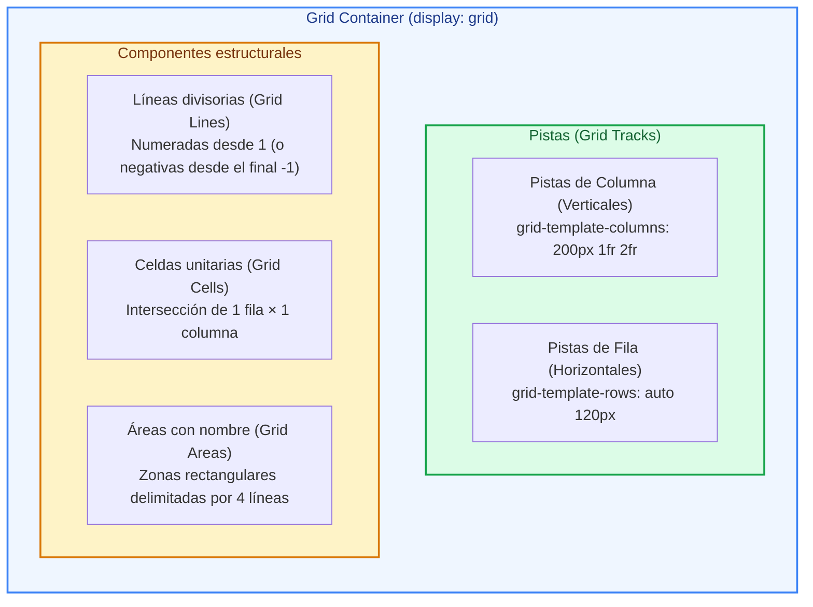
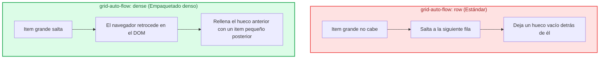
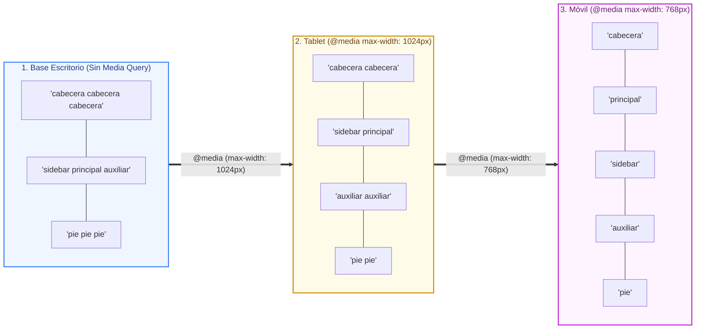
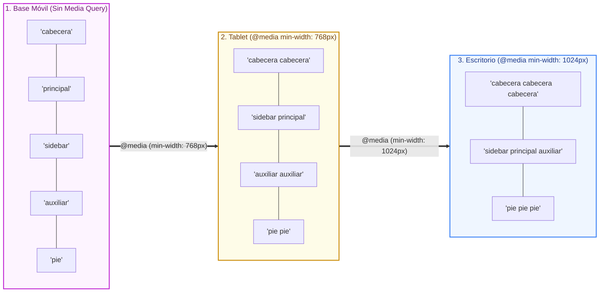
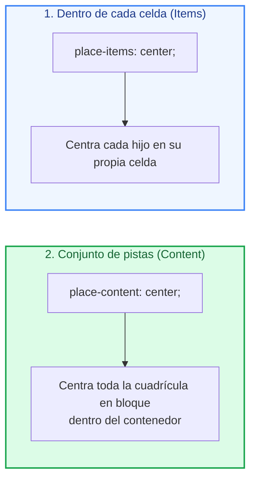
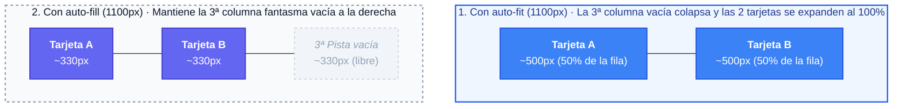
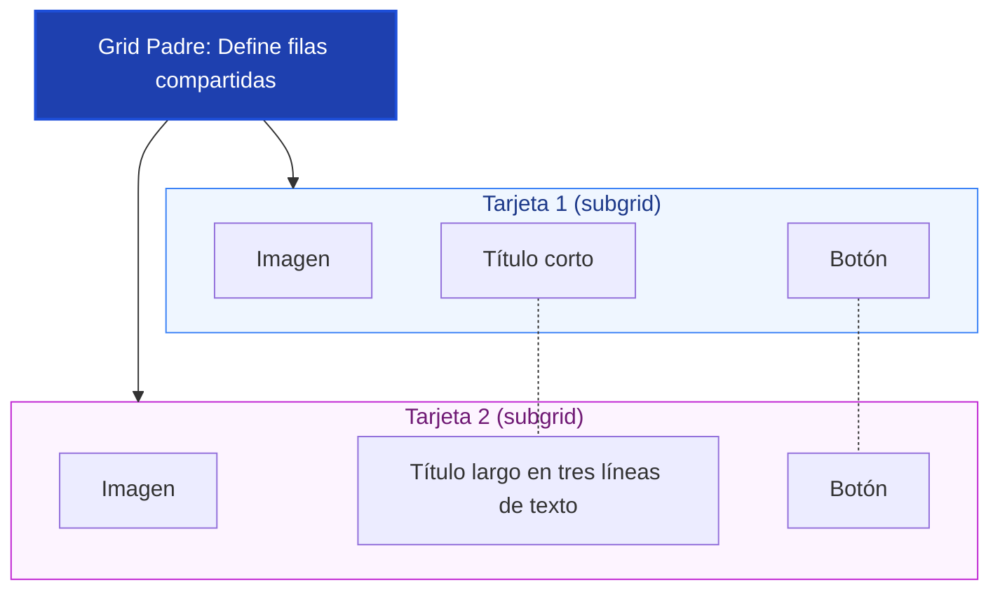

# Ejemplos de Código · Unidad 06: CSS Grid

<div class="badges">
  <span class="badge badge-css">CSS3 Moderno</span>
  <span class="badge badge-blue">Código Práctico</span>
  <span class="badge badge-green">CSS Grid 2D</span>
  <span class="badge badge-ra">RA 2 / RA 3</span>
</div>

En este documento se desarrollan **ejemplos completos y funcionales de código HTML5 y CSS3** para dominar el sistema de maquetación bidimensional (**CSS Grid**): definición de pistas explícitas e implícitas, la unidad fraccionaria `fr`, posicionamiento mediante líneas y áreas semánticas (`grid-template-areas`), alineación bidireccional (`place-items`, `place-content`), el algoritmo de empaquetado denso (`grid-auto-flow: dense`), la fórmula mágica responsiva `auto-fit` vs `auto-fill` sin *media queries*, alineación modular con `subgrid` y arquitecturas de interfaz tipo *Dashboard*.

!!! info "Estructura didáctica de cada apartado"

    Cada sección está diseñada para su experimentación directa en el aula:

    1. **Fundamento conceptual:** Explicación técnica de la retícula, fórmulas matemáticas y diagramas visuales (Mermaid).
    2. **Código fuente interactivo:** Pestañas separadas para el marcado **HTML** completo y la hoja de estilos **CSS** con tokens semánticos.
    3. **Disección técnica paso a paso:** Análisis línea a línea y comprobación en el inspector de Grid de las *DevTools*.
    4. **Retos y preguntas guiadas:** Propuestas de modificación práctica para el alumnado.

---

## 1. Anatomía del Grid Container: Pistas, Líneas y la Unidad `fr`

### Fundamento Conceptual

A diferencia de Flexbox (modelo unidimensional centrado en el contenido), **CSS Grid es bidimensional (*layout-first*)**: primero se diseña el esqueleto de filas y columnas, y a continuación los elementos hijos se sitúan en las coordenadas creadas.



#### ¿Cómo calcula el navegador la unidad fraccionaria `fr`?

La unidad ==`fr`== (*fractional unit*) representa una **fracción del espacio libre positivo remanente** tras deducir las pistas de tamaño fijo (`px`, `rem`, etc.) y los canalones de separación (`gap`):

```text
Espacio a repartir = Ancho total - Suma(Pistas fijas) - Suma(Gaps)
```

Si declaramos `grid-template-columns: 200px 1fr 2fr;` en un contenedor de `1100px` con `gap: 0`:

1. **Pistas fijas:** `200px`.
2. **Espacio libre restante:** `1100px - 200px = 900px`.
3. **Suma de fracciones:** `1fr + 2fr = 3fr`.
4. **Valor de 1fr:** `900px / 3 = 300px`.
5. **Resultado final:**
    - Columna 1: `200px`
    - Columna 2: `300px` (`1fr`)
    - Columna 3: `600px` (`2fr`)

### Código de Ejemplo

=== "HTML"

    ```html title="01-anatomia-grid-fr.html"
    <!DOCTYPE html>
    <html lang="es">
    <head>
      <meta charset="UTF-8">
      <meta name="viewport" content="width=device-width, initial-scale=1.0">
      <title>Anatomía de Grid y Unidad FR</title>
      <link rel="stylesheet" href="01-anatomia-grid-fr.css">
    </head>
    <body>
      <main class="contenedor-principal">
        <h1>Anatomía de CSS Grid y Reparto con <code>fr</code></h1>
        <p class="intro">
          Contenedor de 3 columnas: Columna lateral fija de <code>200px</code>, Columna central de <code>1fr</code> y Columna principal de <code>2fr</code>.
        </p>

        <!-- Cuadrícula de 3 columnas y 2 filas -->
        <section class="rejilla-anatomia">
          <div class="celda celda--lateral">1. Barra lateral (200px fijo)</div>
          <div class="celda celda--central">2. Contenido secundario (1fr)</div>
          <div class="celda celda--principal">3. Contenido principal (2fr)</div>
          
          <div class="celda celda--lateral">4. Menú inferior (200px fijo)</div>
          <div class="celda celda--central">5. Datos complementarios (1fr)</div>
          <div class="celda celda--principal">6. Gráfica estadística (2fr)</div>
        </section>
      </main>
    </body>
    </html>
    ```

=== "CSS"

    ```css title="01-anatomia-grid-fr.css"
    :root {
      --color-fondo: #f8fafc;
      --color-superficie: #ffffff;
      --color-texto: #0f172a;
      --color-texto-mutado: #64748b;
      --color-borde: #cbd5e1;
      --radio-sm: 6px;
      --radio-md: 10px;
      --gap-rejilla: 1rem;
    }

    * {
      box-sizing: border-box;
      margin: 0;
      padding: 0;
    }

    body {
      font-family: system-ui, -apple-system, sans-serif;
      background-color: var(--color-fondo);
      color: var(--color-texto);
      padding: 2.5rem 1.5rem;
      line-height: 1.5;
    }

    .contenedor-principal {
      max-width: 900px;
      margin: 0 auto;
    }

    h1 {
      font-size: 1.5rem;
      margin-bottom: 0.5rem;
    }

    .intro {
      color: var(--color-texto-mutado);
      margin-bottom: 2rem;
      font-size: 0.9rem;
    }

    /* DEFINICIÓN DEL GRID CONTAINER */
    .rejilla-anatomia {
      display: grid;
      
      /* 3 Columnas: la primera fija de 200px; el resto se reparte 1:2 */
      grid-template-columns: 200px 1fr 2fr;
      
      /* 2 Filas automáticas con altura mínima de 90px */
      grid-template-rows: repeat(2, minmax(90px, auto));
      
      /* Canalón uniforme horizontal y vertical */
      gap: var(--gap-rejilla);
      
      background-color: var(--color-superficie);
      padding: 1.5rem;
      border-radius: var(--radio-md);
      border: 2px dashed var(--color-borde);
      box-shadow: 0 4px 6px -1px rgba(0, 0, 0, 0.05);
    }

    /* Celdas individuales */
    .celda {
      padding: 1rem;
      border-radius: var(--radio-sm);
      font-size: 0.85rem;
      font-weight: 600;
      display: flex;
      align-items: center;
      justify-content: center;
      text-align: center;
    }

    .celda--lateral {
      background-color: #fee2e2;
      color: #991b1b;
      border: 2px solid #ef4444;
    }

    .celda--central {
      background-color: #e0f2fe;
      color: #0369a1;
      border: 2px solid #0284c7;
    }

    .celda--principal {
      background-color: #dcfce7;
      color: #166534;
      border: 2px solid #22c55e;
    }
    ```

!!! tip "Disección técnica paso a paso"

    1. **`display: grid`:** Activa el contexto de rejilla. Abre las herramientas de desarrollo (*DevTools*) de tu navegador y activa la casilla **Grid** sobre `.rejilla-anatomia` para visualizar las líneas numeradas.
    2. **Cálculo de `grid-template-columns: 200px 1fr 2fr`:** Observa cómo la primera columna no varía nunca de tamaño (mide siempre `200px`). El resto del ancho disponible se divide en 3 fracciones: la central recibe 1 parte y la derecha recibe 2 partes exactas.
    3. **Pistas de fila con `repeat(2, minmax(90px, auto))`:** Define 2 filas que como mínimo miden 90px de alto, pero que pueden crecer libremente (`auto`) si el texto interior lo requiere, evitando desbordamientos de contenido.

!!! warning "Analiza"

    1. ¿Por qué usamos flexbox dentro del grid? ¿Qué función tiene?
    2. Se han creado solo 2 filas con la plantilla de grid proporcionada. ¿Qué ocurre si añadimos una tercera? ¿Que diferencia hay con `grid-auto-rows: minmax(90px, auto);`?

---

## 2. Posicionamiento por Líneas: `grid-column`, `grid-row`, `span` y Líneas Negativas

### Fundamento Conceptual

Las pistas de una cuadrícula están delimitadas por **líneas divisorias (*Grid Lines*)**. Un contenedor con $N$ columnas tiene exactamente $N + 1$ líneas verticales, numeradas de izquierda a derecha desde `1` hasta $N + 1$, y en sentido inverso desde `-1` hasta $-(N + 1)$:

```text
 (1)             (2)             (3)             (4)  <- Líneas Positivas
┌───────────────┬───────────────┬───────────────┐
│   Columna 1  │   Columna 2  │   Columna 3  │
└───────────────┴───────────────┴───────────────┘
(-4)            (-3)            (-2)            (-1)  <- Líneas Negativas
```

| Propiedad | Sintaxis habitual | Significado |
| :--- | :--- | :--- |
| **`grid-column`** | `start / end` | Define la línea de inicio y la línea de fin vertical. |
| **`span N`** | `grid-column: span 2;` | Ocupa $N$ columnas contiguas a partir de su posición. |
| **Línea `-1`** | `grid-column: 1 / -1;` | **Atajo imprescindible:** Se expande por todo el ancho de la rejilla. |
| **`grid-row`** | `1 / span 2;` | Ocupa 2 filas contiguas en vertical. |

### Código de Ejemplo

=== "HTML"

    ```html title="02-lineas-span-negativas.html"
    <!DOCTYPE html>
    <html lang="es">
    <head>
      <meta charset="UTF-8">
      <meta name="viewport" content="width=device-width, initial-scale=1.0">
      <title>Posicionamiento por Líneas y Span</title>
      <link rel="stylesheet" href="02-lineas-span-negativas.css">
    </head>
    <body>
      <main class="contenedor">
        <h1>Mosaico Estructurado con Líneas y <code>span</code></h1>

        <section class="mosaico-grid">
          <!-- Item destacado: ocupa 2 columnas y 2 filas -->
          <article class="tarjeta tarjeta--hero">
            <h3>Artículo Destacado (span 2 cols × span 2 filas)</h3>
            <p>Este bloque absorbe cuatro celdas completas de la cuadrícula.</p>
          </article>

          <!-- Elementos secundarios de 1x1 -->
          <article class="tarjeta">
            <h4>Noticia 1</h4>
            <p>Breve resumen de actualidad tecnológica.</p>
          </article>

          <article class="tarjeta">
            <h4>Noticia 2</h4>
            <p>Novedades en el estándar ECMAScript.</p>
          </article>

          <article class="tarjeta">
            <h4>Noticia 3</h4>
            <p>Guía de accesibilidad WCAG 2.2.</p>
          </article>

          <article class="tarjeta">
            <h4>Noticia 4</h4>
            <p>Optimización del rendimiento web (Core Web Vitals).</p>
          </article>

          <!-- Barra horizontal completa usando 1 / -1 -->
          <footer class="tarjeta tarjeta--fullwidth">
            <span>📢 Anuncio institucional con <code>grid-column: 1 / -1</code> (Abarca de la primera a la última línea)</span>
          </footer>
        </section>
      </main>
    </body>
    </html>
    ```

=== "CSS"

    ```css title="02-lineas-span-negativas.css"
    :root {
      --color-fondo: #f1f5f9;
      --color-superficie: #ffffff;
      --color-primario: #4f46e5;
      --color-acento: #059669;
      --color-texto: #0f172a;
      --color-borde: #cbd5e1;
      --radio: 10px;
    }

    * {
      box-sizing: border-box;
      margin: 0;
      padding: 0;
    }

    body {
      font-family: system-ui, sans-serif;
      background-color: var(--color-fondo);
      color: var(--color-texto);
      padding: 2.5rem 1.5rem;
    }

    .contenedor {
      max-width: 900px;
      margin: 0 auto;
    }

    h1 {
      font-size: 1.5rem;
      margin-bottom: 1.5rem;
    }

    /* MATRIZ DE 4 COLUMNAS IGUALES */
    .mosaico-grid {
      display: grid;
      grid-template-columns: repeat(4, 1fr);
      grid-auto-rows: minmax(110px, auto);
      gap: 1.25rem;
    }

    .tarjeta {
      background-color: var(--color-superficie);
      border: 1px solid var(--color-borde);
      border-radius: var(--radio);
      padding: 1.25rem;
      box-shadow: 0 4px 6px -1px rgba(0, 0, 0, 0.05);
    }

    .tarjeta h4 {
      font-size: 1rem;
      margin-bottom: 0.35rem;
      color: #334155;
    }

    .tarjeta p {
      font-size: 0.85rem;
      color: #64748b;
      line-height: 1.4;
    }

    /* 1. ITEM DESTACADO: 2 COLUMNAS Y 2 FILAS */
    .tarjeta--hero {
      grid-column: 1 / span 2; /* De la línea 1 avanza 2 columnas */
      grid-row: 1 / span 2;    /* De la línea 1 avanza 2 filas */
      background: linear-gradient(135deg, #4f46e5, #06b6d4);
      color: #ffffff;
      border: none;
      display: flex;
      flex-direction: column;
      justify-content: center;
    }

    .tarjeta--hero h3 {
      font-size: 1.35rem;
      margin-bottom: 0.5rem;
    }

    .tarjeta--hero p {
      color: #e0e7ff;
    }

    /* 2. BARRA DE ANCHO COMPLETO CON LÍNEA NEGATIVA */
    .tarjeta--fullwidth {
      grid-column: 1 / -1; /* Empieza en la línea 1 y termina en la última línea (-1) */
      background-color: #ecfdf5;
      border: 2px solid var(--color-acento);
      color: #065f46;
      font-weight: 600;
      font-size: 0.9rem;
      text-align: center;
      padding: 0.85rem;
    }
    ```

!!! tip "Disección técnica paso a paso"

    1. **`grid-column: 1 / span 2`:** El navegador reserva las pistas entre la línea 1 y la 3 para el hero. Al combinarlo con `grid-row: 1 / span 2`, el bloque forma un gran cuadrado de $2 \times 2$.
    2. **Autocolocación de los hermanos:** Las cuatro tarjetas secundarias se van ubicando de forma automática en los huecos restantes (2 celdas en la primera fila, 2 en la segunda).
    3. **El poder de `grid-column: 1 / -1`:** No necesitas saber si la cuadrícula tiene 4, 8 o 12 columnas. La línea `-1` referencia siempre el límite final derecho, expandiendo la tarjeta por todo el ancho sin riesgo de descuadre.


!!! warning "Modifica"

    1. Si añadimos 2 tarjetas nuevas de 1x1, ¿dónde se sitúan?
    2. Para centrar el texto del cuadro verde, ¿cómo lo harías? 
---

## 3. Cuadrícula Implícita y Flujo Denso: `grid-auto-flow: dense`

### Fundamento Conceptual

Cuando el número de elementos HTML excede las celdas declaradas explícitamente con `grid-template-*`, el navegador crea **pistas implícitas** sobre la marcha:

- ==`grid-auto-rows`==: Define la altura de las filas creadas automáticamente.
- ==`grid-auto-columns`==: Define el ancho de las columnas creadas automáticamente.
- ==`grid-auto-flow`==: Controla el algoritmo de avance (`row`, `column` o `dense`).



!!! danger "Advertencia de Accesibilidad en `dense`"

    El modo `dense` reordena los elementos **visualmente**, pero **no altera el orden del DOM**. Una persona que navegue con lector de pantalla o tabulador recorrerá los elementos en el orden del código HTML, saltando de adelante hacia atrás en pantalla. Documenta y utiliza `dense` solo para galerías puramente visuales (imágenes, portfolios).


### Código de Ejemplo

=== "HTML"

    ```html title="03-auto-flow-dense.html"
    <!DOCTYPE html>
    <html lang="es">
    <head>
      <meta charset="UTF-8">
      <meta name="viewport" content="width=device-width, initial-scale=1.0">
      <title>Cuadrícula Implícita y Grid Auto Flow Dense</title>
      <link rel="stylesheet" href="03-auto-flow-dense.css">
    </head>
    <body>
      <main class="contenedor">
        <h1>Galería con Empaquetado Denso (<code>dense</code>)</h1>
        <p class="intro">Observa cómo los items pequeños (como el #4 y #6) rellenan los huecos que los items anchos (#3 y #5) dejaron atrás.</p>

        <section class="rejilla-galeria">
          <div class="bloque bloque--normal">Item 1 (1×1)</div>
          <div class="bloque bloque--normal">Item 2 (1×1)</div>
          <!-- Item ancho que no cabe en la columna restante de la fila 1 y salta -->
          <div class="bloque bloque--ancho">Item 3 (span 2 cols)</div>
          <div class="bloque bloque--normal">Item 4 (1×1)</div>
          <!-- Segundo item ancho que no cabe en la columna restante de la fila 2 y salta -->
          <div class="bloque bloque--ancho">Item 5 (span 2 cols)</div>
          <div class="bloque bloque--normal">Item 6 (1×1)</div>
          <div class="bloque bloque--alto">Item 7 (span 2 filas)</div>
          <div class="bloque bloque--normal">Item 8 (1×1)</div>
          <div class="bloque bloque--normal">Item 9 (1×1)</div>
        </section>
      </main>
    </body>
    </html>
    ```

=== "CSS"

    ```css title="03-auto-flow-dense.css"
    :root {
      --color-fondo: #f8fafc;
      --color-superficie: #ffffff;
      --color-texto: #0f172a;
      --color-borde: #cbd5e1;
    }

    * {
      box-sizing: border-box;
      margin: 0;
      padding: 0;
    }

    body {
      font-family: system-ui, sans-serif;
      background-color: var(--color-fondo);
      color: var(--color-texto);
      padding: 2.5rem 1.5rem;
    }

    .contenedor {
      max-width: 750px;
      margin: 0 auto;
    }

    h1 {
      font-size: 1.5rem;
      margin-bottom: 0.5rem;
    }

    .intro {
      color: #64748b;
      margin-bottom: 2rem;
      font-size: 0.9rem;
    }

    /* REJILLA CON 3 COLUMNAS Y ALGORITMO DENSE */
    .rejilla-galeria {
      display: grid;
      grid-template-columns: repeat(3, 1fr);
      
      /* Filas implícitas de 90px de alto */
      grid-auto-rows: 90px;
      
      /* ¡LA CLAVE!: Rellena huecos pasados con elementos posteriores */
      grid-auto-flow: row dense;
      
      gap: 1rem;
      background-color: var(--color-superficie);
      padding: 1.5rem;
      border-radius: 12px;
      border: 1px solid var(--color-borde);
    }

    .bloque {
      padding: 1rem;
      border-radius: 8px;
      font-weight: 700;
      font-size: 0.85rem;
      display: flex;
      align-items: center;
      justify-content: center;
      text-align: center;
    }

    .bloque--normal {
      background-color: #e0f2fe;
      color: #0369a1;
      border: 2px solid #38bdf8;
    }

    .bloque--ancho {
      grid-column: span 2;
      background-color: #fef08a;
      color: #854d0e;
      border: 2px solid #eab308;
    }

    .bloque--alto {
      grid-row: span 2;
      background-color: #fce7f3;
      color: #9d174d;
      border: 2px solid #ec4899;
    }
    ```

!!! tip "Disección técnica paso a paso"

    1. **Sin `dense` (modo normal):** Si cambias a `grid-auto-flow: row`, tras colocar el Item 1 y el Item 2 en la primera fila, el Item 3 (que ocupa 2 columnas) no cabe en la única columna restante y salta a la fila 2, dejando un espacio vacío inservible en la fila 1. Lo mismo ocurre en la fila 2 con el Item 5.
    2. **Con `grid-auto-flow: row dense`:** El motor de layout detecta los huecos vacíos en las filas anteriores y busca hacia adelante en el código HTML. Al ver que el Item 4 y el Item 6 solo miden 1 columna, los «teletransporta» visualmente hacia atrás para rellenar esos huecos, logrando un mosaico compacto sin fisuras.


!!! warning "Modifica"

    1. Desactiva la opción "dense", ¿qué ocurre con los elementos mostrados?

---

## 4. Maquetación con Áreas Nombradas: `grid-template-areas` (Enfoque Desktop-First)

### Fundamento Conceptual

==`grid-template-areas`== permite diseñar la estructura visual de una aplicación utilizando un **mapa semántico ASCII** directamente en el CSS.

En este primer ejemplo se muestra la técnica clásica **Desktop-First** (*degradación grácil*): se define como regla base la retícula completa de escritorio (3 columnas × 3 filas) y posteriormente se emplean dos reglas `@media (max-width: ...)` descendentes para adaptar el diseño progresivamente: primero a 2 columnas para tablet (`max-width: 1024px`) y finalmente a 1 columna vertical para smartphone (`max-width: 768px`):



Reglas obligatorias de la sintaxis:

1. Cada fila de áreas debe estar entre comillas dobles y tener el mismo número de nombres que columnas haya declaradas.
2. Cada área debe conformar un **rectángulo perfecto**. No se permiten formas en "L" o en "T".
3. El símbolo del punto (`.`) indica una celda vacía no asignada a ningún área.

### Código de Ejemplo

=== "HTML"

    ```html title="04-grid-template-areas.html"
    <!DOCTYPE html>
    <html lang="es">
    <head>
      <meta charset="UTF-8">
      <meta name="viewport" content="width=device-width, initial-scale=1.0">
      <title>Maquetación con Grid Template Areas (Desktop-First)</title>
      <link rel="stylesheet" href="04-grid-template-areas.css">
    </head>
    <body>
      <div class="pantalla-completa">
        <!-- ÁREA CABECERA -->
        <header class="bloque-cabecera">
          <h2>Panel de Administración (Desktop-First)</h2>
          <span class="usuario">Admin · DominF3</span>
        </header>

        <!-- ÁREA SIDEBAR -->
        <aside class="bloque-sidebar">
          <nav aria-label="Menú principal">
            <ul>
              <li><a href="#" class="activo">📊 Métricas</a></li>
              <li><a href="#">👥 Usuarios</a></li>
              <li><a href="#">⚙️ Configuración</a></li>
            </ul>
          </nav>
        </aside>

        <!-- ÁREA MAIN -->
        <main class="bloque-principal">
          <h1>Resumen Operativo</h1>
          <p>La cuadrícula completa se gobierna mediante la propiedad <code>grid-template-areas</code>.</p>
          <div class="kpi-tarjeta">
            <strong>Tráfico diario:</strong> 14.280 peticiones HTTP/3
          </div>
        </main>

        <!-- ÁREA WIDGETS AUXILIARES -->
        <aside class="bloque-auxiliar">
          <h3>Alertas</h3>
          <p>CPU estable al 24%.</p>
        </aside>

        <!-- ÁREA PIE -->
        <footer class="bloque-pie">
          <p>&copy; 2026 DominFe Academy · Todos los derechos reservados</p>
        </footer>
      </div>
    </body>
    </html>
    ```

=== "CSS"

    ```css title="04-grid-template-areas.css"
    :root {
      --color-fondo: #f8fafc;
      --color-superficie: #ffffff;
      --color-texto: #0f172a;
      --color-borde: #e2e8f0;
      --radio: 8px;
    }

    * {
      box-sizing: border-box;
      margin: 0;
      padding: 0;
    }

    body {
      font-family: system-ui, sans-serif;
      background-color: var(--color-fondo);
      color: var(--color-texto);
      line-height: 1.5;
    }

    /* ==========================================================================
       1. LAYOUT BASE DE ESCRITORIO (3 COLUMNAS × 3 FILAS)
       Enfoque Desktop-First: La regla base asume pantalla grande por defecto.
       ========================================================================== */
    .pantalla-completa {
      display: grid;
      min-height: 100dvh; /* Ocupa el 100% de la ventana */
      
      grid-template-columns: 220px 1fr 240px;
      grid-template-rows: auto 1fr auto;
      
      /* MAPA SEMÁNTICO VISUAL DE ESCRITORIO */
      grid-template-areas:
        "cabecera cabecera  cabecera"
        "sidebar  principal auxiliar"
        "pie      pie       pie";
      
      gap: 1rem;
      padding: 1rem;
    }

    /* ASIGNACIÓN DE CADA ELEMENTO A SU ÁREA */
    .bloque-cabecera  { grid-area: cabecera; }
    .bloque-sidebar   { grid-area: sidebar; }
    .bloque-principal { grid-area: principal; }
    .bloque-auxiliar  { grid-area: auxiliar; }
    .bloque-pie       { grid-area: pie; }

    /* Estilos decorativos */
    .bloque-cabecera {
      background-color: #1e293b;
      color: #ffffff;
      padding: 1rem 1.5rem;
      border-radius: var(--radio);
      display: flex;
      justify-content: space-between;
      align-items: center;
    }

    .bloque-sidebar {
      background-color: var(--color-superficie);
      border: 1px solid var(--color-borde);
      border-radius: var(--radio);
      padding: 1.5rem 1rem;
    }

    .bloque-sidebar ul {
      list-style: none;
    }

    .bloque-sidebar a {
      display: block;
      padding: 0.5rem 0.75rem;
      color: #475569;
      text-decoration: none;
      border-radius: 6px;
      font-weight: 500;
      font-size: 0.9rem;
    }

    .bloque-sidebar a.activo,
    .bloque-sidebar a:hover {
      background-color: #eff6ff;
      color: #2563eb;
    }

    .bloque-principal {
      background-color: var(--color-superficie);
      border: 1px solid var(--color-borde);
      border-radius: var(--radio);
      padding: 2rem;
    }

    .bloque-principal h1 {
      font-size: 1.4rem;
      margin-bottom: 0.5rem;
    }

    .kpi-tarjeta {
      margin-top: 1.5rem;
      background-color: #f1f5f9;
      padding: 1rem;
      border-radius: 6px;
      font-size: 0.9rem;
    }

    .bloque-auxiliar {
      background-color: var(--color-superficie);
      border: 1px solid var(--color-borde);
      border-radius: var(--radio);
      padding: 1.5rem;
    }

    .bloque-pie {
      background-color: #e2e8f0;
      color: #475569;
      text-align: center;
      padding: 0.75rem;
      border-radius: var(--radio);
      font-size: 0.8rem;
    }

    /* ==========================================================================
       2. ADAPTACIÓN INTERMEDIA PARA TABLET (DESKTOP-FIRST: MÁXIMO 1024px -> 2 COLS)
       ========================================================================== */
    @media (max-width: 1024px) {
      .pantalla-completa {
        grid-template-columns: 240px 1fr;
        grid-template-rows: auto 1fr auto auto;
        
        /* Reordenamos a 2 columnas: sidebar y principal lado a lado; auxiliar debajo */
        grid-template-areas:
          "cabecera  cabecera"
          "sidebar   principal"
          "auxiliar  auxiliar"
          "pie       pie";
      }

      .bloque-principal {
        padding: 1.5rem;
      }
    }

    /* ==========================================================================
       3. ADAPTACIÓN FINAL PARA MÓVIL (DESKTOP-FIRST: MÁXIMO 768px -> 1 COLUMNA)
       ========================================================================== */
    @media (max-width: 768px) {
      .pantalla-completa {
        grid-template-columns: 1fr; /* Columna única */
        grid-template-rows: auto;
        
        /* Reordenamos la página para smartphone: principal antes de sidebar */
        grid-template-areas:
          "cabecera"
          "principal"
          "sidebar"
          "auxiliar"
          "pie";
      }
    }
    ```

!!! tip "Disección técnica paso a paso"

    1. **Legibilidad arquitectónica:** No necesitas rastrear números de líneas `1 / 4` o `span 3`. El bloque `grid-template-areas` muestra un mapa visual de cómo se organizará la pantalla en cada resolución.
    2. **Degradación grácil en orden descendente:** En la metodología Desktop-First, las reglas `@media (max-width: ...)` deben escribirse en orden **descendente** de resolución (`1024px` y luego `768px`). La cascada de CSS asegura que un smartphone aplique la regla final de 1 columna sin que la regla intermedia de tablet la anule.
    3. **Paso intermedio para tablet (2 columnas):** Al pasar a `max-width: 1024px`, la cuadrícula reorganiza las áreas centrales para aprovechar el ancho mediano: `sidebar` y `principal` comparten fila, mientras que `auxiliar` se extiende al 100% de la fila inferior.
    4. **Reordenación móvil prioritaria:** En `max-width: 768px`, el mapa ASCII sitúa `principal` antes que `sidebar` y `auxiliar`. Así, el usuario móvil accede inmediatamente al contenido fundamental sin verse obligado a desplazarse por menús de navegación largos.

---

## 4bis. Maquetación con Áreas Nombradas: `grid-template-areas` (Enfoque Mobile-First)

### Fundamento Conceptual y Comparativa Arquitectónica

El enfoque **Mobile-First** (*mejora progresiva* o *progressive enhancement*) es el estándar recomendado por la industria moderna de desarrollo web y por los principales frameworks (como Tailwind CSS):

1. **Diseño base sin media queries:** La estructura por defecto fuera de cualquier `@media` se diseña exclusivamente para el dispositivo más restringido (el smartphone). Se define una cuadrícula natural de 1 sola columna (`grid-template-columns: 1fr`).
2. **Menor coste computacional en móviles:** El dispositivo móvil lee y ejecuta de forma inmediata el CSS base sin tener que evaluar ni sobreescribir complejas reglas de cuadrículas de escritorio.
3. **Mejora progresiva con `min-width`:** A medida que la pantalla crece (tablets y monitores de escritorio), se agregan columnas progresivamente mediante `@media (min-width: 768px)` y `@media (min-width: 1024px)`.



### Comparativa: Desktop-First frente a Mobile-First

| Criterio | Enfoque Desktop-First (Ejemplo 4) | Enfoque Mobile-First (Ejemplo 4bis) |
| :--- | :--- | :--- |
| **Media Query utilizada** | `@media (max-width: ...)` (Degradación grácil) | `@media (min-width: ...)` (Mejora progresiva) |
| **Estilos base (fuera de media query)** | Complejos: 3 columnas para pantalla de escritorio | Ligeros: 1 columna vertical para smartphone |
| **Carga en móviles** | El móvil debe procesar y anular reglas de escritorio | El móvil ejecuta directamente el código base sin sobreescrituras |
| **Flujo natural del DOM** | Lucha contra el flujo vertical natural de HTML | Aprovecha el flujo en bloque natural de la web |
| **Adopción en la industria** | En desuso en arquitecturas contemporáneas | **Estándar en frameworks modernos** (Tailwind CSS, Bootstrap 5) |

### Código de Ejemplo

=== "HTML"

    ```html title="04bis-grid-template-areas-mobile-first.html"
    <!DOCTYPE html>
    <html lang="es">
    <head>
      <meta charset="UTF-8">
      <meta name="viewport" content="width=device-width, initial-scale=1.0">
      <title>Maquetación con Grid Template Areas (Mobile-First)</title>
      <link rel="stylesheet" href="04bis-grid-template-areas-mobile-first.css">
    </head>
    <body>
      <div class="pantalla-completa">
        <!-- ÁREA CABECERA -->
        <header class="bloque-cabecera">
          <h2>Panel de Administración (Mobile-First)</h2>
          <span class="usuario">Admin · DominF3</span>
        </header>

        <!-- ÁREA SIDEBAR -->
        <aside class="bloque-sidebar">
          <nav aria-label="Menú principal">
            <ul>
              <li><a href="#" class="activo">📊 Métricas</a></li>
              <li><a href="#">👥 Usuarios</a></li>
              <li><a href="#">⚙️ Configuración</a></li>
            </ul>
          </nav>
        </aside>

        <!-- ÁREA MAIN -->
        <main class="bloque-principal">
          <h1>Resumen Operativo</h1>
          <p>Estructura concebida desde la pantalla pequeña con mejora progresiva mediante <code>min-width</code>.</p>
          <div class="kpi-tarjeta">
            <strong>Tráfico diario:</strong> 18.450 peticiones HTTP/3
          </div>
        </main>

        <!-- ÁREA WIDGETS AUXILIARES -->
        <aside class="bloque-auxiliar">
          <h3>Alertas de Servidor</h3>
          <p>CPU estable al 18% · Memoria al 42%.</p>
        </aside>

        <!-- ÁREA PIE -->
        <footer class="bloque-pie">
          <p>&copy; 2026 DominFe Academy · Arquitectura Mobile-First</p>
        </footer>
      </div>
    </body>
    </html>
    ```

=== "CSS"

    ```css title="04bis-grid-template-areas-mobile-first.css"
    :root {
      --color-fondo: #f8fafc;
      --color-superficie: #ffffff;
      --color-texto: #0f172a;
      --color-borde: #e2e8f0;
      --radio: 8px;
    }

    * {
      box-sizing: border-box;
      margin: 0;
      padding: 0;
    }

    body {
      font-family: system-ui, sans-serif;
      background-color: var(--color-fondo);
      color: var(--color-texto);
      line-height: 1.5;
    }

    /* ==========================================================================
       1. ESTILOS BASE: MÓVIL POR DEFECTO (MOBILE-FIRST, SIN MEDIA QUERY)
       La cuadrícula base se define como 1 sola columna vertical.
       El mapa sitúa el área 'principal' antes que el 'sidebar' para optimizar UX móvil.
       ========================================================================== */
    .pantalla-completa {
      display: grid;
      min-height: 100dvh;
      grid-template-columns: 1fr;
      grid-template-rows: auto;
      gap: 1rem;
      padding: 1rem;

      /* MAPA SEMÁNTICO MÓVIL (1 COLUMNA) */
      grid-template-areas:
        "cabecera"
        "principal"
        "sidebar"
        "auxiliar"
        "pie";
    }

    /* ASIGNACIÓN DE CADA ELEMENTO A SU ÁREA SEMÁNTICA (Común a todas las resoluciones) */
    .bloque-cabecera  { grid-area: cabecera; }
    .bloque-sidebar   { grid-area: sidebar; }
    .bloque-principal { grid-area: principal; }
    .bloque-auxiliar  { grid-area: auxiliar; }
    .bloque-pie       { grid-area: pie; }

    /* Estilos decorativos base */
    .bloque-cabecera {
      background-color: #0f172a;
      color: #ffffff;
      padding: 1rem 1.25rem;
      border-radius: var(--radio);
      display: flex;
      justify-content: space-between;
      align-items: center;
    }

    .bloque-sidebar {
      background-color: var(--color-superficie);
      border: 1px solid var(--color-borde);
      border-radius: var(--radio);
      padding: 1.25rem 1rem;
    }

    .bloque-sidebar ul {
      list-style: none;
    }

    .bloque-sidebar a {
      display: block;
      padding: 0.5rem 0.75rem;
      color: #475569;
      text-decoration: none;
      border-radius: 6px;
      font-weight: 500;
      font-size: 0.9rem;
    }

    .bloque-sidebar a.activo,
    .bloque-sidebar a:hover {
      background-color: #f0fdf4;
      color: #16a34a;
    }

    .bloque-principal {
      background-color: var(--color-superficie);
      border: 1px solid var(--color-borde);
      border-radius: var(--radio);
      padding: 1.5rem;
    }

    .bloque-principal h1 {
      font-size: 1.3rem;
      margin-bottom: 0.5rem;
    }

    .kpi-tarjeta {
      margin-top: 1.25rem;
      background-color: #f1f5f9;
      padding: 1rem;
      border-radius: 6px;
      font-size: 0.9rem;
    }

    .bloque-auxiliar {
      background-color: var(--color-superficie);
      border: 1px solid var(--color-borde);
      border-radius: var(--radio);
      padding: 1.25rem;
    }

    .bloque-pie {
      background-color: #e2e8f0;
      color: #475569;
      text-align: center;
      padding: 0.75rem;
      border-radius: var(--radio);
      font-size: 0.8rem;
    }

    /* ==========================================================================
       2. MEJORA PROGRESIVA PARA TABLET (MÍNIMO 768px -> 2 COLUMNAS)
       ========================================================================== */
    @media (min-width: 768px) {
      .pantalla-completa {
        grid-template-columns: 240px 1fr;
        grid-template-rows: auto 1fr auto auto;
        
        /* El menú se coloca a la izquierda del contenido principal */
        grid-template-areas:
          "cabecera  cabecera"
          "sidebar   principal"
          "auxiliar  auxiliar"
          "pie       pie";
      }
    }

    /* ==========================================================================
       3. MEJORA PROGRESIVA PARA ESCRITORIO (MÍNIMO 1024px -> 3 COLUMNAS)
       ========================================================================== */
    @media (min-width: 1024px) {
      .pantalla-completa {
        grid-template-columns: 220px 1fr 240px;
        grid-template-rows: auto 1fr auto;
        
        /* Disposición final con 3 columnas en pantalla completa */
        grid-template-areas:
          "cabecera cabecera  cabecera"
          "sidebar  principal auxiliar"
          "pie      pie       pie";
      }

      .bloque-principal {
        padding: 2rem;
      }
    }
    ```

!!! tip "Disección técnica paso a paso"

    1. **Base limpia sin sobrecoste:** Al declarar `grid-template-columns: 1fr` como regla base, los smartphones y dispositivos de recursos reducidos renderizan inmediatamente el diseño vertical sin esperar a evaluar media queries.
    2. **Jerarquía móvil respetada en el mapa ASCII:** En la base móvil, `principal` se sitúa directamente bajo `cabecera` y antes de `sidebar` y `auxiliar`. Así, el usuario móvil accede de inmediato al contenido principal sin tener que scrollear a través de toda la botonera de navegación.
    3. **Mejora progresiva en dos saltos:** En `min-width: 768px` (tablets), la cuadrícula aprovecha el espacio horizontal para colocar el menú al lado del contenido en 2 columnas. En `min-width: 1024px` (escritorio), se abre la tercera columna para el panel de alertas auxiliares.
    4. **Inmutabilidad de los estilos cosméticos:** Los estilos decorativos (fondos, bordes, tipografías, hover de enlaces) se definen una única vez en el bloque base y se heredan limpiamente en las media queries superiores sin necesidad de reescribirlos ni anularlos.

!!! question "¿Por qué la industria prefiere Mobile-First?"

    Compara el CSS de la sección 4 (`max-width`) con el de la sección 4bis (`min-width`). Observa cómo en Mobile-First no se "deshace" ninguna propiedad: cada media query añade capacidad visual en lugar de anular configuraciones previas.

---

## 5. Alineación Bidimensional: `place-items`, `place-content` y `place-self`

### Fundamento Conceptual

En CSS Grid disponemos de una matriz de alineación bidireccional completa dividida en dos ámbitos:

1. **Alineación del contenido dentro de cada celda:**
   - `justify-items` (eje horizontal / inline).
   - `align-items` (eje vertical / bloque).
   - ==`place-items: align justify;`== (atajo bidireccional).
2. **Alineación de la cuadrícula completa respecto al contenedor** (cuando las pistas no llenan todo el espacio):
   - `justify-content` y `align-content`.
   - ==`place-content: align justify;`==.



### Código de Ejemplo

=== "HTML"

    ```html title="05-alineacion-place-items.html"
    <!DOCTYPE html>
    <html lang="es">
    <head>
      <meta charset="UTF-8">
      <meta name="viewport" content="width=device-width, initial-scale=1.0">
      <title>Alineación con place-items y place-content</title>
      <link rel="stylesheet" href="05-alineacion-place-items.css">
    </head>
    <body>
      <main class="laboratorio">
        <h1>Alineación Bidimensional en CSS Grid</h1>

        <!-- CASO 1: EL CENTRADO TOTAL EN 1 LÍNEA -->
        <section class="caso">
          <h3>1. Centrado Absoluto en 1 sola línea (<code>place-items: center</code>)</h3>
          <div class="lienzo-centrado">
            <div class="caja-centrada">
              🎯 <code>display: grid; place-items: center;</code>
            </div>
          </div>
        </section>

        <!-- CASO 2: MATRIZ DE ALINEACIONES ESPECÍFICAS -->
        <section class="caso">
          <h3>2. Rejilla con <code>place-items: stretch</code> y excepciones con <code>place-self</code></h3>
          <div class="rejilla-alineaciones">
            <div class="item">Item 1 (stretch)</div>
            <!-- Excepción: alineado abajo a la derecha -->
            <div class="item item--excepcion">place-self: end end</div>
            <div class="item">Item 3 (stretch)</div>
            <div class="item">Item 4 (stretch)</div>
          </div>
        </section>
      </main>
    </body>
    </html>
    ```

=== "CSS"

    ```css title="05-alineacion-place-items.css"
    :root {
      --color-fondo: #f8fafc;
      --color-superficie: #ffffff;
      --color-texto: #0f172a;
      --color-borde: #cbd5e1;
    }

    * {
      box-sizing: border-box;
      margin: 0;
      padding: 0;
    }

    body {
      font-family: system-ui, sans-serif;
      background-color: var(--color-fondo);
      color: var(--color-texto);
      padding: 2.5rem 1.5rem;
    }

    .laboratorio {
      max-width: 650px;
      margin: 0 auto;
    }

    .caso {
      background-color: var(--color-superficie);
      padding: 1.5rem;
      border-radius: 12px;
      border: 1px solid var(--color-borde);
      margin-bottom: 2rem;
    }

    .caso h3 {
      font-size: 0.95rem;
      margin-bottom: 1rem;
    }

    /* CASO 1: CENTRADO ABSOLUTO EN 1 LÍNEA */
    .lienzo-centrado {
      display: grid;
      place-items: center; /* Centrado vertical y horizontal simultáneo */
      height: 180px;
      background-color: #f1f5f9;
      border: 2px dashed #94a3b8;
      border-radius: 8px;
    }

    .caja-centrada {
      background-color: #4f46e5;
      color: #ffffff;
      padding: 1rem 1.5rem;
      border-radius: 8px;
      font-weight: 700;
      font-size: 0.9rem;
      box-shadow: 0 10px 15px -3px rgba(79, 70, 229, 0.3);
    }

    /* CASO 2: MATRIZ DE CELDAS CON PLACE-SELF */
    .rejilla-alineaciones {
      display: grid;
      grid-template-columns: repeat(2, 1fr);
      grid-auto-rows: 100px;
      gap: 1rem;
      background-color: #f1f5f9;
      padding: 1rem;
      border-radius: 8px;
    }

    .item {
      background-color: #e0f2fe;
      color: #0369a1;
      border: 2px solid #0284c7;
      border-radius: 6px;
      font-weight: 600;
      font-size: 0.85rem;
      padding: 0.5rem;
      display: flex;
      align-items: center;
      justify-content: center;
    }

    /* Sobrescribe la alineación para un solo item */
    .item--excepcion {
      place-self: end end; /* align-self: end; justify-self: end; */
      background-color: #fef08a;
      color: #854d0e;
      border-color: #ca8a04;
      width: fit-content;
      height: fit-content;
    }
    ```

!!! tip "Disección técnica paso a paso"

    1. **El sustituto definitivo de Flexbox para centrar:** `display: grid; place-items: center;` sustituye a la combinación tradicional de Flexbox (`display: flex; justify-content: center; align-items: center;`), requiriendo una sola propiedad.
    2. **`place-self: end end`:** Por defecto las celdas se estiran (`stretch`). Al declarar `place-self: end end` y dimensiones automáticas, la segunda celda se encoge a su tamaño de contenido y se pega a la esquina inferior derecha de su espacio asignado.

---

## 6. Galerías Responsivas con `minmax()`: `auto-fit` vs `auto-fill` (Riesgo de Desbordamiento)

### Fundamento Conceptual

Uno de los mayores atractivos de CSS Grid es crear cuadrículas adaptables que calculan el número de columnas de forma automática **sin escribir una sola *media query***. Para ello, se combina la función `repeat()` con las palabras clave `auto-fit` o `auto-fill` y la función `minmax()`:

```css title="Fórmula clásica con mínimo absoluto"
grid-template-columns: repeat(auto-fit, minmax(280px, 1fr));
```

Para entender a fondo este mecanismo, es fundamental aclarar dos aspectos que suelen generar dudas al probarlo en el navegador:

---

#### 1. ¿Dónde se aprecia realmente la diferencia entre `auto-fit` y `auto-fill`?

> **Regla clave:** La diferencia **NO se aprecia al comprimir** la pantalla, sino **al ENSANCHARLA** cuando el contenedor es lo bastante amplio para alojar más columnas que tarjetas disponibles en el HTML.

* **Al comprimir la pantalla (ancho reducido ~300px - 700px):**  
  Como solo caben 1 o 2 columnas y tenemos 2 tarjetas en el HTML, **ambas propiedades se ven exactamente iguales** (1 o 2 columnas ocupadas al 100%). No hay pistas vacías sobrantes.

* **Al ensanchar la pantalla (ancho amplio ~1100px):**  
  Para que aparezca una 3ª columna vacía de 280px con un `gap: 1rem (16px)`, se requiere un ancho neto de cuadrícula de $280\text{px} \times 3 + 16\text{px} \times 2 = 872\text{px}$ (alrededor de 960px sumando márgenes y rellenos del contenedor). Al superar ese umbral en un contenedor de 1100px, el navegador calcula que caben 3 columnas y aquí es donde divergen:



=== "auto-fit"

    !!! example "auto-fit · Ajuste dinámico (Recomendado en el 95% de interfaces)"
        El navegador detecta que sobran columnas porque solo hay 2 tarjetas en el HTML. **Colapsa a 0px las pistas vacías** y estira las tarjetas existentes para que llenen el **100% del contenedor**.

        - **Resultado visual:** Sin huecos a la derecha. Ambas tarjetas llenan todo el ancho simétricamente.
        - **Casos de uso:** Tiendas online, catálogos de productos, listados de noticias, blogs.

=== "auto-fill"

    !!! info "auto-fill · Relleno estricto (Para slots y plantillas fijas)"
        El navegador calcula cuántas columnas de 280px caben en el ancho actual y **reserva todas las pistas en la cuadrícula**, incluso si no hay tarjetas suficientes para llenarlas.

        - **Resultado visual:** Las tarjetas se alinean a la izquierda con su tamaño base y queda un espacio libre punteado a la derecha.
        - **Casos de uso:** Cuadrículas de inventario (videojuegos), barras de herramientas, dashboards modulares con slots disponibles para añadir nuevos elementos.

| Valor | ¿Qué ocurre con las pistas sobrantes? | Impacto Visual en Pantalla Ancha | Caso de Uso en la Industria |
| :--- | :--- | :--- | :--- |
| **`auto-fit`** | **Colapsa a 0px** las columnas vacías. El espacio sobrante se reparte entre las tarjetas presentes. | Las tarjetas se expanden ocupando el **100% del ancho**. | **Recomendado en el 95% de interfaces:** catálogos de productos, noticias, tarjetas de blog. |
| **`auto-fill`** | **Preserva las columnas vacías** en la estructura de la retícula. | Las tarjetas mantienen su tamaño base a la izquierda y queda un **hueco vacío a la derecha**. | Inventarios de videojuegos, paletas de herramientas, slots de dashboards modulares. |

---

#### 2. El problema del mínimo rígido: ¿Por qué aparece la barra de desplazamiento horizontal?

En este ejemplo 6 utilizamos un mínimo absoluto rígido: `minmax(280px, 1fr)`.

* Le estamos ordenando al navegador: *«Cada tarjeta debe medir obligatoriamente **como mínimo 280 píxeles**»*.
* Si abres la página en un teléfono móvil estrecho (como un Galaxy Fold cerrado de 280px o menos), en un reloj inteligente o si abres las DevTools y comprimes la vista por debajo de los 280px:

!!! danger "Condición de desbordamiento en pantallas pequeñas"
    **Ancho mínimo de la tarjeta (280px) > Ancho disponible del contenedor (< 280px)**
    
    El contenido ya no cabe en el viewport, se sale por el lateral derecho y **provoca la aparición de la barra de desplazamiento horizontal** (*overflow horizontal*), rompiendo la experiencia móvil.

---

### Código de Ejemplo (Con riesgo de desbordamiento en < 280px)

=== "HTML"

    ```html title="06-autofit-vs-autofill-desbordamiento.html"
    <!DOCTYPE html>
    <html lang="es">
    <head>
      <meta charset="UTF-8">
      <meta name="viewport" content="width=device-width, initial-scale=1.0">
      <title>Comparativa Visual auto-fit vs auto-fill (Con Desbordamiento)</title>
      <link rel="stylesheet" href="06-autofit-vs-autofill-desbordamiento.css">
    </head>
    <body>
      <main class="laboratorio">
        <h1>Comparativa: <code>auto-fit</code> frente a <code>auto-fill</code></h1>
        <p class="intro">
          Ambos contenedores tienen solo 2 tarjetas con base fija de <code>280px</code> en un contenedor de hasta <code>1100px</code>.
          <br><strong>Prueba 1 (Ensanchar > 960px):</strong> En pantallas amplias donde caben 3 columnas, observa cómo <code>auto-fit</code> estira las 2 tarjetas al 50% cada una, mientras que <code>auto-fill</code> deja la 3ª columna libre como un hueco punteado a la derecha.
          <br><strong>Prueba 2 (Comprimir en DevTools):</strong> Comprime la ventana por debajo de 280px para ver aparecer la barra de desplazamiento horizontal provocada por el mínimo rígido.
        </p>

        <!-- CASO A: AUTO-FIT -->
        <section class="caso">
          <h3>1. Con <code>auto-fit</code> (Las columnas vacías colapsan y las tarjetas se expanden)</h3>
          <div class="rejilla rejilla--autofit">
            <article class="tarjeta">Tarjeta A</article>
            <article class="tarjeta">Tarjeta B</article>
          </div>
        </section>

        <!-- CASO B: AUTO-FILL -->
        <section class="caso">
          <h3>2. Con <code>auto-fill</code> (Mantiene los huecos vacíos fantasma a la derecha)</h3>
          <div class="rejilla rejilla--autofill">
            <article class="tarjeta">Tarjeta A</article>
            <article class="tarjeta">Tarjeta B</article>
          </div>
        </section>
      </main>
    </body>
    </html>
    ```

=== "CSS"

    ```css title="06-autofit-vs-autofill-desbordamiento.css"
    :root {
      --color-fondo: #f8fafc;
      --color-superficie: #ffffff;
      --color-texto: #0f172a;
      --color-borde: #cbd5e1;
    }

    * {
      box-sizing: border-box;
      margin: 0;
      padding: 0;
    }

    body {
      font-family: system-ui, sans-serif;
      background-color: var(--color-fondo);
      color: var(--color-texto);
      padding: 2.5rem 1.5rem;
    }

    .laboratorio {
      max-width: 1100px;
      margin: 0 auto;
    }

    h1 {
      font-size: 1.5rem;
      margin-bottom: 0.5rem;
    }

    .intro {
      color: #64748b;
      margin-bottom: 2rem;
      font-size: 0.9rem;
      line-height: 1.6;
    }

    .caso {
      background-color: var(--color-superficie);
      padding: 1.5rem;
      border-radius: 12px;
      border: 1px solid var(--color-borde);
      margin-bottom: 2rem;
      /* Permite visualizar la barra de scroll si la cuadrícula desborda */
      overflow-x: auto;
    }

    .caso h3 {
      font-size: 1rem;
      margin-bottom: 1rem;
    }

    .rejilla {
      display: grid;
      gap: 1rem;
      background-color: #f1f5f9;
      padding: 1rem;
      border-radius: 8px;
      border: 2px dashed #94a3b8;
    }

    /* CASO A: AUTO-FIT CON MÍNIMO RÍGIDO (280px) */
    .rejilla--autofit {
      grid-template-columns: repeat(auto-fit, minmax(280px, 1fr));
    }

    /* CASO B: AUTO-FILL CON MÍNIMO RÍGIDO (280px) */
    .rejilla--autofill {
      grid-template-columns: repeat(auto-fill, minmax(280px, 1fr));
    }

    .tarjeta {
      background-color: #4f46e5;
      color: #ffffff;
      padding: 1.5rem;
      border-radius: 6px;
      font-weight: 700;
      text-align: center;
    }
    ```

!!! tip "Disección técnica paso a paso"

    1. **Visualización de `auto-fit` al ensanchar:** En pantallas anchas (contenedor de 1100px), caben 3 columnas de 280px ($280\text{px} \times 3 + 32\text{px} = 872\text{px}$). Con `auto-fit`, la 3ª columna sobrante colapsa a 0px y las 2 tarjetas existentes se expanden llenando el 100% del ancho (~500px cada una).
    2. **Visualización de `auto-fill` al ensanchar:** En el mismo contenedor amplio, `auto-fill` mantiene reservada la 3ª columna libre. Las tarjetas A y B ocupan su espacio a la izquierda (~330px cada una) y a su derecha se observa con claridad el hueco vacío punteado de la 3ª columna.
    3. **Aparición de la barra de desplazamiento horizontal al comprimir:** Al forzar un mínimo absoluto de `280px`, si la pantalla o el contenedor se reduce por debajo de esa cifra, el navegador no tiene permiso para encoger la tarjeta. En consecuencia, se desborda y genera una barra de scroll horizontal.

---

## 6bis. Galerías Responsivas Blindadas con `min()`: Solución Definitiva Anti-Desbordamiento

### Fundamento Conceptual: Eliminando el Scroll Horizontal de Raíz

Para resolver el problema del desbordamiento en dispositivos pequeños sin renunciar a la adaptabilidad automática de `auto-fit`, la especificación moderna de CSS permite anidar la función matemática `min()` dentro de `minmax()`:

```css title="La fórmula fluida definitiva sin desbordamientos"
grid-template-columns: repeat(auto-fit, minmax(min(100%, 280px), 1fr));
```

#### ¿Cómo actúa matemáticamente `min(100%, 280px)` en cada resolución?

La función `min(A, B)` devuelve en tiempo real el valor **más pequeño** entre los dos argumentos:

| Ancho del Contenedor | Cálculo de `min(100%, 280px)` | Tamaño Mínimo de la Tarjeta | ¿Aparece Barra de Scroll? |
| :--- | :--- | :--- | :---: |
| **Escritorio amplio (1200px)** | `min(1200px, 280px) = 280px` | 280px (se crean hasta 4 columnas de 280px+) | ❌ No |
| **Tablet estándar (768px)** | `min(768px, 280px) = 280px` | 280px (se crean 2 columnas de ~360px) | ❌ No |
| **Smartphone común (375px)** | `min(375px, 280px) = 280px` | 280px (se crea 1 columna que llena los 375px) | ❌ No |
| **Móvil ultra-estrecho (240px)** | `min(240px, 280px) = 240px` | **240px (la tarjeta se comprime elásticamente)** | **❌ NUNCA** |

> **La gran ventaja:** En pantallas de más de 280px, la tarjeta pide sus 280px normales. Pero si la pantalla mide menos de 280px (por ejemplo 240px), la tarjeta adopta el `100%` (240px) y se adapta elásticamente al espacio disponible. **¡La barra de desplazamiento horizontal queda erradicada para siempre!**

---

### Código de Ejemplo (100% fluido y blindado contra desbordamiento)

=== "HTML"

    ```html title="06bis-autofit-vs-autofill-blindado.html"
    <!DOCTYPE html>
    <html lang="es">
    <head>
      <meta charset="UTF-8">
      <meta name="viewport" content="width=device-width, initial-scale=1.0">
      <title>Cuadrícula Blindada con min() (Sin Scroll Horizontal)</title>
      <link rel="stylesheet" href="06bis-autofit-vs-autofill-blindado.css">
    </head>
    <body>
      <main class="laboratorio">
        <h1>Cuadrícula Blindada con <code>min(100%, 280px)</code></h1>
        <p class="intro">
          Esta versión implementa la fórmula matemática moderna en un contenedor amplio de hasta <code>1100px</code>.
          <br><strong>Prueba 1 (Diferencia fit vs fill al ensanchar):</strong> En pantallas de más de 960px caben 3 columnas de 280px. Observa que en la parte superior (<code>auto-fit</code>) las 2 tarjetas se estiran al 50% cada una (~500px), mientras que en la parte inferior (<code>auto-fill</code>) ocupan un tercio cada una (~330px) y dejan la 3ª columna vacía punteada a la derecha.
          <br><strong>Prueba 2 (Anti-desbordamiento al comprimir):</strong> Abre DevTools y comprime la vista por debajo de 280px (por ejemplo a 240px). Observa que la tarjeta se adapta elásticamente al 100% y <strong>no aparece ninguna barra de scroll horizontal</strong>.
        </p>

        <!-- CASO A: AUTO-FIT BLINDADO -->
        <section class="caso">
          <h3>1. Con <code>auto-fit</code> + <code>min(100%, 280px)</code> (Recomendado en producción)</h3>
          <div class="rejilla rejilla--autofit-blindada">
            <article class="tarjeta">Tarjeta A</article>
            <article class="tarjeta">Tarjeta B</article>
          </div>
        </section>

        <!-- CASO B: AUTO-FILL BLINDADO -->
        <section class="caso">
          <h3>2. Con <code>auto-fill</code> + <code>min(100%, 280px)</code> (Para slots fijos)</h3>
          <div class="rejilla rejilla--autofill-blindada">
            <article class="tarjeta">Tarjeta A</article>
            <article class="tarjeta">Tarjeta B</article>
          </div>
        </section>
      </main>
    </body>
    </html>
    ```

=== "CSS"

    ```css title="06bis-autofit-vs-autofill-blindado.css"
    :root {
      --color-fondo: #f8fafc;
      --color-superficie: #ffffff;
      --color-texto: #0f172a;
      --color-borde: #cbd5e1;
    }

    * {
      box-sizing: border-box;
      margin: 0;
      padding: 0;
    }

    body {
      font-family: system-ui, sans-serif;
      background-color: var(--color-fondo);
      color: var(--color-texto);
      padding: 2.5rem 1.5rem;
    }

    .laboratorio {
      max-width: 1100px;
      margin: 0 auto;
    }

    h1 {
      font-size: 1.5rem;
      margin-bottom: 0.5rem;
    }

    .intro {
      color: #64748b;
      margin-bottom: 2rem;
      font-size: 0.9rem;
      line-height: 1.6;
    }

    .caso {
      background-color: var(--color-superficie);
      padding: 1.5rem;
      border-radius: 12px;
      border: 1px solid var(--color-borde);
      margin-bottom: 2rem;
    }

    .caso h3 {
      font-size: 1rem;
      margin-bottom: 1rem;
    }

    .rejilla {
      display: grid;
      gap: 1rem;
      background-color: #f1f5f9;
      padding: 1rem;
      border-radius: 8px;
      border: 2px dashed #94a3b8;
    }

    /* CASO A: AUTO-FIT BLINDADO (FÓRMULA MODERNA) */
    .rejilla--autofit-blindada {
      /* min(100%, 280px) evita que la tarjeta supere el ancho del contenedor en móviles estrechos */
      grid-template-columns: repeat(auto-fit, minmax(min(100%, 280px), 1fr));
    }

    /* CASO B: AUTO-FILL BLINDADO */
    .rejilla--autofill-blindada {
      grid-template-columns: repeat(auto-fill, minmax(min(100%, 280px), 1fr));
    }

    .tarjeta {
      background-color: #0284c7;
      color: #ffffff;
      padding: 1.5rem;
      border-radius: 6px;
      font-weight: 700;
      text-align: center;
    }
    ```

!!! tip "Disección técnica paso a paso"

    1. **Diferencia visible entre `auto-fit` y `auto-fill` al ensanchar:** Al fijar `.laboratorio { max-width: 1100px; }`, el contenedor permite que quepan 3 pistas de 280px en pantallas de escritorio (> 960px). En `auto-fit`, la 3ª columna vacía colapsa y las 2 tarjetas llenan el 100% de la fila (~500px cada una). En `auto-fill`, la 3ª columna se reserva y permanece vacía como un hueco punteado a la derecha (~330px cada una).
    2. **Eliminación del desbordamiento en móviles:** Al utilizar `min(100%, 280px)`, el suelo dimensional de la tarjeta nunca puede ser mayor que el ancho de la propia pantalla del usuario. Si el viewport se reduce a 220px, la tarjeta adopta el 100% (220px) y no se desborda ni un solo píxel hacia la derecha.
    3. **Comportamiento elástico en pantallas pequeñas:** En pantallas menores a 280px, la función `min()` devuelve el ancho disponible al 100%, eliminando la barra de scroll horizontal sin necesidad de media queries.

---

## 7. Alineación Multidimensional con `subgrid`

### Fundamento Conceptual

En una cuadrícula CSS convencional, los elementos hijos de un *grid item* **están completamente aislados de la cuadrícula padre**. Esto provoca un problema estético omnipresente en tarjetas con contenidos de longitud variable: las tarjetas tienen el mismo alto exterior, pero sus títulos, párrafos y botones quedan desalineados internamente.

==`subgrid`== resuelve esta limitación permitiendo que un grid item adopte las pistas de su padre:



### Código de Ejemplo

=== "HTML"

    ```html title="07-tarjetas-subgrid.html"
    <!DOCTYPE html>
    <html lang="es">
    <head>
      <meta charset="UTF-8">
      <meta name="viewport" content="width=device-width, initial-scale=1.0">
      <title>Alineación Modular con Subgrid</title>
      <link rel="stylesheet" href="07-tarjetas-subgrid.css">
    </head>
    <body>
      <main class="contenedor">
        <h1>Catálogo con Filas Sincronizadas (<code>subgrid</code>)</h1>
        <p class="intro">Observa cómo los botones inferiores y los títulos quedan alineados en la misma cota horizontal.</p>

        <section class="parrilla-padre">
          <!-- TARJETA 1 -->
          <article class="tarjeta-curso">
            <div class="imagen-portada">🎨</div>
            <h3>Diseño Web</h3>
            <p>Fundamentos de accesibilidad y tipografía responsive para interfaces modernas.</p>
            <button class="btn-accion">Comenzar</button>
          </article>

          <!-- TARJETA 2 (TÍTULO LARGO) -->
          <article class="tarjeta-curso">
            <div class="imagen-portada">💻</div>
            <h3>Arquitectura de Software y Servicios Web Distribuidos en la Nube</h3>
            <p>Despliegue con Docker y Kubernetes.</p>
            <button class="btn-accion">Comenzar</button>
          </article>

          <!-- TARJETA 3 -->
          <article class="tarjeta-curso">
            <div class="imagen-portada">⚡</div>
            <h3>Bases de Datos</h3>
            <p>Optimización de consultas SQL y modelado relacional riguroso.</p>
            <button class="btn-accion">Comenzar</button>
          </article>
        </section>
      </main>
    </body>
    </html>
    ```

=== "CSS"

    ```css title="07-tarjetas-subgrid.css"
    :root {
      --color-fondo: #f8fafc;
      --color-superficie: #ffffff;
      --color-texto: #0f172a;
      --color-borde: #cbd5e1;
      --color-primario: #2563eb;
    }

    * {
      box-sizing: border-box;
      margin: 0;
      padding: 0;
    }

    body {
      font-family: system-ui, sans-serif;
      background-color: var(--color-fondo);
      color: var(--color-texto);
      padding: 2.5rem 1.5rem;
    }

    .contenedor {
      max-width: 900px;
      margin: 0 auto;
    }

    h1 {
      font-size: 1.5rem;
      margin-bottom: 0.5rem;
    }

    .intro {
      color: #64748b;
      margin-bottom: 2rem;
      font-size: 0.9rem;
    }

    /* 1. GRID PADRE: DECLARA COLUMNAS Y LAS 4 FILAS EXPLÍCITAS A HEREDAR */
    .parrilla-padre {
      display: grid;
      grid-template-columns: repeat(3, 1fr);
      grid-template-rows: repeat(4, auto);
      gap: 1.5rem;
    }

    /* 2. TARJETA HIJA: SE DECLARA GRID Y ACTIVA SUBGRID EN FILAS */
    .tarjeta-curso {
      display: grid;
      
      /* Ocupa 4 filas del padre: Imagen (1), Título (2), Párrafo (3), Botón (4) */
      grid-row: span 4;
      
      /* ¡LA MAGIA!: Hereda las líneas de fila del padre */
      grid-template-rows: subgrid;
      
      background-color: var(--color-superficie);
      border: 1px solid var(--color-borde);
      border-radius: 12px;
      padding: 1.25rem;
      box-shadow: 0 4px 6px -1px rgba(0, 0, 0, 0.05);
    }

    .imagen-portada {
      height: 70px;
      background-color: #eff6ff;
      border-radius: 8px;
      display: grid;
      place-items: center;
      font-size: 2rem;
    }

    .tarjeta-curso h3 {
      font-size: 1.1rem;
      color: #1e3a8a;
      align-self: center; /* Centra el título en su franja compartida */
    }

    .tarjeta-curso p {
      font-size: 0.85rem;
      color: #64748b;
      line-height: 1.4;
    }

    .btn-accion {
      background-color: var(--color-primario);
      color: #ffffff;
      border: none;
      padding: 0.6rem;
      border-radius: 6px;
      font-weight: 700;
      cursor: pointer;
    }
    ```

!!! tip "Disección técnica paso a paso"

    1. **`grid-template-rows: repeat(4, auto)` en el padre:** Requisito indispensable según la especificación CSS Grid Level 2: un subgrid solo puede heredar pistas que hayan sido declaradas explícitamente en el contenedor padre. Sin esta definición de 4 filas explícitas en el padre, el subgrid no dispone de pistas a las que anclarse.
    2. **`grid-row: span 4` y `grid-template-rows: subgrid`:** La tarjeta abarca las cuatro filas del contenedor padre y adopta su cuadrícula para el eje vertical. Sus cuatro componentes directos (imagen, título, párrafo y botón) ocupan consecutivamente cada una de estas filas compartidas.
    3. **Alineación perfecta:** Aunque la Tarjeta 2 tiene un título de tres líneas de texto, la fila 2 de la retícula global se ensancha para todas las tarjetas simultáneamente. Como consecuencia, todos los párrafos comienzan a la misma altura y todos los botones quedan alineados al pie.

---

## 8. Patrón de Producción Real: Dashboard Administrativo Modular (Analytics & KPIs)

### Fundamento Conceptual

Este patrón integra todos los conceptos de la unidad en una arquitectura empresarial con cuadrícula de 12 columnas:

- Cuadrícula base de 12 columnas (`repeat(12, 1fr)`).
- Tarjetas de indicadores (*KPIs*) a 3 columnas (`span 3`).
- Gráfica central de alto impacto a 8 columnas y 2 filas (`span 8 / span 2`).
- Feed de auditoría en columna lateral a 4 columnas y 2 filas (`span 4 / span 2`).
- Tabla de datos completa a 12 columnas (`span 12`).

### Código de Ejemplo

=== "HTML"

    ```html title="08-dashboard-completo.html"
    <!DOCTYPE html>
    <html lang="es">
    <head>
      <meta charset="UTF-8">
      <meta name="viewport" content="width=device-width, initial-scale=1.0">
      <title>CSS Grid · Dashboard de Rendimiento Empresarial</title>
      <link rel="stylesheet" href="08-dashboard-completo.css">
    </head>
    <body>
      <main class="dashboard-contenedor">
        <header class="dashboard-cabecera">
          <h1>Panel de Telemetría CloudMetrics</h1>
          <span class="estado-sistema">🟢 Todos los sistemas operativos</span>
        </header>

        <!-- KPI 1 -->
        <article class="widget widget-kpi">
          <span class="icono-kpi">⚡</span>
          <div>
            <span class="kpi-valor">99.98%</span>
            <span class="kpi-etiqueta">Disponibilidad SLA</span>
          </div>
        </article>

        <!-- KPI 2 -->
        <article class="widget widget-kpi">
          <span class="icono-kpi">🛡️</span>
          <div>
            <span class="kpi-valor">0</span>
            <span class="kpi-etiqueta">Incidentes Críticos</span>
          </div>
        </article>

        <!-- KPI 3 -->
        <article class="widget widget-kpi">
          <span class="icono-kpi">⏱️</span>
          <div>
            <span class="kpi-valor">42 ms</span>
            <span class="kpi-etiqueta">Latencia Media</span>
          </div>
        </article>

        <!-- KPI 4 -->
        <article class="widget widget-kpi">
          <span class="icono-kpi">👥</span>
          <div>
            <span class="kpi-valor">14.820</span>
            <span class="kpi-etiqueta">Usuarios Conectados</span>
          </div>
        </article>

        <!-- WIDGET GRÁFICA PRINCIPAL (8 COLS × 2 FILAS) -->
        <article class="widget widget-grafica">
          <h2>Rendimiento de Servidores y Tráfico de Red (24h)</h2>
          <div class="lienzo-grafica">
            <span>[Área interactiva de visualización de métricas en tiempo real]</span>
          </div>
        </article>

        <!-- WIDGET LATERAL DE REGISTRO DE AUDITORÍA (4 COLS × 2 FILAS) -->
        <aside class="widget widget-actividad">
          <h2>Auditoría en Vivo</h2>
          <ul class="lista-eventos">
            <li><span>11:42</span> Backup completado en eu-west-1</li>
            <li><span>11:38</span> Certificado TLS renovado</li>
            <li><span>11:15</span> Despliegue v2.4.0 finalizado</li>
            <li><span>10:50</span> Escalado automático: +2 nodos</li>
          </ul>
        </aside>

        <!-- TABLA COMPLETA DE SERVIDORES (12 COLS) -->
        <section class="widget widget-tabla">
          <h2>Estado de los Nodos de Cómputo</h2>
          <div class="tabla-envoltorio">
            <table>
              <thead>
                <tr>
                  <th>Identificador</th>
                  <th>Zona</th>
                  <th>Carga de CPU</th>
                  <th>Memoria</th>
                  <th>Estado</th>
                </tr>
              </thead>
              <tbody>
                <tr>
                  <td>srv-app-01</td>
                  <td>eu-central-1a</td>
                  <td>28%</td>
                  <td>4.2 / 16 GB</td>
                  <td><span class="badge badge--ok">Activo</span></td>
                </tr>
                <tr>
                  <td>srv-app-02</td>
                  <td>eu-central-1b</td>
                  <td>34%</td>
                  <td>5.1 / 16 GB</td>
                  <td><span class="badge badge--ok">Activo</span></td>
                </tr>
              </tbody>
            </table>
          </div>
        </section>
      </main>
    </body>
    </html>
    ```

=== "CSS"

    ```css title="08-dashboard-completo.css"
    :root {
      --color-fondo: #0f172a;
      --color-superficie: #1e293b;
      --color-superficie-hover: #334155;
      --color-texto: #f8fafc;
      --color-texto-mutado: #94a3b8;
      --color-borde: #334155;
      --color-primario: #38bdf8;
      --color-exito: #22c55e;
      --radio: 10px;
    }

    * {
      box-sizing: border-box;
      margin: 0;
      padding: 0;
    }

    body {
      font-family: system-ui, -apple-system, sans-serif;
      background-color: var(--color-fondo);
      color: var(--color-texto);
      padding: 2rem 1.5rem;
      line-height: 1.5;
    }

    /* MATRIZ DE 12 COLUMNAS */
    .dashboard-contenedor {
      max-width: 1200px;
      margin: 0 auto;
      display: grid;
      grid-template-columns: repeat(12, 1fr);
      grid-auto-rows: minmax(100px, auto);
      gap: 1.25rem;
    }

    .dashboard-cabecera {
      grid-column: 1 / -1; /* Ocupa las 12 columnas */
      display: flex;
      justify-content: space-between;
      align-items: center;
      padding-bottom: 0.5rem;
      border-bottom: 1px solid var(--color-borde);
      margin-bottom: 0.5rem;
    }

    .dashboard-cabecera h1 {
      font-size: 1.4rem;
    }

    .estado-sistema {
      font-size: 0.85rem;
      color: var(--color-exito);
      background-color: rgba(34, 197, 94, 0.1);
      padding: 0.35rem 0.75rem;
      border-radius: 9999px;
      border: 1px solid rgba(34, 197, 94, 0.2);
    }

    /* ESTILO BASE DE WIDGETS */
    .widget {
      background-color: var(--color-superficie);
      border: 1px solid var(--color-borde);
      border-radius: var(--radio);
      padding: 1.25rem;
    }

    .widget h2 {
      font-size: 1.05rem;
      margin-bottom: 1rem;
      color: var(--color-primario);
    }

    /* 1. KPIS (3 COLUMNAS CADA UNO) */
    .widget-kpi {
      grid-column: span 3;
      display: flex;
      align-items: center;
      gap: 1rem;
    }

    .icono-kpi {
      font-size: 2rem;
      background-color: #0f172a;
      width: 50px;
      height: 50px;
      border-radius: 8px;
      display: grid;
      place-items: center;
    }

    .kpi-valor {
      display: block;
      font-size: 1.4rem;
      font-weight: 800;
    }

    .kpi-etiqueta {
      font-size: 0.75rem;
      color: var(--color-texto-mutado);
    }

    /* 2. GRÁFICA (8 COLUMNAS × 2 FILAS) */
    .widget-grafica {
      grid-column: span 8;
      grid-row: span 2;
      display: flex;
      flex-direction: column;
    }

    .lienzo-grafica {
      flex: 1;
      min-height: 200px;
      background-color: #0f172a;
      border: 1px dashed var(--color-borde);
      border-radius: 8px;
      display: grid;
      place-items: center;
      color: var(--color-texto-mutado);
      font-size: 0.85rem;
    }

    /* 3. ACTIVIDAD (4 COLUMNAS × 2 FILAS) */
    .widget-actividad {
      grid-column: span 4;
      grid-row: span 2;
    }

    .lista-eventos {
      list-style: none;
      font-size: 0.85rem;
    }

    .lista-eventos li {
      padding: 0.6rem 0;
      border-bottom: 1px solid var(--color-borde);
      color: var(--color-texto-mutado);
    }

    .lista-eventos li span {
      color: var(--color-primario);
      font-weight: 700;
      margin-right: 0.5rem;
    }

    /* 4. TABLA (12 COLUMNAS) */
    .widget-tabla {
      grid-column: 1 / -1;
    }

    .tabla-envoltorio {
      overflow-x: auto;
    }

    table {
      width: 100%;
      border-collapse: collapse;
      font-size: 0.85rem;
      text-align: left;
    }

    th, td {
      padding: 0.75rem 1rem;
      border-bottom: 1px solid var(--color-borde);
    }

    th {
      color: var(--color-texto-mutado);
      font-weight: 600;
    }

    .badge--ok {
      background-color: rgba(34, 197, 94, 0.15);
      color: var(--color-exito);
      padding: 0.2rem 0.5rem;
      border-radius: 4px;
      font-weight: 700;
      font-size: 0.75rem;
    }

    /* ADAPTACIÓN RESPONSIVE */
    @media (max-width: 900px) {
      .widget-kpi {
        grid-column: span 6; /* 2 KPIs por fila */
      }
      
      .widget-grafica,
      .widget-actividad {
        grid-column: 1 / -1; /* Ocupan todo el ancho en pantallas medianas */
      }
    }

    @media (max-width: 600px) {
      .widget-kpi {
        grid-column: 1 / -1; /* 1 KPI por fila en móvil */
      }
    }
    ```

!!! tip "Disección técnica paso a paso"

    1. **La cuadrícula de 12 columnas:** Utilizar `repeat(12, 1fr)` proporciona la máxima granularidad de diseño. Permite crear bloques de media anchura (`span 6`), tercios (`span 4`), cuartos (`span 3`) o doceavos con total libertad matemática.
    2. **Fusión bidimensional en la gráfica (`span 8` y `span 2`):** La gráfica toma 8 columnas de ancho y 2 filas de alto. La lista de actividad encaja de forma simétrica a su derecha ocupando las 4 columnas restantes con la misma altura de 2 filas.
    3. **Resiliencia móvil:** Con solo dos *media queries* estratégicas, el layout pasa limpiamente de un panel de control de 12 columnas en escritorio a 6 columnas en tablet y a 1 sola columna en dispositivos móviles.

---

## 9. Checklist de Verificación de Competencias

!!! success "Lista de control para el aula (DAW / DAM)"

    - [x] **Vocabulario y Ejes:** Distingo conceptualmente entre Grid container, Grid item, Track, Line, Cell y Area.
    - [x] **Unidad `fr`:** Calculo matemáticamente el reparto de espacio libre tras deducir pistas fijas y gaps.
    - [x] **Posicionamiento por Líneas:** Sé aplicar `grid-column: start / end`, el operador `span` y la línea negativa `1 / -1`.
    - [x] **Cuadrícula Implícita y `dense`:** Configuro `grid-auto-rows` y explico el comportamiento de rellenado de huecos con `grid-auto-flow: dense`.
    - [x] **`grid-template-areas`:** Maqueto una estructura completa mediante mapas ASCII y realizo la reorganización responsiva para móvil.
    - [x] **Alineación Bidimensional:** Domino el centrado perfecto con `place-items: center` y las excepciones individuales con `place-self`.
    - [x] **Fórmula Mágica Responsiva:** Aplico `repeat(auto-fit, minmax(min(100%, ...), 1fr))` y razono la diferencia visual frente a `auto-fill`.
    - [x] **`subgrid`:** Sé sincronizar las filas internas de componentes anidados con la retícula del contenedor padre.