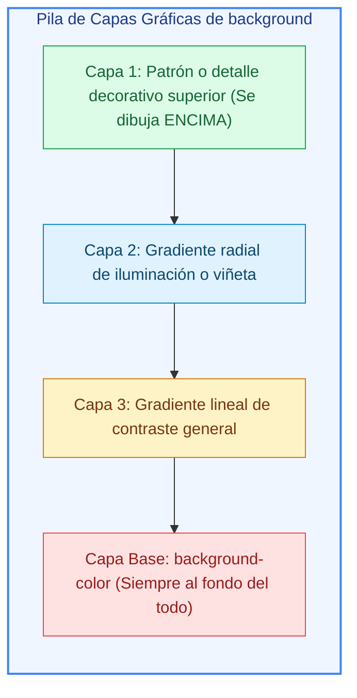
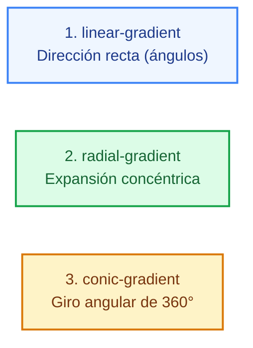
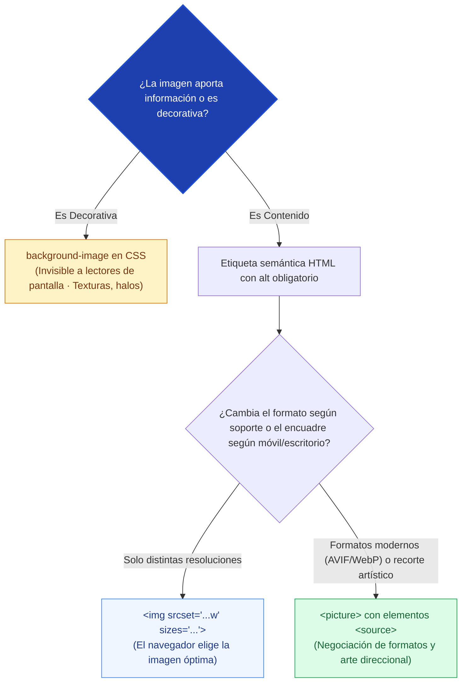
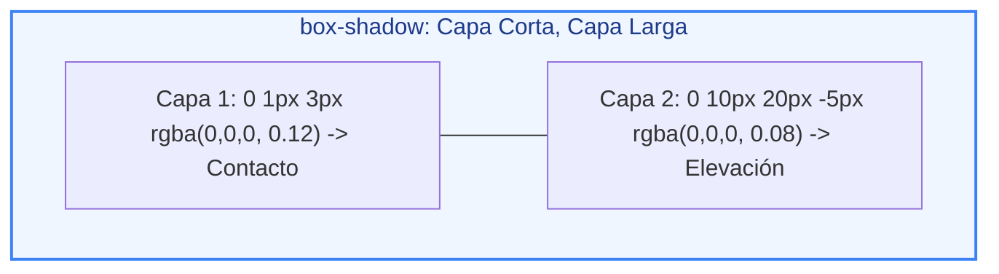
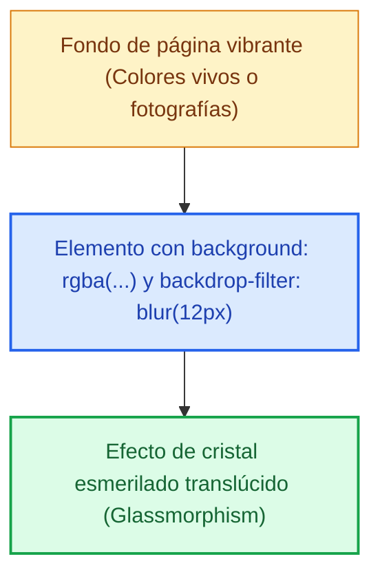
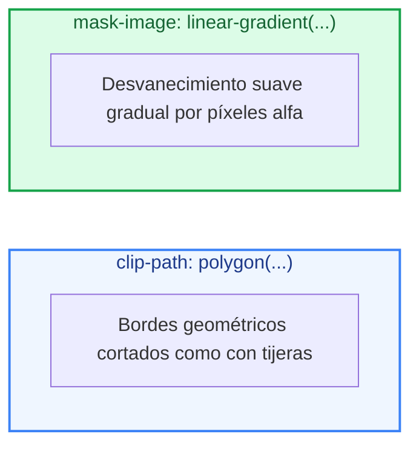

# Ejemplos de Código · Unidad 09: Fondos, Imágenes y Decoración

<div class="badges">
  <span class="badge badge-css">CSS3 Moderno</span>
  <span class="badge badge-blue">Código Práctico</span>
  <span class="badge badge-green">Fondos y Decoración</span>
  <span class="badge badge-ra">RA 3 / RA 4</span>
</div>

En este documento se desarrollan **ejemplos completos y funcionales de código HTML5 y CSS3** para dominar la presentación y decoración gráfica web: el atajo `background` y la composición multicapa, los tres motores de degradado (`linear`, `radial`, `conic`), el control de encuadre fotográfico con `object-fit` y `aspect-ratio`, la integración semántica de imágenes responsivas (`` con `srcset`/`sizes` y `<picture>`), sombras realistas de elevación física, efectos de vidrio (*glassmorphism*) con `backdrop-filter`, recortes duros con `clip-path` y máscaras por canal alfa con `mask-image`.

!!! info "Estructura didáctica de cada apartado"

    Cada sección está lista para que el alumnado copie, experimente e inspeccione en el navegador:

    1. **Fundamento conceptual:** Teoría técnica, orden de apilamiento gráfico y esquemas visuales (Mermaid).
    2. **Código fuente interactivo:** Pestañas separadas para el archivo **HTML** completo y la hoja de estilos **CSS** con tokens de diseño.
    3. **Disección técnica paso a paso:** Análisis de las propiedades críticas y comprobación en las *DevTools*.
    4. **Retos y preguntas de razonamiento:** Propuestas de modificación práctica guiada.

---

## 1. La Propiedad `background` y Composición Multicapa

### Fundamento Conceptual

El atajo ==`background`== agrupa hasta ocho subpropiedades individuales (`image`, `position`, `size`, `repeat`, `origin`, `clip`, `attachment`, `color`). Una de sus capacidades más potentes es admitir una **lista separada por comas de múltiples capas**:



| Subpropiedad | Función técnica | Regla clave |
| :--- | :--- | :--- |
| **`background-image`** | Define la fuente gráfica (`url()`, gradientes). | La primera de la lista es la más visible (arriba). |
| **`background-size`** | Escala de la imagen (`cover`, `contain`, `px`, `%`). | `cover` llena recortando; `contain` cabe entera. |
| **`background-position`** | Coordenadas de anclaje (`x y`, `center`, `%`). | En el atajo va junto al tamaño: `center / cover`. |
| **`background-repeat`** | Repetición en mosaico (`no-repeat`, `repeat`). | `space` y `round` distribuyen sin recortar tiles. |
| **`background-color`** | Color plano de relleno inferior. | Solo se puede declarar una vez, en la capa base. |

### Código de Ejemplo

=== "HTML"

    ```html title="01-background-multicapa.html"
    <!DOCTYPE html>
    <html lang="es">
    <head>
      <meta charset="UTF-8">
      <meta name="viewport" content="width=device-width, initial-scale=1.0">
      <title>Fondos Multicapa con CSS3</title>
      <link rel="stylesheet" href="01-background-multicapa.css">
    </head>
    <body>
      <main class="contenedor">
        <!-- Hero Banner con 3 capas gráficas superpuestas -->
        <section class="banner-hero">
          <div class="banner-hero__contenido">
            <span class="insignia">Arquitectura CSS3</span>
            <h1>Fondos Multicapa de Alto Rendimiento</h1>
            <p>
              Composición gráfica generada al 100% en el navegador: un patrón sutil de rejilla sobre un halo de iluminación radial y un gradiente oscuro de contraste.
            </p>
            <button class="btn-primario">Explorar Proyectos</button>
          </div>
        </section>
      </main>
    </body>
    </html>
    ```

=== "CSS"

    ```css title="01-background-multicapa.css"
    :root {
      --color-primario: #0ea5e9;
      --color-fondo: #0f172a;
      --color-superficie: #1e293b;
      --color-texto: #f8fafc;
      --color-texto-mutado: #94a3b8;
      --radio: 12px;
    }

    * {
      box-sizing: border-box;
      margin: 0;
      padding: 0;
    }

    body {
      font-family: system-ui, -apple-system, sans-serif;
      background-color: var(--color-fondo);
      color: var(--color-texto);
      padding: 2.5rem 1.5rem;
      line-height: 1.6;
    }

    .contenedor {
      max-width: 850px;
      margin: 0 auto;
    }

    /* COMPOSICIÓN MULTICAPA EN UNA SOLA DECLARACIÓN */
    .banner-hero {
      border-radius: var(--radio);
      padding: 4rem 2.5rem;
      border: 1px solid rgba(255, 255, 255, 0.1);
      box-shadow: 0 20px 25px -5px rgba(0, 0, 0, 0.5);

      /* 
        PILA DE FONDOS (de arriba a abajo):
        1. Capa 1: Cuadrícula sutil SVG transparente (repetida cada 30px)
        2. Capa 2: Foco de luz radial azulada en la esquina superior derecha
        3. Capa 3: Gradiente lineal oscuro para garantizar legibilidad
        4. Capa Base: Color sólido de fallback #0b1120
      */
      background-image:
        url("data:image/svg+xml,%3Csvg xmlns='http://www.w3.org/2000/svg' width='30' height='30' viewBox='0 0 30 30'%3E%3Cpath d='M30 0H0v30' fill='none' stroke='rgba(255,255,255,0.05)' stroke-width='1'/%3E%3C/svg%3E"),
        radial-gradient(circle at 85% 20%, rgba(14, 165, 233, 0.35) 0%, transparent 55%),
        linear-gradient(180deg, rgba(15, 23, 42, 0.6) 0%, rgba(15, 23, 42, 0.95) 100%);
      
      background-repeat: 
        repeat, 
        no-repeat, 
        no-repeat;
      
      background-size: 
        30px 30px, 
        auto, 
        auto;
      
      background-color: #0b1120;
    }

    .banner-hero__contenido {
      max-width: 580px;
    }

    .insignia {
      display: inline-block;
      background-color: rgba(14, 165, 233, 0.15);
      color: var(--color-primario);
      border: 1px solid rgba(14, 165, 233, 0.3);
      padding: 0.25rem 0.75rem;
      border-radius: 9999px;
      font-size: 0.75rem;
      font-weight: 700;
      text-transform: uppercase;
      letter-spacing: 0.05em;
      margin-bottom: 1rem;
    }

    .banner-hero h1 {
      font-size: 2.2rem;
      font-weight: 800;
      letter-spacing: -0.02em;
      line-height: 1.2;
      margin-bottom: 1rem;
    }

    .banner-hero p {
      color: var(--color-texto-mutado);
      font-size: 1rem;
      margin-bottom: 2rem;
    }

    .btn-primario {
      background-color: var(--color-primario);
      color: #ffffff;
      border: none;
      padding: 0.75rem 1.5rem;
      border-radius: 8px;
      font-weight: 700;
      font-size: 0.95rem;
      cursor: pointer;
      box-shadow: 0 10px 15px -3px rgba(14, 165, 233, 0.3);
    }
    ```

!!! tip "Disección técnica paso a paso"

    1. **Orden de pintura:** La cuadrícula SVG encabeza la lista de `background-image`, por lo que se dibuja sobre el halo radial y el fondo lineal.
    2. **Emparejamiento de listas:** Observa cómo `background-repeat` y `background-size` declaran sus valores en el mismo orden que las imágenes separadas por coma (`repeat` corresponde a los 30px del SVG; `no-repeat` a los gradientes).
    3. **Rendimiento:** Este banner no descarga imágenes externas pesadas de miles de kilobytes; todo el impacto estético se sintetiza mediante matemáticas CSS nativas en milisegundos.

---

## 2. Motores de Degradado: `linear`, `radial`, `conic` y Texto Degradado

### Fundamento Conceptual

CSS ofrece tres funciones matemáticas de interpolación cromática:

1. ==`linear-gradient`==: Transición unidireccional a lo largo de un ángulo (`45deg`, `to right`, `180deg`).
2. ==`radial-gradient`==: Transición desde un punto central hacia afuera en forma elíptica o circular.
3. ==`conic-gradient`==: Transición rotacional de 360 grados alrededor de un punto focal (ideal para gráficos de tarta, anillos o velocímetros).



!!! tip "El truco del texto con degradado"

    Para aplicar un degradado de color a una tipografía en lugar de a la caja rectangular, se combinan dos propiedades:
    ```css
    background-image: linear-gradient(90deg, #6366f1, #ec4899);
    background-clip: text;
    color: transparent;
    ```
    El fondo se recorta exactamente al glifo de las letras y `color: transparent` permite que el degradado inferior se transparente a través del texto.

### Código de Ejemplo

=== "HTML"

    ```html title="02-motores-degradados.html"
    <!DOCTYPE html>
    <html lang="es">
    <head>
      <meta charset="UTF-8">
      <meta name="viewport" content="width=device-width, initial-scale=1.0">
      <title>Degradados Modernos en CSS3</title>
      <link rel="stylesheet" href="02-motores-degradados.css">
    </head>
    <body>
      <main class="laboratorio">
        <h1>Los Tres Motores de Degradado</h1>

        <!-- 1. TEXTO CON DEGRADADO LINEAL -->
        <section class="caso">
          <h3>1. Titular con <code>background-clip: text</code></h3>
          <h2 class="texto-degradado">Innovación &amp; Diseño Web</h2>
        </section>

        <!-- 2. ANILLO DE PROGRESO CON CONIC-GRADIENT -->
        <section class="caso">
          <h3>2. Gráfico de Tarta con <code>conic-gradient</code> (Progreso al 75%)</h3>
          <div class="contenedor-donuts">
            <div class="anillo-progreso" role="progressbar" aria-valuenow="75" aria-valuemin="0" aria-valuemax="100">
              <span class="valor-porcentaje">75%</span>
            </div>
            <p class="detalle">Sin SVG ni JavaScript: el 75% se calcula girando 270 grados en CSS.</p>
          </div>
        </section>

        <!-- 3. RAYAS DIAGONALES CON REPEATING-LINEAR-GRADIENT -->
        <section class="caso">
          <h3>3. Textura de Advertencia con <code>repeating-linear-gradient</code></h3>
          <div class="cinta-peligro">
            <span>ZONA EN MANTENIMIENTO TÉCNICO</span>
          </div>
        </section>
      </main>
    </body>
    </html>
    ```

=== "CSS"

    ```css title="02-motores-degradados.css"
    :root {
      --color-fondo: #f8fafc;
      --color-superficie: #ffffff;
      --color-texto: #0f172a;
      --color-borde: #cbd5e1;
    }

    * {
      box-sizing: border-box;
      margin: 0;
      padding: 0;
    }

    body {
      font-family: system-ui, sans-serif;
      background-color: var(--color-fondo);
      color: var(--color-texto);
      padding: 2.5rem 1.5rem;
    }

    .laboratorio {
      max-width: 650px;
      margin: 0 auto;
    }

    h1 {
      font-size: 1.5rem;
      margin-bottom: 2rem;
    }

    .caso {
      background-color: var(--color-superficie);
      padding: 1.5rem;
      border-radius: 12px;
      border: 1px solid var(--color-borde);
      margin-bottom: 2rem;
      box-shadow: 0 4px 6px -1px rgba(0, 0, 0, 0.05);
    }

    .caso h3 {
      font-size: 0.95rem;
      color: #64748b;
      margin-bottom: 1rem;
    }

    /* 1. TEXTO CON DEGRADADO */
    .texto-degradado {
      font-size: 2.2rem;
      font-weight: 900;
      letter-spacing: -0.03em;
      background-image: linear-gradient(135deg, #4f46e5 0%, #06b6d4 50%, #10b981 100%);
      -webkit-background-clip: text;
      background-clip: text;
      color: transparent;
      display: inline-block;
    }

    /* 2. GRÁFICO CIRCULAR CON CONIC-GRADIENT Y MÁSCARA INTERIOR */
    .contenedor-donuts {
      display: flex;
      align-items: center;
      gap: 1.5rem;
    }

    .anillo-progreso {
      width: 100px;
      height: 100px;
      border-radius: 50%;
      /* 75% = 270 grados coloreados de azul; el resto gris */
      background: conic-gradient(#0284c7 0% 75%, #e2e8f0 75% 100%);
      display: grid;
      place-items: center;
      position: relative;
    }

    /* Hueco interior blanco para crear la forma de rosquilla (Donut chart) */
    .anillo-progreso::before {
      content: "";
      position: absolute;
      width: 74px;
      height: 74px;
      border-radius: 50%;
      background-color: var(--color-superficie);
    }

    .valor-porcentaje {
      position: relative;
      font-size: 1.2rem;
      font-weight: 800;
      color: #0284c7;
    }

    .detalle {
      font-size: 0.85rem;
      color: #64748b;
      line-height: 1.4;
    }

    /* 3. RAYAS DE PRECAUCIÓN CON REPEATING-LINEAR-GRADIENT */
    .cinta-peligro {
      height: 50px;
      border-radius: 8px;
      /* Alterna 15px de amarillo y 15px de negro a 45 grados */
      background: repeating-linear-gradient(
        45deg,
        #facc15 0px 15px,
        #0f172a 15px 30px
      );
      display: flex;
      align-items: center;
      justify-content: center;
    }

    .cinta-peligro span {
      background-color: #0f172a;
      color: #facc15;
      font-size: 0.75rem;
      font-weight: 800;
      letter-spacing: 0.08em;
      padding: 0.25rem 0.75rem;
      border-radius: 4px;
    }
    ```

!!! tip "Disección técnica paso a paso"

    1. **`background-clip: text`:** Hace que el fondo solo exista donde hay letras. Requiere obligatoriamente `color: transparent` para que el color base del texto no tape el degradado inferior.
    2. **Paradas duras en `conic-gradient`:** Al escribir `#0284c7 0% 75%, #e2e8f0 75% 100%`, el cambio entre el color azul y el gris ocurre instantáneamente en el 75%, generando un sector circular nítido.
    3. **Donut chart con pseudo-elemento `::before`:** Un círculo blanco concéntrico perfora el centro del disco, transformando un gráfico de tarta macizo en un anillo estético moderno.

---

## 3. Encuadre Fotográfico con `object-fit`, `object-position` y `aspect-ratio`

### Fundamento Conceptual

Históricamente, forzar a una imagen a encajar en un contenedor de tamaño fijo con `width: 100%; height: 100%;` destruía su proporción de aspecto (*aspect ratio*), deformando las caras y achatando los gráficos.

La propiedad ==`object-fit`== define cómo debe acomodarse el contenido multimedia (`` o `<video>`) dentro de su caja de visualización:

| Valor de `object-fit` | Comportamiento | Impacto visual |
| :--- | :--- | :--- |
| **`fill`** (defecto) | Deforma la imagen para estirarla a las dimensiones exactas. | Imagen distorsionada/aplastada. |
| **`cover`** | **Llena la caja recortando** los bordes sobrantes sin deformar. | Encuadre perfecto tipo banner o tarjeta. |
| **`contain`** | **Muestra la imagen completa** sin recortar, dejando franjas vacías si no coincide. | Ideal para logos o fotografías médicas/legales. |
| **`none`** | Respeta el tamaño intrínseco original de la imagen ignorando la caja. | Puede recortar en exceso. |

Combinado con ==`aspect-ratio: 16 / 9`== (o `4 / 3`, `1 / 1`), el navegador reserva el espacio vertical exacto antes de que la imagen termine de descargarse, eliminando el parpadeo de salto de maquetación (**CLS - Cumulative Layout Shift**).

### Código de Ejemplo

=== "HTML"

    ```html title="03-object-fit-aspect-ratio.html"
    <!DOCTYPE html>
    <html lang="es">
    <head>
      <meta charset="UTF-8">
      <meta name="viewport" content="width=device-width, initial-scale=1.0">
      <title>Object Fit y Aspect Ratio</title>
      <link rel="stylesheet" href="03-object-fit-aspect-ratio.css">
    </head>
    <body>
      <main class="laboratorio">
        <h1>Control de Encuadre Fotográfico</h1>

        <!-- CASO A: COMPARATIVA DIRECTA FILL VS COVER -->
        <section class="caso">
          <h3>1. Comparativa: <code>fill</code> (Deformado) vs <code>cover</code> (Elegante)</h3>
          <div class="comparativa-grid">
            <div class="tarjeta-foto">
              <span class="etiqueta-error">fill (Deformada)</span>
              
            </div>

            <div class="tarjeta-foto">
              <span class="etiqueta-exito">cover (Recorte Perfecto)</span>
              
            </div>
          </div>
        </section>

        <!-- CASO B: ENFOCAR CARAS CON OBJECT-POSITION -->
        <section class="caso">
          <h3>2. Corrección del Punto Focal con <code>object-position: center top</code></h3>
          <div class="comparativa-grid">
            <div class="tarjeta-foto">
              <span class="etiqueta-aviso">center center (Corta la cabeza)</span>
              
            </div>

            <div class="tarjeta-foto">
              <span class="etiqueta-exito">center top (Enfoca la mirada)</span>
              
            </div>
          </div>
        </section>
      </main>
    </body>
    </html>
    ```

=== "CSS"

    ```css title="03-object-fit-aspect-ratio.css"
    :root {
      --color-fondo: #f8fafc;
      --color-superficie: #ffffff;
      --color-texto: #0f172a;
      --color-borde: #cbd5e1;
    }

    * {
      box-sizing: border-box;
      margin: 0;
      padding: 0;
    }

    body {
      font-family: system-ui, sans-serif;
      background-color: var(--color-fondo);
      color: var(--color-texto);
      padding: 2.5rem 1.5rem;
    }

    .laboratorio {
      max-width: 700px;
      margin: 0 auto;
    }

    h1 {
      font-size: 1.5rem;
      margin-bottom: 2rem;
    }

    .caso {
      background-color: var(--color-superficie);
      padding: 1.5rem;
      border-radius: 12px;
      border: 1px solid var(--color-borde);
      margin-bottom: 2rem;
      box-shadow: 0 4px 6px -1px rgba(0, 0, 0, 0.05);
    }

    .caso h3 {
      font-size: 0.95rem;
      color: #64748b;
      margin-bottom: 1.25rem;
    }

    .comparativa-grid {
      display: grid;
      grid-template-columns: repeat(2, 1fr);
      gap: 1.5rem;
    }

    .tarjeta-foto {
      position: relative;
      background-color: #f1f5f9;
      border-radius: 8px;
      overflow: hidden;
      border: 1px solid var(--color-borde);
    }

    /* RESERVA DE ESPACIO CON ASPECT-RATIO ANTI-CLS */
    .foto {
      width: 100%;
      aspect-ratio: 1 / 1; /* Cuadrado perfecto */
      display: block;
    }

    /* 1. FILL (DEFORMACIÓN) */
    .foto--fill {
      object-fit: fill;
    }

    /* 2. COVER (RECORTE PROPORCIONAL) */
    .foto--cover {
      object-fit: cover;
    }

    /* 3. PUNTOS FOCALES CON OBJECT-POSITION */
    .foto--pos-center {
      object-fit: cover;
      object-position: center center;
    }

    .foto--pos-top {
      object-fit: cover;
      object-position: center 15%; /* Eleva el foco al tercio superior */
    }

    /* Etiquetas didácticas sobrepuestas */
    .etiqueta-error, .etiqueta-exito, .etiqueta-aviso {
      position: absolute;
      top: 0.5rem;
      left: 0.5rem;
      font-size: 0.75rem;
      font-weight: 700;
      padding: 0.2rem 0.5rem;
      border-radius: 4px;
      z-index: 2;
    }

    .etiqueta-error { background-color: #fee2e2; color: #991b1b; }
    .etiqueta-exito { background-color: #dcfce7; color: #166534; }
    .etiqueta-aviso { background-color: #fef3c7; color: #854d0e; }
    ```

!!! tip "Disección técnica paso a paso"

    1. **Eliminación del CLS con `aspect-ratio: 1 / 1`:** Antes de que la fotografía empiece a descargarse por red, el navegador ya calcula la altura cuadrada exacta y no empuja el resto del documento al cargar.
    2. **Magia de `object-fit: cover`:** La imagen se amplía proporcionalmente hasta cubrir el 100% del contenedor sin achatarse en ningún eje.
    3. **Ajuste de caras con `object-position: center 15%`:** En retratos verticales, el centrado predeterminado (`center center`) a menudo corta la frente o los ojos. Desplazando el foco vertical al 15% garantizamos que el rostro permanezca visible.

---

## 4. Imágenes Responsivas Semánticas: `srcset`/`sizes` y `<picture>`

### Fundamento Conceptual

Una de las decisiones arquitectónicas más importantes en la integración multimedia es saber cuándo utilizar CSS y cuándo marcado HTML:



### Código de Ejemplo

=== "HTML"

    ```html title="04-imagenes-responsivas-picture.html"
    <!DOCTYPE html>
    <html lang="es">
    <head>
      <meta charset="UTF-8">
      <meta name="viewport" content="width=device-width, initial-scale=1.0">
      <title>Imágenes Responsivas con Picture y Srcset</title>
      <link rel="stylesheet" href="04-imagenes-responsivas-picture.css">
    </head>
    <body>
      <main class="contenedor">
        <h1>Integración Multimedia de Alto Rendimiento</h1>

        <!-- PATRÓN 1: <picture> CON ARTE DIRECCIONAL Y NEGOCIACIÓN DE FORMATOS -->
        <article class="tarjeta-articulo">
          <picture class="imagen-adaptable">
            <!-- 1. Formato AVIF para pantallas grandes (ahorro del 50% de peso) -->
            <source media="(min-width: 768px)" 
                    srcset="https://images.unsplash.com/photo-1517694712202-14dd9538aa97?auto=format&fit=crop&w=1200&q=80" 
                    type="image/webp">
            
            <!-- 2. Formato recortado verticalmente para móvil -->
            <source media="(max-width: 767px)" 
                    srcset="https://images.unsplash.com/photo-1517694712202-14dd9538aa97?auto=format&fit=crop&w=600&h=600&q=80" 
                    type="image/webp">
            
            <!-- 3. Fallback estándar universal -->
            
          </picture>

          <div class="cuerpo-articulo">
            <h2>Ingeniería de Software con Estándares Web</h2>
            <p>
              El elemento <code>&lt;picture&gt;</code> descarga una imagen panorámica de 1200px en monitores y una versión cuadrada compacta de 600px en smartphones.
            </p>
          </div>
        </article>
      </main>
    </body>
    </html>
    ```

=== "CSS"

    ```css title="04-imagenes-responsivas-picture.css"
    :root {
      --color-fondo: #f8fafc;
      --color-superficie: #ffffff;
      --color-texto: #0f172a;
      --color-borde: #cbd5e1;
    }

    * {
      box-sizing: border-box;
      margin: 0;
      padding: 0;
    }

    body {
      font-family: system-ui, sans-serif;
      background-color: var(--color-fondo);
      color: var(--color-texto);
      padding: 2.5rem 1.5rem;
    }

    .contenedor {
      max-width: 800px;
      margin: 0 auto;
    }

    h1 {
      font-size: 1.5rem;
      margin-bottom: 2rem;
    }

    .tarjeta-articulo {
      background-color: var(--color-superficie);
      border-radius: 12px;
      border: 1px solid var(--color-borde);
      overflow: hidden;
      box-shadow: 0 4px 6px -1px rgba(0, 0, 0, 0.05);
    }

    .foto-articulo {
      width: 100%;
      height: auto;
      display: block;
      aspect-ratio: 16 / 9;
      object-fit: cover;
    }

    .cuerpo-articulo {
      padding: 1.5rem;
    }

    .cuerpo-articulo h2 {
      font-size: 1.25rem;
      margin-bottom: 0.5rem;
    }

    .cuerpo-articulo p {
      color: #64748b;
      line-height: 1.5;
      font-size: 0.95rem;
    }

    /* En móvil adaptamos el aspect-ratio a 4:3 para mayor altura */
    @media (max-width: 767px) {
      .foto-articulo {
        aspect-ratio: 1 / 1;
      }
    }
    ```

!!! tip "Disección técnica paso a paso"

    1. **Arte direccional con `<source media="...">`:** El navegador lee las condiciones antes de descargar bytes. Si la ventana mide menos de 768px, ignora la imagen ancha y descarga exclusivamente la versión recortada para móvil, ahorrando megabytes de datos.
    2. **Atributos de rendimiento (`loading="lazy"` y `decoding="async"`):** La imagen no bloquea el hilo principal de renderizado y solo se descarga cuando el usuario se aproxima a ella mediante scroll.
    3. **Accesibilidad asegurada:** A diferencia de una imagen de fondo CSS, el atributo `alt` describe la escena con precisión para los usuarios que dependen de lectores de pantalla.

---

## 5. Sombras Realistas de Elevación Multicapa

### Fundamento Conceptual

En el mundo físico real, una fuente de luz natural nunca genera una sombra dura de bordes uniformes. Las interfaces de usuario de alta fidelidad consiguen un aspecto visualmente prémium combinando **dos o tres capas de sombra simultáneas**:

1. **Sombra de oclusión ambiental (Corta y oscura):** Define la línea física de contacto inmediato con la superficie.
2. **Sombra difusa de elevación (Larga y translúcida):** Simula la dispersión de la luz ambiental en el espacio tridimensional.



### Código de Ejemplo

=== "HTML"

    ```html title="05-sombras-multicapa.html"
    <!DOCTYPE html>
    <html lang="es">
    <head>
      <meta charset="UTF-8">
      <meta name="viewport" content="width=device-width, initial-scale=1.0">
      <title>Sombras de Elevación Multicapa</title>
      <link rel="stylesheet" href="05-sombras-multicapa.css">
    </head>
    <body>
      <main class="laboratorio">
        <h1>Sistema de Elevación Física (Design Tokens)</h1>

        <section class="rejilla-sombras">
          <!-- ELEVACIÓN 1: CARTA BASE -->
          <article class="tarjeta-elevada tarjeta--baja">
            <h3>Elevación Baja</h3>
            <p>Sombra de apoyo para tarjetas estáticas en reposo.</p>
          </article>

          <!-- ELEVACIÓN 2: CARTA FLOTANTE INTERACTIVA -->
          <article class="tarjeta-elevada tarjeta--media">
            <h3>Elevación Media</h3>
            <p>Pasa el ratón para elevar la tarjeta a nivel alto.</p>
          </article>

          <!-- ELEVACIÓN 3: CARTA DESTACADA O MODAL -->
          <article class="tarjeta-elevada tarjeta--alta">
            <h3>Elevación Alta</h3>
            <p>Para modales, menús flotantes y popovers prioritarios.</p>
          </article>
        </section>
      </main>
    </body>
    </html>
    ```

=== "CSS"

    ```css title="05-sombras-multicapa.css"
    /* SISTEMA DE DESIGN TOKENS DE ELEVACIÓN */
    :root {
      --color-fondo: #f1f5f9;
      --color-superficie: #ffffff;
      --color-texto: #0f172a;
      --color-primario: #3b82f6;

      /* Nivel 1: Corta */
      --sombra-baja: 
        0 1px 2px rgba(15, 23, 42, 0.08), 
        0 2px 4px rgba(15, 23, 42, 0.04);

      /* Nivel 2: Media */
      --sombra-media: 
        0 4px 6px -1px rgba(15, 23, 42, 0.08), 
        0 10px 15px -3px rgba(15, 23, 42, 0.06);

      /* Nivel 3: Alta */
      --sombra-alta: 
        0 10px 25px -5px rgba(15, 23, 42, 0.1), 
        0 20px 30px -10px rgba(15, 23, 42, 0.08);
    }

    * {
      box-sizing: border-box;
      margin: 0;
      padding: 0;
    }

    body {
      font-family: system-ui, sans-serif;
      background-color: var(--color-fondo);
      color: var(--color-texto);
      padding: 3rem 1.5rem;
    }

    .laboratorio {
      max-width: 850px;
      margin: 0 auto;
    }

    h1 {
      font-size: 1.5rem;
      margin-bottom: 2rem;
    }

    .rejilla-sombras {
      display: grid;
      grid-template-columns: repeat(auto-fit, minmax(240px, 1fr));
      gap: 1.5rem;
    }

    .tarjeta-elevada {
      background-color: var(--color-superficie);
      padding: 2rem;
      border-radius: 12px;
      border: 1px solid rgba(226, 232, 240, 0.8);
      transition: transform 0.2s ease, box-shadow 0.2s ease;
    }

    .tarjeta-elevada h3 {
      font-size: 1.15rem;
      margin-bottom: 0.5rem;
    }

    .tarjeta-elevada p {
      font-size: 0.85rem;
      color: #64748b;
      line-height: 1.5;
    }

    /* APLICACIÓN DE LOS TOKENS */
    .tarjeta--baja {
      box-shadow: var(--sombra-baja);
    }

    .tarjeta--media {
      box-shadow: var(--sombra-media);
      cursor: pointer;
    }

    .tarjeta--media:hover {
      transform: translateY(-4px);
      box-shadow: var(--sombra-alta);
      border-color: var(--color-primario);
    }

    .tarjeta--alta {
      box-shadow: var(--sombra-alta);
    }
    ```

!!! tip "Disección técnica paso a paso"

    1. **Eliminación del efecto "halo sucio":** En lugar de usar una sola sombra gris oscura como `0 0 15px #000`, combinamos dos capas con opacidades sutiles (`0.08` y `0.04`).
    2. **Parámetro negativo de dispersión (*spread*):** Al declarar `-5px` en el cuarto parámetro de la segunda capa (`0 10px 25px -5px`), la sombra se comprime ligeramente hacia adentro, evitando que se desborde de forma antiestética por los laterales de la tarjeta.

---

## 6. Efectos de Vidrio (*Glassmorphism*) con `backdrop-filter`

### Fundamento Conceptual

==`backdrop-filter`== aplica efectos gráficos (como desenfoque gaussiano, saturación o brillo) **a la zona que queda inmediatamente detrás del elemento**. Para que sea visible, el elemento debe tener un fondo semitransparente:



!!! danger "Accesibilidad obligatoria"

    El desenfoque de fondo tiene un coste elevado de procesamiento en la GPU y puede dificultar la lectura a personas con problemas visuales. Siempre debe incluirse una regla de compatibilidad con `@media (prefers-reduced-transparency: reduce)` que elimine el desenfoque y aplique un color opaco legible.

### Código de Ejemplo

=== "HTML"

    ```html title="06-glassmorphism-accesible.html"
    <!DOCTYPE html>
    <html lang="es">
    <head>
      <meta charset="UTF-8">
      <meta name="viewport" content="width=device-width, initial-scale=1.0">
      <title>Glassmorphism Accesible con backdrop-filter</title>
      <link rel="stylesheet" href="06-glassmorphism-accesible.css">
    </head>
    <body>
      <!-- Escenario con orbes de color de fondo para evidenciar el desenfoque -->
      <div class="escenario-vidrio">
        <div class="orbe orbe--rosa"></div>
        <div class="orbe orbe--azul"></div>

        <!-- TARJETA DE CRISTAL ESMERILADO -->
        <article class="tarjeta-cristal">
          <span class="etiqueta-status">Suscripción Pro</span>
          <h2>Diseño de Interfaces Web</h2>
          <p>
            Efecto de cristal esmerilado con <code>backdrop-filter: blur(16px)</code> y borde translúcido reflectante.
          </p>
          <div class="acciones">
            <button class="btn-cristal">Renovar Plan</button>
          </div>
        </article>
      </div>
    </body>
    </html>
    ```

=== "CSS"

    ```css title="06-glassmorphism-accesible.css"
    * {
      box-sizing: border-box;
      margin: 0;
      padding: 0;
    }

    body {
      font-family: system-ui, sans-serif;
      background-color: #0b0f19;
      color: #ffffff;
      min-height: 100vh;
      display: grid;
      place-items: center;
      padding: 1.5rem;
    }

    .escenario-vidrio {
      position: relative;
      width: 100%;
      max-width: 500px;
      padding: 2rem;
    }

    /* ORBES DE LUZ COLORIDA EN EL FONDO */
    .orbe {
      position: absolute;
      width: 220px;
      height: 220px;
      border-radius: 50%;
      filter: blur(50px);
      z-index: 1;
    }

    .orbe--rosa {
      background-color: #ec4899;
      top: -30px;
      left: -20px;
    }

    .orbe--azul {
      background-color: #3b82f6;
      bottom: -30px;
      right: -20px;
    }

    /* TARJETA DE VIDRIO (GLASSMORPHISM) */
    .tarjeta-cristal {
      position: relative;
      z-index: 2; /* Por encima de los orbes */
      background: rgba(255, 255, 255, 0.08); /* Fondo blanco translúcido */
      backdrop-filter: blur(16px) saturate(180%);
      -webkit-backdrop-filter: blur(16px) saturate(180%); /* Safari */
      
      border: 1px solid rgba(255, 255, 255, 0.2); /* Borde reflectante */
      border-radius: 16px;
      padding: 2.5rem;
      box-shadow: 0 25px 50px -12px rgba(0, 0, 0, 0.5);
    }

    .etiqueta-status {
      display: inline-block;
      font-size: 0.75rem;
      font-weight: 700;
      color: #38bdf8;
      text-transform: uppercase;
      letter-spacing: 0.05em;
      margin-bottom: 0.75rem;
    }

    .tarjeta-cristal h2 {
      font-size: 1.5rem;
      margin-bottom: 0.5rem;
    }

    .tarjeta-cristal p {
      color: #cbd5e1;
      font-size: 0.95rem;
      line-height: 1.5;
      margin-bottom: 1.5rem;
    }

    .btn-cristal {
      background-color: #ffffff;
      color: #0f172a;
      border: none;
      padding: 0.65rem 1.25rem;
      border-radius: 8px;
      font-weight: 700;
      font-size: 0.9rem;
      cursor: pointer;
    }

    /* REGLA DE ACCESIBILIDAD PARA TRANSPARENCIAS REDUCIDAS */
    @media (prefers-reduced-transparency: reduce) {
      .tarjeta-cristal {
        backdrop-filter: none;
        -webkit-backdrop-filter: none;
        background: #1e293b; /* Color opaco sólido de alto contraste */
        border-color: #475569;
      }
    }
    ```

!!! tip "Disección técnica paso a paso"

    1. **`backdrop-filter: blur(16px) saturate(180%)`:** Difumina los orbes de luz rosa y azul situados debajo y amplía su viveza cromática en un 180%.
    2. **Borde sutil con `rgba(255, 255, 255, 0.2)`:** Delimita el bisel del cristal, evitando que el panel se confunda con el fondo.
    3. **Compatibilidad con `prefers-reduced-transparency`:** Si el usuario tiene habilitada la reducción de transparencias en los ajustes de accesibilidad de su sistema operativo, el desenfoque se apaga automáticamente y la tarjeta adopta un fondo opaco de alto contraste.

---

## 7. Recortes con `clip-path` frente a Máscaras con `mask-image`

### Fundamento Conceptual

Tanto `clip-path` como `mask-image` recortan elementos, pero utilizan paradigmas matemáticos diferentes:

| Propiedad | Mecanismo | ¿Admite degradados de transparencia? | Uso ideal |
| :--- | :--- | :---: | :--- |
| **`clip-path`** | **Recorte vectorial duro** (geometría todo o nada). | No | Polígonos, círculos, diagonales, flechas. |
| **`mask-image`** | **Máscara basada en canal alfa** (escala de opacidad). | **Sí** | Desvanecimientos graduales, fundidos a transparente. |



### Código de Ejemplo

=== "HTML"

    ```html title="07-clippath-vs-mask.html"
    <!DOCTYPE html>
    <html lang="es">
    <head>
      <meta charset="UTF-8">
      <meta name="viewport" content="width=device-width, initial-scale=1.0">
      <title>Clip-Path frente a Mask-Image</title>
      <link rel="stylesheet" href="07-clippath-vs-mask.css">
    </head>
    <body>
      <main class="laboratorio">
        <h1>Recortes Vectoriales vs Máscaras Alfa</h1>

        <!-- 1. CLIP-PATH: POLÍGONO EN FORMA DE CINTA DE PRECIO -->
        <section class="caso">
          <h3>1. Recorte Geométrico con <code>clip-path: polygon()</code></h3>
          <div class="cinta-corte">
            <span>OFERTA ESPECIAL -30%</span>
          </div>
        </section>

        <!-- 2. MASK-IMAGE: FUNDIDO GRADUAL A TRANSPARENTE -->
        <section class="caso">
          <h3>2. Desvanecimiento Suave con <code>mask-image</code></h3>
          <div class="texto-desvanecido">
            <p>
              Este párrafo tiene aplicado un fundido vertical con un degradado en su máscara alfa. Conforme el usuario lee hacia abajo, las letras se desvanecen gradualmente hacia la transparencia absoluta sin necesidad de overlays con gradientes opacos.
            </p>
          </div>
        </section>
      </main>
    </body>
    </html>
    ```

=== "CSS"

    ```css title="07-clippath-vs-mask.css"
    :root {
      --color-fondo: #f8fafc;
      --color-superficie: #ffffff;
      --color-texto: #0f172a;
      --color-borde: #cbd5e1;
    }

    * {
      box-sizing: border-box;
      margin: 0;
      padding: 0;
    }

    body {
      font-family: system-ui, sans-serif;
      background-color: var(--color-fondo);
      color: var(--color-texto);
      padding: 2.5rem 1.5rem;
    }

    .laboratorio {
      max-width: 600px;
      margin: 0 auto;
    }

    h1 {
      font-size: 1.5rem;
      margin-bottom: 2rem;
    }

    .caso {
      background-color: var(--color-superficie);
      padding: 1.5rem;
      border-radius: 12px;
      border: 1px solid var(--color-borde);
      margin-bottom: 2rem;
    }

    .caso h3 {
      font-size: 0.95rem;
      color: #64748b;
      margin-bottom: 1rem;
    }

    /* 1. RECORTE DURO CON CLIP-PATH (FORMA DE CINTA CON BISEL) */
    .cinta-corte {
      display: inline-block;
      background: linear-gradient(135deg, #ef4444, #dc2626);
      color: #ffffff;
      font-weight: 800;
      font-size: 0.85rem;
      padding: 0.6rem 2rem 0.6rem 1.25rem;
      
      /* Corta una muesca en forma de flecha en el lateral derecho */
      clip-path: polygon(
        0% 0%, 
        85% 0%, 
        100% 50%, 
        85% 100%, 
        0% 100%
      );
    }

    /* 2. MÁSCARA ALFA SUAVE CON MASK-IMAGE */
    .texto-desvanecido {
      height: 90px;
      line-height: 1.6;
      font-size: 0.95rem;
      color: #334155;
      
      /* La máscara negra es opaca (visible); la transparente oculta */
      -webkit-mask-image: linear-gradient(180deg, #000000 40%, transparent 100%);
      mask-image: linear-gradient(180deg, #000000 40%, transparent 100%);
    }
    ```

!!! tip "Disección técnica paso a paso"

    1. **Coordenadas de `clip-path: polygon`:** Los pares ordenados `(X Y)` definen los vértices de la figura geométrica. Al colocar el punto `100% 50%` entre `85% 0%` y `85% 100%`, se dibuja el pico de flecha sin recurrir a trucos con pseudo-elementos o bordes transparentes.
    2. **El poder de `mask-image` sobre fondos dinámicos:** Si pusiéramos un degradado blanco encima del texto para desvanecerlo, se rompería en cuanto el fondo cambiara de color o fuera una imagen. Con `mask-image`, lo que se desvanece es la propia pintura del texto.

---

## 8. Patrón de Producción Real: Tarjeta de Comercio Electrónico de Lujo

### Fundamento Conceptual

Este componente integra todas las técnicas de la unidad en una tarjeta de producto interactiva:

- Imagen de producto enmarcada con `aspect-ratio` y `object-fit: cover`.
- Etiqueta de descuento biselada mediante `clip-path`.
- Fondo con degradado sutil multicapa.
- Sombras realistas de dos capas con transición suave al interactuar con el ratón.

### Código de Ejemplo

=== "HTML"

    ```html title="08-tarjeta-producto-decorada.html"
    <!DOCTYPE html>
    <html lang="es">
    <head>
      <meta charset="UTF-8">
      <meta name="viewport" content="width=device-width, initial-scale=1.0">
      <title>Tarjeta de Producto Decorada</title>
      <link rel="stylesheet" href="08-tarjeta-producto-decorada.css">
    </head>
    <body>
      <main class="contenedor-tarjeta">
        <article class="tarjeta-producto">
          <!-- CABECERA VISUAL CON IMAGEN Y BADGE POLIGONAL -->
          <div class="tarjeta-producto__imagen-envoltorio">
            <span class="badge-rebaja">-25% OFF</span>
            
          </div>

          <!-- CUERPO CON TIPOGRAFÍA Y ACCIONES -->
          <div class="tarjeta-producto__cuerpo">
            <span class="categoria">Tecnología</span>
            <h2 class="titulo-producto">Chronos Smartwatch X1</h2>
            <p class="descripcion">
              Caja de titanio aeroespacial con pantalla AMOLED de alta resolución y monitorización biométrica continua.
            </p>

            <div class="tarjeta-producto__pie">
              <div class="precios">
                <span class="precio-original">299€</span>
                <span class="precio-actual">224€</span>
              </div>
              <button class="btn-comprar">Añadir al carrito</button>
            </div>
          </div>
        </article>
      </main>
    </body>
    </html>
    ```

=== "CSS"

    ```css title="08-tarjeta-producto-decorada.css"
    :root {
      --color-fondo: #f1f5f9;
      --color-superficie: #ffffff;
      --color-texto: #0f172a;
      --color-texto-mutado: #64748b;
      --color-primario: #0284c7;
      --color-acento: #ea580c;
      --radio: 12px;

      /* Tokens de sombras multicapa */
      --sombra-reposo: 
        0 1px 3px rgba(15, 23, 42, 0.08), 
        0 8px 16px -4px rgba(15, 23, 42, 0.06);

      --sombra-hover: 
        0 4px 6px rgba(15, 23, 42, 0.04), 
        0 20px 25px -5px rgba(15, 23, 42, 0.12);
    }

    * {
      box-sizing: border-box;
      margin: 0;
      padding: 0;
    }

    body {
      font-family: system-ui, -apple-system, sans-serif;
      background-color: var(--color-fondo);
      color: var(--color-texto);
      min-height: 100vh;
      display: grid;
      place-items: center;
      padding: 2rem 1rem;
    }

    .contenedor-tarjeta {
      max-width: 380px;
      width: 100%;
    }

    .tarjeta-producto {
      background-color: var(--color-superficie);
      border-radius: var(--radio);
      overflow: hidden;
      border: 1px solid #e2e8f0;
      box-shadow: var(--sombra-reposo);
      transition: transform 0.25s ease, box-shadow 0.25s ease;
    }

    .tarjeta-producto:hover {
      transform: translateY(-6px);
      box-shadow: var(--sombra-hover);
    }

    .tarjeta-producto__imagen-envoltorio {
      position: relative;
      background: linear-gradient(180deg, #f8fafc 0%, #e2e8f0 100%);
    }

    /* BADGE CON CLIP-PATH POLIGONAL */
    .badge-rebaja {
      position: absolute;
      top: 1rem;
      left: 0;
      background-color: var(--color-acento);
      color: #ffffff;
      font-size: 0.75rem;
      font-weight: 800;
      padding: 0.35rem 1.25rem 0.35rem 0.75rem;
      z-index: 2;
      clip-path: polygon(0 0, 100% 0, 85% 100%, 0 100%);
    }

    /* IMAGEN RECORTE PERFECTO SIN DEFORMACIÓN */
    .tarjeta-producto__foto {
      width: 100%;
      aspect-ratio: 4 / 3;
      object-fit: cover;
      object-position: center;
      display: block;
      transition: transform 0.4s ease;
    }

    .tarjeta-producto:hover .tarjeta-producto__foto {
      transform: scale(1.05); /* Zoom sutil al pasar el ratón */
    }

    .tarjeta-producto__cuerpo {
      padding: 1.5rem;
    }

    .categoria {
      font-size: 0.75rem;
      font-weight: 700;
      color: var(--color-primario);
      text-transform: uppercase;
      letter-spacing: 0.05em;
    }

    .titulo-producto {
      font-size: 1.25rem;
      font-weight: 750;
      margin: 0.25rem 0 0.5rem 0;
      color: var(--color-texto);
    }

    .descripcion {
      font-size: 0.85rem;
      color: var(--color-texto-mutado);
      line-height: 1.5;
      margin-bottom: 1.5rem;
    }

    .tarjeta-producto__pie {
      display: flex;
      justify-content: space-between;
      align-items: center;
      border-top: 1px solid #f1f5f9;
      padding-top: 1rem;
    }

    .precios {
      display: flex;
      align-items: baseline;
      gap: 0.5rem;
    }

    .precio-original {
      font-size: 0.85rem;
      color: #94a3b8;
      text-decoration: line-through;
    }

    .precio-actual {
      font-size: 1.35rem;
      font-weight: 800;
      color: #0f172a;
    }

    .btn-comprar {
      background-color: var(--color-primario);
      color: #ffffff;
      border: none;
      padding: 0.6rem 1rem;
      border-radius: 6px;
      font-weight: 700;
      font-size: 0.85rem;
      cursor: pointer;
      transition: background-color 0.2s ease;
    }

    .btn-comprar:hover {
      background-color: #0284c7;
    }
    ```

!!! tip "Disección técnica paso a paso"

    1. **Efecto zoom contenido:** Al aplicar `overflow: hidden` en `.tarjeta-producto`, la imagen puede crecer suavemente con `transform: scale(1.05)` sin salirse de las esquinas redondeadas de la tarjeta.
    2. **Bisel del badge de descuento:** `clip-path: polygon(0 0, 100% 0, 85% 100%, 0 100%)` le otorga una inclinación deportiva moderna al extremo derecho de la etiqueta roja.
    3. **Prevención de saltos de maquetación (CLS):** La imagen define explícitamente `aspect-ratio: 4 / 3` y atributos de ancho/alto (`width="400" height="300"`), permitiendo una carga instantánea y estable.

---

## 9. Checklist de Verificación de Competencias

!!! success "Lista de control para el aula (DAW / DAM)"

    - [x] **Fondos Multicapa:** Entiendo el orden de pintura de `background-image` y sé emparejar múltiples capas con sus respectivos `background-size` y `repeat`.
    - [x] **Degradados Modernos:** Aplico `linear-gradient`, `radial-gradient` y `conic-gradient` para crear elementos interactivos sin descargar imágenes.
    - [x] **Texto con Degradado:** Domino la combinación de `background-clip: text` y `color: transparent`.
    - [x] **`object-fit` vs `background-size`:** Aplico `cover` y `contain` sobre etiquetas `` y corrijo el encuadre facial con `object-position`.
    - [x] **Prevención de CLS:** Combino `aspect-ratio` con dimensiones de atributos para evitar desajustes visuales durante la carga.
    - [x] **Imágenes Responsivas:** Sé cuándo utilizar `srcset`/`sizes` y cuándo emplear `<picture>` para cambio de arte o negociación de formatos modernos (AVIF/WebP).
    - [x] **Sombras Multicapa:** Configuro tokens de elevación física combinando una sombra de contacto con una sombra difusa.
    - [x] **`backdrop-filter` Accesible:** Aplico efectos de vidrio esmerilado con la alternativa obligatoria para `prefers-reduced-transparency`.
    - [x] **`clip-path` frente a `mask-image`:** Distingo cuándo usar un recorte geométrico duro y cuándo un desvanecimiento suave por canal alfa.
