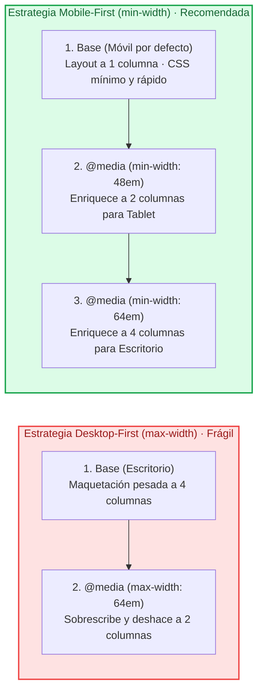
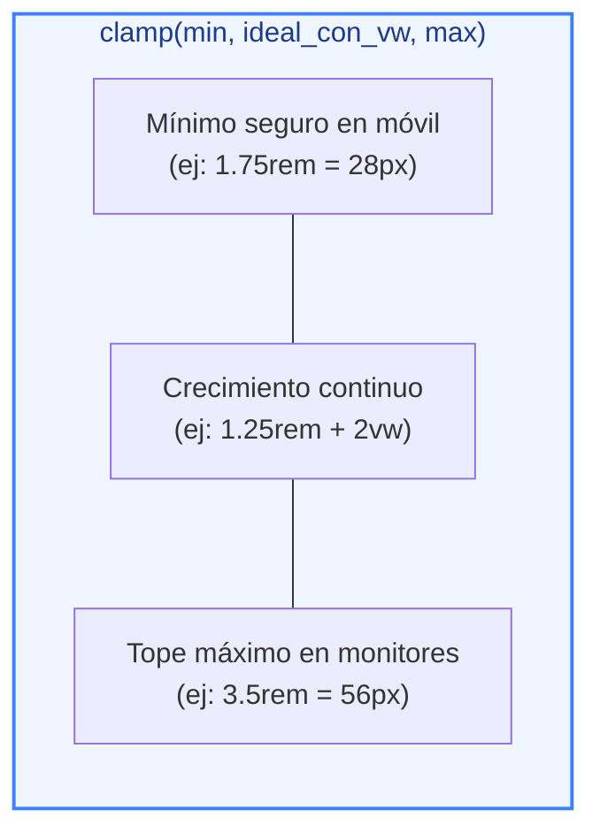
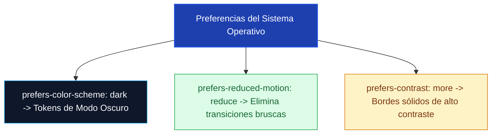
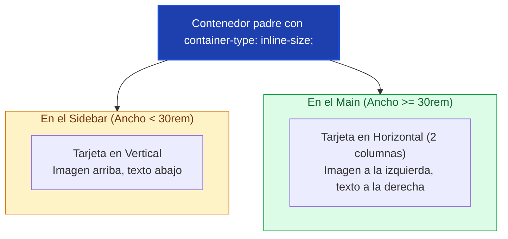

# Ejemplos de Código · Unidad 10: Diseño Responsivo

<div class="badges">
  <span class="badge badge-css">CSS3 Moderno</span>
  <span class="badge badge-blue">Código Práctico</span>
  <span class="badge badge-green">Diseño Responsivo</span>
  <span class="badge badge-ra">RA 2 / RA 4</span>
</div>

En este documento se desarrollan **ejemplos completos y funcionales de código HTML5 y CSS3** para dominar la construcción de interfaces adaptables a cualquier dispositivo: el requisito fundacional de `<meta name="viewport">`, la arquitectura progresiva **Mobile-First** con `min-width` en unidades relativas (`em`), tipografía y espaciado fluidos con `clamp()`, consultas de medios de interacción ergonómica (`hover`, `pointer`) y accesibilidad (`prefers-color-scheme`, `prefers-reduced-motion`), tratamiento responsivo de tablas complejas y el salto generacional a los **Container Queries (`@container`)** con unidades relativas al contenedor (`cqi`, `cqw`).

!!! info "Estructura didáctica de cada apartado"

    Cada bloque incluye todo lo necesario para su comprobación inmediata en el aula:

    1. **Fundamento conceptual:** Teoría técnica, tablas comparativas y diagramas Mermaid.
    2. **Código fuente interactivo:** Pestañas separadas para el archivo **HTML** completo y la hoja de estilos **CSS** con tokens de diseño.
    3. **Disección técnica paso a paso:** Análisis de las reglas y experimentación con el modo de inspección de dispositivos (*Device Mode*) de las *DevTools*.
    4. **Retos y preguntas guiadas:** Ejercicios prácticos para el alumnado.

---

## 1. El Pilar Base: `<meta name="viewport">` y la Filosofía Mobile-First con `min-width`

### Fundamento Conceptual

Sin la etiqueta meta del viewport, los navegadores móviles asumen que la página fue diseñada para un monitor de escritorio de los años 2000, emulando un lienzo virtual de `980px` y renderizando el texto de forma microscópica. Declarar `<meta name="viewport" content="width=device-width, initial-scale=1">` sincroniza el lienzo lógico con los píxeles físicos del dispositivo.

#### ¿Por qué Mobile-First (`min-width`) frente a Desktop-First (`max-width`)?



| Criterio técnico | Mobile-First (`min-width`) | Desktop-First (`max-width`) |
| :--- | :--- | :--- |
| **Punto de partida** | Código base limpio a 1 columna | Código base complejo a múltiples columnas |
| **Sobrescritura de estilos** | **Cero overrides**: solo se añaden capacidades | Decenas de `width: auto!`, `float: none!`, etc. |
| **Rendimiento móvil** | Óptimo (el móvil procesa la base sin esperar a MQs) | Pobre (el móvil descarga y deshace reglas de escritorio) |
| **Unidades de consulta** | **`em`** (respeta el zoom del usuario) | `px` (rompe el diseño si el usuario amplía la fuente) |

### Código de Ejemplo

=== "HTML"

    ```html title="01-mobile-first-layout.html"
    <!DOCTYPE html>
    <html lang="es">
    <head>
      <!-- REQUISITO INDISPENSABLE: Sincronización del viewport móvil -->
      <meta charset="UTF-8">
      <meta name="viewport" content="width=device-width, initial-scale=1.0">
      <title>Diseño Progresivo Mobile-First</title>
      <link rel="stylesheet" href="01-mobile-first-layout.css">
    </head>
    <body>
      <main class="contenedor-app">
        <header class="cabecera">
          <h1>Arquitectura Mobile-First</h1>
          <p>Redimensiona la ventana o activa el modo dispositivo de las DevTools.</p>
        </header>

        <!-- Cuadrícula adaptable progresiva -->
        <section class="rejilla-servicios">
          <article class="tarjeta-servicio">
            <span class="icono">📱</span>
            <h3>1. Base Móvil</h3>
            <p>1 columna por defecto en pantallas inferiores a 768px (48em).</p>
          </article>

          <article class="tarjeta-servicio">
            <span class="icono">💻</span>
            <h3>2. Tablet</h3>
            <p>Se enriquece automáticamente a 2 columnas a partir de 48em.</p>
          </article>

          <article class="tarjeta-servicio">
            <span class="icono">🖥️</span>
            <h3>3. Escritorio</h3>
            <p>Alcanza las 3 columnas sin necesidad de sobrescribir reglas previas.</p>
          </article>
        </section>
      </main>
    </body>
    </html>
    ```

=== "CSS"

    ```css title="01-mobile-first-layout.css"
    :root {
      --color-fondo: #f8fafc;
      --color-superficie: #ffffff;
      --color-texto: #0f172a;
      --color-texto-mutado: #64748b;
      --color-primario: #2563eb;
      --color-borde: #cbd5e1;
      --radio: 10px;
    }

    * {
      box-sizing: border-box;
      margin: 0;
      padding: 0;
    }

    body {
      font-family: system-ui, -apple-system, sans-serif;
      background-color: var(--color-fondo);
      color: var(--color-texto);
      line-height: 1.5;
      padding: 2rem 1.25rem;
    }

    .contenedor-app {
      max-width: 1000px;
      margin: 0 auto;
    }

    .cabecera {
      margin-bottom: 2rem;
    }

    .cabecera h1 {
      font-size: 1.5rem;
      margin-bottom: 0.5rem;
    }

    .cabecera p {
      color: var(--color-texto-mutado);
      font-size: 0.9rem;
    }

    /* ==========================================================================
       1. ESTILOS BASE MÓVIL (Por defecto, sin ninguna media query)
       ========================================================================== */
    .rejilla-servicios {
      display: grid;
      grid-template-columns: 1fr; /* 1 columna en teléfonos */
      gap: 1.25rem;
    }

    .tarjeta-servicio {
      background-color: var(--color-superficie);
      border: 1px solid var(--color-borde);
      border-radius: var(--radio);
      padding: 1.5rem;
      box-shadow: 0 4px 6px -1px rgba(0, 0, 0, 0.05);
    }

    .icono {
      font-size: 2rem;
      display: inline-block;
      margin-bottom: 0.5rem;
    }

    .tarjeta-servicio h3 {
      font-size: 1.1rem;
      margin-bottom: 0.5rem;
    }

    .tarjeta-servicio p {
      color: var(--color-texto-mutado);
      font-size: 0.85rem;
    }

    /* ==========================================================================
       2. ESCALÓN TABLET (48em = 768px con fuente base de 16px)
       ========================================================================== */
    @media (min-width: 48em) {
      .cabecera h1 {
        font-size: 1.8rem;
      }

      .rejilla-servicios {
        grid-template-columns: repeat(2, 1fr); /* 2 columnas */
      }
    }

    /* ==========================================================================
       3. ESCALÓN ESCRITORIO (64em = 1024px)
       ========================================================================== */
    @media (min-width: 64em) {
      .cabecera h1 {
        font-size: 2.2rem;
      }

      .rejilla-servicios {
        grid-template-columns: repeat(3, 1fr); /* 3 columnas */
        gap: 1.75rem;
      }
    }
    ```

!!! tip "Disección técnica paso a paso"

    1. **Sin consultas para móvil:** Las pantallas pequeñas no evalúan `@media`; ejecutan directamente las reglas base de la raíz del CSS.
    2. **Uso de `em` en lugar de `px` en breakpoints (`48em` y `64em`):** Si un usuario con discapacidad visual amplía el tamaño de fuente predeterminado de su navegador de 16px a 24px, `48em` se expandirá proporcionalmente a `1152px`, adaptando la cuadrícula al texto sin provocar desbordamientos horizontales.
    3. **Principio de adición:** En los bloques `@media` solo se declara `grid-template-columns: repeat(2, 1fr);`. No hay que resetear rellenos, bordes ni colores previamente definidos.

---

## 2. Tipografía y Ritmo Vertical Fluido con `clamp()`

### Fundamento Conceptual

En la maquetación responsiva tradicional, los títulos cambiaban de tamaño mediante saltos escalonados bruscos al cruzar cada breakpoint:

```text
Móvil (< 768px): font-size: 24px  ──[Salto brusco]──> Escritorio (>= 768px): font-size: 48px
```

La función matemática ==`clamp(mínimo, valor_ideal, máximo)`== permite calcular una escala **completamente fluida** que crece de forma continua e imperceptible milímetro a milímetro:



### Código de Ejemplo

=== "HTML"

    ```html title="02-tipografia-espaciado-fluido.html"
    <!DOCTYPE html>
    <html lang="es">
    <head>
      <meta charset="UTF-8">
      <meta name="viewport" content="width=device-width, initial-scale=1.0">
      <title>Tipografía y Espaciado Fluido con Clamp</title>
      <link rel="stylesheet" href="02-tipografia-espaciado-fluido.css">
    </head>
    <body>
      <main class="seccion-fluida">
        <!-- Titular que escala fluidamente entre 28px y 56px sin breakpoints -->
        <h1 class="titular-fluido">Experiencias Digitales Sin Saltos de Escala</h1>
        
        <p class="prosa-fluida">
          Tanto la tipografía de este párrafo como el relleno de la sección escalan de manera continua en función del ancho del viewport mediante la función <code>clamp()</code>.
        </p>
        
        <div class="caja-muestra">
          <span>Espaciado interno adaptable</span>
        </div>
      </main>
    </body>
    </html>
    ```

=== "CSS"

    ```css title="02-tipografia-espaciado-fluido.css"
    :root {
      --color-fondo: #0f172a;
      --color-superficie: #1e293b;
      --color-texto: #f8fafc;
      --color-texto-mutado: #94a3b8;
      --color-primario: #38bdf8;

      /* TOKENS FLUIDOS GLOBALES */
      /* H1: Nunca baja de 1.75rem (28px) ni supera 3.5rem (56px) */
      --font-titular: clamp(1.75rem, 1.25rem + 2.5vw, 3.5rem);

      /* Texto de cuerpo: Fluye suavemente entre 1rem (16px) y 1.2rem (19.2px) */
      --font-cuerpo: clamp(1rem, 0.95rem + 0.35vw, 1.2rem);

      /* Relleno vertical de sección: Escala entre 2rem (32px) y 5rem (80px) */
      --espacio-seccion: clamp(2rem, 1rem + 4vw, 5rem);
    }

    * {
      box-sizing: border-box;
      margin: 0;
      padding: 0;
    }

    body {
      font-family: system-ui, -apple-system, sans-serif;
      background-color: var(--color-fondo);
      color: var(--color-texto);
      line-height: 1.6;
    }

    .seccion-fluida {
      max-width: 850px;
      margin: 0 auto;
      
      /* Aplicación del padding fluido */
      padding: var(--espacio-seccion) 1.5rem;
    }

    .titular-fluido {
      font-size: var(--font-titular);
      font-weight: 800;
      line-height: 1.15;
      letter-spacing: -0.02em;
      margin-bottom: 1.5rem;
      color: var(--color-primario);
    }

    .prosa-fluida {
      font-size: var(--font-cuerpo);
      color: var(--color-texto-mutado);
      margin-bottom: 2rem;
      max-width: 65ch; /* Longitud ergonómica de lectura */
    }

    .caja-muestra {
      background-color: var(--color-superficie);
      border: 1px dashed rgba(56, 189, 248, 0.4);
      border-radius: 8px;
      padding: clamp(1rem, 0.5rem + 2vw, 2.5rem);
      text-align: center;
      font-weight: 600;
      font-size: 0.9rem;
    }
    ```

!!! tip "Disección técnica paso a paso"

    1. **Estructura de `clamp(1.75rem, 1.25rem + 2.5vw, 3.5rem)`:**
       - En un móvil de 360px de ancho: `2.5vw` equivale a 9px. La suma `1.25rem (20px) + 9px = 29px`. El valor ideal se sitúa dentro de los topes permitidos.
       - En un monitor 4K de 2560px: `2.5vw` valdría 64px. Sin el tope superior, el texto mediría más de 84px y rompería la pantalla. Gracias a `3.5rem`, el crecimiento se detiene limpiamente en 56px.
    2. **Ritmo vertical coordinado:** Al aplicar `clamp()` también al espaciado de sección (`--espacio-seccion`), las páginas respiran en pantallas grandes y se compactan en smartphones sin necesidad de escribir una sola `@media`.

---

## 3. Media Queries de Interacción Ergonómica: `hover` y `pointer`

### Fundamento Conceptual

Uno de los errores más comunes en diseño web es equiparar erróneamente «pantalla pequeña = táctil» y «pantalla grande = ratón». Existen portátiles táctiles de 15 pulgadas y pantallas de coche pequeñas controladas con ruedas o punteros.

CSS nos proporciona las **características de interacción (*Interaction Media Features*)**:

| Consulta | Condición que detecta | Uso recomendado |
| :--- | :--- | :--- |
| **`@media (hover: hover)`** | El dispositivo tiene capacidad de pasar el cursor por encima (*hover real* con ratón o trackpad). | Efectos de elevación, tooltips flotantes al vuelo. |
| **`@media (hover: none)`** | Dispositivo táctil puro (pantalla capacitiva de smartphone). | **Evitar el bug del «hover pegado»** (estados `:hover` que se quedan congelados al tocar la pantalla). |
| **`@media (pointer: coarse)`** | Puntero grueso / impreciso (un dedo humano). | Ampliar botones y enlaces a un tamaño mínimo de **44×44px** (WCAG 2.5.5). |
| **`@media (pointer: fine)`** | Puntero fino y de alta precisión (ratón óptico, lápiz stylus). | Interfaces de alta densidad con controles compactos. |

### Código de Ejemplo

=== "HTML"

    ```html title="03-interaccion-hover-pointer.html"
    <!DOCTYPE html>
    <html lang="es">
    <head>
      <meta charset="UTF-8">
      <meta name="viewport" content="width=device-width, initial-scale=1.0">
      <title>Consultas de Interacción Ergonómica</title>
      <link rel="stylesheet" href="03-interaccion-hover-pointer.css">
    </head>
    <body>
      <main class="contenedor">
        <h1>Adaptación a las Capacidades de Entrada</h1>

        <section class="tarjeta-interactiva">
          <h3>Tarjeta con Detección de Dispositivo</h3>
          <p>
            En ordenadores con ratón (`hover: hover`), esta tarjeta se eleva suavemente. En pantallas táctiles (`pointer: coarse`), el botón amplía automáticamente su área de pulsación para facilitar el toque con el dedo.
          </p>
          <button class="btn-ergonomico">Acción Principal</button>
        </section>
      </main>
    </body>
    </html>
    ```

=== "CSS"

    ```css title="03-interaccion-hover-pointer.css"
    :root {
      --color-fondo: #f8fafc;
      --color-superficie: #ffffff;
      --color-texto: #0f172a;
      --color-primario: #0284c7;
      --color-borde: #cbd5e1;
    }

    * {
      box-sizing: border-box;
      margin: 0;
      padding: 0;
    }

    body {
      font-family: system-ui, sans-serif;
      background-color: var(--color-fondo);
      color: var(--color-texto);
      padding: 2.5rem 1.5rem;
    }

    .contenedor {
      max-width: 600px;
      margin: 0 auto;
    }

    h1 {
      font-size: 1.5rem;
      margin-bottom: 2rem;
    }

    .tarjeta-interactiva {
      background-color: var(--color-superficie);
      border: 1px solid var(--color-borde);
      border-radius: 12px;
      padding: 2rem;
      box-shadow: 0 4px 6px -1px rgba(0, 0, 0, 0.05);
      transition: transform 0.2s ease, box-shadow 0.2s ease;
    }

    .tarjeta-interactiva h3 {
      font-size: 1.2rem;
      margin-bottom: 0.5rem;
    }

    .tarjeta-interactiva p {
      color: #64748b;
      font-size: 0.95rem;
      line-height: 1.5;
      margin-bottom: 1.5rem;
    }

    /* ESTILO BASE DEL BOTÓN */
    .btn-ergonomico {
      background-color: var(--color-primario);
      color: #ffffff;
      border: none;
      padding: 0.6rem 1.25rem;
      border-radius: 8px;
      font-weight: 700;
      font-size: 0.9rem;
      cursor: pointer;
    }

    /* 1. EFECTO HOVER EXCLUSIVO PARA DISPOSITIVOS CON RATÓN REAL */
    @media (hover: hover) and (pointer: fine) {
      .tarjeta-interactiva:hover {
        transform: translateY(-4px);
        box-shadow: 0 12px 20px -3px rgba(2, 132, 199, 0.15);
        border-color: var(--color-primario);
      }

      .btn-ergonomico:hover {
        background-color: #0369a1;
      }
    }

    /* 2. ADAPTACIÓN ERGONÓMICA PARA DEDOS (PUNTERO GRUESO TÁCTIL) */
    @media (pointer: coarse) {
      .btn-ergonomico {
        /* Garantiza el tamaño mínimo accesible WCAG de 44x44px */
        min-height: 48px;
        min-width: 140px;
        padding: 0.85rem 1.5rem;
        font-size: 1rem;
      }
    }
    ```

!!! tip "Disección técnica paso a paso"

    1. **Eliminación del bug del hover en móviles:** En un smartphone, si tocas un botón con `:hover` ordinario, el botón queda pintado con el estilo activo hasta que tocas otra parte de la pantalla. Al encapsular el hover dentro de `@media (hover: hover)`, el móvil ignora esas transiciones.
    2. **Cumplimiento de accesibilidad con `pointer: coarse`:** Si el usuario interactúa con los dedos, la consulta agranda el botón a `48px`, evitando toques erróneos accidentales.

---

## 4. Consultas de Accesibilidad y Preferencias de Usuario

### Fundamento Conceptual

El diseño responsivo moderno no solo se adapta al ancho de pantalla físico, sino también a la **salud, contexto y preferencias del usuario**:

1. ==`prefers-color-scheme`==: Detecta si el sistema operativo tiene activado el modo claro (`light`) o el modo oscuro (`dark`).
2. ==`prefers-reduced-motion`==: Permite a personas con trastornos vestibulares, epilepsia o mareos cinéticos desactivar animaciones bruscas.
3. ==`prefers-contrast`==: Atiende a usuarios que han solicitado mayor contraste visual en los ajustes del sistema.



### Código de Ejemplo

=== "HTML"

    ```html title="04-preferencias-accesibilidad.html"
    <!DOCTYPE html>
    <html lang="es">
    <head>
      <meta charset="UTF-8">
      <meta name="viewport" content="width=device-width, initial-scale=1.0">
      <title>Modo Oscuro y Accesibilidad con Media Queries</title>
      <link rel="stylesheet" href="04-preferencias-accesibilidad.css">
    </head>
    <body>
      <main class="contenedor-alerta">
        <article class="tarjeta-respetuosa">
          <span class="icono-alerta">🔔</span>
          <div class="contenido-alerta">
            <h2>Actualización del Sistema</h2>
            <p>
              Este componente conmuta automáticamente a tema oscuro y desactiva las animaciones si el usuario lo ha indicado en las preferencias de su sistema operativo.
            </p>
          </div>
        </article>
      </main>
    </body>
    </html>
    ```

=== "CSS"

    ```css title="04-preferencias-accesibilidad.css"
    /* 1. TOKENS PREDETERMINADOS (TEMA CLARO) */
    :root {
      --color-fondo: #f8fafc;
      --color-superficie: #ffffff;
      --color-texto: #0f172a;
      --color-texto-mutado: #64748b;
      --color-borde: #cbd5e1;
      --color-acento: #2563eb;
      --sombra: 0 4px 6px -1px rgba(0, 0, 0, 0.05);
    }

    /* 2. CONMUTACIÓN AUTOMÁTICA A MODO OSCURO */
    @media (prefers-color-scheme: dark) {
      :root {
        --color-fondo: #090d16;
        --color-superficie: #131b2e;
        --color-texto: #f8fafc;
        --color-texto-mutado: #94a3b8;
        --color-borde: #1e293b;
        --color-acento: #38bdf8;
        --sombra: 0 4px 6px -1px rgba(0, 0, 0, 0.4);
      }
    }

    * {
      box-sizing: border-box;
      margin: 0;
      padding: 0;
    }

    body {
      font-family: system-ui, sans-serif;
      background-color: var(--color-fondo);
      color: var(--color-texto);
      padding: 3rem 1.5rem;
      transition: background-color 0.3s ease, color 0.3s ease;
    }

    .contenedor-alerta {
      max-width: 600px;
      margin: 0 auto;
    }

    .tarjeta-respetuosa {
      background-color: var(--color-superficie);
      border: 1px solid var(--color-borde);
      border-radius: 12px;
      padding: 1.5rem;
      display: flex;
      gap: 1.25rem;
      box-shadow: var(--sombra);
      
      /* Animación decorativa de entrada */
      animation: deslizar-arriba 0.5s ease-out;
    }

    .icono-alerta {
      font-size: 2rem;
    }

    .contenido-alerta h2 {
      font-size: 1.2rem;
      color: var(--color-acento);
      margin-bottom: 0.35rem;
    }

    .contenido-alerta p {
      color: var(--color-texto-mutado);
      font-size: 0.9rem;
      line-height: 1.5;
    }

    @keyframes deslizar-arriba {
      from {
        opacity: 0;
        transform: translateY(20px);
      }
      to {
        opacity: 1;
        transform: translateY(0);
      }
    }

    /* 3. REGLA MAESTRA DE MOVIMIENTO REDUCIDO (ACCESIBILIDAD UNIVERSAL) */
    @media (prefers-reduced-motion: reduce) {
      *,
      *::before,
      *::after {
        animation-duration: 0.01ms !important;
        animation-iteration-count: 1 !important;
        transition-duration: 0.01ms !important;
        scroll-behavior: auto !important;
      }
    }
    ```

!!! tip "Disección técnica paso a paso"

    1. **Arquitectura limpia de Modo Oscuro:** No hace falta reescribir clases de componentes dentro de `@media (prefers-color-scheme: dark)`. Basta con redefinir los tokens de variables CSS en `:root` y toda la interfaz cambiará de color de forma instantánea.
    2. **El bloque universal de `prefers-reduced-motion`:** La regla con el selector universal `*` neutraliza todas las transiciones y animaciones en milisegundos imperceptibles, protegiendo a los usuarios sensibles a mareos sin romper la estructura de la aplicación.

---

## 5. Tablas y Formularios Adaptables en Pantallas Estrechas

### Fundamento Conceptual

Las tablas de datos HTML (`<table>`) sufren problemas críticos en pantallas móviles porque su anchura natural mínima viene impuesta por el contenido textual de sus columnas. Existen dos estrategias principales:

1. **Contenedor scrollable horizontal (`overflow-x: auto`):** La tabla conserva su aspecto tradicional pero se encapsula en una ventana deslizante con aviso visual.
2. **Transformación de filas en tarjetas (*Card layout*):** Mediante `display: block` y atributos personalizados `data-label`, cada fila se convierte en una tarjeta independiente legible verticalmente.

### Código de Ejemplo

=== "HTML"

    ```html title="05-tablas-responsivas.html"
    <!DOCTYPE html>
    <html lang="es">
    <head>
      <meta charset="UTF-8">
      <meta name="viewport" content="width=device-width, initial-scale=1.0">
      <title>Tablas Responsivas con CSS</title>
      <link rel="stylesheet" href="05-tablas-responsivas.css">
    </head>
    <body>
      <main class="contenedor">
        <h1>Tabla Adaptable: De Filas a Tarjetas en Móvil</h1>
        <p class="intro">En móvil, cada fila se transforma en un bloque con sus encabezados generados por CSS.</p>

        <table class="tabla-responsiva">
          <thead>
            <tr>
              <th>ID Pedido</th>
              <th>Cliente</th>
              <th>Fecha</th>
              <th>Total</th>
              <th>Estado</th>
            </tr>
          </thead>
          <tbody>
            <tr>
              <td data-label="ID Pedido">#ORD-9021</td>
              <td data-label="Cliente">Lucía Méndez</td>
              <td data-label="Fecha">16/10/2026</td>
              <td data-label="Total">149,00 €</td>
              <td data-label="Estado"><span class="badge badge--completado">Completado</span></td>
            </tr>
            <tr>
              <td data-label="ID Pedido">#ORD-9022</td>
              <td data-label="Cliente">Carlos Varela</td>
              <td data-label="Fecha">16/10/2026</td>
              <td data-label="Total">85,50 €</td>
              <td data-label="Estado"><span class="badge badge--pendiente">Pendiente</span></td>
            </tr>
          </tbody>
        </table>
      </main>
    </body>
    </html>
    ```

=== "CSS"

    ```css title="05-tablas-responsivas.css"
    :root {
      --color-fondo: #f8fafc;
      --color-superficie: #ffffff;
      --color-texto: #0f172a;
      --color-borde: #e2e8f0;
      --color-primario: #0284c7;
    }

    * {
      box-sizing: border-box;
      margin: 0;
      padding: 0;
    }

    body {
      font-family: system-ui, sans-serif;
      background-color: var(--color-fondo);
      color: var(--color-texto);
      padding: 2.5rem 1.5rem;
    }

    .contenedor {
      max-width: 800px;
      margin: 0 auto;
    }

    h1 {
      font-size: 1.4rem;
      margin-bottom: 0.5rem;
    }

    .intro {
      color: #64748b;
      margin-bottom: 2rem;
      font-size: 0.9rem;
    }

    /* ESTILO BASE DE ESCRITORIO */
    .tabla-responsiva {
      width: 100%;
      border-collapse: collapse;
      background-color: var(--color-superficie);
      border-radius: 8px;
      overflow: hidden;
      border: 1px solid var(--color-borde);
      box-shadow: 0 4px 6px -1px rgba(0, 0, 0, 0.05);
    }

    .tabla-responsiva th,
    .tabla-responsiva td {
      padding: 0.85rem 1.25rem;
      text-align: left;
      font-size: 0.9rem;
      border-bottom: 1px solid var(--color-borde);
    }

    .tabla-responsiva th {
      background-color: #f1f5f9;
      font-weight: 700;
      color: #475569;
    }

    .badge {
      font-size: 0.75rem;
      font-weight: 700;
      padding: 0.25rem 0.5rem;
      border-radius: 4px;
    }

    .badge--completado { background-color: #dcfce7; color: #166534; }
    .badge--pendiente  { background-color: #fef3c7; color: #854d0e; }

    /* TRANSFORMACIÓN A TARJETAS EN MÓVILES (< 40em = 640px) */
    @media (max-width: 40em) {
      /* Ocultamos los encabezados tradicionales de la tabla */
      .tabla-responsiva thead {
        display: none;
      }

      .tabla-responsiva,
      .tabla-responsiva tbody,
      .tabla-responsiva tr,
      .tabla-responsiva td {
        display: block; /* Desmonta el comportamiento tabular */
        width: 100%;
      }

      .tabla-responsiva tr {
        margin-bottom: 1.25rem;
        border: 1px solid var(--color-borde);
        border-radius: 8px;
        padding: 0.5rem;
        background-color: var(--color-superficie);
        box-shadow: 0 2px 4px rgba(0, 0, 0, 0.05);
      }

      .tabla-responsiva td {
        display: flex;
        justify-content: space-between;
        align-items: center;
        padding: 0.6rem 0.75rem;
        border-bottom: 1px dashed var(--color-borde);
      }

      .tabla-responsiva td:last-child {
        border-bottom: none;
      }

      /* Inyectamos el nombre del encabezado mediante attr(data-label) */
      .tabla-responsiva td::before {
        content: attr(data-label);
        font-weight: 700;
        color: #64748b;
        font-size: 0.8rem;
        text-transform: uppercase;
      }
    }
    ```

!!! tip "Disección técnica paso a paso"

    1. **`content: attr(data-label)`:** En móvil, la etiqueta de encabezado original (`<th>`) se oculta con `display: none`. Sin embargo, el pseudo-elemento `::before` de cada celda lee el valor del atributo HTML `data-label` y lo renderiza dinámicamente a la izquierda.
    2. **`display: flex; justify-content: space-between;`:** Organiza cada fila como una clave-valor (nombre del dato a la izquierda, contenido real a la derecha), ofreciendo una experiencia idéntica a una aplicación nativa para smartphone.

---

## 6. Container Queries (`@container`): El Nuevo Paradigma del Componente Modular

### Fundamento Conceptual

Las *Media Queries* adolecen de un defecto histórico insalvable: **solo pueden medir el tamaño de la ventana completa del navegador (*viewport*)**, pero ignoran por completo el espacio real disponible en el contenedor donde se inserta un componente.

> Con ==Container Queries (`@container`)==, el componente decide su maquetación en función del ancho del contenedor padre. El mismo componente puede vivir en un *sidebar* estrecho de 250px (mostrándose en vertical) o en el *main* de 800px (mostrándose en horizontal de 2 columnas) **con el mismo código CSS**.



### Código de Ejemplo

=== "HTML"

    ```html title="06-container-queries.html"
    <!DOCTYPE html>
    <html lang="es">
    <head>
      <meta charset="UTF-8">
      <meta name="viewport" content="width=device-width, initial-scale=1.0">
      <title>Container Queries Modernas</title>
      <link rel="stylesheet" href="06-container-queries.css">
    </head>
    <body>
      <main class="escenario-prueba">
        <h1>El Mismo Componente, Dos Huecos Distintos</h1>

        <div class="maqueta-dos-columnas">
          <!-- 1. HUECO ESTRECHO (SIDEBAR DE 260px) -->
          <aside class="columna-sidebar">
            <h3>Sidebar (260px)</h3>
            <div class="contenedor-tarjeta-cq">
              <article class="tarjeta-noticia">
                <div class="tarjeta-noticia__foto">🖼️</div>
                <div class="tarjeta-noticia__cuerpo">
                  <h4>Componente Autónomo</h4>
                  <p>En el sidebar estrecho se muestra en vertical.</p>
                </div>
              </article>
            </div>
          </aside>

          <!-- 2. HUECO ANCHO (MAIN DE 550px) -->
          <section class="columna-main">
            <h3>Área Principal (550px)</h3>
            <div class="contenedor-tarjeta-cq">
              <article class="tarjeta-noticia">
                <div class="tarjeta-noticia__foto">🖼️</div>
                <div class="tarjeta-noticia__cuerpo">
                  <h4>Componente Autónomo</h4>
                  <p>En el main ancho conmuta a 2 columnas horizontales automáticamente.</p>
                </div>
              </article>
            </div>
          </section>
        </div>
      </main>
    </body>
    </html>
    ```

=== "CSS"

    ```css title="06-container-queries.css"
    :root {
      --color-fondo: #f8fafc;
      --color-superficie: #ffffff;
      --color-texto: #0f172a;
      --color-borde: #cbd5e1;
      --color-primario: #4f46e5;
    }

    * {
      box-sizing: border-box;
      margin: 0;
      padding: 0;
    }

    body {
      font-family: system-ui, sans-serif;
      background-color: var(--color-fondo);
      color: var(--color-texto);
      padding: 2.5rem 1.5rem;
    }

    .escenario-prueba {
      max-width: 900px;
      margin: 0 auto;
    }

    h1 {
      font-size: 1.5rem;
      margin-bottom: 2rem;
    }

    .maqueta-dos-columnas {
      display: grid;
      grid-template-columns: 280px 1fr;
      gap: 2rem;
    }

    .columna-sidebar, .columna-main {
      background-color: #f1f5f9;
      border: 1px dashed #94a3b8;
      border-radius: 12px;
      padding: 1.25rem;
    }

    .columna-sidebar h3, .columna-main h3 {
      font-size: 0.95rem;
      margin-bottom: 1rem;
      color: #64748b;
    }

    /* ==========================================================================
       1. ACTIVACIÓN DEL CONTENEDOR DE CONSULTA (CONTAINER CONTEXT)
       ========================================================================== */
    .contenedor-tarjeta-cq {
      container-type: inline-size; /* Observa exclusivamente el ancho del padre */
    }

    /* ESTILO BASE DEL COMPONENTE (Para contenedores estrechos) */
    .tarjeta-noticia {
      background-color: var(--color-superficie);
      border: 1px solid var(--color-borde);
      border-radius: 8px;
      overflow: hidden;
      display: grid;
      grid-template-columns: 1fr; /* Vertical */
    }

    .tarjeta-noticia__foto {
      height: 110px;
      background-color: #e0e7ff;
      display: grid;
      place-items: center;
      font-size: 2.5rem;
    }

    .tarjeta-noticia__cuerpo {
      padding: 1rem;
    }

    .tarjeta-noticia__cuerpo h4 {
      font-size: 1rem;
      margin-bottom: 0.35rem;
      color: var(--color-primario);
    }

    .tarjeta-noticia__cuerpo p {
      font-size: 0.85rem;
      color: #64748b;
      line-height: 1.4;
    }

    /* ==========================================================================
       2. CONSULTA DE CONTENEDOR: Si el padre mide 400px o más, pasa a horizontal
       ========================================================================== */
    @container (min-width: 400px) {
      .tarjeta-noticia {
        grid-template-columns: 140px 1fr; /* 2 Columnas Horizontales */
      }

      .tarjeta-noticia__foto {
        height: 100%; /* Se adapta a la altura completa de la tarjeta */
      }
    }
    ```

!!! tip "Disección técnica paso a paso"

    1. **Independencia absoluta del Viewport:** La ventana del navegador mide 1200px para ambos elementos. Sin embargo, la tarjeta de la izquierda se muestra en vertical y la de la derecha en horizontal.
    2. **`container-type: inline-size`:** Avisa al navegador para que cree un contexto de contención dimensional en el eje horizontal.
    3. **Reutilización de componentes en librerías de diseño:** Gracias a las *Container Queries*, puedes empaquetar un componente en un archivo CSS independiente y soltarlo en cualquier rejilla, modal o columna sin tener que crear clases especiales como `.tarjeta--sidebar` o `.tarjeta--main`.

---

## 7. Unidades de Contenedor (`cqi`, `cqw`) y Escalado Interno

### Fundamento Conceptual

De la misma manera que existen las unidades `vw` (1% del viewport), CSS introduce las **unidades relativas al contenedor**:

| Unidad | Definición |
| :--- | :--- |
| **`cqi`** | **1% del tamaño en línea (*inline-size*) del contenedor más cercano.** |
| **`cqb`** | 1% del tamaño de bloque (*block-size*). |
| **`cqw` / `cqh`** | 1% del ancho (*width*) / alto (*height*) del contenedor. |

### Código de Ejemplo

=== "HTML"

    ```html title="07-unidades-contenedor-cqi.html"
    <!DOCTYPE html>
    <html lang="es">
    <head>
      <meta charset="UTF-8">
      <meta name="viewport" content="width=device-width, initial-scale=1.0">
      <title>Unidades de Contenedor CQI</title>
      <link rel="stylesheet" href="07-unidades-contenedor-cqi.css">
    </head>
    <body>
      <main class="laboratorio">
        <h1>Tipografía Escalada con Unidades de Contenedor (<code>cqi</code>)</h1>

        <!-- Envoltorio adaptable -->
        <div class="caja-redimensionable">
          <div class="banner-promocional">
            <h2 class="titulo-cqi">CyberWeek 2026</h2>
            <p class="subtitulo-cqi">El tamaño de esta fuente equivale al 5% del ancho de este contenedor.</p>
          </div>
        </div>
      </main>
    </body>
    </html>
    ```

=== "CSS"

    ```css title="07-unidades-contenedor-cqi.css"
    :root {
      --color-fondo: #f8fafc;
      --color-texto: #0f172a;
    }

    * {
      box-sizing: border-box;
      margin: 0;
      padding: 0;
    }

    body {
      font-family: system-ui, sans-serif;
      background-color: var(--color-fondo);
      color: var(--color-texto);
      padding: 2.5rem 1.5rem;
    }

    .laboratorio {
      max-width: 800px;
      margin: 0 auto;
    }

    h1 {
      font-size: 1.4rem;
      margin-bottom: 2rem;
    }

    /* CONTENEDOR CON CAPACIDAD RESIZE PARA PROBAR EN VIVO */
    .caja-redimensionable {
      container-type: inline-size; /* Activa las unidades cqi */
      resize: horizontal;          /* Permite al alumno estirar la caja con el ratón */
      overflow: auto;
      max-width: 100%;
      min-width: 280px;
      width: 500px;
      border: 2px dashed #94a3b8;
      border-radius: 12px;
      padding: 0.5rem;
      background-color: #ffffff;
    }

    .banner-promocional {
      background: linear-gradient(135deg, #0284c7, #4f46e5);
      color: #ffffff;
      padding: 2rem;
      border-radius: 8px;
      text-align: center;
    }

    /* LA FUENTE CRECE EXACTAMENTE CON EL CONTENEDOR (5cqi = 5% del ancho de la caja) */
    .titulo-cqi {
      font-size: clamp(1.4rem, 6cqi, 3rem);
      font-weight: 900;
      line-height: 1.1;
      margin-bottom: 0.5rem;
    }

    .subtitulo-cqi {
      font-size: clamp(0.8rem, 2.5cqi, 1.1rem);
      color: #e0f2fe;
    }
    ```

!!! tip "Disección técnica paso a paso"

    1. **Tirador interactivo con `resize: horizontal`:** La caja tiene un tirador en la esquina inferior derecha. Al arrastrarla y ensancharla, comprobarás que el titular `CyberWeek 2026` crece y se encoge en sincronía milimétrica con la caja.
    2. **Fórmula `clamp(1.4rem, 6cqi, 3rem)`:** Asigna el 6% del ancho de la caja (`6cqi`) pero garantizando que en contenedores diminutos no baje de `1.4rem` ni supere `3rem` en monitores gigantescos.

---

## 8. Patrón de Producción Real: Barra de Navegación Adaptativa Accesible

### Fundamento Conceptual

Uno de los desafíos responsivos más frecuentes en el desarrollo profesional es la **barra de navegación que conmuta a menú desplegable accesible**:

- **Escritorio:** Enlaces horizontales en fila con espacio holgado.
- **Móvil:** Botón de menú visible, enlaces ocultos en panel vertical desplegable con selector `:checked` o estado de activación y objetivos táctiles accesibles.

### Código de Ejemplo

=== "HTML"

    ```html title="08-navegacion-adaptativa.html"
    <!DOCTYPE html>
    <html lang="es">
    <head>
      <meta charset="UTF-8">
      <meta name="viewport" content="width=device-width, initial-scale=1.0">
      <title>Navegación Responsiva Accesible</title>
      <link rel="stylesheet" href="08-navegacion-adaptativa.css">
    </head>
    <body>
      <!-- CABECERA PRINCIPAL -->
      <header class="cabecera-global">
        <div class="cabecera-contenedor">
          <a href="#" class="logo-marca">🚀 DominIA</a>

          <!-- Botón de control de menú accesible para móvil -->
          <input type="checkbox" id="menu-toggle" class="menu-toggle-input" aria-hidden="true">
          <label for="menu-toggle" class="boton-hamburguesa" aria-label="Abrir menú de navegación">
            <span class="linea"></span>
            <span class="linea"></span>
            <span class="linea"></span>
          </label>

          <!-- LISTA DE ENLACES -->
          <nav class="navegacion-principal" aria-label="Navegación del sitio">
            <ul class="lista-enlaces">
              <li><a href="#" class="enlace-nav activo">Inicio</a></li>
              <li><a href="#" class="enlace-nav">Cursos</a></li>
              <li><a href="#" class="enlace-nav">Temario</a></li>
              <li><a href="#" class="enlace-nav">Comunidad</a></li>
              <li><a href="#" class="btn-cta">Acceso Aula</a></li>
            </ul>
          </nav>
        </div>
      </header>

      <main class="contenido-muestra">
        <h1>Navegación Adaptativa Sin Dependencias</h1>
        <p>En pantallas de escritorio la barra es horizontal; en móviles se pliega en un panel desplegable.</p>
      </main>
    </body>
    </html>
    ```

=== "CSS"

    ```css title="08-navegacion-adaptativa.css"
    :root {
      --color-fondo: #f8fafc;
      --color-superficie: #ffffff;
      --color-texto: #0f172a;
      --color-texto-mutado: #64748b;
      --color-primario: #0284c7;
      --color-borde: #e2e8f0;
      --alto-cabecera: 64px;
    }

    * {
      box-sizing: border-box;
      margin: 0;
      padding: 0;
    }

    body {
      font-family: system-ui, -apple-system, sans-serif;
      background-color: var(--color-fondo);
      color: var(--color-texto);
      line-height: 1.5;
    }

    .cabecera-global {
      background-color: var(--color-superficie);
      border-bottom: 1px solid var(--color-borde);
      position: sticky;
      top: 0;
      z-index: 100;
    }

    .cabecera-contenedor {
      max-width: 1000px;
      margin: 0 auto;
      height: var(--alto-cabecera);
      display: flex;
      align-items: center;
      justify-content: space-between;
      padding: 0 1.5rem;
      position: relative;
    }

    .logo-marca {
      font-size: 1.25rem;
      font-weight: 800;
      color: var(--color-texto);
      text-decoration: none;
    }

    /* OCULTAR EL CHECKBOX HACK */
    .menu-toggle-input {
      display: none;
    }

    /* ==========================================================================
       1. ESTILOS MÓVIL (Por defecto: Menú plegable)
       ========================================================================== */
    .boton-hamburguesa {
      display: flex;
      flex-direction: column;
      justify-content: space-between;
      width: 28px;
      height: 20px;
      cursor: pointer;
    }

    .boton-hamburguesa .linea {
      width: 100%;
      height: 3px;
      background-color: var(--color-texto);
      border-radius: 2px;
      transition: transform 0.2s ease, opacity 0.2s ease;
    }

    .navegacion-principal {
      position: absolute;
      top: var(--alto-cabecera);
      left: 0;
      width: 100%;
      background-color: var(--color-superficie);
      border-bottom: 1px solid var(--color-borde);
      padding: 1.5rem;
      box-shadow: 0 10px 15px -3px rgba(0, 0, 0, 0.1);
      
      /* Oculto por defecto en móvil */
      display: none;
    }

    .lista-enlaces {
      list-style: none;
      display: flex;
      flex-direction: column;
      gap: 1rem;
    }

    .enlace-nav {
      color: var(--color-texto-mutado);
      text-decoration: none;
      font-weight: 600;
      font-size: 1rem;
      padding: 0.5rem 0;
      display: block;
    }

    .enlace-nav.activo,
    .enlace-nav:hover {
      color: var(--color-primario);
    }

    .btn-cta {
      background-color: var(--color-primario);
      color: #ffffff;
      text-decoration: none;
      padding: 0.75rem;
      border-radius: 8px;
      font-weight: 700;
      text-align: center;
      display: block;
    }

    /* DESPLIEGUE DEL MENÚ AL ACTIVAR EL CHECKBOX */
    .menu-toggle-input:checked ~ .navegacion-principal {
      display: block;
    }

    /* Transformación del icono en aspa (X) */
    .menu-toggle-input:checked ~ .boton-hamburguesa .linea:nth-child(1) {
      transform: translateY(8px) rotate(45deg);
    }
    .menu-toggle-input:checked ~ .boton-hamburguesa .linea:nth-child(2) {
      opacity: 0;
    }
    .menu-toggle-input:checked ~ .boton-hamburguesa .linea:nth-child(3) {
      transform: translateY(-8px) rotate(-45deg);
    }

    /* ==========================================================================
       2. ESTILOS ESCRITORIO (>= 48em = 768px)
       ========================================================================== */
    @media (min-width: 48em) {
      .boton-hamburguesa {
        display: none; /* Ocultamos el icono de hamburguesa */
      }

      .navegacion-principal {
        position: static;
        display: block; /* Visible por defecto */
        width: auto;
        padding: 0;
        background: transparent;
        border: none;
        box-shadow: none;
      }

      .lista-enlaces {
        flex-direction: row;
        align-items: center;
        gap: 1.5rem;
      }

      .enlace-nav {
        font-size: 0.9rem;
        padding: 0;
      }

      .btn-cta {
        padding: 0.45rem 1rem;
        font-size: 0.85rem;
      }
    }

    .contenido-muestra {
      max-width: 1000px;
      margin: 3rem auto;
      padding: 0 1.5rem;
    }
    ```

!!! tip "Disección técnica paso a paso"

    1. **Animación en aspa (X) sin JavaScript:** Mediante el selector de hermanos `~` (`.menu-toggle-input:checked ~ .boton-hamburguesa`), las tres barras se transforman en una cruz de cierre mediante `rotate(45deg)` y `opacity: 0`.
    2. **Transición limpia a escritorio en `48em`:** Al ensanchar la pantalla a partir de 768px, el botón de menú desaparece y la navegación recupera su flujo normal en fila (`position: static; flex-direction: row`).

---

## 9. Checklist de Verificación de Competencias

!!! success "Lista de control para el aula (DAW / DAM)"

    - [x] **`<meta name="viewport">`:** Sé explicar el motivo por el que los móviles emulan 980px sin esta etiqueta.
    - [x] **Filosofía Mobile-First:** Desarrollo la base a 1 columna y enriquezco con `min-width` en unidades relativas `em`.
    - [x] **Tipografía Fluida con `clamp()`:** Calculo interpolaciones con `vw` sin provocar saltos bruscos entre breakpoints.
    - [x] **Detección de Entrada:** Utilizo `@media (hover: hover)` para eliminar el bug del hover pegado en táctiles y `@media (pointer: coarse)` para botones accesibles de 48px.
    - [x] **Preferencias del Usuario:** Configuro el modo oscuro automático con tokens y anulo animaciones con `prefers-reduced-motion`.
    - [x] **Tablas Móviles:** Transformo filas en tarjetas autónomas con `data-label` y `display: block`.
    - [x] **Container Queries (`@container`):** Activo `container-type: inline-size` para crear componentes autosuficientes que responden al ancho de su padre.
    - [x] **Unidades `cqi`:** Domino el escalado de fuentes y proporciones relativas a la retícula del contenedor.
