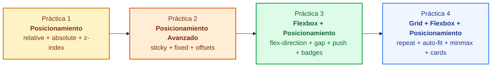
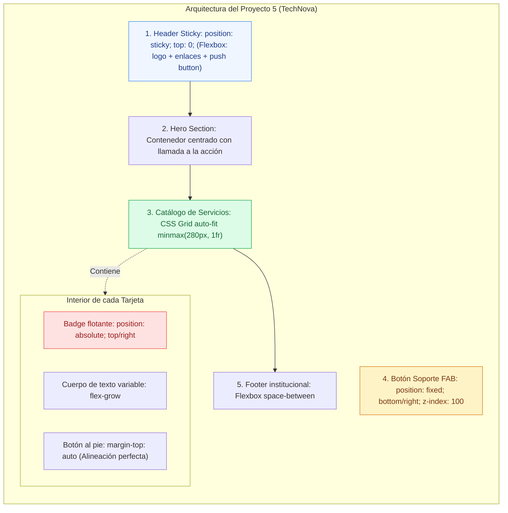
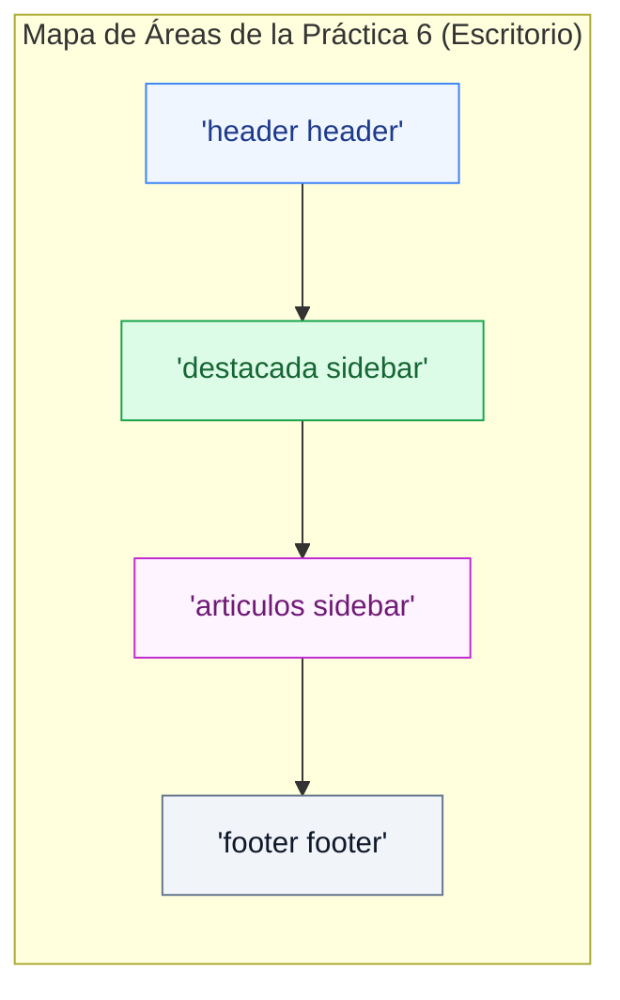
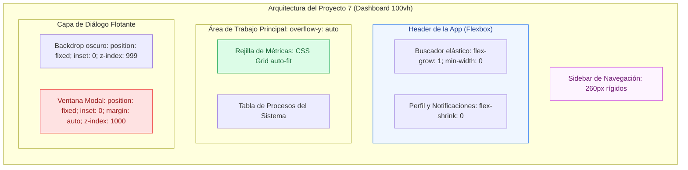

# Prácticas de Layout: Posicionamiento, Flexbox y Grid

<div class="badges">
  <span class="badge badge-css">CSS3 Moderno</span>
  <span class="badge badge-blue">Itinerario Progresivo</span>
  <span class="badge badge-amber">Posicionamiento</span>
  <span class="badge badge-green">Flexbox</span>
  <span class="badge badge-purple">CSS Grid</span>
  <span class="badge badge-ra">RA 2 / RA 3</span>
</div>

<div class="admonition tip">
<p class="admonition-title">Metodología de Trabajo: Reto de Maquetación con Lienzo Visual (Canvas)</p>
<p>
Para desarrollar tu intuición espacial y rigor técnico como desarrollador frontend, <strong>este documento no incluye soluciones CSS para copiar y pegar</strong>. En cada práctica dispones de:
</p>
<ol>
  <li><strong>Lienzo Visual <code>&lt;canvas&gt;</code></strong>: Una representación gráfica pixel-perfect del objetivo a replicar (renderizada en mapa de bits en el navegador, sin estilos CSS en el DOM inspeccionable).</li>
  <li><strong>Código HTML Base</strong>: El marcado semántico limpio con las clases que debes estilizar en tu propio fichero <code>.css</code>.</li>
  <li><strong>Requerimientos Técnicos y Rúbrica</strong>: Los criterios de modelo de caja, posicionamiento, flexbox o grid requeridos.</li>
</ol>
</div>

En el desarrollo web profesional, **ningún modelo de maquetación resuelve todos los problemas por sí solo**. La creación de interfaces de usuario robustas, accesibles y resilientes exige comprender con precisión el rol específico de cada tecnología:

1. **Posicionamiento (`position` y `z-index`):** Controla elementos que deben escapar del flujo normal o fijarse durante el desplazamiento (insignias, capas superpuestas, cabeceras adhesivas, barras flotantes y ventanas modales).
2. **Flexbox (Unidimensional - 1D):** Especializado en la distribución, orden y alineación geométrica elástica a lo largo de un único eje lineal (barras de navegación, fichas de catálogo, metadatos y botones al pie).
3. **CSS Grid (Bidimensional - 2D):** Especializado en el esqueleto estructural macro (diseño previo de filas y columnas, áreas nombradas y cuadrículas responsivas autoajustables).

Este documento está estructurado de forma **estrictamente secuencial y acumulativa** en dos bloques:

* **Bloque I: Fundamentos Incrementales (Dificultad Guiada):** 4 prácticas paso a paso. Comienza dominando el posicionamiento, añade la flexibilidad lineal de Flexbox e incorpora la retícula de CSS Grid.
* **Bloque II: Proyectos Integrales de Página Completa (Nivel Profesional):** 3 proyectos de aplicación real de página completa (*Landing Page*, *Periódico Editorial* y *Dashboard SPA 100vh*).

---

# BLOQUE I: Fundamentos Incrementales (Paso a Paso)



---


## Práctica 1: Tarjeta Comercial con Capas, Badges y Tooltip (Fundamentos de Posicionamiento)

!!! info "Objetivo pedagógico de la práctica"
    El objetivo de esta primera práctica es dominar el comportamiento de los elementos **fuera del flujo normal** mediante la interacción entre:
    
    * **`position: relative`** en el contenedor padre, estableciendo el **bloque contenedor de referencia**.
    * **`position: absolute`** en elementos hijos para ubicar una insignia de descuento en una esquina, un botón de favoritos y un mensaje flotante informativo (*tooltip*).
    * La propiedad **`z-index`** para garantizar el orden de apilamiento correcto sobre la imagen del producto.

### 1. Escenario y Requerimientos

Vas a maquetar la tarjeta de producto de una tienda de tecnología para unos auriculares inalámbricos de estudio:

1. **Bloque Contenedor:**
    * El elemento `.card-product` debe tener ancho acotado (`max-width: 320px`), fondo blanco, borde y esquinas redondeadas. **No debes usar `overflow: hidden;` en `.card-product`**, ya que recortaría físicamente cualquier elemento hijo que sobresalga (como el *tooltip* superior), sin importar su nivel de `z-index`.
    * El contenedor de la imagen `.product-media` debe declarar **`position: relative;`** para actuar como sistema de coordenadas de sus elementos hijos absolutos, y aplicar `border-top-left-radius` y `border-top-right-radius` para adaptarse al borde redondeado superior de la tarjeta.
2. **Insignia de Descuento (Badge):**
    * La etiqueta `.badge-discount` («-25% HOY») debe posicionarse de forma absoluta en la esquina superior izquierda de la imagen (`top: 0.75rem; left: 0.75rem;`).
3. **Botón de Favoritos con Tooltip:**
    * El botón flotante `.btn-favorite` (icono de corazón) debe ubicarse de forma absoluta en la esquina superior derecha (`top: 0.75rem; right: 0.75rem;`).
    * Al pasar el cursor (`:hover`) o enfocar por teclado (`:focus-visible`), debe mostrarse un texto flotante `.tooltip` centrado horizontalmente justo encima del botón, utilizando `position: absolute; bottom: calc(100% + 6px); left: 50%; transform: translateX(-50%);`.
4. **Cuerpo del Producto:**
    * Debajo de la imagen, muestra el título, la valoración en estrellas, el precio rebajado y un botón de añadir al carrito.

---

### 2. Código Fuente de la Práctica 1

### 2. Lienzo Gráfico y Código HTML Base

=== "Lienzo Visual"

    !!! tip "Objetivo visual a replicar"
        Observa con detenimiento las coordenadas, alineaciones y proporciones en el siguiente lienzo gráfico. Debes conseguir este resultado visual exacto escribiendo tu propia hoja de estilos CSS. **El código CSS no está expuesto en el código fuente de la página.**

    <div class="browser-preview">
      <div class="browser-preview-bar">
        <span class="browser-preview-dot red"></span>
        <span class="browser-preview-dot yellow"></span>
        <span class="browser-preview-dot green"></span>
        <span style="font-family: monospace; font-size: 0.75rem; color: #64748b; margin-left: 0.5rem;">canvas://practica-01-objetivo-visual</span>
      </div>
      <div class="browser-preview-body" style="background: #0f172a; text-align: center; padding: 1.5rem 0.5rem; overflow-x: auto;">
        <canva id="canva-practica-1" style="display:none;"></canva>
        <canvas id="canvas-practica-1" width="760" height="460" style="max-width: 100%; height: auto; border-radius: 8px; box-shadow: 0 4px 20px rgba(0,0,0,0.4);" aria-label="Lienzo gráfico con la visualización esperada de la Práctica 1">
          Tu navegador no soporta el elemento canvas de HTML5.
        </canvas>
      </div>
    </div>

=== "Código HTML Base"

    ```html title="practica-01-tarjeta-posicionamiento.html"
    <!DOCTYPE html>
    <html lang="es">
    <head>
      <meta charset="UTF-8">
      <meta name="viewport" content="width=device-width, initial-scale=1.0">
      <title>Práctica 1: Posicionamiento — Tarjeta de Producto</title>
      <link rel="stylesheet" href="practica-01-tarjeta-posicionamiento.css">
    </head>
    <body>

      <main class="showcase">
        <!-- TARJETA DE PRODUCTO -->
        <article class="card-product">
          
          <!-- ZONA MULTIMEDIA CON ELEMENTOS ABSOLUTOS SUPERPUESTOS -->
          <div class="product-media">
            <!-- 1. Insignia absoluta en esquina superior izquierda -->
            <span class="badge-discount">-25% HOY</span>

            <!-- 2. Botón flotante absoluto en esquina superior derecha con tooltip -->
            <button type="button" class="btn-favorite" aria-label="Guardar en favoritos">
              <span>🤍</span>
              <span class="tooltip" role="tooltip">Añadir a mi lista</span>
            </button>

            <!-- Imagen del producto -->
            <div class="product-image-mockup">
              <span class="product-icon">🎧</span>
            </div>
          </div>

          <!-- INFORMACIÓN DEL PRODUCTO (FLUJO NORMAL) -->
          <div class="product-details">
            <span class="product-brand">AudioPro Elite</span>
            <h2 class="product-title">Auriculares Studio Wireless Pro ANC</h2>
            
            <div class="product-rating">
              <span class="stars">★★★★★</span>
              <span class="rating-count">(142)</span>
            </div>

            <div class="product-pricing">
              <span class="price-current">149,99€</span>
              <span class="price-old">199,99€</span>
            </div>

            <button type="button" class="btn-buy">Añadir a la Cesta</button>
          </div>

        </article>
      </main>

    </body>
    </html>
    ```

---

### 3. Puntos Críticos y Rúbrica de la Práctica 1

!!! warning "La Trampa de `overflow: hidden` frente a `z-index`: ¿Por qué se cortaba el Tooltip?"
    Un error clásico al maquetar tarjetas con elementos flotantes es añadir `overflow: hidden;` a `.card-product` para recortar automáticamente la imagen superior.
    
    * **¿Por qué falla el tooltip aunque tenga `z-index: 10`?**
      `overflow: hidden` crea una frontera física de recorte (*clipping path*). Aunque apliques `z-index: 10`, `z-index: 999` o `z-index: 999999`, **`z-index` únicamente define el orden de apilamiento en el eje perpendicular (profundidad Z), pero jamás puede anular ni atravesar el recorte geométrico de un contenedor ancestro con `overflow: hidden`**.
    * **La solución arquitectónica correcta:**
      1. Quitar `overflow: hidden;` de la tarjeta padre `.card-product`.
      2. Aplicar `border-top-left-radius` y `border-top-right-radius` directamente a `.product-media` para mantener el acabado visual limpio sin amputar los elementos flotantes.

!!! tip "¿Qué ocurre si eliminas `position: relative` de `.product-media`?"
    Si comentas la regla `position: relative;` del contenedor multimedia, el navegador buscará hacia arriba en el árbol DOM hasta el elemento raíz `<html>`. Como consecuencia, la insignia `-25%` y el botón de favoritos volarán a la esquina superior de la ventana del navegador, saliéndose por completo de la tarjeta.

!!! success "Rúbrica de verificación (Práctica 1)"
    - [ ] **Referencia espacial:** `.product-media` tiene `position: relative;` y sirve de origen de coordenadas `(0,0)`.
    - [ ] **Sin recorte de desbordamiento:** `.card-product` no tiene `overflow: hidden;`, permitiendo que el `.tooltip` sobresalga y se lea al completo sin amputarse.
    - [ ] **Insignia fija en esquina:** `.badge-discount` usa `position: absolute; top: 0.75rem; left: 0.75rem;`.
    - [ ] **Botón en esquina:** `.btn-favorite` usa `position: absolute; top: 0.75rem; right: 0.75rem;`.
    - [ ] **Tooltip flotante:** El mensaje explicativo descansa encima del botón con `bottom: calc(100% + 8px); left: 50%; transform: translateX(-50%);` y solo se muestra en `:hover` o `:focus-visible`.

---

## Práctica 2: Barra Superior Adhesiva y Banner Fijo de Consentimiento (Sticky vs Fixed)

!!! info "Objetivo pedagógico de la práctica"
    El objetivo de esta segunda práctica es dominar la diferencia técnica entre dos esquemas de posicionamiento esenciales:
    
    * **`position: sticky`:** El elemento fluye normalmente con el texto hasta que el scroll del usuario alcanza su umbral (`top: 0`), momento en el que se congela en pantalla mientras su contenedor padre continúe en el área visible.
    * **`position: fixed`:** El elemento se extrae completamente del flujo y se ancla de forma inmutable respecto a la ventana física (*Viewport*). Se aplicará en un botón de «Subir Arriba» y en un aviso inferior de cookies.

### 1. Escenario y Requerimientos

Maquetarás la vista de lectura y documentación de una academia online:

1. **Cabecera Adhesiva (`sticky-header`):**
    * La barra superior `.sticky-header` debe permanecer visible pegada al borde superior de la pantalla durante todo el desplazamiento (`position: sticky; top: 0;`) con `z-index: 100` y fondo oscuro (`#0f172a`).
    * Contiene el logotipo corporativo (`⚡ DominIA Academy`), un menú de navegación principal con los enlaces `Inicio`, `Artículos`, `Lecciones` y `Recursos`, y un botón de notificaciones con icono de campana `🔔` e insignia numérica roja (`.notification-badge`) superpuesta en la esquina superior derecha (`position: absolute; top: 0; right: 0;`).
2. **Cuerpo del Artículo y Cuadrícula Comparativa:**
    * Encabezado con título principal `Guía Maestra: Sticky vs Fixed en CSS` y subtítulo explicativo.
    * Una cuadrícula `.cards-grid` con dos tarjetas comparativas:
        * `.concept-card--sticky`: Título azul `1. Comportamiento Sticky`, explicación y badge `position: sticky; top: 0;`.
        * `.concept-card--fixed`: Título naranja `2. Comportamiento Fixed`, explicación y badge `position: fixed; bottom: 0;`.
    * Párrafos de lectura complementarios para garantizar suficiente recorrido de desplazamiento vertical en el navegador.
3. **Botón Volver Arriba (`fixed`):**
    * Un botón circular flotante `.btn-scroll-top` en la esquina inferior derecha con `position: fixed; bottom: 5rem; right: 1.5rem; z-index: 90;` y flecha `↑`.
4. **Banner de Consentimiento Fijo Inferior (`fixed`):**
    * Una barra fija inferior `.cookie-banner` que ocupa el 100% del ancho con `position: fixed; bottom: 0; left: 0; right: 0; z-index: 95;`.
    * Contiene el texto `🍪 Utilizamos cookies técnicas para garantizar el funcionamiento del aula.` y el botón `Aceptar todas`.
    * El elemento `body` debe reservar un margen inferior (`padding-bottom: 6rem;`) para que el banner fijo no tape el final del artículo.

### 2. Lienzo Gráfico y Código HTML Base

=== "Lienzo Visual"

    !!! tip "Objetivo visual a replicar"
        Observa con detenimiento las coordenadas, alineaciones y proporciones en el siguiente lienzo gráfico. Debes conseguir este resultado visual exacto escribiendo tu propia hoja de estilos CSS. **El código CSS no está expuesto en el código fuente de la página.**

    <div class="browser-preview">
      <div class="browser-preview-bar">
        <span class="browser-preview-dot red"></span>
        <span class="browser-preview-dot yellow"></span>
        <span class="browser-preview-dot green"></span>
        <span style="font-family: monospace; font-size: 0.75rem; color: #64748b; margin-left: 0.5rem;">canvas://practica-02-objetivo-visual</span>
      </div>
      <div class="browser-preview-body" style="background: #0f172a; text-align: center; padding: 1.5rem 0.5rem; overflow-x: auto;">
        <canva id="canva-practica-2" style="display:none;"></canva>
        <canvas id="canvas-practica-2" width="760" height="500" style="max-width: 100%; height: auto; border-radius: 8px; box-shadow: 0 4px 20px rgba(0,0,0,0.4);" aria-label="Lienzo gráfico con la visualización esperada de la Práctica 2">
          Tu navegador no soporta el elemento canvas de HTML5.
        </canvas>
      </div>
    </div>

=== "Código HTML Base"

    ```html title="practica-02-sticky-vs-fixed.html"
    <!DOCTYPE html>
    <html lang="es">
    <head>
      <meta charset="UTF-8">
      <meta name="viewport" content="width=device-width, initial-scale=1.0">
      <title>Práctica 2: Posicionamiento — Sticky vs Fixed</title>
      <link rel="stylesheet" href="practica-02-sticky-vs-fixed.css">
    </head>
    <body>

      <!-- 1. CABECERA ADHESIVA (POSITION: STICKY) -->
      <header class="sticky-header">
        <div class="header-content">
          <!-- Logotipo de la academia -->
          <a href="#" class="logo">
            <span class="logo-icon">⚡</span>
            <span class="logo-text">DominIA Academy</span>
          </a>

          <!-- Menú de navegación principal -->
          <nav class="main-nav" aria-label="Navegación principal">
            <a href="#" class="nav-link active">Inicio</a>
            <a href="#" class="nav-link">Artículos</a>
            <a href="#" class="nav-link">Lecciones</a>
            <a href="#" class="nav-link">Recursos</a>
          </nav>

          <!-- Zona de acciones con campana e insignia absoluta -->
          <div class="header-actions">
            <button type="button" class="btn-notifications" aria-label="Notificaciones">
              <span class="bell-icon">🔔</span>
              <span class="notification-badge" aria-label="3 notificaciones nuevas">3</span>
            </button>
          </div>
        </div>
      </header>

      <!-- 2. CONTENIDO PRINCIPAL CON TARJETAS COMPARATIVAS Y SCROLL EXTENSO -->
      <main class="article-container">
        <header class="article-intro">
          <h1 class="article-title">Guía Maestra: Sticky vs Fixed en CSS</h1>
          <p class="article-lead">
            Aprende la diferencia operativa entre elementos anclados al flujo y fijados a la ventana.
          </p>
        </header>

        <!-- Tarjetas comparativas principales -->
        <section class="cards-grid">
          <!-- Tarjeta 1: Comportamiento Sticky -->
          <article class="concept-card concept-card--sticky">
            <h2 class="card-title">1. Comportamiento Sticky</h2>
            <p class="card-desc">
              El elemento fluye con el scroll hasta alcanzar top: 0, donde queda congelado. 
              Requiere que su contenedor padre mantenga altura en pantalla.
            </p>
            <div class="card-footer">
              <span class="badge badge--sticky">position: sticky; top: 0;</span>
            </div>
          </article>

          <!-- Tarjeta 2: Comportamiento Fixed -->
          <article class="concept-card concept-card--fixed">
            <h2 class="card-title">2. Comportamiento Fixed</h2>
            <p class="card-desc">
              Se extrae por completo del flujo y se ancla al viewport físico de la pantalla. 
              No se mueve jamás al hacer scroll, independientemente de los padres.
            </p>
            <div class="card-footer">
              <span class="badge badge--fixed">position: fixed; bottom: 0;</span>
            </div>
          </article>
        </section>

        <!-- Secciones de texto extendido para garantizar recorrido de scroll holgado -->
        <section class="text-block">
          <h2>3. Profundizando en el Mecanismo de Sticky</h2>
          <p>
            A diferencia de <code>fixed</code>, un elemento <code>sticky</code> respeta su hueco inicial en el documento. 
            No requiere compensaciones artificiales de <code>padding-top</code> en el <code>body</code>. 
            Al hacer scroll y alcanzar el umbral declarado (por ejemplo <code>top: 0</code>), conmuta su renderizado 
            a fijo relativo a la pantalla hasta que su contenedor ancestro finaliza.
          </p>
        </section>

        <section class="text-block">
          <h2>4. El Funcionamiento Inmutable de Fixed</h2>
          <p>
            Los elementos <code>fixed</code> se posicionan siempre respecto al <em>Viewport</em> (la ventana del navegador). 
            Por este motivo son la solución obligada para barras de consentimiento, botones flotantes de ayuda o retorno 
            al inicio (FAB) y ventanas modales de diálogo.
          </p>
        </section>

        <section class="text-block">
          <h2>5. La Jerarquía de Capas con z-index</h2>
          <p>
            Tanto la cabecera adhesiva (<code>z-index: 100</code>) como los elementos fijos inferiores 
            (<code>z-index: 90</code> y <code>95</code>) deben declarar niveles de apilamiento superiores al contenido 
            estándar para evitar que imágenes o bloques de código los oculten durante el desplazamiento.
          </p>
        </section>
      </main>

      <!-- 3. BOTÓN FLOTANTE FIJO (POSITION: FIXED) -->
      <a href="#" class="btn-scroll-top" title="Volver al principio" aria-label="Volver al principio">
        ↑
      </a>

      <!-- 4. BANNER DE CONSENTIMIENTO FIJO INFERIOR (POSITION: FIXED) -->
      <aside class="cookie-banner" role="region" aria-label="Aviso de privacidad">
        <div class="cookie-content">
          <p class="cookie-text">
            🍪 Utilizamos cookies técnicas para garantizar el funcionamiento del aula.
          </p>
          <div class="cookie-actions">
            <button type="button" class="btn-cookie">Aceptar todas</button>
          </div>
        </div>
      </aside>

    </body>
    </html>
    ```

---

### 3. Puntos Críticos y Rúbrica de la Práctica 2

!!! tip "Diferencia de comportamiento en el flujo: Sticky vs Fixed"
    * **`position: sticky`** mantiene su espacio en el flujo normal del documento al cargar la página; solo conmuta a comportamiento flotante cuando el scroll alcanza su coordenada umbral (`top: 0`).
    * **`position: fixed`** extrae al elemento por completo del flujo desde el primer instante; no reserva espacio en el layout y se ancla de forma inmutable respecto a la ventana física (*Viewport*).

!!! success "Rúbrica de verificación (Práctica 2)"
    - [ ] **Cabecera adhesiva (`sticky`):** `.sticky-header` tiene `position: sticky; top: 0; z-index: 100;` y se mantiene visible durante todo el scroll.
    - [ ] **Estructura de cabecera:** La cabecera incluye el logotipo `⚡ DominIA Academy`, el menú con enlaces (`Inicio`, `Artículos`, `Lecciones`, `Recursos`) y el botón con campana `🔔`.
    - [ ] **Insignia numérica absoluta:** `.notification-badge` se posiciona de forma absoluta respecto al botón de notificaciones (`position: absolute; top: 0; right: 0;`).
    - [ ] **Cuadrícula comparativa:** Las tarjetas `.concept-card--sticky` y `.concept-card--fixed` explican claramente ambos comportamientos.
    - [ ] **Botón flotante fijo:** `.btn-scroll-top` usa `position: fixed; bottom: 5rem; right: 1.5rem; z-index: 90;`.
    - [ ] **Banner fijo de cookies:** `.cookie-banner` usa `position: fixed; bottom: 0; left: 0; width: 100%; z-index: 95;`.
    - [ ] **Reserva de espacio inferior:** `body` incluye `padding-bottom: 6rem;` para evitar que el banner fijo tape el último bloque de texto.

---

## Práctica 3: Ficha de Perfil y Barra de Acciones (Flexbox + Posicionamiento)

!!! info "Objetivo pedagógico de la práctica"
    Esta práctica integra el **modelo de caja unidimensional de Flexbox** con el **posicionamiento de capas**, abordando:
    
    * **Distribución lineal:** `flex-direction`, `justify-content: space-between`, `align-items: center` y `gap`.
    * **Efecto Push con `margin-inline-start: auto`** para empujar botones al extremo sin contenedores anidados vacíos.
    * **Avatar circular protegido con `flex-shrink: 0`** e indicador de estado («En línea») superpuesto con `position: absolute`.
    * **Solución de textos desbordantes** con `min-width: 0` y puntos suspensivos (`text-overflow: ellipsis`).

### 1. Escenario y Requerimientos

Maquetarás un componente de ficha de usuario para el panel interno de una empresa tecnológica:

1. **Barra de Acciones Superior (Flexbox):**
    * Contenedor con `display: flex; align-items: center; gap: 1rem;`.
    * El botón «Cerrar Sesión» debe empujarse automáticamente al final derecho mediante `margin-inline-start: auto;`.
2. **Tarjeta de Usuario (Flexbox Horizontal):**
    * El avatar circular debe medir 56px × 56px y declarar obligatoriamente **`flex-shrink: 0;`** para evitar que se deforme en un óvalo si el nombre del usuario es largo.
    * El avatar debe tener `position: relative;` y en su esquina inferior derecha debe anclarse un punto verde de conexión mediante `position: absolute; bottom: 0; right: 0;`.
3. **Control de Desbordamiento:**
    * El bloque de datos del usuario debe declarar **`min-width: 0;`** para permitir que un nombre de usuario largo se trunque con puntos suspensivos (`text-overflow: ellipsis; white-space: nowrap; overflow: hidden;`).
4. **Lista de Habilidades (Flex-wrap):**
    * Un conjunto de insignias que deben envolver limpiamente en varias filas mediante `flex-wrap: wrap; gap: 0.5rem;`.

---

### 2. Código Fuente de la Práctica 3

### 2. Lienzo Gráfico y Código HTML Base

=== "Lienzo Visual"

    !!! tip "Objetivo visual a replicar"
        Observa con detenimiento las coordenadas, alineaciones y proporciones en el siguiente lienzo gráfico. Debes conseguir este resultado visual exacto escribiendo tu propia hoja de estilos CSS. **El código CSS no está expuesto en el código fuente de la página.**

    <div class="browser-preview">
      <div class="browser-preview-bar">
        <span class="browser-preview-dot red"></span>
        <span class="browser-preview-dot yellow"></span>
        <span class="browser-preview-dot green"></span>
        <span style="font-family: monospace; font-size: 0.75rem; color: #64748b; margin-left: 0.5rem;">canvas://practica-03-objetivo-visual</span>
      </div>
      <div class="browser-preview-body" style="background: #0f172a; text-align: center; padding: 1.5rem 0.5rem; overflow-x: auto;">
        <canva id="canva-practica-3" style="display:none;"></canva>
        <canvas id="canvas-practica-3" width="760" height="480" style="max-width: 100%; height: auto; border-radius: 8px; box-shadow: 0 4px 20px rgba(0,0,0,0.4);" aria-label="Lienzo gráfico con la visualización esperada de la Práctica 3">
          Tu navegador no soporta el elemento canvas de HTML5.
        </canvas>
      </div>
    </div>

=== "Código HTML Base"

    ```html title="practica-03-flexbox-perfil.html"
    <!DOCTYPE html>
    <html lang="es">
    <head>
      <meta charset="UTF-8">
      <meta name="viewport" content="width=device-width, initial-scale=1.0">
      <title>Práctica 3: Flexbox y Posicionamiento — Ficha de Perfil</title>
      <link rel="stylesheet" href="practica-03-flexbox-perfil.css">
    </head>
    <body>

      <main class="panel-container">

        <!-- 1. BARRA SUPERIOR CON FLEXBOX Y EFECTO PUSH -->
        <header class="toolbar">
          <div class="toolbar-brand">
            <span class="toolbar-icon">⚙️</span>
            <h3>Panel de Desarrollador</h3>
          </div>
          <!-- Este botón absorbe el espacio libre a su izquierda mediante margin-inline-start: auto -->
          <button type="button" class="btn-logout">Cerrar Sesión</button>
        </header>

        <!-- 2. TARJETA DE PERFIL (FLEXBOX + BADGE ABSOLUTA) -->
        <article class="profile-card">
          
          <div class="profile-header">
            <!-- AVATAR CON POSITION: RELATIVE Y FLEX-SHRINK: 0 -->
            <div class="avatar-wrapper">
              <span class="avatar-img">👩‍💻</span>
              <!-- Indicador de conexión absoluto -->
              <span class="status-dot status-dot--online" title="Usuario en línea"></span>
            </div>

            <!-- DATOS DE USUARIO CON PROTECCIÓN MIN-WIDTH: 0 -->
            <div class="profile-data">
              <h2 class="user-name">Alejandra Gómez de la Torre de la Vega</h2>
              <span class="user-role">Ingeniera Cloud & DevOps Senior</span>
              <span class="user-location">📍 Madrid, España</span>
            </div>
          </div>

          <!-- 3. LISTA DE HABILIDADES CON FLEX-WRAP -->
          <div class="skills-block">
            <h4 class="skills-title">Competencias Tecnológicas</h4>
            <div class="tags-cloud">
              <span class="tag">Docker</span>
              <span class="tag">Kubernetes</span>
              <span class="tag">TypeScript</span>
              <span class="tag">CSS Grid</span>
              <span class="tag">Flexbox</span>
              <span class="tag">Microservicios</span>
              <span class="tag">Terraform</span>
              <span class="tag">CI/CD Pipelines</span>
            </div>
          </div>

          <!-- 4. FOOTER DE LA TARJETA CON SPACE-BETWEEN -->
          <footer class="profile-footer">
            <span class="reputation-score">Puntuación: <strong>98.5%</strong></span>
            <button type="button" class="btn-action">Asignar Proyecto</button>
          </footer>

        </article>
      </main>

    </body>
    </html>
    ```

---


---

## Práctica 4: Catálogo de Cursos en Cuadrícula (Grid + Flexbox + Posicionamiento)

!!! info "Objetivo pedagógico de la práctica"
    Esta práctica une por primera vez los **tres pilares en un único componente**:
    
    * **CSS Grid (Macro):** Estructura el catálogo con columnas responsivas automáticas mediante `repeat(auto-fit, minmax(260px, 1fr))` y `gap: 1.5rem;`.
    * **Flexbox (Micro):** Organiza el interior de cada tarjeta en vertical (`flex-direction: column`), empujando el botón de matrícula al pie con `margin-top: auto;` para igualar alturas dispares.
    * **Posicionamiento (Capas):** Insignia de nivel del curso anclada en la esquina de la imagen mediante `position: absolute; top: 0.75rem; right: 0.75rem;`.

### 1. Escenario y Requerimientos

Maquetarás el catálogo de cursos de formación online para desarrolladores web:

1. **Catálogo con CSS Grid:**
    * El contenedor `.courses-grid` debe maquetarse con `display: grid; grid-template-columns: repeat(auto-fit, minmax(260px, 1fr)); gap: 1.5rem;`.
    * Debe adaptarse automáticamente de 3 o 4 columnas en escritorio a 2 en tablet y 1 en móvil sin media queries.
2. **Tarjeta de Curso (Flexbox Vertical):**
    * Cada tarjeta `.course-card` debe tener `display: flex; flex-direction: column;`.
    * La descripción del curso tiene longitudes variables. El pie de la tarjeta `.course-card__footer` debe declarar **`margin-top: auto;`** para que todos los botones de inscripción queden perfectamente alineados en la misma cota inferior.
3. **Insignia de Dificultad (Posicionamiento Absoluto):**
    * La cabecera de la tarjeta `.course-card__media` tiene `position: relative;`.
    * La etiqueta de dificultad `.badge-level` se ubica con `position: absolute; top: 0.75rem; right: 0.75rem; z-index: 2;`.

---

### 2. Código Fuente de la Práctica 4

### 2. Lienzo Gráfico y Código HTML Base

=== "Lienzo Visual"

    !!! tip "Objetivo visual a replicar"
        Observa con detenimiento las coordenadas, alineaciones y proporciones en el siguiente lienzo gráfico. Debes conseguir este resultado visual exacto escribiendo tu propia hoja de estilos CSS. **El código CSS no está expuesto en el código fuente de la página.**

    <div class="browser-preview">
      <div class="browser-preview-bar">
        <span class="browser-preview-dot red"></span>
        <span class="browser-preview-dot yellow"></span>
        <span class="browser-preview-dot green"></span>
        <span style="font-family: monospace; font-size: 0.75rem; color: #64748b; margin-left: 0.5rem;">canvas://practica-04-objetivo-visual</span>
      </div>
      <div class="browser-preview-body" style="background: #0f172a; text-align: center; padding: 1.5rem 0.5rem; overflow-x: auto;">
        <canva id="canva-practica-4" style="display:none;"></canva>
        <canvas id="canvas-practica-4" width="760" height="490" style="max-width: 100%; height: auto; border-radius: 8px; box-shadow: 0 4px 20px rgba(0,0,0,0.4);" aria-label="Lienzo gráfico con la visualización esperada de la Práctica 4">
          Tu navegador no soporta el elemento canvas de HTML5.
        </canvas>
      </div>
    </div>

=== "Código HTML Base"

    ```html title="practica-04-grid-flex-posicionamiento.html"
    <!DOCTYPE html>
    <html lang="es">
    <head>
      <meta charset="UTF-8">
      <meta name="viewport" content="width=device-width, initial-scale=1.0">
      <title>Práctica 4: Grid, Flexbox y Posicionamiento — Catálogo</title>
      <link rel="stylesheet" href="practica-04-grid-flex-posicionamiento.css">
    </head>
    <body>

      <main class="catalog-wrapper">
        <header class="catalog-header">
          <h1>Cursos Oficiales de Desarrollo Web</h1>
          <p>Catálogo modular para ciclos formativos de Grado Superior (DAW / DAM).</p>
        </header>

        <!-- 1. CUADRÍCULA CSS GRID -->
        <section class="courses-grid">

          <!-- Tarjeta 1: Con texto medio -->
          <article class="course-card">
            <div class="course-card__media">
              <span class="badge-level badge-level--intermediate">Intermedio</span>
              <span class="media-icon">🎨</span>
            </div>
            <div class="course-card__body">
              <span class="course-tag">CSS3 Avanzado</span>
              <h2 class="course-title">Maquetación Moderna con Flexbox y CSS Grid</h2>
              <p class="course-desc">
                Aprende a estructurar aplicaciones web responsivas combinando layouts unidimensionales y bidimensionales.
              </p>
            </div>
            <!-- Pie de tarjeta empujado al fondo con margin-top: auto -->
            <div class="course-card__footer">
              <span class="course-price">Gratuito</span>
              <button type="button" class="btn-enroll">Matricularme</button>
            </div>
          </article>

          <!-- Tarjeta 2: Con texto MUY largo -->
          <article class="course-card">
            <div class="course-card__media">
              <span class="badge-level badge-level--advanced">Avanzado</span>
              <span class="media-icon">⚙️</span>
            </div>
            <div class="course-card__body">
              <span class="course-tag">Backend</span>
              <h2 class="course-title">Microservicios y APIs REST con Node.js y PostgreSQL</h2>
              <p class="course-desc">
                Construcción paso a paso de arquitecturas distribuidas, autenticación segura mediante tokens JWT, 
                migraciones de base de datos relacionales y pruebas automatizadas con Jest y Supertest.
              </p>
            </div>
            <div class="course-card__footer">
              <span class="course-price">120€</span>
              <button type="button" class="btn-enroll">Matricularme</button>
            </div>
          </article>

          <!-- Tarjeta 3: Con texto MUY breve -->
          <article class="course-card">
            <div class="course-card__media">
              <span class="badge-level badge-level--beginner">Iniciación</span>
              <span class="media-icon">📄</span>
            </div>
            <div class="course-card__body">
              <span class="course-tag">Semántica</span>
              <h2 class="course-title">Fundamentos de HTML5 y Accesibilidad Web</h2>
              <p class="course-desc">
                Etiquetado semántico y buenas prácticas de usabilidad.
              </p>
            </div>
            <div class="course-card__footer">
              <span class="course-price">Gratuito</span>
              <button type="button" class="btn-enroll">Matricularme</button>
            </div>
          </article>

        </section>
      </main>

    </body>
    </html>
    ```

---


---

## Práctica 5 (Proyecto): Landing Page Corporativa con Catálogo de Servicios («TechNova Solutions»)

!!! info "Objetivo pedagógico del proyecto"
    Construir la arquitectura completa de una **página de aterrizaje corporativa (*landing page*)**, integrando:
    
    * Una **cuadrícula responsiva autoajustable** con CSS Grid (`repeat`, `auto-fit`, `minmax`) sin recurrir a consultas de medios (*media queries*).
    * Una **barra de navegación elástica** y **tarjetas de servicio con alturas variables** mediante Flexbox, aprovechando el efecto *push* de los márgenes automáticos para anclar botones a la misma cota inferior.
    * Una **cabecera adhesiva (`position: sticky`)**, **insignias flotantes (`position: absolute`)** y un **botón flotante de contacto (`position: fixed`)**.



### 1. Escenario y Requerimientos

La consultora tecnológica **TechNova Solutions** necesita maquetar su nueva página comercial. Se requiere que:

1. **Estructura Global y Cabecera:**
    * El elemento `<header>` debe fijarse al borde superior de la pantalla mediante `position: sticky; top: 0;` y contar con un nivel de apilamiento `z-index: 100` para que ningún contenido de la página lo solape al hacer scroll.
    * El menú de navegación debe usar `display: flex; align-items: center; gap: 1.5rem;`. El botón «Acceso Clientes» debe empujarse automáticamente al extremo derecho mediante la propiedad lógica `margin-inline-start: auto;`.
2. **Catálogo de Servicios:**
    * El contenedor `.services-grid` debe maquetarse con **CSS Grid** utilizando una pista elástica autoajustable con la fórmula:
      grid-template-columns: repeat(auto-fit, minmax(280px, 1fr));
    * La separación entre celdas debe declararse mediante `gap: 2rem;`.
3. **Tarjetas de Servicio:**
    * Cada tarjeta `.service-card` debe comportarse como un contenedor `display: flex; flex-direction: column;` para que los botones de contratación `.btn-card` queden matemáticamente alineados al fondo mediante `margin-top: auto;`, sin importar que una tarjeta tenga dos líneas de descripción y otra tenga cinco.
    * La tarjeta destacada debe llevar una insignia flotante «MÁS DEMANDADO» posicionada con `position: absolute; top: -12px; right: 1rem;`, para lo cual la tarjeta debe establecer `position: relative;`.
4. **Elemento de Soporte Flotante (FAB):**
    * Un botón de asistencia flotante `.fab-support` debe permanecer anclado de forma fija en la esquina inferior derecha del *viewport* (`position: fixed; bottom: 2rem; right: 2rem; z-index: 90;`).

---

### 2. Código Fuente de la Práctica 5

### 2. Lienzo Gráfico y Código HTML Base

=== "Lienzo Visual"

    !!! tip "Objetivo visual a replicar"
        Observa con detenimiento las coordenadas, alineaciones y proporciones en el siguiente lienzo gráfico. Debes conseguir este resultado visual exacto escribiendo tu propia hoja de estilos CSS. **El código CSS no está expuesto en el código fuente de la página.**

    <div class="browser-preview">
      <div class="browser-preview-bar">
        <span class="browser-preview-dot red"></span>
        <span class="browser-preview-dot yellow"></span>
        <span class="browser-preview-dot green"></span>
        <span style="font-family: monospace; font-size: 0.75rem; color: #64748b; margin-left: 0.5rem;">canvas://practica-05-objetivo-visual</span>
      </div>
      <div class="browser-preview-body" style="background: #0f172a; text-align: center; padding: 1.5rem 0.5rem; overflow-x: auto;">
        <canva id="canva-practica-5" style="display:none;"></canva>
        <canvas id="canvas-practica-5" width="760" height="540" style="max-width: 100%; height: auto; border-radius: 8px; box-shadow: 0 4px 20px rgba(0,0,0,0.4);" aria-label="Lienzo gráfico con la visualización esperada de la Práctica 5">
          Tu navegador no soporta el elemento canvas de HTML5.
        </canvas>
      </div>
    </div>

=== "Código HTML Base"

    ```html title="practica-05-technova.html"
    <!DOCTYPE html>
    <html lang="es">
    <head>
      <meta charset="UTF-8">
      <meta name="viewport" content="width=device-width, initial-scale=1.0">
      <title>TechNova Solutions — Servicios Cloud y DevOps</title>
      <link rel="stylesheet" href="practica-05-technova.css">
    </head>
    <body>

      <!-- 1. CABECERA STICKY CON NAVEGACIÓN FLEXBOX -->
      <header class="site-header">
        <div class="header-inner">
          <a href="#" class="brand-logo">
            <span class="brand-icon">⚡</span>
            <strong>TechNova</strong>
          </a>
          <nav class="main-nav">
            <a href="#servicios" class="nav-link">Servicios</a>
            <a href="#proyectos" class="nav-link">Casos de Éxito</a>
            <a href="#equipo" class="nav-link">Equipo</a>
            <!-- El siguiente botón usa margin-inline-start: auto para empujarse a la derecha -->
            <button type="button" class="btn btn--primary btn--portal">Acceso Clientes</button>
          </nav>
        </div>
      </header>

      <!-- 2. SECCIÓN PRINCIPAL (HERO) -->
      <section class="hero-section">
        <div class="hero-content">
          <span class="badge-tag">Plataforma Cloud Enterprise</span>
          <h1 class="hero-title">Arquitectura Web Escalable sin Límites</h1>
          <p class="hero-desc">
            Diseñamos infraestructuras de alta disponibilidad combinando microservicios, 
            despliegue continuo y rendimiento optimizado para aplicaciones críticas.
          </p>
          <div class="hero-actions">
            <a href="#servicios" class="btn btn--accent">Explorar Soluciones</a>
            <a href="#contacto" class="btn btn--outline">Solicitar Demo</a>
          </div>
        </div>
      </section>

      <!-- 3. CATÁLOGO EN CUADRÍCULA CSS GRID -->
      <main id="servicios" class="catalog-section">
        <div class="section-heading">
          <h2>Nuestros Servicios Especializados</h2>
          <p>Catálogo modular diseñado para cubrir todo el ciclo de vida del software.</p>
        </div>

        <div class="services-grid">

          <!-- Tarjeta 1: Estándar -->
          <article class="service-card">
            <div class="service-card__icon">☁️</div>
            <h3 class="service-card__title">Infraestructura Kubernetes</h3>
            <p class="service-card__desc">
              Orquestación automatizada de contenedores en clusters multi-región con 
              escalado elástico bajo demanda.
            </p>
            <div class="service-card__footer">
              <span class="price-label">Desde <strong>450€</strong> / mes</span>
              <button type="button" class="btn-card">Contratar Plan</button>
            </div>
          </article>

          <!-- Tarjeta 2: Destacada con Badge Absoluta -->
          <article class="service-card service-card--featured">
            <!-- Insignia absoluta que sobresale del borde superior -->
            <span class="badge-featured">MÁS DEMANDADO</span>
            <div class="service-card__icon">🛡️</div>
            <h3 class="service-card__title">Ciberseguridad y Zero Trust</h3>
            <p class="service-card__desc">
              Auditoría integral de vulnerabilidades, protección contra ataques DDoS perimetrales, 
              gestión criptográfica de identidades y monitorización activa de intrusiones 24/7/365.
            </p>
            <div class="service-card__footer">
              <span class="price-label">Desde <strong>890€</strong> / mes</span>
              <button type="button" class="btn-card btn-card--accent">Contratar Plan</button>
            </div>
          </article>

          <!-- Tarjeta 3: Estándar con texto breve -->
          <article class="service-card">
            <div class="service-card__icon">🚀</div>
            <h3 class="service-card__title">Pipelines CI/CD Automatizados</h3>
            <p class="service-card__desc">
              Entrega continua sin tiempo de inactividad con pruebas unitarias integradas.
            </p>
            <div class="service-card__footer">
              <span class="price-label">Desde <strong>320€</strong> / mes</span>
              <button type="button" class="btn-card">Contratar Plan</button>
            </div>
          </article>

          <!-- Tarjeta 4: Estándar -->
          <article class="service-card">
            <div class="service-card__icon">📊</div>
            <h3 class="service-card__title">Observabilidad y Telemetría</h3>
            <p class="service-card__desc">
              Recolección centralizada de logs, métricas distribuidas y trazabilidad de peticiones 
              con dashboards interactivos Grafana.
            </p>
            <div class="service-card__footer">
              <span class="price-label">Desde <strong>280€</strong> / mes</span>
              <button type="button" class="btn-card">Contratar Plan</button>
            </div>
          </article>

        </div>
      </main>

      <!-- 4. BOTÓN FLOTANTE FIJO (FAB) -->
      <aside class="fab-support" aria-label="Soporte técnico directo">
        <button type="button" class="fab-btn" title="Chatear con soporte">
          <span class="fab-icon">💬</span>
          <span class="fab-pulse"></span>
        </button>
      </aside>

      <!-- 5. PIE DE PÁGINA -->
      <footer class="site-footer">
        <div class="footer-inner">
          <p>© 2026 TechNova Solutions S.L. — Todos los derechos reservados.</p>
          <div class="footer-links">
            <a href="#">Privacidad</a>
            <a href="#">Términos del Servicio</a>
            <a href="#">SLA de Garantía</a>
          </div>
        </div>
      </footer>

    </body>
    </html>
    ```

---


---

## Práctica 6 (Proyecto): Portal Editorial con Retícula Completa («DevPulse Magazine»)

!!! info "Objetivo pedagógico del proyecto"
    Maquetar la **portada completa de un portal de noticias tecnológicas**, combinando:
    
    * **Áreas de maquetación semántica bidimensional** con `grid-template-areas` para ordenar cabecera, noticia principal, sidebar de tendencias, artículos secundarios y pie.
    * **Flexbox para micro-layouts de metadatos:** autores, fechas, lectura y tags organizados con `align-items: center` y resolviendo la trampa de `min-width: auto` con `min-width: 0` y puntos suspensivos (`text-overflow: ellipsis`).
    * **Posicionamiento avanzado:** Capas de superposición (*overlays*) con `position: absolute; inset: 0;` sobre imágenes y **menú lateral adhesivo (`position: sticky`)** que acompaña la lectura mientras el contenedor padre esté visible.



### 1. Escenario y Requerimientos

La revista digital **DevPulse Magazine** requiere una portada editorial moderna:

1. **Retícula Principal con `grid-template-areas`:**
    * El contenedor maestro `.magazine-layout` debe articular la página mediante el siguiente mapa semántico:
      ```css
      grid-template-areas:
        "header   header"
        "featured sidebar"
        "articles sidebar"
        "footer   footer";
      ```
    * La columna de contenidos principales debe recibir `1fr` y el sidebar debe fijarse en `340px`.
2. **Artículo Destacado (Hero con Capa Absoluta):**
    * El artículo principal `.article-featured` debe tener una imagen de fondo y encima una capa de gradiente oscuro con `position: absolute; inset: 0;` para asegurar legibilidad sobre la fotografía.
    * En la esquina superior izquierda de la foto se sitúa una etiqueta «🔴 EXCLUSIVA» con `position: absolute; top: 1.5rem; left: 1.5rem; z-index: 2;`.
3. **Sidebar Adhesivo (Sticky):**
    * La columna lateral `.magazine-sidebar` debe acompañar al usuario al desplazarse por los artículos: declara `position: sticky; top: 2rem;`.
4. **Metadatos y Prevención de Desbordamientos (Flexbox):**
    * El avatar del periodista usa `flex-shrink: 0;`.
    * Los titulares en el sidebar de tendencias implementan protección de ancho mínimo: `min-width: 0;` con elipsis tipográfica (`text-overflow: ellipsis; white-space: nowrap; overflow: hidden;`) para evitar roturas ante URLs extensas.

---

### 2. Código Fuente de la Práctica 6

### 2. Lienzo Gráfico y Código HTML Base

=== "Lienzo Visual"

    !!! tip "Objetivo visual a replicar"
        Observa con detenimiento las coordenadas, alineaciones y proporciones en el siguiente lienzo gráfico. Debes conseguir este resultado visual exacto escribiendo tu propia hoja de estilos CSS. **El código CSS no está expuesto en el código fuente de la página.**

    <div class="browser-preview">
      <div class="browser-preview-bar">
        <span class="browser-preview-dot red"></span>
        <span class="browser-preview-dot yellow"></span>
        <span class="browser-preview-dot green"></span>
        <span style="font-family: monospace; font-size: 0.75rem; color: #64748b; margin-left: 0.5rem;">canvas://practica-06-objetivo-visual</span>
      </div>
      <div class="browser-preview-body" style="background: #0f172a; text-align: center; padding: 1.5rem 0.5rem; overflow-x: auto;">
        <canva id="canva-practica-6" style="display:none;"></canva>
        <canvas id="canvas-practica-6" width="760" height="550" style="max-width: 100%; height: auto; border-radius: 8px; box-shadow: 0 4px 20px rgba(0,0,0,0.4);" aria-label="Lienzo gráfico con la visualización esperada de la Práctica 6">
          Tu navegador no soporta el elemento canvas de HTML5.
        </canvas>
      </div>
    </div>

=== "Código HTML Base"

    ```html title="practica-06-devpulse.html"
    <!DOCTYPE html>
    <html lang="es">
    <head>
      <meta charset="UTF-8">
      <meta name="viewport" content="width=device-width, initial-scale=1.0">
      <title>DevPulse Magazine — La Vanguardia de la Ingeniería Web</title>
      <link rel="stylesheet" href="practica-06-devpulse.css">
    </head>
    <body>

      <div class="magazine-layout">

        <!-- 1. CABECERA EDITORIAL (ÁREA: header) -->
        <header class="mag-header">
          <div class="mag-header__top">
            <span class="live-indicator">● EDICIÓN GLOBAL</span>
            <span class="current-date">Lunes, 20 de Octubre de 2026</span>
          </div>
          <div class="mag-header__brand">
            <h1 class="logo-text">DEVPULSE</h1>
            <p class="tagline">Diario de Arquitectura, Rendimiento y Ecosistema Web</p>
          </div>
          <nav class="mag-nav">
            <a href="#" class="is-active">Actualidad</a>
            <a href="#">Frontend Moderno</a>
            <a href="#">Bases de Datos</a>
            <a href="#">DevOps y Cloud</a>
            <a href="#">Inteligencia Artificial</a>
          </nav>
        </header>

        <!-- 2. NOTICIA DESTACADA (ÁREA: featured) -->
        <article class="article-featured">
          <span class="badge-live">🔴 EXCLUSIVA</span>
          <div class="article-featured__overlay"></div>
          
          <div class="article-featured__body">
            <span class="category-pill">Estándares W3C</span>
            <h2 class="featured-headline">
              CSS Container Queries y Subgrid Alcanzan el 99% de Soporte Global en Producción
            </h2>
            <p class="featured-lead">
              El consorcio internacional confirma la consolidación definitiva del modelo 
              de diseño basado en contenedores intrínsecos, sustituyendo los esquemas monolíticos.
            </p>
            <div class="meta-row">
              <span class="meta-author">Por <strong>Elena Vega</strong></span>
              <span class="meta-time">⏱️ 6 min de lectura</span>
            </div>
          </div>
        </article>

        <!-- 3. BARRA LATERAL STICKY (ÁREA: sidebar) -->
        <aside class="magazine-sidebar">
          <div class="sidebar-sticky-box">
            <h3 class="sidebar-title">🔥 Lo Más Leído Hoy</h3>

            <div class="trending-list">
              <a href="#" class="trending-item">
                <span class="trending-num">01</span>
                <div class="trending-content">
                  <span class="tag-topic">Rendimiento</span>
                  <h4 class="trending-title">Eliminando el 40% del JavaScript no utilizado en arquitecturas SSR</h4>
                  <span class="meta-muted">Hace 2 horas</span>
                </div>
              </a>

              <a href="#" class="trending-item">
                <span class="trending-num">02</span>
                <div class="trending-content">
                  <span class="tag-topic">Seguridad</span>
                  <h4 class="trending-title">https://vulnerabilidades.seguridad-avanzada-infraestructura.org/alerta-critica-oauth2</h4>
                  <span class="meta-muted">Hace 4 horas</span>
                </div>
              </a>

              <a href="#" class="trending-item">
                <span class="trending-num">03</span>
                <div class="trending-content">
                  <span class="tag-topic">Bases de Datos</span>
                  <h4 class="trending-title">PostgreSQL 19: Consultas vectoriales nativas para modelos LLM</h4>
                  <span class="meta-muted">Hace 5 horas</span>
                </div>
              </a>
            </div>

            <div class="newsletter-card">
              <h4>Newsletter Semanal</h4>
              <p>Recibe los domingos el resumen técnico de nuestros analistas.</p>
              <form class="newsletter-form" onsubmit="event.preventDefault();">
                <input type="email" placeholder="tu.correo@ingenieria.es" required>
                <button type="submit">Suscribirse</button>
              </form>
            </div>
          </div>
        </aside>

        <!-- 4. REJILLA DE ARTÍCULOS SECUNDARIOS (ÁREA: articles) -->
        <section class="secondary-articles">
          <h3 class="section-divider-title">Artículos de Profundidad</h3>

          <div class="articles-grid">
            
            <article class="news-card">
              <div class="news-card__badge">CSS Layout</div>
              <h4 class="news-card__title">La trampa oculta de min-width: auto en Flexbox y cómo solventarla</h4>
              <p class="news-card__excerpt">
                Análisis pormenorizado del cálculo de tamaño intrínseco que rompe cuadrículas flexibles cuando hay URLs largas.
              </p>
              <div class="news-card__meta">
                <span class="author-avatar">👨‍💻</span>
                <span>Carlos Martí</span>
              </div>
            </article>

            <article class="news-card">
              <div class="news-card__badge">Cloud Native</div>
              <h4 class="news-card__title">Migración de microservicios monolíticos a clústeres serverless edge</h4>
              <p class="news-card__excerpt">
                Cómo una plataforma con 2 millones de peticiones por minuto redujo su factura un 65% adoptando WASM.
              </p>
              <div class="news-card__meta">
                <span class="author-avatar">👩‍💼</span>
                <span>Sofía Castro</span>
              </div>
            </article>

            <article class="news-card">
              <div class="news-card__badge">Accesibilidad</div>
              <h4 class="news-card__title">Auditoría WCAG 2.2: Contraste cromático, foco por teclado y roles ARIA</h4>
              <p class="news-card__excerpt">
                Estrategias prácticas para garantizar el cumplimiento normativo europeo en portales de banca y comercio.
              </p>
              <div class="news-card__meta">
                <span class="author-avatar">🧑‍🔧</span>
                <span>Javier Morales</span>
              </div>
            </article>

          </div>
        </section>

        <!-- 5. PIE DE PÁGINA (ÁREA: footer) -->
        <footer class="mag-footer">
          <p>© 2026 DevPulse Media Group — Publicación editada bajo licencia Creative Commons BY-SA 4.0</p>
        </footer>

      </div>

    </body>
    </html>
    ```

---


---

## Práctica 7 (Proyecto): Panel de Control de Aplicación Web Completa («CloudMatrix Analytics»)

!!! info "Objetivo pedagógico del proyecto"
    Maquetar una **interfaz de aplicación web completa (*Single-Page Application Dashboard*)**, integrando:
    
    * Un **layout a pantalla completa (*100vh*)** sin desbordamiento global, con barra lateral de navegación, barra superior de herramientas y área de contenido con desplazamiento independiente (`overflow-y: auto`).
    * Una **cuadrícula de métricas operativas (*KPIs*)** con CSS Grid y barras de progreso flexibles.
    * Una **ventana modal de alerta/configuración** perfectamente centrada en pantalla mediante la técnica moderna de **centrado absoluto (`position: fixed; inset: 0; margin: auto;`)** y control estricto de capas mediante `z-index` e `isolation: isolate`.



### 1. Escenario y Requerimientos

El equipo de infraestructura de **CloudMatrix** requiere maquetar la consola de control para administradores de sistemas y DevOps:

1. **Layout a Pantalla Completa (App Viewport):**
    * La aplicación debe ocupar el 100% de la altura de la ventana del navegador (`height: 100vh; overflow: hidden;`), evitando el scroll general del `body`.
    * La estructura global se diseña con **CSS Grid**: columna izquierda rígida para el menú lateral (`260px`) y columna derecha elástica (`1fr`) dividida en fila superior de cabecera (`64px`) y zona de trabajo (`1fr` con `overflow-y: auto`).
2. **Barra Superior Flexible:**
    * El buscador se expande para absorber todo el espacio libre (`flex-grow: 1`) garantizando `min-width: 0;` para evitar roturas.
    * El icono de notificaciones cuenta con una insignia de alerta numérica con `position: absolute; top: -4px; right: -4px;`.
3. **Métricas Operativas (KPI Grid):**
    * Las cuatro tarjetas de métricas del servidor fluyen en una cuadrícula CSS Grid con `grid-template-columns: repeat(auto-fit, minmax(220px, 1fr)); gap: 1.5rem;`.
4. **Ventana Modal de Confirmación:**
    * Ventana de diálogo centrada con el método moderno:
      ```css
      position: fixed;
      inset: 0;
      margin: auto;
      width: min(90vw, 480px);
      height: fit-content;
      z-index: 1000;
      ```
    * Capa de oscurecimiento (*backdrop*) con `position: fixed; inset: 0; background: rgba(15, 23, 42, 0.7); backdrop-filter: blur(4px); z-index: 999;`.

---

### 2. Código Fuente de la Práctica 7

### 2. Lienzo Gráfico y Código HTML Base

=== "Lienzo Visual"

    !!! tip "Objetivo visual a replicar"
        Observa con detenimiento las coordenadas, alineaciones y proporciones en el siguiente lienzo gráfico. Debes conseguir este resultado visual exacto escribiendo tu propia hoja de estilos CSS. **El código CSS no está expuesto en el código fuente de la página.**

    <div class="browser-preview">
      <div class="browser-preview-bar">
        <span class="browser-preview-dot red"></span>
        <span class="browser-preview-dot yellow"></span>
        <span class="browser-preview-dot green"></span>
        <span style="font-family: monospace; font-size: 0.75rem; color: #64748b; margin-left: 0.5rem;">canvas://practica-07-objetivo-visual</span>
      </div>
      <div class="browser-preview-body" style="background: #0f172a; text-align: center; padding: 1.5rem 0.5rem; overflow-x: auto;">
        <canva id="canva-practica-7" style="display:none;"></canva>
        <canvas id="canvas-practica-7" width="760" height="550" style="max-width: 100%; height: auto; border-radius: 8px; box-shadow: 0 4px 20px rgba(0,0,0,0.4);" aria-label="Lienzo gráfico con la visualización esperada de la Práctica 7">
          Tu navegador no soporta el elemento canvas de HTML5.
        </canvas>
      </div>
    </div>

=== "Código HTML Base"

    ```html title="practica-07-cloudmatrix.html"
    <!DOCTYPE html>
    <html lang="es">
    <head>
      <meta charset="UTF-8">
      <meta name="viewport" content="width=device-width, initial-scale=1.0">
      <title>CloudMatrix — Consola de Operaciones y Métricas</title>
      <link rel="stylesheet" href="practica-07-cloudmatrix.css">
    </head>
    <body>

      <div class="app-container">

        <!-- 1. BARRA LATERAL (SIDEBAR) -->
        <aside class="app-sidebar">
          <div class="sidebar-brand">
            <span class="brand-icon">🌐</span>
            <span class="brand-name">CloudMatrix</span>
          </div>

          <nav class="sidebar-menu">
            <a href="#" class="menu-item is-active">
              <span class="menu-icon">📊</span>
              <span>Visión General</span>
            </a>
            <a href="#" class="menu-item">
              <span class="menu-icon">🖥️</span>
              <span>Nodos y Clústeres</span>
            </a>
            <a href="#" class="menu-item">
              <span class="menu-icon">🔒</span>
              <span>Políticas de Red</span>
            </a>
            <a href="#" class="menu-item">
              <span class="menu-icon">📈</span>
              <span>Alertas y Logs</span>
            </a>
            <a href="#" class="menu-item">
              <span class="menu-icon">⚙️</span>
              <span>Configuración</span>
            </a>
          </nav>

          <div class="sidebar-profile">
            <span class="avatar-circle">AD</span>
            <div class="profile-info">
              <span class="profile-name">Admin Root</span>
              <span class="profile-role">Superusuario SRE</span>
            </div>
          </div>
        </aside>

        <!-- 2. CABECERA SUPERIOR (TOOLBAR) -->
        <header class="app-header">
          <div class="search-box">
            <span class="search-icon">🔍</span>
            <input type="search" placeholder="Buscar IP, pod, servicio o contenedor...">
          </div>

          <div class="header-actions">
            <button type="button" class="action-btn" title="Notificaciones del sistema">
              <span>🔔</span>
              <span class="badge-counter">3</span>
            </button>
            <button type="button" class="btn btn--danger">Reiniciar Nodo</button>
          </div>
        </header>

        <!-- 3. ÁREA DE TRABAJO CON SCROLL INDEPENDIENTE -->
        <main class="app-main">
          
          <div class="main-header">
            <div>
              <h2>Monitor de Rendimiento en Tiempo Real</h2>
              <p>Clúster de Producción: <code>eu-west-1 (Madrid - Tier IV)</code></p>
            </div>
            <span class="status-pill status-pill--healthy">● Sistema Saludable</span>
          </div>

          <!-- CUADRÍCULA DE KPIS CON CSS GRID -->
          <section class="kpi-grid">
            
            <article class="kpi-card">
              <div class="kpi-card__top">
                <span class="kpi-title">Uso de CPU Global</span>
                <span class="kpi-icon">⚡</span>
              </div>
              <div class="kpi-value">42.8%</div>
              <div class="progress-track">
                <div class="progress-bar" style="width: 42.8%;"></div>
              </div>
              <span class="kpi-subtext">32 núcleos asignados</span>
            </article>

            <article class="kpi-card">
              <div class="kpi-card__top">
                <span class="kpi-title">Memoria RAM Asignada</span>
                <span class="kpi-icon">💾</span>
              </div>
              <div class="kpi-value">78.4 GB</div>
              <div class="progress-track">
                <div class="progress-bar progress-bar--warning" style="width: 61.2%;"></div>
              </div>
              <span class="kpi-subtext">de 128 GB totales</span>
            </article>

            <article class="kpi-card">
              <div class="kpi-card__top">
                <span class="kpi-title">Ancho de Banda de Entrada</span>
                <span class="kpi-icon">📡</span>
              </div>
              <div class="kpi-value">4.2 Gbps</div>
              <div class="progress-track">
                <div class="progress-bar" style="width: 25%;"></div>
              </div>
              <span class="kpi-subtext">Capacidad de red 20 Gbps</span>
            </article>

            <article class="kpi-card">
              <div class="kpi-card__top">
                <span class="kpi-title">Tasa de Errores HTTP 5xx</span>
                <span class="kpi-icon">🛑</span>
              </div>
              <div class="kpi-value">0.002%</div>
              <div class="progress-track">
                <div class="progress-bar progress-bar--success" style="width: 2%;"></div>
              </div>
              <span class="kpi-subtext">SLA 99.99% garantizado</span>
            </article>

          </section>

          <!-- TABLA DE PROCESOS ACTIVOS -->
          <section class="processes-section">
            <div class="section-title-bar">
              <h3>Procesos y Contenedores Activos</h3>
              <span class="badge-total">4 Servicios en Ejecución</span>
            </div>

            <div class="table-container">
              <table class="data-table">
                <thead>
                  <tr>
                    <th>Servicio</th>
                    <th>PID</th>
                    <th>Estado</th>
                    <th>Consumo CPU</th>
                    <th>Consumo RAM</th>
                    <th style="text-align: right;">Acciones</th>
                  </tr>
                </thead>
                <tbody>
                  <tr>
                    <td><strong>nginx-ingress-controller</strong></td>
                    <td><code>1042</code></td>
                    <td><span class="tag-status tag-status--ok">Running</span></td>
                    <td>4.2%</td>
                    <td>240 MB</td>
                    <td style="text-align: right;"><button class="btn-table">Logs</button></td>
                  </tr>
                  <tr>
                    <td><strong>postgres-primary-node</strong></td>
                    <td><code>1088</code></td>
                    <td><span class="tag-status tag-status--ok">Running</span></td>
                    <td>28.5%</td>
                    <td>14.2 GB</td>
                    <td style="text-align: right;"><button class="btn-table">Logs</button></td>
                  </tr>
                  <tr>
                    <td><strong>redis-cache-cluster</strong></td>
                    <td><code>1120</code></td>
                    <td><span class="tag-status tag-status--ok">Running</span></td>
                    <td>1.8%</td>
                    <td>2.1 GB</td>
                    <td style="text-align: right;"><button class="btn-table">Logs</button></td>
                  </tr>
                  <tr>
                    <td><strong>auth-jwt-microservice</strong></td>
                    <td><code>1204</code></td>
                    <td><span class="tag-status tag-status--ok">Running</span></td>
                    <td>8.3%</td>
                    <td>512 MB</td>
                    <td style="text-align: right;"><button class="btn-table">Logs</button></td>
                  </tr>
                </tbody>
              </table>
            </div>
          </section>

        </main>
      </div>

      <!-- 4. CAPA MODAL: CENTRADO ABSOLUTO MODERNO CON INSET: 0 -->
      <div class="modal-backdrop" aria-hidden="true"></div>

      <dialog class="modal-dialog" open role="alertdialog" aria-labelledby="modal-title">
        <div class="modal-header">
          <div class="modal-icon-warning">⚠️</div>
          <div>
            <h3 id="modal-title">Confirmar Reinicio de Emergencia</h3>
            <p class="modal-subtitle">Esta acción drenará las peticiones activas hacia el clúster secundario.</p>
          </div>
        </div>
        <div class="modal-body">
          <p>
            El reinicio del nodo principal <code>master-node-01</code> tardará aproximadamente 
            <strong>45 segundos</strong>. ¿Deseas proceder con la conmutación automática de tráfico?
          </p>
        </div>
        <div class="modal-footer">
          <button type="button" class="btn btn--outline">Cancelar</button>
          <button type="button" class="btn btn--danger">Confirmar Reinicio</button>
        </div>
      </dialog>

    </body>
    </html>
    ```

---


---

## Comparativa y Guía de Decisión Arquitectónica

Para consolidar la elección de la tecnología correcta al desarrollar cualquier página web completa, consulta la siguiente matriz de decisión:

| Escenario de Maquetación | Herramienta Óptima | Razón Técnica |
| :--- | :---: | :--- |
| **Estructura general de la página** (Header, Sidebar, Main, Footer) | **CSS Grid** | Control bidimensional simultáneo de filas y columnas (*Layout-First*). |
| **Catálogos de tarjetas y galerías** autoajustables | **CSS Grid** | `repeat(auto-fit, minmax(...))` gestiona columnas elásticas sin media queries. |
| **Barras de navegación y menús** | **Flexbox** | Distribución unidimensional lineal con empaque, separación y efecto *push*. |
| **Alineación de botones al pie en tarjetas** de altura variable | **Flexbox** | `margin-top: auto` absorbe el espacio libre vertical remanente. |
| **Avatar / Icono rígido junto a texto variable** | **Flexbox** | `flex-shrink: 0` previene la deformación elíptica del elemento visual. |
| **Cabecera que acompaña el scroll pero respeta el flujo** | **`position: sticky`** | Mantiene su hueco original al inicio y se ancla al alcanzar el umbral superior. |
| **Insignias, etiquetas «Oferta» o iconos de cierre** en esquinas | **`position: absolute`** | Se acoplan rígidamente a los bordes de su ancestro posicionado (`relative`). |
| **Botones de chat flotantes (*FAB*) o barras de cookies** | **`position: fixed`** | Permanecen en coordenadas fijas de la pantalla física (*Viewport*). |
| **Ventanas modales centradas y diálogos** | **`position: fixed`** | `inset: 0; margin: auto;` centra perfectamente en ambos ejes sin subpíxeles. |


<!-- Motor de renderizado en cliente para los 7 lienzos canvas -->
<script>
// Engine de renderizado para los 7 lienzos canvas
(function() {
  function drawRoundRect(ctx, x, y, w, h, r, fill, stroke, strokeWidth) {
    if (r === undefined) r = 0;
    if (typeof r === 'number') {
      r = { tl: r, tr: r, br: r, bl: r };
    } else if (Array.isArray(r)) {
      r = { tl: r[0] || 0, tr: r[1] || 0, br: r[2] || 0, bl: r[3] || 0 };
    }
    ctx.beginPath();
    ctx.moveTo(x + r.tl, y);
    ctx.lineTo(x + w - r.tr, y);
    ctx.quadraticCurveTo(x + w, y, x + w, y + r.tr);
    ctx.lineTo(x + w, y + h - r.br);
    ctx.quadraticCurveTo(x + w, y + h, x + w - r.br, y + h);
    ctx.lineTo(x + r.bl, y + h);
    ctx.quadraticCurveTo(x, y + h, x, y + h - r.bl);
    ctx.lineTo(x, y + r.tl);
    ctx.quadraticCurveTo(x, y, x + r.tl, y);
    ctx.closePath();
    if (fill) { ctx.fillStyle = fill; ctx.fill(); }
    if (stroke) { ctx.strokeStyle = stroke; ctx.lineWidth = strokeWidth || 1; ctx.stroke(); }
  }

  function drawText(ctx, text, x, y, font, color, align, baseline) {
    ctx.font = font || '12px system-ui, sans-serif';
    ctx.fillStyle = color || '#0f172a';
    ctx.textAlign = align || 'left';
    ctx.textBaseline = baseline || 'alphabetic';
    ctx.fillText(text, x, y);
  }

  function drawBadge(ctx, text, x, y, bg, color, fontSize, bold) {
    fontSize = fontSize || 11;
    ctx.font = (bold ? 'bold ' : '') + fontSize + 'px system-ui, sans-serif';
    const textWidth = ctx.measureText(text).width;
    const padX = 8;
    const h = fontSize + 8;
    const w = textWidth + padX * 2;
    drawRoundRect(ctx, x, y, w, h, 6, bg);
    drawText(ctx, text, x + padX, y + fontSize + 1, ctx.font, color);
    return w;
  }

  function drawAnnotation(ctx, text, x, y, tx, ty, color) {
    color = color || '#2563eb';
    ctx.save();
    ctx.strokeStyle = color;
    ctx.fillStyle = color;
    ctx.lineWidth = 1.5;
    ctx.setLineDash([3, 3]);
    ctx.beginPath();
    ctx.moveTo(x, y);
    ctx.lineTo(tx, ty);
    ctx.stroke();
    ctx.setLineDash([]);
    ctx.beginPath();
    ctx.arc(tx, ty, 3, 0, Math.PI * 2);
    ctx.fill();
    ctx.font = '10px monospace';
    ctx.fillStyle = color;
    ctx.textAlign = (x < tx) ? 'right' : 'left';
    ctx.textBaseline = 'middle';
    ctx.fillText(text, (x < tx) ? x - 6 : x + 6, y);
    ctx.restore();
  }

  // --- PRÁCTICA 1: Tarjeta Comercial (Posicionamiento) ---
  function renderP1(ctx, w, h) {
    ctx.fillStyle = '#0f172a';
    ctx.fillRect(0, 0, w, h);
    ctx.strokeStyle = 'rgba(255, 255, 255, 0.05)';
    ctx.lineWidth = 1;
    for (let x = 0; x < w; x += 30) { ctx.beginPath(); ctx.moveTo(x, 0); ctx.lineTo(x, h); ctx.stroke(); }
    for (let y = 0; y < h; y += 30) { ctx.beginPath(); ctx.moveTo(0, y); ctx.lineTo(w, y); ctx.stroke(); }

    const cardW = 310, cardH = 415, cardX = (w - cardW) / 2, cardY = 22;
    drawRoundRect(ctx, cardX, cardY, cardW, cardH, 12, '#ffffff', '#e2e8f0', 1);

    const mediaH = 195;
    const mediaGrad = ctx.createLinearGradient(cardX, cardY, cardX + cardW, cardY + mediaH);
    mediaGrad.addColorStop(0, '#1e293b');
    mediaGrad.addColorStop(1, '#0f172a');
    drawRoundRect(ctx, cardX, cardY, cardW, mediaH, [12, 12, 0, 0], mediaGrad);

    ctx.font = '64px system-ui';
    ctx.textAlign = 'center';
    ctx.textBaseline = 'middle';
    ctx.fillText('🎧', cardX + cardW / 2, cardY + mediaH / 2);

    drawBadge(ctx, '-25% HOY', cardX + 12, cardY + 12, '#ef4444', '#ffffff', 10, true);

    const favX = cardX + cardW - 32, favY = cardY + 28;
    ctx.beginPath(); ctx.arc(favX, favY, 16, 0, Math.PI * 2); ctx.fillStyle = '#ffffff'; ctx.fill();
    ctx.font = '14px system-ui'; ctx.textAlign = 'center'; ctx.textBaseline = 'middle';
    ctx.fillText('🤍', favX, favY + 1);

    const tipText = 'Añadir a mi lista';
    ctx.font = '10px system-ui';
    const tipW = ctx.measureText(tipText).width + 12, tipX = favX - tipW / 2, tipY = favY - 34;
    drawRoundRect(ctx, tipX, tipY, tipW, 18, 4, '#0f172a');
    drawText(ctx, tipText, favX, tipY + 12, '10px system-ui', '#ffffff', 'center');
    ctx.beginPath(); ctx.moveTo(favX - 4, tipY + 18); ctx.lineTo(favX + 4, tipY + 18); ctx.lineTo(favX, tipY + 22);
    ctx.closePath(); ctx.fillStyle = '#0f172a'; ctx.fill();

    drawText(ctx, 'AUDIOPRO ELITE', cardX + 16, cardY + 222, 'bold 10px system-ui', '#2563eb');
    drawText(ctx, 'Auriculares Wireless Pro ANC', cardX + 16, cardY + 244, 'bold 14px system-ui', '#0f172a');
    drawText(ctx, '★★★★★', cardX + 16, cardY + 266, '13px system-ui', '#f59e0b');
    drawText(ctx, '(142 valoraciones)', cardX + 75, cardY + 266, '11px system-ui', '#64748b');

    drawText(ctx, '149,99 €', cardX + 16, cardY + 300, 'bold 20px system-ui', '#0f172a');
    drawText(ctx, '199,99 €', cardX + 110, cardY + 300, '12px system-ui', '#94a3b8');
    ctx.strokeStyle = '#94a3b8'; ctx.lineWidth = 1.5;
    ctx.beginPath(); ctx.moveTo(cardX + 108, cardY + 296); ctx.lineTo(cardX + 155, cardY + 296); ctx.stroke();

    drawRoundRect(ctx, cardX + 16, cardY + 348, cardW - 32, 38, 8, '#2563eb');
    drawText(ctx, '🛒 Añadir a la Cesta', cardX + cardW / 2, cardY + 371, 'bold 12px system-ui', '#ffffff', 'center');

    drawAnnotation(ctx, 'position: absolute (top, left)', cardX - 25, cardY + 22, cardX + 12, cardY + 20, '#f87171');
    drawAnnotation(ctx, 'position: absolute (bottom: 100%)', cardX + cardW + 25, cardY + 15, favX, tipY + 9, '#60a5fa');
    drawAnnotation(ctx, 'position: relative (referencia)', cardX - 25, cardY + 105, cardX, cardY + 105, '#34d399');
  }

  // --- PRÁCTICA 2: Sticky vs Fixed ---
  function renderP2(ctx, w, h) {
    ctx.fillStyle = '#0f172a';
    ctx.fillRect(0, 0, w, h);

    const bx = 20, by = 15, bw = w - 40, bh = h - 30;
    drawRoundRect(ctx, bx, by, bw, bh, 10, '#f8fafc', '#334155', 1);

    drawRoundRect(ctx, bx, by, bw, 32, [10, 10, 0, 0], '#1e293b');
    ctx.fillStyle = '#ef4444'; ctx.beginPath(); ctx.arc(bx + 16, by + 16, 4, 0, Math.PI*2); ctx.fill();
    ctx.fillStyle = '#f59e0b'; ctx.beginPath(); ctx.arc(bx + 28, by + 16, 4, 0, Math.PI*2); ctx.fill();
    ctx.fillStyle = '#10b981'; ctx.beginPath(); ctx.arc(bx + 40, by + 16, 4, 0, Math.PI*2); ctx.fill();
    drawRoundRect(ctx, bx + 55, by + 7, bw - 110, 18, 4, '#0f172a');
    drawText(ctx, '🔒 https://dominia-academy.com/articulos/posicionamiento', bx + 65, by + 19, '10px monospace', '#94a3b8');

    const headY = by + 32;
    drawRoundRect(ctx, bx, headY, bw, 46, 0, '#0f172a');
    drawText(ctx, '⚡ DominIA Academy', bx + 20, headY + 28, 'bold 14px system-ui', '#38bdf8');
    drawText(ctx, 'Inicio    Artículos    Lecciones    Recursos', bx + 185, headY + 28, '11px system-ui', '#cbd5e1');

    // Campana de notificaciones con insignia numérica (position: absolute)
    const bellX = bx + bw - 35, bellY = headY + 28;
    ctx.font = '16px system-ui';
    ctx.fillText('🔔', bellX, bellY);
    ctx.beginPath();
    ctx.arc(bellX + 7, bellY - 11, 6, 0, Math.PI * 2);
    ctx.fillStyle = '#ef4444';
    ctx.fill();
    drawText(ctx, '3', bellX + 7, bellY - 8, 'bold 7px system-ui', '#ffffff', 'center');

    const contY = headY + 60;
    drawText(ctx, 'Guía Maestra: Sticky vs Fixed en CSS', bx + 30, contY + 20, 'bold 18px system-ui', '#0f172a');
    drawText(ctx, 'Aprende la diferencia operativa entre elementos anclados al flujo y fijados a la ventana.', bx + 30, contY + 42, '12px system-ui', '#64748b');

    drawRoundRect(ctx, bx + 30, contY + 65, bw / 2 - 40, 130, 8, '#ffffff', '#e2e8f0', 1);
    drawText(ctx, '1. Comportamiento Sticky', bx + 45, contY + 90, 'bold 13px system-ui', '#2563eb');
    drawText(ctx, 'El elemento fluye con el scroll hasta', bx + 45, contY + 112, '11px system-ui', '#475569');
    drawText(ctx, 'alcanzar top: 0, donde queda congelado.', bx + 45, contY + 128, '11px system-ui', '#475569');
    drawBadge(ctx, 'position: sticky; top: 0;', bx + 45, contY + 155, '#dbeafe', '#1e40af', 10, true);

    drawRoundRect(ctx, bx + bw / 2 + 10, contY + 65, bw / 2 - 40, 130, 8, '#ffffff', '#e2e8f0', 1);
    drawText(ctx, '2. Comportamiento Fixed', bx + bw / 2 + 25, contY + 90, 'bold 13px system-ui', '#ea580c');
    drawText(ctx, 'Se extrae por completo del flujo y se ancla', bx + bw / 2 + 25, contY + 112, '11px system-ui', '#475569');
    drawText(ctx, 'al viewport físico de la pantalla.', bx + bw / 2 + 25, contY + 128, '11px system-ui', '#475569');
    drawBadge(ctx, 'position: fixed; bottom: 0;', bx + bw / 2 + 25, contY + 155, '#ffedd5', '#9a3412', 10, true);

    drawRoundRect(ctx, bx + bw - 12, headY + 50, 6, 200, 3, '#cbd5e1');
    drawRoundRect(ctx, bx + bw - 12, headY + 80, 6, 70, 3, '#94a3b8');

    const fabX = bx + bw - 45, fabY = by + bh - 100;
    ctx.beginPath(); ctx.arc(fabX, fabY, 20, 0, Math.PI*2); ctx.fillStyle = '#2563eb'; ctx.fill();
    ctx.fillStyle = '#ffffff'; ctx.font = 'bold 16px system-ui'; ctx.textAlign = 'center'; ctx.textBaseline = 'middle';
    ctx.fillText('↑', fabX, fabY);

    const cookH = 55, cookY = by + bh - cookH;
    drawRoundRect(ctx, bx, cookY, bw, cookH, [0, 0, 10, 10], '#1e293b');
    drawText(ctx, '🍪 Utilizamos cookies técnicas para garantizar el funcionamiento del aula.', bx + 20, cookY + 32, '11px system-ui', '#f1f5f9');
    drawRoundRect(ctx, bx + bw - 110, cookY + 15, 90, 26, 6, '#10b981');
    drawText(ctx, 'Aceptar todas', bx + bw - 65, cookY + 31, 'bold 11px system-ui', '#ffffff', 'center');

    drawAnnotation(ctx, 'position: sticky; top: 0;', bx + bw - 120, headY + 12, bx + bw - 60, headY + 12, '#38bdf8');
    drawAnnotation(ctx, 'position: fixed (bottom: 5rem)', fabX - 25, fabY, fabX, fabY, '#60a5fa');
    drawAnnotation(ctx, 'position: fixed (bottom: 0)', bx + 160, cookY + 10, bx + 120, cookY + 25, '#34d399');
  }

  // --- PRÁCTICA 3: Ficha de Perfil (Flexbox + Posicionamiento) ---
  function renderP3(ctx, w, h) {
    ctx.fillStyle = '#0f172a';
    ctx.fillRect(0, 0, w, h);
    ctx.strokeStyle = 'rgba(255, 255, 255, 0.05)'; ctx.lineWidth = 1;
    for (let x = 0; x < w; x += 30) { ctx.beginPath(); ctx.moveTo(x, 0); ctx.lineTo(x, h); ctx.stroke(); }
    for (let y = 0; y < h; y += 30) { ctx.beginPath(); ctx.moveTo(0, y); ctx.lineTo(w, y); ctx.stroke(); }

    const cardW = 420, cardH = 430, cardX = (w - cardW) / 2, cardY = 25;
    drawRoundRect(ctx, cardX, cardY, cardW, cardH, 14, '#ffffff', '#e2e8f0', 1);

    const bannerH = 95;
    const banGrad = ctx.createLinearGradient(cardX, cardY, cardX + cardW, cardY + bannerH);
    banGrad.addColorStop(0, '#4338ca'); banGrad.addColorStop(1, '#6366f1');
    drawRoundRect(ctx, cardX, cardY, cardW, bannerH, [14, 14, 0, 0], banGrad);

    const avX = cardX + 30, avY = cardY + bannerH - 35, avR = 38;
    ctx.beginPath(); ctx.arc(avX + avR, avY + avR, avR + 4, 0, Math.PI*2); ctx.fillStyle = '#ffffff'; ctx.fill();
    ctx.beginPath(); ctx.arc(avX + avR, avY + avR, avR, 0, Math.PI*2); ctx.fillStyle = '#1e293b'; ctx.fill();
    ctx.font = '36px system-ui'; ctx.textAlign = 'center'; ctx.textBaseline = 'middle';
    ctx.fillText('👩‍💻', avX + avR, avY + avR);

    const dotX = avX + avR * 2 - 6, dotY = avY + avR * 2 - 6;
    ctx.beginPath(); ctx.arc(dotX, dotY, 9, 0, Math.PI*2); ctx.fillStyle = '#ffffff'; ctx.fill();
    ctx.beginPath(); ctx.arc(dotX, dotY, 7, 0, Math.PI*2); ctx.fillStyle = '#10b981'; ctx.fill();

    const infoX = cardX + 125, infoY = cardY + bannerH + 12;
    drawText(ctx, 'Elena Rostova', infoX, infoY, 'bold 17px system-ui', '#0f172a');
    ctx.beginPath(); ctx.arc(infoX + 115, infoY - 5, 8, 0, Math.PI*2); ctx.fillStyle = '#2563eb'; ctx.fill();
    drawText(ctx, '✓', infoX + 115, infoY - 2, 'bold 10px system-ui', '#ffffff', 'center');

    drawText(ctx, 'Senior Frontend Architect & UI Lead', infoX, infoY + 20, 'bold 12px system-ui', '#2563eb');
    drawText(ctx, 'Especialista en Design Systems, accesibilidad web y CSS moderno.', cardX + 25, cardY + 185, '12px system-ui', '#475569');

    const tagY = cardY + 215;
    let currX = cardX + 25;
    const tags = ['CSS Grid', 'Flexbox', 'TypeScript', 'Design Systems', 'A11y'];
    tags.forEach(t => {
      currX += drawBadge(ctx, t, currX, tagY, '#f1f5f9', '#334155', 10, true) + 8;
    });

    const statY = cardY + 265;
    ctx.strokeStyle = '#e2e8f0'; ctx.lineWidth = 1;
    ctx.beginPath(); ctx.moveTo(cardX + 20, statY); ctx.lineTo(cardX + cardW - 20, statY); ctx.stroke();
    ctx.beginPath(); ctx.moveTo(cardX + 20, statY + 55); ctx.lineTo(cardX + cardW - 20, statY + 55); ctx.stroke();

    const stats = [
      { val: '1.4k', lbl: 'Seguidores' },
      { val: '42', lbl: 'Proyectos' },
      { val: '99.8%', lbl: 'Feedback' }
    ];
    stats.forEach((s, idx) => {
      const colX = cardX + (cardW / 3) * (idx + 0.5);
      drawText(ctx, s.val, colX, statY + 25, 'bold 15px system-ui', '#0f172a', 'center');
      drawText(ctx, s.lbl, colX, statY + 42, '10px system-ui', '#64748b', 'center');
    });

    const btnY = cardY + 345, btnW = (cardW - 60) / 2;
    drawRoundRect(ctx, cardX + 25, btnY, btnW, 38, 8, '#ffffff', '#cbd5e1', 1.5);
    drawText(ctx, '💬 Enviar Mensaje', cardX + 25 + btnW/2, btnY + 23, 'bold 12px system-ui', '#334155', 'center');

    drawRoundRect(ctx, cardX + 35 + btnW, btnY, btnW, 38, 8, '#2563eb');
    drawText(ctx, '+ Seguir Perfil', cardX + 35 + btnW + btnW/2, btnY + 23, 'bold 12px system-ui', '#ffffff', 'center');

    drawAnnotation(ctx, 'position: absolute (online dot)', cardX - 25, dotY, dotX, dotY, '#34d399');
    drawAnnotation(ctx, 'display: flex; flex-wrap: wrap;', cardX + cardW + 25, tagY + 10, currX - 15, tagY + 10, '#38bdf8');
    drawAnnotation(ctx, 'justify-content: space-around;', cardX + cardW + 25, statY + 28, cardX + cardW - 25, statY + 28, '#818cf8');
  }

  // --- PRÁCTICA 4: Catálogo de Cursos (Grid + Flexbox + Posicionamiento) ---
  function renderP4(ctx, w, h) {
    ctx.fillStyle = '#0f172a';
    ctx.fillRect(0, 0, w, h);

    drawText(ctx, 'Catálogo de Formación Especializada', 35, 30, 'bold 16px system-ui', '#ffffff');
    drawText(ctx, 'Cuadrícula CSS Grid con Tarjetas Flexbox y Badges Absolutos', 35, 48, '11px system-ui', '#94a3b8');

    const cardW = 215, cardH = 400, gap = 20, startX = 35, startY = 65;
    const courses = [
      {
        icon: '📐', title: 'CSS Grid & Flexbox Avanzado', badge: 'Nuevo', badgeBg: '#10b981',
        grad: ['#1e3a8a', '#1e1b4b'], hours: '24 Horas',
        desc: 'Domina los modelos de maquetación web modernos sin depender de frameworks externos.',
        teacher: 'Carlos Méndez', price: '49,99 €'
      },
      {
        icon: '🎨', title: 'Design Systems con Tokens', badge: 'Destacado', badgeBg: '#f59e0b',
        ribbon: '★ Bestseller', grad: ['#581c87', '#2e1065'], hours: '36 Horas',
        desc: 'Crea arquitecturas CSS modulares, escalables y mantenibles con tokens semánticos.',
        teacher: 'Sara Connor', price: '69,99 €'
      },
      {
        icon: '⚡', title: 'Animaciones y UI Fluida', badge: 'Práctico', badgeBg: '#3b82f6',
        grad: ['#134e4a', '#042f2e'], hours: '18 Horas',
        desc: 'Microinteracciones de alto impacto visual y optimización de renderizado en 60 FPS.',
        teacher: 'David Valdés', price: '39,99 €'
      }
    ];

    courses.forEach((c, idx) => {
      const cx = startX + idx * (cardW + gap);
      drawRoundRect(ctx, cx, startY, cardW, cardH, 12, '#ffffff', '#e2e8f0', 1);

      const mediaH = 130;
      const gr = ctx.createLinearGradient(cx, startY, cx + cardW, startY + mediaH);
      gr.addColorStop(0, c.grad[0]); gr.addColorStop(1, c.grad[1]);
      drawRoundRect(ctx, cx, startY, cardW, mediaH, [12, 12, 0, 0], gr);

      ctx.font = '40px system-ui'; ctx.textAlign = 'center'; ctx.textBaseline = 'middle';
      ctx.fillText(c.icon, cx + cardW / 2, startY + mediaH / 2);

      drawBadge(ctx, c.badge, cx + 10, startY + 10, c.badgeBg, '#ffffff', 9, true);
      if (c.ribbon) {
        drawBadge(ctx, c.ribbon, cx + cardW - 78, startY + 10, '#d97706', '#ffffff', 9, true);
      }

      drawText(ctx, '⏱ ' + c.hours, cx + 14, startY + mediaH + 20, 'bold 10px system-ui', '#2563eb');
      drawText(ctx, c.title, cx + 14, startY + mediaH + 40, 'bold 13px system-ui', '#0f172a');

      ctx.font = '11px system-ui'; ctx.fillStyle = '#64748b';
      const words = c.desc.split(' ');
      let line = '', lineY = startY + mediaH + 68;
      for (let n = 0; n < words.length; n++) {
        const testLine = line + words[n] + ' ';
        if (ctx.measureText(testLine).width > cardW - 28) {
          ctx.fillText(line, cx + 14, lineY);
          line = words[n] + ' '; lineY += 15;
        } else { line = testLine; }
      }
      ctx.fillText(line, cx + 14, lineY);

      drawText(ctx, '👤 ' + c.teacher, cx + 14, startY + cardH - 60, '11px system-ui', '#475569');

      const footY = startY + cardH - 42;
      ctx.strokeStyle = '#f1f5f9'; ctx.lineWidth = 1;
      ctx.beginPath(); ctx.moveTo(cx + 12, footY); ctx.lineTo(cx + cardW - 12, footY); ctx.stroke();

      drawText(ctx, c.price, cx + 14, footY + 25, 'bold 15px system-ui', '#0f172a');
      drawRoundRect(ctx, cx + cardW - 90, footY + 10, 78, 26, 6, '#2563eb');
      drawText(ctx, 'Inscribirme', cx + cardW - 51, footY + 25, 'bold 10px system-ui', '#ffffff', 'center');
    });

    drawAnnotation(ctx, 'grid-template-columns: repeat(3, 1fr)', w - 180, 48, startX + cardW * 2 + gap, 65, '#38bdf8');
    drawAnnotation(ctx, 'margin-top: auto; (pie alineado)', w - 170, startY + cardH - 25, startX + cardW * 3 + gap * 2, startY + cardH - 25, '#34d399');
  }

  // --- PRÁCTICA 5: Proyecto TechNova Solutions (Landing Page) ---
  function renderP5(ctx, w, h) {
    ctx.fillStyle = '#0f172a';
    ctx.fillRect(0, 0, w, h);

    const bx = 20, by = 15, bw = w - 40, bh = h - 30;
    drawRoundRect(ctx, bx, by, bw, bh, 10, '#f8fafc', '#334155', 1);

    drawRoundRect(ctx, bx, by, bw, 42, [10, 10, 0, 0], '#0f172a');
    drawText(ctx, '💠 TechNova Solutions', bx + 20, by + 26, 'bold 13px system-ui', '#38bdf8');
    drawText(ctx, 'Servicios      Soluciones      Casos      Contacto', bx + 210, by + 26, '11px system-ui', '#cbd5e1');
    drawRoundRect(ctx, bx + bw - 110, by + 9, 95, 24, 6, '#2563eb');
    drawText(ctx, 'Solicitar Demo', bx + bw - 62, by + 24, 'bold 10px system-ui', '#ffffff', 'center');

    const heroY = by + 42, heroH = 175;
    const heroGrad = ctx.createLinearGradient(bx, heroY, bx + bw, heroY + heroH);
    heroGrad.addColorStop(0, '#0f172a'); heroGrad.addColorStop(1, '#1e293b');
    ctx.fillStyle = heroGrad; ctx.fillRect(bx, heroY, bw, heroH);

    drawBadge(ctx, '🚀 ARQUITECTURA DIGITAL 2026', bx + 25, heroY + 22, 'rgba(56, 189, 248, 0.2)', '#38bdf8', 9, true);
    drawText(ctx, 'Infraestructuras Cloud & Frontend', bx + 25, heroY + 62, 'bold 18px system-ui', '#ffffff');
    drawText(ctx, 'de Rendimiento Crítico', bx + 25, heroY + 84, 'bold 18px system-ui', '#38bdf8');
    drawText(ctx, 'Diseñamos plataformas web resilientes y escalables para empresas globales.', bx + 25, heroY + 110, '11px system-ui', '#94a3b8');

    drawRoundRect(ctx, bx + 25, heroY + 128, 110, 30, 6, '#2563eb');
    drawText(ctx, 'Comenzar Ahora', bx + 80, heroY + 147, 'bold 11px system-ui', '#ffffff', 'center');
    drawRoundRect(ctx, bx + 145, heroY + 128, 100, 30, 6, 'transparent', '#475569', 1);
    drawText(ctx, 'Ver Portfolio', bx + 195, heroY + 147, 'bold 11px system-ui', '#cbd5e1', 'center');

    const cardGX = bx + bw - 240, cardGY = heroY + 20, cardGW = 215, cardGH = 135;
    drawRoundRect(ctx, cardGX, cardGY, cardGW, cardGH, 10, '#1e293b', '#334155', 1);
    drawText(ctx, '📊 Estado de Nodos Cloud', cardGX + 15, cardGY + 25, 'bold 11px system-ui', '#ffffff');
    const mBars = [45, 65, 85, 95, 75, 99];
    mBars.forEach((val, i) => {
      drawRoundRect(ctx, cardGX + 15 + i * 32, cardGY + 105 - val * 0.5, 20, val * 0.5, 3, '#38bdf8');
    });
    drawBadge(ctx, '● 99.98% SLA Activo', cardGX + cardGW - 120, cardGY - 10, '#10b981', '#ffffff', 9, true);

    const servY = heroY + heroH + 20;
    drawText(ctx, 'Nuestros Servicios de Consultoría Técnica', bx + 25, servY, 'bold 14px system-ui', '#0f172a');
    
    const sCards = [
      { icon: '☁️', title: 'Cloud Architecture', desc: 'Diseño de nubes híbridas y microservicios con alta disponibilidad.' },
      { icon: '🎨', title: 'Design Systems UI', desc: 'Sistemas atómicos con CSS Tokens y componentes desacoplados.' },
      { icon: '🛡️', title: 'Ciberseguridad Web', desc: 'Auditorías de código y protección conforme a estándares OWASP.' }
    ];
    const sCardW = (bw - 60) / 3;
    sCards.forEach((sc, i) => {
      const scX = bx + 20 + i * (sCardW + 10);
      drawRoundRect(ctx, scX, servY + 15, sCardW, 110, 8, '#ffffff', '#e2e8f0', 1);
      ctx.font = '24px system-ui'; ctx.fillText(sc.icon, scX + 15, servY + 45);
      drawText(ctx, sc.title, scX + 15, servY + 70, 'bold 12px system-ui', '#0f172a');
      drawText(ctx, sc.desc, scX + 15, servY + 90, '10px system-ui', '#64748b');
    });

    const metY = servY + 140;
    drawRoundRect(ctx, bx + 20, metY, bw - 40, 42, 6, '#0f172a');
    const mets = ['500+ Clientes Globales', '15+ Países', '99.9% Uptime Garantizado', '24/7 Soporte N3'];
    mets.forEach((m, idx) => {
      drawText(ctx, m, bx + 30 + idx * ((bw - 40) / 4), metY + 25, 'bold 11px system-ui', '#38bdf8');
    });

    const footY = by + bh - 40;
    drawRoundRect(ctx, bx, footY, bw, 40, [0, 0, 10, 10], '#1e293b');
    drawText(ctx, '© 2026 TechNova Solutions S.L. Todos los derechos reservados.', bx + 20, footY + 24, '10px system-ui', '#94a3b8');
    drawText(ctx, 'Aviso Legal    Privacidad    Cookies', bx + bw - 210, footY + 24, '10px system-ui', '#cbd5e1');

    drawAnnotation(ctx, 'position: sticky; top: 0;', bx + bw - 120, by + 26, bx + bw - 20, by + 26, '#38bdf8');
    drawAnnotation(ctx, 'grid-template-columns: repeat(3, 1fr)', bx + bw - 140, servY + 60, bx + bw - 40, servY + 60, '#10b981');
  }

  // --- PRÁCTICA 6: Proyecto DevPulse Magazine (Portal Editorial) ---
  function renderP6(ctx, w, h) {
    ctx.fillStyle = '#0f172a';
    ctx.fillRect(0, 0, w, h);

    const bx = 20, by = 15, bw = w - 40, bh = h - 30;
    drawRoundRect(ctx, bx, by, bw, bh, 10, '#ffffff', '#334155', 1);

    drawRoundRect(ctx, bx, by, bw, 28, [10, 10, 0, 0], '#0f172a');
    drawBadge(ctx, '🔴 EN DIRECTO', bx + 12, by + 5, '#ef4444', '#ffffff', 9, true);
    drawText(ctx, 'W3C aprueba formalmente las especificaciones finales de CSS Grid Nivel 3 y Subgrid.', bx + 115, by + 18, '10px system-ui', '#f1f5f9');

    const mastY = by + 28;
    ctx.strokeStyle = '#0f172a'; ctx.lineWidth = 2;
    ctx.beginPath(); ctx.moveTo(bx + 20, mastY + 12); ctx.lineTo(bx + bw - 20, mastY + 12); ctx.stroke();
    drawText(ctx, 'THE DEVPULSE GAZETTE', bx + bw / 2, mastY + 42, 'bold 26px serif', '#0f172a', 'center');
    drawText(ctx, 'EL DIARIO INTERNACIONAL DE ARQUITECTURA WEB Y DESARROLLO DE INTERFACES', bx + bw / 2, mastY + 58, '9px system-ui', '#64748b', 'center');
    ctx.lineWidth = 1;
    ctx.beginPath(); ctx.moveTo(bx + 20, mastY + 66); ctx.lineTo(bx + bw - 20, mastY + 66); ctx.stroke();

    const gridY = mastY + 80;
    const col1W = 340, col2W = 165, col3W = 165, gap = 15;

    const heroH = 165;
    const heroGr = ctx.createLinearGradient(bx + 20, gridY, bx + 20 + col1W, gridY + heroH);
    heroGr.addColorStop(0, '#1e293b'); heroGr.addColorStop(1, '#0f172a');
    drawRoundRect(ctx, bx + 20, gridY, col1W, heroH, 6, heroGr);
    drawBadge(ctx, 'EXCLUSIVA', bx + 30, gridY + 12, '#ea580c', '#ffffff', 9, true);
    ctx.font = '50px system-ui'; ctx.fillText('📰', bx + 20 + col1W / 2, gridY + 85);

    drawText(ctx, 'El Fin del CSS Tradicional: La Revolución Agéntica', bx + 20, gridY + heroH + 22, 'bold 14px serif', '#0f172a');
    drawText(ctx, 'Por Dra. Lucía Aranda • 21 Oct 2026 • 8 min de lectura', bx + 20, gridY + heroH + 38, '10px system-ui', '#64748b');
    drawText(ctx, 'El auge de modelos agénticos autónomos transforma la maquetación en código verificable...', bx + 20, gridY + heroH + 55, '11px system-ui', '#334155');

    const col2X = bx + 20 + col1W + gap;
    drawText(ctx, 'BREVES TÉCNICAS', col2X, gridY + 12, 'bold 11px system-ui', '#2563eb');
    const news2 = [
      { t: 'Subgrid 100% Adoptado', d: 'Compatibilidad universal lograda en todos los navegadores.' },
      { t: 'Container Queries vs Media', d: 'El diseño desacoplado sustituye a los breakpoints globales.' },
      { t: 'CSS @starting-style', d: 'Transiciones de entrada nativas para dialog sin hacks de JS.' }
    ];
    news2.forEach((n, idx) => {
      const ny = gridY + 30 + idx * 75;
      drawRoundRect(ctx, col2X, ny, col2W, 68, 6, '#f8fafc', '#e2e8f0', 1);
      drawText(ctx, n.t, col2X + 10, ny + 20, 'bold 11px system-ui', '#0f172a');
      drawText(ctx, n.d, col2X + 10, ny + 38, '9px system-ui', '#64748b');
    });

    const col3X = col2X + col2W + gap;
    drawRoundRect(ctx, col3X, gridY, col3W, 255, 6, '#f1f5f9', '#e2e8f0', 1);
    drawText(ctx, '🔥 MÁS LEÍDOS HOY', col3X + 12, gridY + 22, 'bold 11px system-ui', '#ea580c');
    const ranks = [
      '1. Guía de z-index sin trampas',
      '2. Flexbox: flex-basis vs width',
      '3. Centrar un div en 2026',
      '4. Grid Areas semánticas'
    ];
    ranks.forEach((r, idx) => {
      drawText(ctx, r, col3X + 12, gridY + 55 + idx * 50, 'bold 10px system-ui', '#0f172a');
      drawText(ctx, '👁 ' + (4200 - idx * 800) + ' lecturas', col3X + 12, gridY + 72 + idx * 50, '9px system-ui', '#64748b');
    });

    const multY = by + bh - 70;
    ctx.strokeStyle = '#e2e8f0'; ctx.lineWidth = 1;
    ctx.beginPath(); ctx.moveTo(bx + 20, multY); ctx.lineTo(bx + bw - 20, multY); ctx.stroke();
    drawText(ctx, '🎙️ Podcast #42: Accesibilidad Web Real', bx + 25, multY + 35, 'bold 10px system-ui', '#2563eb');
    drawText(ctx, '🎥 Taller: Retículas Complejas con Subgrid', bx + 270, multY + 35, 'bold 10px system-ui', '#2563eb');
    drawText(ctx, '📊 Infografía: El Box Model Moderno', bx + 510, multY + 35, 'bold 10px system-ui', '#2563eb');

    drawAnnotation(ctx, 'grid-template-columns: 2fr 1fr 1fr', bx + bw - 180, mastY + 42, col2X, gridY, '#2563eb');
  }

  // --- PRÁCTICA 7: Proyecto CloudMatrix Analytics (Dashboard SPA) ---
  function renderP7(ctx, w, h) {
    ctx.fillStyle = '#0f172a';
    ctx.fillRect(0, 0, w, h);

    const bx = 20, by = 15, bw = w - 40, bh = h - 30;
    drawRoundRect(ctx, bx, by, bw, bh, 10, '#090d16', '#334155', 1);

    const sideW = 160;
    drawRoundRect(ctx, bx, by, sideW, bh, [10, 0, 0, 10], '#0f172a');
    drawText(ctx, '☁ CloudMatrix', bx + 16, by + 30, 'bold 14px system-ui', '#38bdf8');
    drawText(ctx, 'ENTERPRISE SUITE', bx + 16, by + 44, 'bold 8px system-ui', '#64748b');

    const menu = [
      { i: '📊', t: 'Dashboard', act: true },
      { i: '📈', t: 'Analítica', act: false },
      { i: '👥', t: 'Usuarios', act: false },
      { i: '💳', t: 'Facturación', act: false },
      { i: '⚙️', t: 'Ajustes', act: false }
    ];
    menu.forEach((m, idx) => {
      const my = by + 70 + idx * 40;
      if (m.act) {
        drawRoundRect(ctx, bx + 10, my, sideW - 20, 32, 6, '#2563eb');
        drawText(ctx, m.i + '  ' + m.t, bx + 22, my + 21, 'bold 11px system-ui', '#ffffff');
      } else {
        drawText(ctx, m.i + '  ' + m.t, bx + 22, my + 21, '11px system-ui', '#94a3b8');
      }
    });

    drawRoundRect(ctx, bx + 10, by + bh - 50, sideW - 20, 38, 6, '#1e293b');
    drawText(ctx, 'Carlos Dev', bx + 20, by + bh - 32, 'bold 10px system-ui', '#ffffff');
    drawBadge(ctx, '● Online', bx + 20, by + bh - 24, 'transparent', '#10b981', 8, true);

    const topX = bx + sideW, topW = bw - sideW, topH = 46;
    drawRoundRect(ctx, topX, by, topW, topH, [0, 10, 0, 0], '#0f172a');
    drawText(ctx, 'Dashboard  /  Resumen General de Rendimiento', topX + 20, by + 28, '11px system-ui', '#cbd5e1');

    const bellX = topX + topW - 40, bellY = by + 28;
    ctx.font = '16px system-ui'; ctx.fillText('🔔', bellX, bellY);
    ctx.beginPath(); ctx.arc(bellX + 8, bellY - 12, 5, 0, Math.PI*2); ctx.fillStyle = '#ef4444'; ctx.fill();
    drawText(ctx, '5', bellX + 8, bellY - 9, 'bold 8px system-ui', '#ffffff', 'center');

    const mainX = topX + 20, mainW = topW - 40, kpiY = by + topH + 15;

    const kpis = [
      { t: 'Ingresos Mensuales', v: '128.450 €', d: '+14.2% ↗', col: '#10b981' },
      { t: 'Usuarios Activos', v: '24.320', d: '+8.1% ↗', col: '#10b981' },
      { t: 'Tasa Conversión', v: '3.82%', d: '+1.2% ↗', col: '#10b981' },
      { t: 'Incidencias Abiertas', v: '2', d: '-40% ↘', col: '#ef4444' }
    ];
    const kpiW = (mainW - 30) / 4;
    kpis.forEach((k, idx) => {
      const kx = mainX + idx * (kpiW + 10);
      drawRoundRect(ctx, kx, kpiY, kpiW, 75, 8, '#1e293b', '#334155', 1);
      drawText(ctx, k.t, kx + 12, kpiY + 20, '10px system-ui', '#94a3b8');
      drawText(ctx, k.v, kx + 12, kpiY + 45, 'bold 16px system-ui', '#ffffff');
      drawBadge(ctx, k.d, kx + 12, kpiY + 52, 'rgba(16, 185, 129, 0.15)', k.col, 9, true);
    });

    const splitY = kpiY + 90, splitH = 210;
    const chartW = mainW * 0.62;
    drawRoundRect(ctx, mainX, splitY, chartW, splitH, 8, '#1e293b', '#334155', 1);
    drawText(ctx, 'Tráfico de Red y Peticiones API (Meses)', mainX + 15, splitY + 25, 'bold 12px system-ui', '#ffffff');

    const months = ['Mayo', 'Junio', 'Julio', 'Agosto', 'Sept', 'Oct'];
    const values = [60, 85, 110, 95, 140, 165];
    const maxVal = 180;
    months.forEach((m, idx) => {
      const barX = mainX + 30 + idx * 52;
      const barH = (values[idx] / maxVal) * 110;
      const barY = splitY + 165 - barH;
      const bGrad = ctx.createLinearGradient(barX, barY, barX, barY + barH);
      bGrad.addColorStop(0, '#38bdf8'); bGrad.addColorStop(1, '#1e3a8a');
      drawRoundRect(ctx, barX, barY, 32, barH, [4, 4, 0, 0], bGrad);
      drawText(ctx, m, barX + 16, splitY + 185, '9px system-ui', '#94a3b8', 'center');
    });

    const actX = mainX + chartW + 15, actW = mainW - chartW - 15;
    drawRoundRect(ctx, actX, splitY, actW, splitH, 8, '#1e293b', '#334155', 1);
    drawText(ctx, 'Eventos Recientes', actX + 15, splitY + 25, 'bold 12px system-ui', '#ffffff');

    const events = [
      { t: 'Despliegue v2.4', st: 'Éxito', c: '#10b981' },
      { t: 'Copia BD S3', st: 'Completado', c: '#38bdf8' },
      { t: 'Pico CPU > 85%', st: 'Alerta', c: '#ef4444' }
    ];
    events.forEach((ev, idx) => {
      const ey = splitY + 50 + idx * 48;
      drawRoundRect(ctx, actX + 12, ey, actW - 24, 40, 6, '#0f172a');
      drawText(ctx, ev.t, actX + 20, ey + 24, '10px system-ui', '#e2e8f0');
      drawBadge(ctx, ev.st, actX + actW - 75, ey + 11, 'transparent', ev.c, 9, true);
    });

    const fabX = bx + bw - 35, fabY = by + bh - 35;
    ctx.beginPath(); ctx.arc(fabX, fabY, 18, 0, Math.PI*2); ctx.fillStyle = '#2563eb'; ctx.fill();
    ctx.font = 'bold 20px system-ui'; ctx.fillStyle = '#ffffff'; ctx.textAlign = 'center'; ctx.textBaseline = 'middle';
    ctx.fillText('+', fabX, fabY + 1);

    drawAnnotation(ctx, 'grid: sidebar + main (100vh)', mainX + 20, by + 12, topX, by + 12, '#38bdf8');
    drawAnnotation(ctx, 'position: fixed (bottom: 20px)', fabX - 25, fabY, fabX, fabY, '#60a5fa');
  }

  // Inicializador global
  function initAllCanvases() {
    const list = [
      { id: 'canvas-practica-1', fn: renderP1 },
      { id: 'canvas-practica-2', fn: renderP2 },
      { id: 'canvas-practica-3', fn: renderP3 },
      { id: 'canvas-practica-4', fn: renderP4 },
      { id: 'canvas-practica-5', fn: renderP5 },
      { id: 'canvas-practica-6', fn: renderP6 },
      { id: 'canvas-practica-7', fn: renderP7 }
    ];
    list.forEach(item => {
      const cv = document.getElementById(item.id);
      if (cv && cv.getContext) {
        const ctx = cv.getContext('2d');
        item.fn(ctx, cv.width, cv.height);
      }
    });
  }

  if (typeof window !== 'undefined') {
    if (document.readyState === 'loading') {
      document.addEventListener('DOMContentLoaded', initAllCanvases);
    } else {
      initAllCanvases();
    }
    window.addEventListener('resize', initAllCanvases);
  }
})();

</script>
