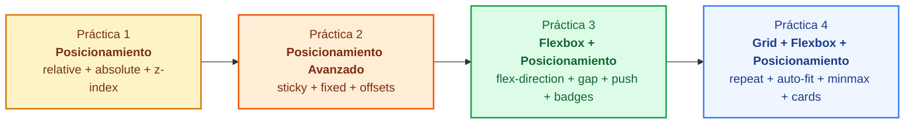
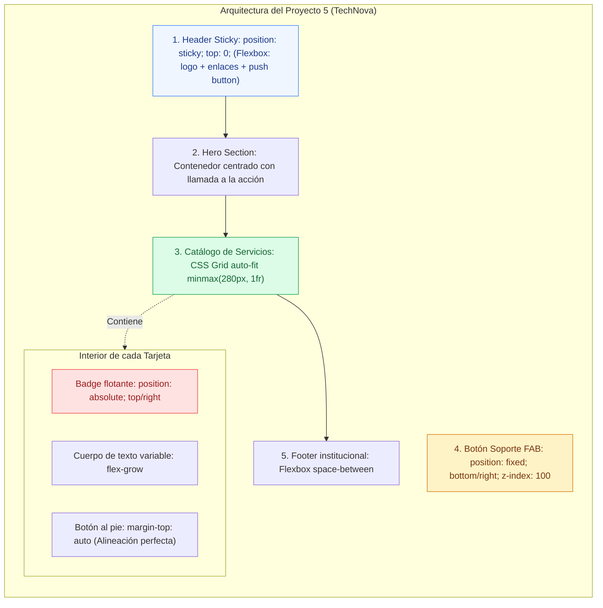
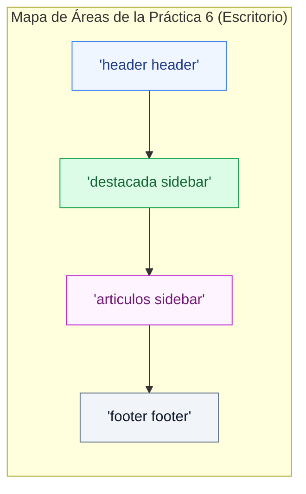
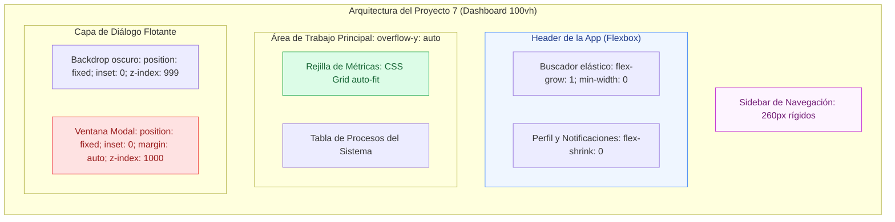

# Prácticas de Layout: Posicionamiento, Flexbox y Grid

<div class="badges">
  <span class="badge badge-css">CSS3 Moderno</span>
  <span class="badge badge-blue">Itinerario Progresivo</span>
  <span class="badge badge-amber">Posicionamiento</span>
  <span class="badge badge-green">Flexbox</span>
  <span class="badge badge-purple">CSS Grid</span>
  <span class="badge badge-ra">RA 2 / RA 3</span>
</div>

En el desarrollo web profesional, **ningún modelo de maquetación resuelve todos los problemas por sí solo**. La creación de interfaces de usuario robustas, accesibles y resilientes exige comprender con precisión el rol específico de cada tecnología:

1. **Posicionamiento (`position` y `z-index`):** Controla elementos que deben escapar del flujo normal o fijarse durante el desplazamiento (insignias, capas superpuestas, cabeceras adhesivas, barras flotantes y ventanas modales).
2. **Flexbox (Unidimensional - 1D):** Especializado en la distribución, orden y alineación geométrica elástica a lo largo de un único eje lineal (barras de navegación, fichas de catálogo, metadatos y botones al pie).
3. **CSS Grid (Bidimensional - 2D):** Especializado en el esqueleto estructural macro (diseño previo de filas y columnas, áreas nombradas y cuadrículas responsivas autoajustables).

Este documento está estructurado de forma **estrictamente secuencial y acumulativa** en dos bloques:

* **Bloque I: Fundamentos Incrementales (Dificultad Guiada):** 4 prácticas paso a paso. Comienza dominando el posicionamiento, añade la flexibilidad lineal de Flexbox e incorpora la retícula de CSS Grid.
* **Bloque II: Proyectos Integrales de Página Completa (Nivel Profesional):** 3 proyectos de aplicación real de página completa (*Landing Page*, *Periódico Editorial* y *Dashboard SPA 100vh*).

---

# BLOQUE I: Fundamentos Incrementales (Paso a Paso)



---

## Práctica 1: Tarjeta Comercial con Capas, Badges y Tooltip (Fundamentos de Posicionamiento)

!!! info "Objetivo pedagógico de la práctica"
    El objetivo de esta primera práctica es dominar el comportamiento de los elementos **fuera del flujo normal** mediante la interacción entre:
    
    * **`position: relative`** en el contenedor padre, estableciendo el **bloque contenedor de referencia**.
    * **`position: absolute`** en elementos hijos para ubicar una insignia de descuento en una esquina, un botón de favoritos y un mensaje flotante informativo (*tooltip*).
    * La propiedad **`z-index`** para garantizar el orden de apilamiento correcto sobre la imagen del producto.

### 1. Escenario y Requerimientos

Vas a maquetar la tarjeta de producto de una tienda de tecnología para unos auriculares inalámbricos de estudio:

1. **Bloque Contenedor:**
    * El elemento `.card-product` debe tener ancho acotado (`max-width: 320px`), fondo blanco, borde y esquinas redondeadas.
    * El contenedor de la imagen `.product-media` debe declarar **`position: relative;`** para actuar como sistema de coordenadas de sus elementos hijos absolutos.
2. **Insignia de Descuento (Badge):**
    * La etiqueta `.badge-discount` («-25% HOY») debe posicionarse de forma absoluta en la esquina superior izquierda de la imagen (`top: 0.75rem; left: 0.75rem;`).
3. **Botón de Favoritos con Tooltip:**
    * El botón flotante `.btn-favorite` (icono de corazón) debe ubicarse de forma absoluta en la esquina superior derecha (`top: 0.75rem; right: 0.75rem;`).
    * Al pasar el cursor (`:hover`) o enfocar por teclado (`:focus-visible`), debe mostrarse un texto flotante `.tooltip` centrado horizontalmente justo encima del botón, utilizando `position: absolute; bottom: calc(100% + 6px); left: 50%; transform: translateX(-50%);`.
4. **Cuerpo del Producto:**
    * Debajo de la imagen, muestra el título, la valoración en estrellas, el precio rebajado y un botón de añadir al carrito.

---

### 2. Código Fuente de la Práctica 1

=== "HTML"

    ```html title="practica-01-tarjeta-posicionamiento.html"
    <!DOCTYPE html>
    <html lang="es">
    <head>
      <meta charset="UTF-8">
      <meta name="viewport" content="width=device-width, initial-scale=1.0">
      <title>Práctica 1: Posicionamiento — Tarjeta de Producto</title>
      <link rel="stylesheet" href="practica-01-tarjeta-posicionamiento.css">
    </head>
    <body>

      <main class="showcase">
        <!-- TARJETA DE PRODUCTO -->
        <article class="card-product">
          
          <!-- ZONA MULTIMEDIA CON ELEMENTOS ABSOLUTOS SUPERPUESTOS -->
          <div class="product-media">
            <!-- 1. Insignia absoluta en esquina superior izquierda -->
            <span class="badge-discount">-25% HOY</span>

            <!-- 2. Botón flotante absoluto en esquina superior derecha con tooltip -->
            <button type="button" class="btn-favorite" aria-label="Guardar en favoritos">
              <span>🤍</span>
              <span class="tooltip" role="tooltip">Añadir a mi lista</span>
            </button>

            <!-- Imagen del producto -->
            <div class="product-image-mockup">
              <span class="product-icon">🎧</span>
            </div>
          </div>

          <!-- INFORMACIÓN DEL PRODUCTO (FLUJO NORMAL) -->
          <div class="product-details">
            <span class="product-brand">AudioPro Elite</span>
            <h2 class="product-title">Auriculares Studio Wireless Pro ANC</h2>
            
            <div class="product-rating">
              <span class="stars">★★★★★</span>
              <span class="rating-count">(142)</span>
            </div>

            <div class="product-pricing">
              <span class="price-current">149,99€</span>
              <span class="price-old">199,99€</span>
            </div>

            <button type="button" class="btn-buy">Añadir a la Cesta</button>
          </div>

        </article>
      </main>

    </body>
    </html>
    ```

=== "CSS"

    ```css title="practica-01-tarjeta-posicionamiento.css"
    /* ==========================================================================
       Práctica 1: Posicionamiento (relative, absolute, z-index, tooltip)
       ========================================================================== */

    :root {
      --color-primary: #2563eb;
      --color-primary-hover: #1d4ed8;
      --color-danger: #ef4444;
      --color-bg: #f8fafc;
      --color-card-bg: #ffffff;
      --color-text-main: #0f172a;
      --color-text-muted: #64748b;
      --color-border: #e2e8f0;
      
      --radius-md: 12px;
      --radius-sm: 6px;
      --shadow-card: 0 4px 12px rgba(0, 0, 0, 0.06);
    }

    *, *::before, *::after {
      box-sizing: border-box;
      margin: 0;
      padding: 0;
    }

    body {
      font-family: system-ui, -apple-system, sans-serif;
      background-color: var(--color-bg);
      color: var(--color-text-main);
      min-height: 100vh;
      display: grid;
      place-items: center;
      padding: 2rem 1rem;
    }

    /* CONTENEDOR PRINCIPAL DE LA TARJETA */
    .card-product {
      background-color: var(--color-card-bg);
      border: 1px solid var(--color-border);
      border-radius: var(--radius-md);
      box-shadow: var(--shadow-card);
      max-width: 320px;
      width: 100%;
      overflow: hidden; /* Corta esquinas de la imagen según el radio */
    }

    /* 1. ZONA MULTIMEDIA: Contexto de referencia con position: relative */
    .product-media {
      position: relative; /* ¡CLAVE!: Sistema de coordenadas para sus hijos absolutos */
      background: linear-gradient(135deg, #e0f2fe 0%, #dbeafe 100%);
      height: 220px;
      display: grid;
      place-items: center;
    }

    .product-image-mockup {
      font-size: 5rem;
    }

    /* 2. INSIGNIA CON POSITION: ABSOLUTE (Esquina superior izquierda) */
    .badge-discount {
      position: absolute;
      top: 0.75rem;
      left: 0.75rem;
      z-index: 2; /* Por encima de la imagen */
      background-color: var(--color-danger);
      color: #ffffff;
      font-size: 0.75rem;
      font-weight: 800;
      letter-spacing: 0.05em;
      padding: 0.25rem 0.6rem;
      border-radius: 9999px;
      box-shadow: 0 2px 6px rgba(239, 68, 68, 0.35);
    }

    /* 3. BOTÓN FLOTANTE CON POSITION: ABSOLUTE (Esquina superior derecha) */
    .btn-favorite {
      position: absolute;
      top: 0.75rem;
      right: 0.75rem;
      z-index: 2;
      width: 36px;
      height: 36px;
      border-radius: 50%;
      background-color: rgba(255, 255, 255, 0.9);
      backdrop-filter: blur(4px);
      border: 1px solid var(--color-border);
      cursor: pointer;
      display: grid;
      place-items: center;
      font-size: 1rem;
      transition: transform 0.15s ease, background-color 0.15s ease;
    }

    .btn-favorite:hover {
      transform: scale(1.1);
      background-color: #ffffff;
    }

    /* 4. TOOLTIP INFORMATIVO CON POSITION: ABSOLUTE */
    .tooltip {
      position: absolute;
      bottom: calc(100% + 8px); /* Se sitúa 8px por encima del botón */
      left: 50%;
      transform: translateX(-50%); /* Centrado horizontal perfecto */
      background-color: #0f172a;
      color: #ffffff;
      font-size: 0.72rem;
      font-weight: 600;
      white-space: nowrap;
      padding: 0.25rem 0.55rem;
      border-radius: 4px;
      pointer-events: none;
      opacity: 0;
      visibility: hidden;
      transition: opacity 0.2s ease, visibility 0.2s ease;
      z-index: 10;
    }

    /* Pequeña flecha inferior del tooltip */
    .tooltip::after {
      content: "";
      position: absolute;
      top: 100%;
      left: 50%;
      transform: translateX(-50%);
      border-width: 4px;
      border-style: solid;
      border-color: #0f172a transparent transparent transparent;
    }

    /* El tooltip se visibiliza al hacer hover o focus en el botón */
    .btn-favorite:hover .tooltip,
    .btn-favorite:focus-visible .tooltip {
      opacity: 1;
      visibility: visible;
    }

    /* DETALLES DEL PRODUCTO (FLUJO NORMAL) */
    .product-details {
      padding: 1.25rem;
    }

    .product-brand {
      font-size: 0.75rem;
      text-transform: uppercase;
      font-weight: 700;
      color: var(--color-text-muted);
      letter-spacing: 0.05em;
    }

    .product-title {
      font-size: 1.1rem;
      font-weight: 700;
      line-height: 1.35;
      margin: 0.25rem 0 0.5rem 0;
    }

    .product-rating {
      display: flex;
      align-items: center;
      gap: 0.35rem;
      font-size: 0.85rem;
      margin-bottom: 0.85rem;
    }

    .stars {
      color: #f59e0b;
    }

    .rating-count {
      color: var(--color-text-muted);
      font-size: 0.8rem;
    }

    .product-pricing {
      display: flex;
      align-items: baseline;
      gap: 0.5rem;
      margin-bottom: 1.25rem;
    }

    .price-current {
      font-size: 1.4rem;
      font-weight: 800;
      color: var(--color-text-main);
    }

    .price-old {
      font-size: 0.95rem;
      color: var(--color-text-muted);
      text-decoration: line-through;
    }

    .btn-buy {
      width: 100%;
      padding: 0.75rem;
      background-color: var(--color-primary);
      color: #ffffff;
      border: none;
      border-radius: var(--radius-sm);
      font-size: 0.9rem;
      font-weight: 700;
      cursor: pointer;
      transition: background-color 0.15s ease;
    }

    .btn-buy:hover {
      background-color: var(--color-primary-hover);
    }
    ```

---

### 3. Puntos Críticos y Rúbrica de la Práctica 1

!!! tip "¿Qué ocurre si eliminas `position: relative` de `.product-media`?"
    Si comentas la regla `position: relative;` del contenedor multimedia, el navegador buscará hacia arriba en el árbol DOM hasta el elemento raíz `<html>`. Como consecuencia, la insignia `-25%` y el botón de favoritos volarán a la esquina superior de la ventana del navegador, saliéndose por completo de la tarjeta.

!!! success "Rúbrica de verificación (Práctica 1)"
    - [ ] **Referencia espacial:** `.product-media` tiene `position: relative;` y sirve de origen de coordenadas `(0,0)`.
    - [ ] **Insignia fija en esquina:** `.badge-discount` usa `position: absolute; top: 0.75rem; left: 0.75rem;`.
    - [ ] **Botón en esquina:** `.btn-favorite` usa `position: absolute; top: 0.75rem; right: 0.75rem;`.
    - [ ] **Tooltip flotante:** El mensaje explicativo descansa encima del botón con `bottom: calc(100% + 8px); left: 50%; transform: translateX(-50%);` y solo se muestra en `:hover` o `:focus-visible`.

---

## Práctica 2: Barra Superior Adhesiva y Banner Fijo de Consentimiento (Sticky vs Fixed)

!!! info "Objetivo pedagógico de la práctica"
    El objetivo de esta segunda práctica es dominar la diferencia técnica entre dos esquemas de posicionamiento esenciales:
    
    * **`position: sticky`:** El elemento fluye normalmente con el texto hasta que el scroll del usuario alcanza su umbral (`top: 0`), momento en el que se congela en pantalla mientras su contenedor padre continúe en el área visible.
    * **`position: fixed`:** El elemento se extrae completamente del flujo y se ancla de forma inmutable respecto a la ventana física (*Viewport*). Se aplicará en un botón de «Subir Arriba» y en un aviso inferior de cookies.

### 1. Escenario y Requerimientos

Maquetarás la vista de lectura de un artículo técnico para una academia online:

1. **Cabecera Adhesiva (`sticky`):**
    * La barra superior `.sticky-header` debe desplazarse normalmente al inicio, pero al hacer scroll debe congelarse pegada al borde superior de la pantalla (`position: sticky; top: 0;`).
    * Debe contar con un `z-index: 100` para que el texto del artículo pase por debajo sin taparla.
2. **Cuerpo del Artículo:**
    * Un texto con suficiente longitud (márgenes y párrafos) para generar scroll vertical holgado en el navegador.
3. **Botón Volver Arriba (`fixed`):**
    * Un botón circular flotante `.btn-scroll-top` en la esquina inferior derecha con `position: fixed; bottom: 5rem; right: 1.5rem; z-index: 90;`.
4. **Banner de Consentimiento (`fixed` inferior):**
    * Una barra fija inferior `.cookie-banner` que ocupa el 100% del ancho con `position: fixed; bottom: 0; left: 0; right: 0; z-index: 95;`.
    * El elemento `body` debe reservar un margen inferior para que el banner fijo no tape el final del artículo.

---

### 2. Código Fuente de la Práctica 2

=== "HTML"

    ```html title="practica-02-sticky-vs-fixed.html"
    <!DOCTYPE html>
    <html lang="es">
    <head>
      <meta charset="UTF-8">
      <meta name="viewport" content="width=device-width, initial-scale=1.0">
      <title>Práctica 2: Posicionamiento — Sticky vs Fixed</title>
      <link rel="stylesheet" href="practica-02-sticky-vs-fixed.css">
    </head>
    <body>

      <!-- 1. BARRA SUPERIOR ADHESIVA (POSITION: STICKY) -->
      <header class="sticky-header">
        <div class="header-content">
          <span class="logo">📚 DominIA Academy</span>
          <span class="lesson-tag">Unidad 04: Posicionamiento</span>
        </div>
      </header>

      <!-- 2. CONTENIDO PRINCIPAL CON SCROLL EXTENSO -->
      <main class="article-container">
        <h1>Entendiendo el Flujo del Documento y las Capas en CSS</h1>
        <p class="lead">
          El posicionamiento en CSS es uno de los conceptos que más confusión genera cuando no se 
          comprende la diferencia entre reservar espacio en el flujo o colapsar a cero píxeles.
        </p>

        <section class="text-block">
          <h2>1. La Naturaleza de position: sticky</h2>
          <p>
            A diferencia de fixed, un elemento sticky respeta el espacio inicial que ocupa en el DOM. 
            No requiere que le añadamos padding-top artificial al body. Solo cuando el usuario hace scroll 
            y la ventana alcanza la cota declarada (por ejemplo top: 0), el elemento conmuta su comportamiento 
            a fijo temporal.
          </p>
          <p>
            Cuidado: un elemento sticky vive dentro de su contenedor padre. En cuanto el borde inferior del padre 
            sale de la pantalla, arrastra al elemento sticky consigo hacia afuera.
          </p>
        </section>

        <section class="text-block">
          <h2>2. El Anclaje Inmutable de position: fixed</h2>
          <p>
            Fixed no negocia con el scroll. Se mide directamente contra el Viewport (el rectángulo visible de tu navegador). 
            Por esa razón, los botones flotantes de ayuda, los banners de cookies y los diálogos modales se construyen con fixed.
          </p>
          <p>
            Desplaza la página hacia abajo para comprobar cómo la cabecera sticky te acompaña en la parte superior, 
            mientras el botón de flecha y la barra de cookies permanecen anclados con fixed en la parte inferior.
          </p>
        </section>

        <section class="text-block">
          <h2>3. El Papel Vital del z-index</h2>
          <p>
            Sin z-index, los elementos que aparecen después en el código HTML taparían a la cabecera sticky 
            cuando esta pasa por encima de ellos. Al asignarle un nivel de apilamiento controlado (z-index: 100), 
            garantizamos que la barra quede siempre en la capa superior visible.
          </p>
          <p>
            Texto complementario de relleno para garantizar suficiente recorrido de desplazamiento en la ventana...
          </p>
        </section>
      </main>

      <!-- 3. BOTÓN FLOTANTE FIJO (POSITION: FIXED) -->
      <a href="#" class="btn-scroll-top" title="Volver al principio" aria-label="Volver al principio">
        ↑
      </a>

      <!-- 4. BANNER DE CONSENTIMIENTO FIJO INFERIOR (POSITION: FIXED) -->
      <aside class="cookie-banner" role="region" aria-label="Aviso de privacidad">
        <p>Utilizamos cookies esenciales para el rendimiento del aula virtual.</p>
        <div class="banner-actions">
          <button type="button" class="btn-banner btn-banner--primary">Aceptar</button>
        </div>
      </aside>

    </body>
    </html>
    ```

=== "CSS"

    ```css title="practica-02-sticky-vs-fixed.css"
    /* ==========================================================================
       Práctica 2: Posicionamiento Sticky vs Fixed
       ========================================================================== */

    :root {
      --color-primary: #1d4ed8;
      --color-bg: #f8fafc;
      --color-surface: #ffffff;
      --color-text-main: #0f172a;
      --color-text-muted: #64748b;
      --color-border: #cbd5e1;
    }

    *, *::before, *::after {
      box-sizing: border-box;
      margin: 0;
      padding: 0;
    }

    body {
      font-family: system-ui, -apple-system, sans-serif;
      background-color: var(--color-bg);
      color: var(--color-text-main);
      line-height: 1.7;
      /* PREVENCIÓN CLAVE: Margen inferior para que el banner fijo no tape el último párrafo */
      padding-bottom: 5rem;
    }

    /* 1. CABECERA ADHESIVA CON POSITION: STICKY */
    .sticky-header {
      position: sticky;
      top: 0; /* Umbral a partir del cual se ancla */
      z-index: 100; /* Asegura que flote sobre los títulos y párrafos del artículo */
      background-color: rgba(255, 255, 255, 0.95);
      backdrop-filter: blur(8px);
      border-bottom: 1px solid var(--color-border);
      box-shadow: 0 2px 4px rgba(0, 0, 0, 0.04);
    }

    .header-content {
      max-width: 800px;
      margin: 0 auto;
      padding: 0.85rem 1.5rem;
      display: flex;
      justify-content: space-between;
      align-items: center;
    }

    .logo {
      font-weight: 800;
      font-size: 1.1rem;
      color: var(--color-primary);
    }

    .lesson-tag {
      font-size: 0.85rem;
      font-weight: 600;
      color: var(--color-text-muted);
    }

    /* 2. ARTÍCULO EN FLUJO NORMAL */
    .article-container {
      max-width: 800px;
      margin: 0 auto;
      padding: 2.5rem 1.5rem;
    }

    h1 {
      font-size: 2.2rem;
      font-weight: 800;
      line-height: 1.25;
      margin-bottom: 1rem;
    }

    .lead {
      font-size: 1.15rem;
      color: var(--color-text-muted);
      margin-bottom: 2rem;
      border-left: 4px solid var(--color-primary);
      padding-left: 1rem;
    }

    .text-block {
      margin-bottom: 2.5rem;
    }

    .text-block h2 {
      font-size: 1.4rem;
      margin-bottom: 0.75rem;
      color: #1e293b;
    }

    .text-block p {
      margin-bottom: 1rem;
      color: #334155;
    }

    /* 3. BOTÓN FLOTANTE CON POSITION: FIXED */
    .btn-scroll-top {
      position: fixed;
      bottom: 5.5rem; /* Situado por encima del banner de cookies */
      right: 1.5rem;
      z-index: 90;
      width: 44px;
      height: 44px;
      border-radius: 50%;
      background-color: var(--color-primary);
      color: #ffffff;
      text-decoration: none;
      font-size: 1.25rem;
      font-weight: 800;
      display: grid;
      place-items: center;
      box-shadow: 0 4px 10px rgba(29, 78, 216, 0.35);
      transition: transform 0.15s ease;
    }

    .btn-scroll-top:hover {
      transform: translateY(-3px);
    }

    /* 4. BANNER FIJO INFERIOR CON POSITION: FIXED */
    .cookie-banner {
      position: fixed;
      bottom: 0;
      left: 0;
      right: 0;
      z-index: 95;
      background-color: #0f172a;
      color: #ffffff;
      padding: 0.85rem 1.5rem;
      display: flex;
      justify-content: space-between;
      align-items: center;
      gap: 1rem;
      flex-wrap: wrap;
      box-shadow: 0 -4px 12px rgba(0, 0, 0, 0.15);
    }

    .cookie-banner p {
      font-size: 0.85rem;
      color: #cbd5e1;
    }

    .btn-banner {
      padding: 0.45rem 1rem;
      border-radius: 4px;
      border: none;
      font-size: 0.85rem;
      font-weight: 700;
      cursor: pointer;
    }

    .btn-banner--primary {
      background-color: #10b981;
      color: #ffffff;
    }
    ```

---

### 3. Puntos Críticos y Rúbrica de la Práctica 2

!!! tip "La trampa de overflow con sticky"
    Si algún contenedor padre en la jerarquía del DOM tiene declarado `overflow: hidden`, `overflow: auto` o `overflow: scroll`, dicho contenedor se convierte en el contexto de desplazamiento y **anula el comportamiento sticky** respecto a la ventana principal.

!!! success "Rúbrica de verificación (Práctica 2)"
    - [ ] **Sticky en scroll:** La cabecera permanece pegada en la parte superior sin dar saltos ni empujar el texto.
    - [ ] **Apilamiento z-index:** El texto del artículo pasa por debajo de la cabecera sin solaparse visualmente.
    - [ ] **Fixed en esquinas:** El botón de flecha `.btn-scroll-top` se ubica con `position: fixed` respecto al Viewport.
    - [ ] **Banner inferior:** El aviso de cookies ocupa el ancho completo en la parte inferior y el `body` cuenta con `padding-bottom` para no tapar el final de la lectura.

---

## Práctica 3: Ficha de Perfil y Barra de Acciones (Flexbox + Posicionamiento)

!!! info "Objetivo pedagógico de la práctica"
    Esta práctica integra el **modelo de caja unidimensional de Flexbox** con el **posicionamiento de capas**, abordando:
    
    * **Distribución lineal:** `flex-direction`, `justify-content: space-between`, `align-items: center` y `gap`.
    * **Efecto Push con `margin-inline-start: auto`** para empujar botones al extremo sin contenedores anidados vacíos.
    * **Avatar circular protegido con `flex-shrink: 0`** e indicador de estado («En línea») superpuesto con `position: absolute`.
    * **Solución de textos desbordantes** con `min-width: 0` y puntos suspensivos (`text-overflow: ellipsis`).

### 1. Escenario y Requerimientos

Maquetarás un componente de ficha de usuario para el panel interno de una empresa tecnológica:

1. **Barra de Acciones Superior (Flexbox):**
    * Contenedor con `display: flex; align-items: center; gap: 1rem;`.
    * El botón «Cerrar Sesión» debe empujarse automáticamente al final derecho mediante `margin-inline-start: auto;`.
2. **Tarjeta de Usuario (Flexbox Horizontal):**
    * El avatar circular debe medir 56px × 56px y declarar obligatoriamente **`flex-shrink: 0;`** para evitar que se deforme en un óvalo si el nombre del usuario es largo.
    * El avatar debe tener `position: relative;` y en su esquina inferior derecha debe anclarse un punto verde de conexión mediante `position: absolute; bottom: 0; right: 0;`.
3. **Control de Desbordamiento:**
    * El bloque de datos del usuario debe declarar **`min-width: 0;`** para permitir que un nombre de usuario largo se trunque con puntos suspensivos (`text-overflow: ellipsis; white-space: nowrap; overflow: hidden;`).
4. **Lista de Habilidades (Flex-wrap):**
    * Un conjunto de insignias que deben envolver limpiamente en varias filas mediante `flex-wrap: wrap; gap: 0.5rem;`.

---

### 2. Código Fuente de la Práctica 3

=== "HTML"

    ```html title="practica-03-flexbox-perfil.html"
    <!DOCTYPE html>
    <html lang="es">
    <head>
      <meta charset="UTF-8">
      <meta name="viewport" content="width=device-width, initial-scale=1.0">
      <title>Práctica 3: Flexbox y Posicionamiento — Ficha de Perfil</title>
      <link rel="stylesheet" href="practica-03-flexbox-perfil.css">
    </head>
    <body>

      <main class="panel-container">

        <!-- 1. BARRA SUPERIOR CON FLEXBOX Y EFECTO PUSH -->
        <header class="toolbar">
          <div class="toolbar-brand">
            <span class="toolbar-icon">⚙️</span>
            <h3>Panel de Desarrollador</h3>
          </div>
          <!-- Este botón absorbe el espacio libre a su izquierda mediante margin-inline-start: auto -->
          <button type="button" class="btn-logout">Cerrar Sesión</button>
        </header>

        <!-- 2. TARJETA DE PERFIL (FLEXBOX + BADGE ABSOLUTA) -->
        <article class="profile-card">
          
          <div class="profile-header">
            <!-- AVATAR CON POSITION: RELATIVE Y FLEX-SHRINK: 0 -->
            <div class="avatar-wrapper">
              <span class="avatar-img">👩‍💻</span>
              <!-- Indicador de conexión absoluto -->
              <span class="status-dot status-dot--online" title="Usuario en línea"></span>
            </div>

            <!-- DATOS DE USUARIO CON PROTECCIÓN MIN-WIDTH: 0 -->
            <div class="profile-data">
              <h2 class="user-name">Alejandra Gómez de la Torre de la Vega</h2>
              <span class="user-role">Ingeniera Cloud & DevOps Senior</span>
              <span class="user-location">📍 Madrid, España</span>
            </div>
          </div>

          <!-- 3. LISTA DE HABILIDADES CON FLEX-WRAP -->
          <div class="skills-block">
            <h4 class="skills-title">Competencias Tecnológicas</h4>
            <div class="tags-cloud">
              <span class="tag">Docker</span>
              <span class="tag">Kubernetes</span>
              <span class="tag">TypeScript</span>
              <span class="tag">CSS Grid</span>
              <span class="tag">Flexbox</span>
              <span class="tag">Microservicios</span>
              <span class="tag">Terraform</span>
              <span class="tag">CI/CD Pipelines</span>
            </div>
          </div>

          <!-- 4. FOOTER DE LA TARJETA CON SPACE-BETWEEN -->
          <footer class="profile-footer">
            <span class="reputation-score">Puntuación: <strong>98.5%</strong></span>
            <button type="button" class="btn-action">Asignar Proyecto</button>
          </footer>

        </article>
      </main>

    </body>
    </html>
    ```

=== "CSS"

    ```css title="practica-03-flexbox-perfil.css"
    /* ==========================================================================
       Práctica 3: Flexbox + Posicionamiento (push, wrap, shrink, min-width: 0)
       ========================================================================== */

    :root {
      --color-primary: #0284c7;
      --color-primary-dark: #0369a1;
      --color-bg: #f1f5f9;
      --color-surface: #ffffff;
      --color-text-main: #0f172a;
      --color-text-muted: #64748b;
      --color-border: #cbd5e1;
      --color-online: #22c55e;
      
      --radius-md: 10px;
      --radius-sm: 6px;
    }

    *, *::before, *::after {
      box-sizing: border-box;
      margin: 0;
      padding: 0;
    }

    body {
      font-family: system-ui, -apple-system, sans-serif;
      background-color: var(--color-bg);
      color: var(--color-text-main);
      padding: 2rem 1rem;
      min-height: 100vh;
      display: grid;
      place-items: center;
    }

    .panel-container {
      max-width: 480px;
      width: 100%;
      display: flex;
      flex-direction: column;
      gap: 1.5rem;
    }

    /* 1. TOOLBAR CON FLEXBOX Y MARGIN-INLINE-START: AUTO */
    .toolbar {
      background-color: var(--color-surface);
      border: 1px solid var(--color-border);
      border-radius: var(--radius-sm);
      padding: 0.75rem 1rem;
      display: flex;
      align-items: center;
      gap: 0.75rem;
      box-shadow: 0 1px 3px rgba(0, 0, 0, 0.04);
    }

    .toolbar-brand {
      display: flex;
      align-items: center;
      gap: 0.5rem;
    }

    .toolbar-brand h3 {
      font-size: 0.95rem;
      font-weight: 700;
    }

    /* EFECTO PUSH: El botón se empuja al extremo derecho sin envoltorios extra */
    .btn-logout {
      margin-inline-start: auto;
      background-color: #fee2e2;
      color: #991b1b;
      border: none;
      padding: 0.4rem 0.8rem;
      border-radius: 4px;
      font-weight: 700;
      font-size: 0.8rem;
      cursor: pointer;
    }

    /* 2. TARJETA DE PERFIL */
    .profile-card {
      background-color: var(--color-surface);
      border: 1px solid var(--color-border);
      border-radius: var(--radius-md);
      padding: 1.5rem;
      box-shadow: 0 4px 6px -1px rgba(0, 0, 0, 0.05);
      display: flex;
      flex-direction: column;
      gap: 1.25rem;
    }

    /* CABECERA DE PERFIL */
    .profile-header {
      display: flex;
      align-items: center;
      gap: 1.25rem;
    }

    /* AVATAR CON POSITION: RELATIVE Y FLEX-SHRINK: 0 */
    .avatar-wrapper {
      position: relative; /* Contexto para el punto verde absoluto */
      width: 60px;
      height: 60px;
      border-radius: 50%;
      background-color: #e0f2fe;
      display: grid;
      place-items: center;
      font-size: 2rem;
      flex-shrink: 0; /* ¡VITAL!: Prohibido aplastarse ante nombres largos */
    }

    /* PUNTO DE ESTADO EN LÍNEA (POSITION: ABSOLUTE) */
    .status-dot {
      position: absolute;
      bottom: 2px;
      right: 2px;
      width: 14px;
      height: 14px;
      border-radius: 50%;
      border: 2px solid #ffffff;
      background-color: var(--color-online);
    }

    /* BLOQUE DE DATOS CON RESOLUCIÓN DE MIN-WIDTH: 0 */
    .profile-data {
      flex: 1; /* Ocupa el resto de la fila */
      min-width: 0; /* ¡LA CLAVE!: Permite a los textos hijos truncarse con elipsis */
    }

    .user-name {
      font-size: 1.15rem;
      font-weight: 800;
      line-height: 1.2;
      white-space: nowrap;
      overflow: hidden;
      text-overflow: ellipsis; /* Puntos suspensivos elegantes */
    }

    .user-role {
      display: block;
      font-size: 0.85rem;
      color: var(--color-primary);
      font-weight: 600;
      margin: 0.2rem 0;
    }

    .user-location {
      font-size: 0.8rem;
      color: var(--color-text-muted);
    }

    /* 3. TAGS CON FLEX-WRAP */
    .skills-block {
      border-top: 1px solid var(--color-border);
      padding-top: 1rem;
    }

    .skills-title {
      font-size: 0.85rem;
      color: var(--color-text-muted);
      margin-bottom: 0.6rem;
      text-transform: uppercase;
      letter-spacing: 0.05em;
    }

    .tags-cloud {
      display: flex;
      flex-wrap: wrap; /* Salta a nuevas líneas cuando no caben */
      gap: 0.5rem;
    }

    .tag {
      background-color: #f8fafc;
      border: 1px solid var(--color-border);
      color: #334155;
      font-size: 0.75rem;
      font-weight: 600;
      padding: 0.25rem 0.6rem;
      border-radius: 9999px;
    }

    /* 4. FOOTER CON JUSTIFY-CONTENT: SPACE-BETWEEN */
    .profile-footer {
      border-top: 1px solid var(--color-border);
      padding-top: 1rem;
      display: flex;
      justify-content: space-between;
      align-items: center;
    }

    .reputation-score {
      font-size: 0.85rem;
      color: var(--color-text-muted);
    }

    .reputation-score strong {
      color: var(--color-text-main);
      font-size: 1rem;
    }

    .btn-action {
      background-color: var(--color-primary);
      color: #ffffff;
      border: none;
      padding: 0.5rem 1rem;
      border-radius: var(--radius-sm);
      font-weight: 700;
      font-size: 0.85rem;
      cursor: pointer;
    }
    ```

---

### 3. Puntos Críticos y Rúbrica de la Práctica 3

!!! tip "La combinación de flex-shrink: 0 y min-width: 0"
    Si un flex item contiene un texto largo sin espacios o un nombre kilométrico, el algoritmo de Flexbox por defecto se niega a comprimirlo por debajo de su tamaño intrínseco (`min-width: auto`). Esto provocaría que el avatar se aplastara en forma de huevo. Al declarar `flex-shrink: 0` en el avatar y `min-width: 0` en el contenedor del nombre, el avatar mantiene sus 60px exactos y el nombre se corta elegantemente con `...`.

!!! success "Rúbrica de verificación (Práctica 3)"
    - [ ] **Efecto Push:** `.btn-logout` se sitúa en el extremo derecho mediante `margin-inline-start: auto;`.
    - [ ] **Avatar rígido:** El círculo del avatar no se deforma gracias a `flex-shrink: 0;`.
    - [ ] **Punto de estado:** La bolita verde se ancla en la esquina del avatar con `position: absolute; bottom: 2px; right: 2px;`.
    - [ ] **Truncado de nombre:** El nombre largo no rompe la tarjeta gracias a `min-width: 0` y `text-overflow: ellipsis`.
    - [ ] **Envoltura elástica:** Las etiquetas `.tag` saltan de fila limpiamente con `flex-wrap: wrap; gap: 0.5rem;`.

---

## Práctica 4: Catálogo de Cursos en Cuadrícula (Grid + Flexbox + Posicionamiento)

!!! info "Objetivo pedagógico de la práctica"
    Esta práctica une por primera vez los **tres pilares en un único componente**:
    
    * **CSS Grid (Macro):** Estructura el catálogo con columnas responsivas automáticas mediante `repeat(auto-fit, minmax(260px, 1fr))` y `gap: 1.5rem;`.
    * **Flexbox (Micro):** Organiza el interior de cada tarjeta en vertical (`flex-direction: column`), empujando el botón de matrícula al pie con `margin-top: auto;` para igualar alturas dispares.
    * **Posicionamiento (Capas):** Insignia de nivel del curso anclada en la esquina de la imagen mediante `position: absolute; top: 0.75rem; right: 0.75rem;`.

### 1. Escenario y Requerimientos

Maquetarás el catálogo de cursos de formación online para desarrolladores web:

1. **Catálogo con CSS Grid:**
    * El contenedor `.courses-grid` debe maquetarse con `display: grid; grid-template-columns: repeat(auto-fit, minmax(260px, 1fr)); gap: 1.5rem;`.
    * Debe adaptarse automáticamente de 3 o 4 columnas en escritorio a 2 en tablet y 1 en móvil sin media queries.
2. **Tarjeta de Curso (Flexbox Vertical):**
    * Cada tarjeta `.course-card` debe tener `display: flex; flex-direction: column;`.
    * La descripción del curso tiene longitudes variables. El pie de la tarjeta `.course-card__footer` debe declarar **`margin-top: auto;`** para que todos los botones de inscripción queden perfectamente alineados en la misma cota inferior.
3. **Insignia de Dificultad (Posicionamiento Absoluto):**
    * La cabecera de la tarjeta `.course-card__media` tiene `position: relative;`.
    * La etiqueta de dificultad `.badge-level` se ubica con `position: absolute; top: 0.75rem; right: 0.75rem; z-index: 2;`.

---

### 2. Código Fuente de la Práctica 4

=== "HTML"

    ```html title="practica-04-grid-flex-posicionamiento.html"
    <!DOCTYPE html>
    <html lang="es">
    <head>
      <meta charset="UTF-8">
      <meta name="viewport" content="width=device-width, initial-scale=1.0">
      <title>Práctica 4: Grid, Flexbox y Posicionamiento — Catálogo</title>
      <link rel="stylesheet" href="practica-04-grid-flex-posicionamiento.css">
    </head>
    <body>

      <main class="catalog-wrapper">
        <header class="catalog-header">
          <h1>Cursos Oficiales de Desarrollo Web</h1>
          <p>Catálogo modular para ciclos formativos de Grado Superior (DAW / DAM).</p>
        </header>

        <!-- 1. CUADRÍCULA CSS GRID -->
        <section class="courses-grid">

          <!-- Tarjeta 1: Con texto medio -->
          <article class="course-card">
            <div class="course-card__media">
              <span class="badge-level badge-level--intermediate">Intermedio</span>
              <span class="media-icon">🎨</span>
            </div>
            <div class="course-card__body">
              <span class="course-tag">CSS3 Avanzado</span>
              <h2 class="course-title">Maquetación Moderna con Flexbox y CSS Grid</h2>
              <p class="course-desc">
                Aprende a estructurar aplicaciones web responsivas combinando layouts unidimensionales y bidimensionales.
              </p>
            </div>
            <!-- Pie de tarjeta empujado al fondo con margin-top: auto -->
            <div class="course-card__footer">
              <span class="course-price">Gratuito</span>
              <button type="button" class="btn-enroll">Matricularme</button>
            </div>
          </article>

          <!-- Tarjeta 2: Con texto MUY largo -->
          <article class="course-card">
            <div class="course-card__media">
              <span class="badge-level badge-level--advanced">Avanzado</span>
              <span class="media-icon">⚙️</span>
            </div>
            <div class="course-card__body">
              <span class="course-tag">Backend</span>
              <h2 class="course-title">Microservicios y APIs REST con Node.js y PostgreSQL</h2>
              <p class="course-desc">
                Construcción paso a paso de arquitecturas distribuidas, autenticación segura mediante tokens JWT, 
                migraciones de base de datos relacionales y pruebas automatizadas con Jest y Supertest.
              </p>
            </div>
            <div class="course-card__footer">
              <span class="course-price">120€</span>
              <button type="button" class="btn-enroll">Matricularme</button>
            </div>
          </article>

          <!-- Tarjeta 3: Con texto MUY breve -->
          <article class="course-card">
            <div class="course-card__media">
              <span class="badge-level badge-level--beginner">Iniciación</span>
              <span class="media-icon">📄</span>
            </div>
            <div class="course-card__body">
              <span class="course-tag">Semántica</span>
              <h2 class="course-title">Fundamentos de HTML5 y Accesibilidad Web</h2>
              <p class="course-desc">
                Etiquetado semántico y buenas prácticas de usabilidad.
              </p>
            </div>
            <div class="course-card__footer">
              <span class="course-price">Gratuito</span>
              <button type="button" class="btn-enroll">Matricularme</button>
            </div>
          </article>

        </section>
      </main>

    </body>
    </html>
    ```

=== "CSS"

    ```css title="practica-04-grid-flex-posicionamiento.css"
    /* ==========================================================================
       Práctica 4: Grid (Macro) + Flexbox (Micro) + Posicionamiento (Capas)
       ========================================================================== */

    :root {
      --color-primary: #4f46e5;
      --color-primary-hover: #4338ca;
      --color-bg: #f8fafc;
      --color-surface: #ffffff;
      --color-text-main: #0f172a;
      --color-text-muted: #64748b;
      --color-border: #e2e8f0;
      
      --radius-md: 12px;
      --radius-sm: 6px;
    }

    *, *::before, *::after {
      box-sizing: border-box;
      margin: 0;
      padding: 0;
    }

    body {
      font-family: system-ui, -apple-system, sans-serif;
      background-color: var(--color-bg);
      color: var(--color-text-main);
      padding: 3rem 1.5rem;
      line-height: 1.6;
    }

    .catalog-wrapper {
      max-width: 1000px;
      margin: 0 auto;
    }

    .catalog-header {
      text-align: center;
      margin-bottom: 2.5rem;
    }

    .catalog-header h1 {
      font-size: 2rem;
      font-weight: 800;
      margin-bottom: 0.5rem;
    }

    .catalog-header p {
      color: var(--color-text-muted);
    }

    /* 1. CUADRÍCULA CON CSS GRID */
    .courses-grid {
      display: grid;
      /* Ajuste automático fluido sin media queries */
      grid-template-columns: repeat(auto-fit, minmax(260px, 1fr));
      gap: 1.5rem;
    }

    /* 2. TARJETA INDIVIDUAL (FLEXBOX VERTICAL) */
    .course-card {
      background-color: var(--color-surface);
      border: 1px solid var(--color-border);
      border-radius: var(--radius-md);
      overflow: hidden;
      box-shadow: 0 4px 6px -1px rgba(0, 0, 0, 0.05);
      
      /* ¡FLEXBOX VERTICAL!: Permite a los hijos estirarse y al pie anclarse al fondo */
      display: flex;
      flex-direction: column;
      transition: transform 0.15s ease, box-shadow 0.15s ease;
    }

    .course-card:hover {
      transform: translateY(-4px);
      box-shadow: 0 10px 15px -3px rgba(0, 0, 0, 0.1);
    }

    /* 3. CABECERA MULTIMEDIA CON POSITION: RELATIVE */
    .course-card__media {
      position: relative; /* Contexto de referencia para la insignia */
      height: 140px;
      background: linear-gradient(135deg, #e0e7ff 0%, #c7d2fe 100%);
      display: grid;
      place-items: center;
    }

    .media-icon {
      font-size: 3.5rem;
    }

    /* INSIGNIA DE NIVEL CON POSITION: ABSOLUTE */
    .badge-level {
      position: absolute;
      top: 0.75rem;
      right: 0.75rem;
      z-index: 2;
      font-size: 0.7rem;
      font-weight: 800;
      text-transform: uppercase;
      letter-spacing: 0.04em;
      padding: 0.2rem 0.55rem;
      border-radius: 4px;
    }

    .badge-level--beginner {
      background-color: #dcfce7;
      color: #166534;
    }

    .badge-level--intermediate {
      background-color: #dbeafe;
      color: #1e40af;
    }

    .badge-level--advanced {
      background-color: #fef3c7;
      color: #92400e;
    }

    /* CUERPO DE LA TARJETA */
    .course-card__body {
      padding: 1.25rem;
      /* Absorbe el espacio disponible para que el footer se empuje */
      flex-grow: 1;
    }

    .course-tag {
      font-size: 0.75rem;
      font-weight: 700;
      color: var(--color-primary);
      text-transform: uppercase;
      letter-spacing: 0.05em;
    }

    .course-title {
      font-size: 1.1rem;
      font-weight: 700;
      line-height: 1.35;
      margin: 0.35rem 0 0.5rem 0;
    }

    .course-desc {
      font-size: 0.88rem;
      color: var(--color-text-muted);
      line-height: 1.5;
    }

    /* 4. PIE DE TARJETA CON MARGIN-TOP: AUTO */
    .course-card__footer {
      margin-top: auto; /* ¡CLAVE!: Empuja el pie al fondo en todas las tarjetas de la fila */
      border-top: 1px solid var(--color-border);
      padding: 1rem 1.25rem;
      background-color: #f8fafc;
      display: flex;
      justify-content: space-between;
      align-items: center;
    }

    .course-price {
      font-size: 1.1rem;
      font-weight: 800;
      color: var(--color-text-main);
    }

    .btn-enroll {
      background-color: var(--color-primary);
      color: #ffffff;
      border: none;
      padding: 0.45rem 0.9rem;
      border-radius: var(--radius-sm);
      font-weight: 700;
      font-size: 0.85rem;
      cursor: pointer;
      transition: background-color 0.15s ease;
    }

    .btn-enroll:hover {
      background-color: var(--color-primary-hover);
    }
    ```

---

### 3. Puntos Críticos y Rúbrica de la Práctica 4

!!! tip "La coordinación perfecta entre Grid y Flexbox"
    * **CSS Grid** crea la cuadrícula exterior con celdas de tamaño proporcional (`1fr`). Como todas las celdas de una fila tienen la misma altura por defecto (`align-items: stretch`), la tarjeta más alta determina la altura de la fila entera.
    * **Flexbox** gestiona el interior de esa celda: al declarar `display: flex; flex-direction: column;`, la tarjeta se estira al 100% del alto y el comando `margin-top: auto` en `.course-card__footer` empuja el botón de matrícula exactamente al borde inferior.

!!! success "Rúbrica de verificación (Práctica 4)"
    - [ ] **Grid elástico:** `.courses-grid` reparte columnas fluidas con `repeat(auto-fit, minmax(260px, 1fr))`.
    - [ ] **Insignia absoluta:** `.badge-level` flota en la esquina superior derecha de la imagen con `position: absolute`.
    - [ ] **Alineación de botones:** A pesar de que la tarjeta 2 tiene cuatro veces más texto que la tarjeta 3, los botones «Matricularme» están alineados a la misma cota inferior mediante `margin-top: auto`.

---

# BLOQUE II: Proyectos Integrales de Página Completa (Nivel Profesional)

Una vez dominados los fundamentos aislados e incrementales, en este bloque se desarrollan **tres proyectos de maquetación web real de página completa**, integrando las tres tecnologías en arquitecturas completas de producción.

---

## Práctica 5 (Proyecto): Landing Page Corporativa con Catálogo de Servicios («TechNova Solutions»)

!!! info "Objetivo pedagógico del proyecto"
    Construir la arquitectura completa de una **página de aterrizaje corporativa (*landing page*)**, integrando:
    
    * Una **cuadrícula responsiva autoajustable** con CSS Grid (`repeat`, `auto-fit`, `minmax`) sin recurrir a consultas de medios (*media queries*).
    * Una **barra de navegación elástica** y **tarjetas de servicio con alturas variables** mediante Flexbox, aprovechando el efecto *push* de los márgenes automáticos para anclar botones a la misma cota inferior.
    * Una **cabecera adhesiva (`position: sticky`)**, **insignias flotantes (`position: absolute`)** y un **botón flotante de contacto (`position: fixed`)**.



### 1. Escenario y Requerimientos

La consultora tecnológica **TechNova Solutions** necesita maquetar su nueva página comercial. Se requiere que:

1. **Estructura Global y Cabecera:**
    * El elemento `<header>` debe fijarse al borde superior de la pantalla mediante `position: sticky; top: 0;` y contar con un nivel de apilamiento `z-index: 100` para que ningún contenido de la página lo solape al hacer scroll.
    * El menú de navegación debe usar `display: flex; align-items: center; gap: 1.5rem;`. El botón «Acceso Clientes» debe empujarse automáticamente al extremo derecho mediante la propiedad lógica `margin-inline-start: auto;`.
2. **Catálogo de Servicios:**
    * El contenedor `.services-grid` debe maquetarse con **CSS Grid** utilizando una pista elástica autoajustable con la fórmula:
      grid-template-columns: repeat(auto-fit, minmax(280px, 1fr));
    * La separación entre celdas debe declararse mediante `gap: 2rem;`.
3. **Tarjetas de Servicio:**
    * Cada tarjeta `.service-card` debe comportarse como un contenedor `display: flex; flex-direction: column;` para que los botones de contratación `.btn-card` queden matemáticamente alineados al fondo mediante `margin-top: auto;`, sin importar que una tarjeta tenga dos líneas de descripción y otra tenga cinco.
    * La tarjeta destacada debe llevar una insignia flotante «MÁS DEMANDADO» posicionada con `position: absolute; top: -12px; right: 1rem;`, para lo cual la tarjeta debe establecer `position: relative;`.
4. **Elemento de Soporte Flotante (FAB):**
    * Un botón de asistencia flotante `.fab-support` debe permanecer anclado de forma fija en la esquina inferior derecha del *viewport* (`position: fixed; bottom: 2rem; right: 2rem; z-index: 90;`).

---

### 2. Código Fuente de la Práctica 5

=== "HTML"

    ```html title="practica-05-technova.html"
    <!DOCTYPE html>
    <html lang="es">
    <head>
      <meta charset="UTF-8">
      <meta name="viewport" content="width=device-width, initial-scale=1.0">
      <title>TechNova Solutions — Servicios Cloud y DevOps</title>
      <link rel="stylesheet" href="practica-05-technova.css">
    </head>
    <body>

      <!-- 1. CABECERA STICKY CON NAVEGACIÓN FLEXBOX -->
      <header class="site-header">
        <div class="header-inner">
          <a href="#" class="brand-logo">
            <span class="brand-icon">⚡</span>
            <strong>TechNova</strong>
          </a>
          <nav class="main-nav">
            <a href="#servicios" class="nav-link">Servicios</a>
            <a href="#proyectos" class="nav-link">Casos de Éxito</a>
            <a href="#equipo" class="nav-link">Equipo</a>
            <!-- El siguiente botón usa margin-inline-start: auto para empujarse a la derecha -->
            <button type="button" class="btn btn--primary btn--portal">Acceso Clientes</button>
          </nav>
        </div>
      </header>

      <!-- 2. SECCIÓN PRINCIPAL (HERO) -->
      <section class="hero-section">
        <div class="hero-content">
          <span class="badge-tag">Plataforma Cloud Enterprise</span>
          <h1 class="hero-title">Arquitectura Web Escalable sin Límites</h1>
          <p class="hero-desc">
            Diseñamos infraestructuras de alta disponibilidad combinando microservicios, 
            despliegue continuo y rendimiento optimizado para aplicaciones críticas.
          </p>
          <div class="hero-actions">
            <a href="#servicios" class="btn btn--accent">Explorar Soluciones</a>
            <a href="#contacto" class="btn btn--outline">Solicitar Demo</a>
          </div>
        </div>
      </section>

      <!-- 3. CATÁLOGO EN CUADRÍCULA CSS GRID -->
      <main id="servicios" class="catalog-section">
        <div class="section-heading">
          <h2>Nuestros Servicios Especializados</h2>
          <p>Catálogo modular diseñado para cubrir todo el ciclo de vida del software.</p>
        </div>

        <div class="services-grid">

          <!-- Tarjeta 1: Estándar -->
          <article class="service-card">
            <div class="service-card__icon">☁️</div>
            <h3 class="service-card__title">Infraestructura Kubernetes</h3>
            <p class="service-card__desc">
              Orquestación automatizada de contenedores en clusters multi-región con 
              escalado elástico bajo demanda.
            </p>
            <div class="service-card__footer">
              <span class="price-label">Desde <strong>450€</strong> / mes</span>
              <button type="button" class="btn-card">Contratar Plan</button>
            </div>
          </article>

          <!-- Tarjeta 2: Destacada con Badge Absoluta -->
          <article class="service-card service-card--featured">
            <!-- Insignia absoluta que sobresale del borde superior -->
            <span class="badge-featured">MÁS DEMANDADO</span>
            <div class="service-card__icon">🛡️</div>
            <h3 class="service-card__title">Ciberseguridad y Zero Trust</h3>
            <p class="service-card__desc">
              Auditoría integral de vulnerabilidades, protección contra ataques DDoS perimetrales, 
              gestión criptográfica de identidades y monitorización activa de intrusiones 24/7/365.
            </p>
            <div class="service-card__footer">
              <span class="price-label">Desde <strong>890€</strong> / mes</span>
              <button type="button" class="btn-card btn-card--accent">Contratar Plan</button>
            </div>
          </article>

          <!-- Tarjeta 3: Estándar con texto breve -->
          <article class="service-card">
            <div class="service-card__icon">🚀</div>
            <h3 class="service-card__title">Pipelines CI/CD Automatizados</h3>
            <p class="service-card__desc">
              Entrega continua sin tiempo de inactividad con pruebas unitarias integradas.
            </p>
            <div class="service-card__footer">
              <span class="price-label">Desde <strong>320€</strong> / mes</span>
              <button type="button" class="btn-card">Contratar Plan</button>
            </div>
          </article>

          <!-- Tarjeta 4: Estándar -->
          <article class="service-card">
            <div class="service-card__icon">📊</div>
            <h3 class="service-card__title">Observabilidad y Telemetría</h3>
            <p class="service-card__desc">
              Recolección centralizada de logs, métricas distribuidas y trazabilidad de peticiones 
              con dashboards interactivos Grafana.
            </p>
            <div class="service-card__footer">
              <span class="price-label">Desde <strong>280€</strong> / mes</span>
              <button type="button" class="btn-card">Contratar Plan</button>
            </div>
          </article>

        </div>
      </main>

      <!-- 4. BOTÓN FLOTANTE FIJO (FAB) -->
      <aside class="fab-support" aria-label="Soporte técnico directo">
        <button type="button" class="fab-btn" title="Chatear con soporte">
          <span class="fab-icon">💬</span>
          <span class="fab-pulse"></span>
        </button>
      </aside>

      <!-- 5. PIE DE PÁGINA -->
      <footer class="site-footer">
        <div class="footer-inner">
          <p>© 2026 TechNova Solutions S.L. — Todos los derechos reservados.</p>
          <div class="footer-links">
            <a href="#">Privacidad</a>
            <a href="#">Términos del Servicio</a>
            <a href="#">SLA de Garantía</a>
          </div>
        </div>
      </footer>

    </body>
    </html>
    ```

=== "CSS"

    ```css title="practica-05-technova.css"
    /* ==========================================================================
       TechNova Solutions — Hoja de Estilos Arquitecturada
       Tecnologías: CSS Grid (Macro) + Flexbox (Micro) + Posicionamiento (Capas)
       ========================================================================== */

    :root {
      --color-primary: #1d4ed8;
      --color-primary-dark: #1e3a8a;
      --color-accent: #059669;
      --color-accent-hover: #047857;
      --color-bg-page: #f8fafc;
      --color-surface: #ffffff;
      --color-text-main: #0f172a;
      --color-text-muted: #64748b;
      --color-border: #e2e8f0;
      
      --radius-sm: 6px;
      --radius-md: 10px;
      --radius-lg: 16px;
      
      --shadow-sm: 0 1px 3px rgba(0, 0, 0, 0.05);
      --shadow-md: 0 4px 6px -1px rgba(0, 0, 0, 0.07);
      --shadow-lg: 0 10px 15px -3px rgba(0, 0, 0, 0.1);
      
      --font-stack: system-ui, -apple-system, "Segoe UI", Roboto, sans-serif;
    }

    *,
    *::before,
    *::after {
      box-sizing: border-box;
      margin: 0;
      padding: 0;
    }

    body {
      font-family: var(--font-stack);
      background-color: var(--color-bg-page);
      color: var(--color-text-main);
      line-height: 1.6;
      min-height: 100vh;
      display: flex;
      flex-direction: column;
    }

    /* CABECERA CON POSITION: STICKY Y FLEXBOX */
    .site-header {
      position: sticky;
      top: 0;
      z-index: 100;
      background-color: rgba(255, 255, 255, 0.95);
      backdrop-filter: blur(8px);
      border-bottom: 1px solid var(--color-border);
      box-shadow: var(--shadow-sm);
    }

    .header-inner {
      max-width: 1200px;
      margin: 0 auto;
      padding: 1rem 1.5rem;
      display: flex;
      align-items: center;
      gap: 2rem;
    }

    .brand-logo {
      display: flex;
      align-items: center;
      gap: 0.5rem;
      text-decoration: none;
      color: var(--color-text-main);
      font-size: 1.25rem;
      font-weight: 800;
    }

    .main-nav {
      display: flex;
      align-items: center;
      gap: 1.5rem;
      flex-grow: 1;
    }

    .nav-link {
      color: var(--color-text-muted);
      text-decoration: none;
      font-weight: 600;
      font-size: 0.95rem;
      transition: color 0.15s ease;
    }

    .nav-link:hover {
      color: var(--color-primary);
    }

    /* EFECTO PUSH CON MARGIN-INLINE-START: AUTO */
    .btn--portal {
      margin-inline-start: auto;
    }

    .btn {
      display: inline-flex;
      align-items: center;
      justify-content: center;
      padding: 0.55rem 1.25rem;
      font-size: 0.9rem;
      font-weight: 700;
      border-radius: var(--radius-sm);
      border: 1px solid transparent;
      cursor: pointer;
      text-decoration: none;
      transition: all 0.15s ease;
    }

    .btn--primary {
      background-color: var(--color-primary);
      color: #ffffff;
    }

    .btn--primary:hover {
      background-color: var(--color-primary-dark);
    }

    .btn--accent {
      background-color: var(--color-accent);
      color: #ffffff;
    }

    .btn--accent:hover {
      background-color: var(--color-accent-hover);
    }

    .btn--outline {
      border-color: var(--color-border);
      background-color: transparent;
      color: var(--color-text-main);
    }

    .btn--outline:hover {
      background-color: var(--color-border);
    }

    /* HERO */
    .hero-section {
      background: linear-gradient(180deg, #eff6ff 0%, var(--color-bg-page) 100%);
      padding: 4.5rem 1.5rem;
      text-align: center;
    }

    .hero-content {
      max-width: 760px;
      margin: 0 auto;
    }

    .badge-tag {
      display: inline-block;
      background-color: #dbeafe;
      color: var(--color-primary);
      font-size: 0.8rem;
      font-weight: 700;
      text-transform: uppercase;
      letter-spacing: 0.05em;
      padding: 0.25rem 0.75rem;
      border-radius: 9999px;
      margin-bottom: 1.25rem;
    }

    .hero-title {
      font-size: 2.5rem;
      font-weight: 800;
      letter-spacing: -0.02em;
      margin-bottom: 1.25rem;
      line-height: 1.2;
    }

    .hero-desc {
      font-size: 1.15rem;
      color: var(--color-text-muted);
      margin-bottom: 2rem;
    }

    .hero-actions {
      display: flex;
      justify-content: center;
      gap: 1rem;
      flex-wrap: wrap;
    }

    /* CATÁLOGO CON CSS GRID */
    .catalog-section {
      max-width: 1200px;
      margin: 0 auto;
      padding: 3rem 1.5rem 5rem 1.5rem;
      flex-grow: 1;
    }

    .section-heading {
      text-align: center;
      margin-bottom: 3rem;
    }

    .section-heading h2 {
      font-size: 2rem;
      font-weight: 800;
      margin-bottom: 0.5rem;
    }

    .section-heading p {
      color: var(--color-text-muted);
    }

    .services-grid {
      display: grid;
      grid-template-columns: repeat(auto-fit, minmax(280px, 1fr));
      gap: 2rem;
    }

    /* TARJETA CON FLEXBOX VERTICAL Y POSITION: RELATIVE */
    .service-card {
      position: relative;
      background-color: var(--color-surface);
      border: 1px solid var(--color-border);
      border-radius: var(--radius-lg);
      padding: 2rem;
      box-shadow: var(--shadow-sm);
      display: flex;
      flex-direction: column;
      transition: transform 0.2s ease, box-shadow 0.2s ease;
    }

    .service-card:hover {
      transform: translateY(-4px);
      box-shadow: var(--shadow-lg);
    }

    .service-card--featured {
      border: 2px solid var(--color-primary);
      box-shadow: var(--shadow-md);
    }

    .badge-featured {
      position: absolute;
      top: -12px;
      right: 1.5rem;
      background-color: var(--color-primary);
      color: #ffffff;
      font-size: 0.75rem;
      font-weight: 800;
      letter-spacing: 0.05em;
      padding: 0.3rem 0.75rem;
      border-radius: 9999px;
      box-shadow: 0 2px 6px rgba(29, 78, 216, 0.35);
    }

    .service-card__icon {
      font-size: 2.2rem;
      margin-bottom: 1rem;
    }

    .service-card__title {
      font-size: 1.25rem;
      font-weight: 700;
      margin-bottom: 0.75rem;
    }

    .service-card__desc {
      color: var(--color-text-muted);
      font-size: 0.95rem;
      margin-bottom: 1.75rem;
      flex-grow: 1;
    }

    /* BOTÓN AL PIE CON MARGIN-TOP: AUTO */
    .service-card__footer {
      margin-top: auto;
      border-top: 1px solid var(--color-border);
      padding-top: 1.25rem;
      display: flex;
      flex-direction: column;
      gap: 0.75rem;
    }

    .price-label {
      font-size: 0.9rem;
      color: var(--color-text-muted);
    }

    .price-label strong {
      font-size: 1.25rem;
      color: var(--color-text-main);
    }

    .btn-card {
      width: 100%;
      padding: 0.75rem;
      background-color: #f1f5f9;
      color: var(--color-text-main);
      border: none;
      border-radius: var(--radius-sm);
      font-weight: 700;
      font-size: 0.9rem;
      cursor: pointer;
      transition: background-color 0.15s ease, color 0.15s ease;
    }

    .btn-card:hover {
      background-color: var(--color-primary);
      color: #ffffff;
    }

    .btn-card--accent {
      background-color: var(--color-primary);
      color: #ffffff;
    }

    .btn-card--accent:hover {
      background-color: var(--color-primary-dark);
    }

    /* FAB POSITION: FIXED */
    .fab-support {
      position: fixed;
      bottom: 2rem;
      right: 2rem;
      z-index: 90;
    }

    .fab-btn {
      width: 56px;
      height: 56px;
      border-radius: 50%;
      background-color: var(--color-primary);
      border: none;
      box-shadow: 0 4px 12px rgba(29, 78, 216, 0.4);
      cursor: pointer;
      display: grid;
      place-items: center;
      position: relative;
      transition: transform 0.2s ease;
    }

    .fab-btn:hover {
      transform: scale(1.08);
    }

    .fab-icon {
      font-size: 1.5rem;
    }

    .fab-pulse {
      position: absolute;
      top: 4px;
      right: 4px;
      width: 12px;
      height: 12px;
      background-color: #22c55e;
      border: 2px solid #ffffff;
      border-radius: 50%;
    }

    /* FOOTER */
    .site-footer {
      background-color: #0f172a;
      color: #94a3b8;
      border-top: 1px solid #1e293b;
      padding: 2rem 1.5rem;
      font-size: 0.9rem;
    }

    .footer-inner {
      max-width: 1200px;
      margin: 0 auto;
      display: flex;
      justify-content: space-between;
      align-items: center;
      flex-wrap: wrap;
      gap: 1rem;
    }

    .footer-links {
      display: flex;
      gap: 1.5rem;
    }

    .footer-links a {
      color: #94a3b8;
      text-decoration: none;
      transition: color 0.15s ease;
    }

    .footer-links a:hover {
      color: #ffffff;
    }
    ```

---

## Práctica 6 (Proyecto): Portal Editorial con Retícula Completa («DevPulse Magazine»)

!!! info "Objetivo pedagógico del proyecto"
    Maquetar la **portada completa de un portal de noticias tecnológicas**, combinando:
    
    * **Áreas de maquetación semántica bidimensional** con `grid-template-areas` para ordenar cabecera, noticia principal, sidebar de tendencias, artículos secundarios y pie.
    * **Flexbox para micro-layouts de metadatos:** autores, fechas, lectura y tags organizados con `align-items: center` y resolviendo la trampa de `min-width: auto` con `min-width: 0` y puntos suspensivos (`text-overflow: ellipsis`).
    * **Posicionamiento avanzado:** Capas de superposición (*overlays*) con `position: absolute; inset: 0;` sobre imágenes y **menú lateral adhesivo (`position: sticky`)** que acompaña la lectura mientras el contenedor padre esté visible.



### 1. Escenario y Requerimientos

La revista digital **DevPulse Magazine** requiere una portada editorial moderna:

1. **Retícula Principal con `grid-template-areas`:**
    * El contenedor maestro `.magazine-layout` debe articular la página mediante el siguiente mapa semántico:
      ```css
      grid-template-areas:
        "header   header"
        "featured sidebar"
        "articles sidebar"
        "footer   footer";
      ```
    * La columna de contenidos principales debe recibir `1fr` y el sidebar debe fijarse en `340px`.
2. **Artículo Destacado (Hero con Capa Absoluta):**
    * El artículo principal `.article-featured` debe tener una imagen de fondo y encima una capa de gradiente oscuro con `position: absolute; inset: 0;` para asegurar legibilidad sobre la fotografía.
    * En la esquina superior izquierda de la foto se sitúa una etiqueta «🔴 EXCLUSIVA» con `position: absolute; top: 1.5rem; left: 1.5rem; z-index: 2;`.
3. **Sidebar Adhesivo (Sticky):**
    * La columna lateral `.magazine-sidebar` debe acompañar al usuario al desplazarse por los artículos: declara `position: sticky; top: 2rem;`.
4. **Metadatos y Prevención de Desbordamientos (Flexbox):**
    * El avatar del periodista usa `flex-shrink: 0;`.
    * Los titulares en el sidebar de tendencias implementan protección de ancho mínimo: `min-width: 0;` con elipsis tipográfica (`text-overflow: ellipsis; white-space: nowrap; overflow: hidden;`) para evitar roturas ante URLs extensas.

---

### 2. Código Fuente de la Práctica 6

=== "HTML"

    ```html title="practica-06-devpulse.html"
    <!DOCTYPE html>
    <html lang="es">
    <head>
      <meta charset="UTF-8">
      <meta name="viewport" content="width=device-width, initial-scale=1.0">
      <title>DevPulse Magazine — La Vanguardia de la Ingeniería Web</title>
      <link rel="stylesheet" href="practica-06-devpulse.css">
    </head>
    <body>

      <div class="magazine-layout">

        <!-- 1. CABECERA EDITORIAL (ÁREA: header) -->
        <header class="mag-header">
          <div class="mag-header__top">
            <span class="live-indicator">● EDICIÓN GLOBAL</span>
            <span class="current-date">Lunes, 20 de Octubre de 2026</span>
          </div>
          <div class="mag-header__brand">
            <h1 class="logo-text">DEVPULSE</h1>
            <p class="tagline">Diario de Arquitectura, Rendimiento y Ecosistema Web</p>
          </div>
          <nav class="mag-nav">
            <a href="#" class="is-active">Actualidad</a>
            <a href="#">Frontend Moderno</a>
            <a href="#">Bases de Datos</a>
            <a href="#">DevOps y Cloud</a>
            <a href="#">Inteligencia Artificial</a>
          </nav>
        </header>

        <!-- 2. NOTICIA DESTACADA (ÁREA: featured) -->
        <article class="article-featured">
          <span class="badge-live">🔴 EXCLUSIVA</span>
          <div class="article-featured__overlay"></div>
          
          <div class="article-featured__body">
            <span class="category-pill">Estándares W3C</span>
            <h2 class="featured-headline">
              CSS Container Queries y Subgrid Alcanzan el 99% de Soporte Global en Producción
            </h2>
            <p class="featured-lead">
              El consorcio internacional confirma la consolidación definitiva del modelo 
              de diseño basado en contenedores intrínsecos, sustituyendo los esquemas monolíticos.
            </p>
            <div class="meta-row">
              <span class="meta-author">Por <strong>Elena Vega</strong></span>
              <span class="meta-time">⏱️ 6 min de lectura</span>
            </div>
          </div>
        </article>

        <!-- 3. BARRA LATERAL STICKY (ÁREA: sidebar) -->
        <aside class="magazine-sidebar">
          <div class="sidebar-sticky-box">
            <h3 class="sidebar-title">🔥 Lo Más Leído Hoy</h3>

            <div class="trending-list">
              <a href="#" class="trending-item">
                <span class="trending-num">01</span>
                <div class="trending-content">
                  <span class="tag-topic">Rendimiento</span>
                  <h4 class="trending-title">Eliminando el 40% del JavaScript no utilizado en arquitecturas SSR</h4>
                  <span class="meta-muted">Hace 2 horas</span>
                </div>
              </a>

              <a href="#" class="trending-item">
                <span class="trending-num">02</span>
                <div class="trending-content">
                  <span class="tag-topic">Seguridad</span>
                  <h4 class="trending-title">https://vulnerabilidades.seguridad-avanzada-infraestructura.org/alerta-critica-oauth2</h4>
                  <span class="meta-muted">Hace 4 horas</span>
                </div>
              </a>

              <a href="#" class="trending-item">
                <span class="trending-num">03</span>
                <div class="trending-content">
                  <span class="tag-topic">Bases de Datos</span>
                  <h4 class="trending-title">PostgreSQL 19: Consultas vectoriales nativas para modelos LLM</h4>
                  <span class="meta-muted">Hace 5 horas</span>
                </div>
              </a>
            </div>

            <div class="newsletter-card">
              <h4>Newsletter Semanal</h4>
              <p>Recibe los domingos el resumen técnico de nuestros analistas.</p>
              <form class="newsletter-form" onsubmit="event.preventDefault();">
                <input type="email" placeholder="tu.correo@ingenieria.es" required>
                <button type="submit">Suscribirse</button>
              </form>
            </div>
          </div>
        </aside>

        <!-- 4. REJILLA DE ARTÍCULOS SECUNDARIOS (ÁREA: articles) -->
        <section class="secondary-articles">
          <h3 class="section-divider-title">Artículos de Profundidad</h3>

          <div class="articles-grid">
            
            <article class="news-card">
              <div class="news-card__badge">CSS Layout</div>
              <h4 class="news-card__title">La trampa oculta de min-width: auto en Flexbox y cómo solventarla</h4>
              <p class="news-card__excerpt">
                Análisis pormenorizado del cálculo de tamaño intrínseco que rompe cuadrículas flexibles cuando hay URLs largas.
              </p>
              <div class="news-card__meta">
                <span class="author-avatar">👨‍💻</span>
                <span>Carlos Martí</span>
              </div>
            </article>

            <article class="news-card">
              <div class="news-card__badge">Cloud Native</div>
              <h4 class="news-card__title">Migración de microservicios monolíticos a clústeres serverless edge</h4>
              <p class="news-card__excerpt">
                Cómo una plataforma con 2 millones de peticiones por minuto redujo su factura un 65% adoptando WASM.
              </p>
              <div class="news-card__meta">
                <span class="author-avatar">👩‍💼</span>
                <span>Sofía Castro</span>
              </div>
            </article>

            <article class="news-card">
              <div class="news-card__badge">Accesibilidad</div>
              <h4 class="news-card__title">Auditoría WCAG 2.2: Contraste cromático, foco por teclado y roles ARIA</h4>
              <p class="news-card__excerpt">
                Estrategias prácticas para garantizar el cumplimiento normativo europeo en portales de banca y comercio.
              </p>
              <div class="news-card__meta">
                <span class="author-avatar">🧑‍🔧</span>
                <span>Javier Morales</span>
              </div>
            </article>

          </div>
        </section>

        <!-- 5. PIE DE PÁGINA (ÁREA: footer) -->
        <footer class="mag-footer">
          <p>© 2026 DevPulse Media Group — Publicación editada bajo licencia Creative Commons BY-SA 4.0</p>
        </footer>

      </div>

    </body>
    </html>
    ```

=== "CSS"

    ```css title="practica-06-devpulse.css"
    /* ==========================================================================
       DevPulse Magazine — Maquetación Editorial Completa
       Tecnologías: CSS Grid (grid-template-areas) + Flexbox + Posicionamiento
       ========================================================================== */

    :root {
      --color-ink: #09090b;
      --color-ink-muted: #52525b;
      --color-brand-red: #dc2626;
      --color-brand-blue: #2563eb;
      --color-surface: #ffffff;
      --color-bg-base: #f4f4f5;
      --color-border: #e4e4e7;
      
      --font-serif: "Charter", "Georgia", serif;
      --font-sans: system-ui, -apple-system, sans-serif;
    }

    *, *::before, *::after {
      box-sizing: border-box;
      margin: 0;
      padding: 0;
    }

    body {
      background-color: var(--color-bg-base);
      color: var(--color-ink);
      font-family: var(--font-sans);
      line-height: 1.6;
      padding: 1.5rem 1rem;
    }

    /* RETÍCULA MAESTRA CON GRID-TEMPLATE-AREAS */
    .magazine-layout {
      max-width: 1280px;
      margin: 0 auto;
      background-color: var(--color-surface);
      border: 1px solid var(--color-border);
      box-shadow: 0 4px 20px rgba(0, 0, 0, 0.04);
      display: grid;
      grid-template-columns: 1fr 340px;
      grid-template-areas:
        "header   header"
        "featured sidebar"
        "articles sidebar"
        "footer   footer";
      gap: 2rem;
      padding: 2rem;
    }

    @media (max-width: 900px) {
      .magazine-layout {
        grid-template-columns: 1fr;
        grid-template-areas:
          "header"
          "featured"
          "articles"
          "sidebar"
          "footer";
        gap: 1.5rem;
        padding: 1.25rem;
      }
    }

    /* HEADER */
    .mag-header {
      grid-area: header;
      border-bottom: 3px double var(--color-ink);
      padding-bottom: 1rem;
    }

    .mag-header__top {
      display: flex;
      justify-content: space-between;
      font-size: 0.8rem;
      font-weight: 700;
      color: var(--color-ink-muted);
      border-bottom: 1px solid var(--color-border);
      padding-bottom: 0.4rem;
      margin-bottom: 1rem;
    }

    .live-indicator {
      color: var(--color-brand-red);
    }

    .mag-header__brand {
      text-align: center;
      margin-bottom: 1.25rem;
    }

    .logo-text {
      font-family: var(--font-serif);
      font-size: 3.5rem;
      font-weight: 900;
      letter-spacing: -0.04em;
      line-height: 1;
    }

    .tagline {
      font-size: 0.9rem;
      color: var(--color-ink-muted);
      font-style: italic;
      margin-top: 0.25rem;
    }

    .mag-nav {
      display: flex;
      justify-content: center;
      gap: 1.5rem;
      flex-wrap: wrap;
      border-top: 1px solid var(--color-border);
      padding-top: 0.75rem;
    }

    .mag-nav a {
      text-decoration: none;
      color: var(--color-ink);
      font-weight: 700;
      font-size: 0.85rem;
      text-transform: uppercase;
      letter-spacing: 0.05em;
    }

    .mag-nav a.is-active,
    .mag-nav a:hover {
      color: var(--color-brand-red);
    }

    /* FEATURED CON POSITION: ABSOLUTE E INSET: 0 */
    .article-featured {
      grid-area: featured;
      position: relative;
      min-height: 420px;
      border-radius: 8px;
      overflow: hidden;
      display: flex;
      align-items: flex-end;
      padding: 2.5rem;
      color: #ffffff;
      background: #18181b url("data:image/svg+xml,%3Csvg xmlns='http://www.w3.org/2000/svg' width='100' height='100' viewBox='0 0 100 100'%3E%3Cpath fill='%2327272a' d='M0 0h50v50H0zM50 50h50v50H50z'/%3E%3C/svg%3E") center/cover;
    }

    .article-featured__overlay {
      position: absolute;
      inset: 0;
      background: linear-gradient(180deg, rgba(0, 0, 0, 0.1) 0%, rgba(9, 9, 11, 0.95) 100%);
      z-index: 1;
    }

    .badge-live {
      position: absolute;
      top: 1.5rem;
      left: 1.5rem;
      z-index: 2;
      background-color: var(--color-brand-red);
      color: #ffffff;
      font-size: 0.75rem;
      font-weight: 800;
      padding: 0.25rem 0.6rem;
      border-radius: 4px;
      letter-spacing: 0.05em;
    }

    .article-featured__body {
      position: relative;
      z-index: 2;
      max-width: 650px;
    }

    .category-pill {
      display: inline-block;
      background-color: var(--color-brand-blue);
      color: #ffffff;
      font-size: 0.75rem;
      font-weight: 700;
      padding: 0.2rem 0.5rem;
      border-radius: 4px;
      margin-bottom: 0.75rem;
      text-transform: uppercase;
    }

    .featured-headline {
      font-family: var(--font-serif);
      font-size: 1.85rem;
      font-weight: 800;
      line-height: 1.25;
      margin-bottom: 0.75rem;
    }

    .featured-lead {
      font-size: 1rem;
      color: #d4d4d8;
      margin-bottom: 1.25rem;
    }

    .meta-row {
      display: flex;
      gap: 1.5rem;
      font-size: 0.85rem;
      color: #a1a1aa;
    }

    /* SIDEBAR STICKY */
    .magazine-sidebar {
      grid-area: sidebar;
      border-left: 1px solid var(--color-border);
      padding-left: 2rem;
    }

    .sidebar-sticky-box {
      position: sticky;
      top: 1.5rem;
      display: flex;
      flex-direction: column;
      gap: 1.75rem;
    }

    .sidebar-title {
      font-size: 1.15rem;
      font-weight: 800;
      border-bottom: 2px solid var(--color-ink);
      padding-bottom: 0.5rem;
    }

    .trending-list {
      display: flex;
      flex-direction: column;
      gap: 1.25rem;
    }

    .trending-item {
      display: flex;
      gap: 1rem;
      text-decoration: none;
      color: var(--color-ink);
      align-items: flex-start;
    }

    .trending-num {
      font-family: var(--font-serif);
      font-size: 2rem;
      font-weight: 900;
      color: #d4d4d8;
      line-height: 1;
      flex-shrink: 0;
    }

    .trending-content {
      flex: 1;
      min-width: 0; /* Prevención contra desbordamiento de URLs */
    }

    .tag-topic {
      display: inline-block;
      font-size: 0.7rem;
      font-weight: 800;
      color: var(--color-brand-blue);
      text-transform: uppercase;
      margin-bottom: 0.2rem;
    }

    .trending-title {
      font-size: 0.9rem;
      font-weight: 700;
      line-height: 1.35;
      white-space: nowrap;
      overflow: hidden;
      text-overflow: ellipsis;
    }

    .trending-item:hover .trending-title {
      color: var(--color-brand-red);
    }

    .meta-muted {
      font-size: 0.75rem;
      color: var(--color-ink-muted);
    }

    .newsletter-card {
      background-color: var(--color-bg-base);
      padding: 1.25rem;
      border-radius: 6px;
      border: 1px solid var(--color-border);
    }

    .newsletter-card h4 {
      font-size: 1rem;
      margin-bottom: 0.4rem;
    }

    .newsletter-card p {
      font-size: 0.85rem;
      color: var(--color-ink-muted);
      margin-bottom: 0.75rem;
    }

    .newsletter-form {
      display: flex;
      flex-direction: column;
      gap: 0.5rem;
    }

    .newsletter-form input {
      padding: 0.6rem;
      border: 1px solid var(--color-border);
      border-radius: 4px;
      font-size: 0.85rem;
    }

    .newsletter-form button {
      padding: 0.6rem;
      background-color: var(--color-ink);
      color: #ffffff;
      border: none;
      border-radius: 4px;
      font-weight: 700;
      font-size: 0.85rem;
      cursor: pointer;
    }

    /* ARTICLES */
    .secondary-articles {
      grid-area: articles;
    }

    .section-divider-title {
      font-size: 1.3rem;
      font-weight: 800;
      border-bottom: 1px solid var(--color-ink);
      padding-bottom: 0.5rem;
      margin-bottom: 1.5rem;
    }

    .articles-grid {
      display: grid;
      grid-template-columns: repeat(auto-fit, minmax(220px, 1fr));
      gap: 1.5rem;
    }

    .news-card {
      background-color: var(--color-surface);
      border: 1px solid var(--color-border);
      border-radius: 6px;
      padding: 1.25rem;
      display: flex;
      flex-direction: column;
    }

    .news-card__badge {
      font-size: 0.7rem;
      font-weight: 800;
      text-transform: uppercase;
      color: var(--color-brand-red);
      margin-bottom: 0.5rem;
    }

    .news-card__title {
      font-family: var(--font-serif);
      font-size: 1.05rem;
      font-weight: 800;
      line-height: 1.3;
      margin-bottom: 0.5rem;
    }

    .news-card__excerpt {
      font-size: 0.85rem;
      color: var(--color-ink-muted);
      line-height: 1.5;
      margin-bottom: 1.25rem;
      flex-grow: 1;
    }

    .news-card__meta {
      margin-top: auto;
      display: flex;
      align-items: center;
      gap: 0.5rem;
      font-size: 0.8rem;
      font-weight: 700;
      color: var(--color-ink);
      border-top: 1px solid var(--color-border);
      padding-top: 0.75rem;
    }

    .author-avatar {
      font-size: 1.1rem;
      flex-shrink: 0;
    }

    /* FOOTER */
    .mag-footer {
      grid-area: footer;
      border-top: 1px solid var(--color-border);
      padding-top: 1.5rem;
      text-align: center;
      font-size: 0.85rem;
      color: var(--color-ink-muted);
    }
    ```

---

## Práctica 7 (Proyecto): Panel de Control de Aplicación Web Completa («CloudMatrix Analytics»)

!!! info "Objetivo pedagógico del proyecto"
    Maquetar una **interfaz de aplicación web completa (*Single-Page Application Dashboard*)**, integrando:
    
    * Un **layout a pantalla completa (*100vh*)** sin desbordamiento global, con barra lateral de navegación, barra superior de herramientas y área de contenido con desplazamiento independiente (`overflow-y: auto`).
    * Una **cuadrícula de métricas operativas (*KPIs*)** con CSS Grid y barras de progreso flexibles.
    * Una **ventana modal de alerta/configuración** perfectamente centrada en pantalla mediante la técnica moderna de **centrado absoluto (`position: fixed; inset: 0; margin: auto;`)** y control estricto de capas mediante `z-index` e `isolation: isolate`.



### 1. Escenario y Requerimientos

El equipo de infraestructura de **CloudMatrix** requiere maquetar la consola de control para administradores de sistemas y DevOps:

1. **Layout a Pantalla Completa (App Viewport):**
    * La aplicación debe ocupar el 100% de la altura de la ventana del navegador (`height: 100vh; overflow: hidden;`), evitando el scroll general del `body`.
    * La estructura global se diseña con **CSS Grid**: columna izquierda rígida para el menú lateral (`260px`) y columna derecha elástica (`1fr`) dividida en fila superior de cabecera (`64px`) y zona de trabajo (`1fr` con `overflow-y: auto`).
2. **Barra Superior Flexible:**
    * El buscador se expande para absorber todo el espacio libre (`flex-grow: 1`) garantizando `min-width: 0;` para evitar roturas.
    * El icono de notificaciones cuenta con una insignia de alerta numérica con `position: absolute; top: -4px; right: -4px;`.
3. **Métricas Operativas (KPI Grid):**
    * Las cuatro tarjetas de métricas del servidor fluyen en una cuadrícula CSS Grid con `grid-template-columns: repeat(auto-fit, minmax(220px, 1fr)); gap: 1.5rem;`.
4. **Ventana Modal de Confirmación:**
    * Ventana de diálogo centrada con el método moderno:
      ```css
      position: fixed;
      inset: 0;
      margin: auto;
      width: min(90vw, 480px);
      height: fit-content;
      z-index: 1000;
      ```
    * Capa de oscurecimiento (*backdrop*) con `position: fixed; inset: 0; background: rgba(15, 23, 42, 0.7); backdrop-filter: blur(4px); z-index: 999;`.

---

### 2. Código Fuente de la Práctica 7

=== "HTML"

    ```html title="practica-07-cloudmatrix.html"
    <!DOCTYPE html>
    <html lang="es">
    <head>
      <meta charset="UTF-8">
      <meta name="viewport" content="width=device-width, initial-scale=1.0">
      <title>CloudMatrix — Consola de Operaciones y Métricas</title>
      <link rel="stylesheet" href="practica-07-cloudmatrix.css">
    </head>
    <body>

      <div class="app-container">

        <!-- 1. BARRA LATERAL (SIDEBAR) -->
        <aside class="app-sidebar">
          <div class="sidebar-brand">
            <span class="brand-icon">🌐</span>
            <span class="brand-name">CloudMatrix</span>
          </div>

          <nav class="sidebar-menu">
            <a href="#" class="menu-item is-active">
              <span class="menu-icon">📊</span>
              <span>Visión General</span>
            </a>
            <a href="#" class="menu-item">
              <span class="menu-icon">🖥️</span>
              <span>Nodos y Clústeres</span>
            </a>
            <a href="#" class="menu-item">
              <span class="menu-icon">🔒</span>
              <span>Políticas de Red</span>
            </a>
            <a href="#" class="menu-item">
              <span class="menu-icon">📈</span>
              <span>Alertas y Logs</span>
            </a>
            <a href="#" class="menu-item">
              <span class="menu-icon">⚙️</span>
              <span>Configuración</span>
            </a>
          </nav>

          <div class="sidebar-profile">
            <span class="avatar-circle">AD</span>
            <div class="profile-info">
              <span class="profile-name">Admin Root</span>
              <span class="profile-role">Superusuario SRE</span>
            </div>
          </div>
        </aside>

        <!-- 2. CABECERA SUPERIOR (TOOLBAR) -->
        <header class="app-header">
          <div class="search-box">
            <span class="search-icon">🔍</span>
            <input type="search" placeholder="Buscar IP, pod, servicio o contenedor...">
          </div>

          <div class="header-actions">
            <button type="button" class="action-btn" title="Notificaciones del sistema">
              <span>🔔</span>
              <span class="badge-counter">3</span>
            </button>
            <button type="button" class="btn btn--danger">Reiniciar Nodo</button>
          </div>
        </header>

        <!-- 3. ÁREA DE TRABAJO CON SCROLL INDEPENDIENTE -->
        <main class="app-main">
          
          <div class="main-header">
            <div>
              <h2>Monitor de Rendimiento en Tiempo Real</h2>
              <p>Clúster de Producción: <code>eu-west-1 (Madrid - Tier IV)</code></p>
            </div>
            <span class="status-pill status-pill--healthy">● Sistema Saludable</span>
          </div>

          <!-- CUADRÍCULA DE KPIS CON CSS GRID -->
          <section class="kpi-grid">
            
            <article class="kpi-card">
              <div class="kpi-card__top">
                <span class="kpi-title">Uso de CPU Global</span>
                <span class="kpi-icon">⚡</span>
              </div>
              <div class="kpi-value">42.8%</div>
              <div class="progress-track">
                <div class="progress-bar" style="width: 42.8%;"></div>
              </div>
              <span class="kpi-subtext">32 núcleos asignados</span>
            </article>

            <article class="kpi-card">
              <div class="kpi-card__top">
                <span class="kpi-title">Memoria RAM Asignada</span>
                <span class="kpi-icon">💾</span>
              </div>
              <div class="kpi-value">78.4 GB</div>
              <div class="progress-track">
                <div class="progress-bar progress-bar--warning" style="width: 61.2%;"></div>
              </div>
              <span class="kpi-subtext">de 128 GB totales</span>
            </article>

            <article class="kpi-card">
              <div class="kpi-card__top">
                <span class="kpi-title">Ancho de Banda de Entrada</span>
                <span class="kpi-icon">📡</span>
              </div>
              <div class="kpi-value">4.2 Gbps</div>
              <div class="progress-track">
                <div class="progress-bar" style="width: 25%;"></div>
              </div>
              <span class="kpi-subtext">Capacidad de red 20 Gbps</span>
            </article>

            <article class="kpi-card">
              <div class="kpi-card__top">
                <span class="kpi-title">Tasa de Errores HTTP 5xx</span>
                <span class="kpi-icon">🛑</span>
              </div>
              <div class="kpi-value">0.002%</div>
              <div class="progress-track">
                <div class="progress-bar progress-bar--success" style="width: 2%;"></div>
              </div>
              <span class="kpi-subtext">SLA 99.99% garantizado</span>
            </article>

          </section>

          <!-- TABLA DE PROCESOS ACTIVOS -->
          <section class="processes-section">
            <div class="section-title-bar">
              <h3>Procesos y Contenedores Activos</h3>
              <span class="badge-total">4 Servicios en Ejecución</span>
            </div>

            <div class="table-container">
              <table class="data-table">
                <thead>
                  <tr>
                    <th>Servicio</th>
                    <th>PID</th>
                    <th>Estado</th>
                    <th>Consumo CPU</th>
                    <th>Consumo RAM</th>
                    <th style="text-align: right;">Acciones</th>
                  </tr>
                </thead>
                <tbody>
                  <tr>
                    <td><strong>nginx-ingress-controller</strong></td>
                    <td><code>1042</code></td>
                    <td><span class="tag-status tag-status--ok">Running</span></td>
                    <td>4.2%</td>
                    <td>240 MB</td>
                    <td style="text-align: right;"><button class="btn-table">Logs</button></td>
                  </tr>
                  <tr>
                    <td><strong>postgres-primary-node</strong></td>
                    <td><code>1088</code></td>
                    <td><span class="tag-status tag-status--ok">Running</span></td>
                    <td>28.5%</td>
                    <td>14.2 GB</td>
                    <td style="text-align: right;"><button class="btn-table">Logs</button></td>
                  </tr>
                  <tr>
                    <td><strong>redis-cache-cluster</strong></td>
                    <td><code>1120</code></td>
                    <td><span class="tag-status tag-status--ok">Running</span></td>
                    <td>1.8%</td>
                    <td>2.1 GB</td>
                    <td style="text-align: right;"><button class="btn-table">Logs</button></td>
                  </tr>
                  <tr>
                    <td><strong>auth-jwt-microservice</strong></td>
                    <td><code>1204</code></td>
                    <td><span class="tag-status tag-status--ok">Running</span></td>
                    <td>8.3%</td>
                    <td>512 MB</td>
                    <td style="text-align: right;"><button class="btn-table">Logs</button></td>
                  </tr>
                </tbody>
              </table>
            </div>
          </section>

        </main>
      </div>

      <!-- 4. CAPA MODAL: CENTRADO ABSOLUTO MODERNO CON INSET: 0 -->
      <div class="modal-backdrop" aria-hidden="true"></div>

      <dialog class="modal-dialog" open role="alertdialog" aria-labelledby="modal-title">
        <div class="modal-header">
          <div class="modal-icon-warning">⚠️</div>
          <div>
            <h3 id="modal-title">Confirmar Reinicio de Emergencia</h3>
            <p class="modal-subtitle">Esta acción drenará las peticiones activas hacia el clúster secundario.</p>
          </div>
        </div>
        <div class="modal-body">
          <p>
            El reinicio del nodo principal <code>master-node-01</code> tardará aproximadamente 
            <strong>45 segundos</strong>. ¿Deseas proceder con la conmutación automática de tráfico?
          </p>
        </div>
        <div class="modal-footer">
          <button type="button" class="btn btn--outline">Cancelar</button>
          <button type="button" class="btn btn--danger">Confirmar Reinicio</button>
        </div>
      </dialog>

    </body>
    </html>
    ```

=== "CSS"

    ```css title="practica-07-cloudmatrix.css"
    /* ==========================================================================
       CloudMatrix Analytics — Dashboard a Pantalla Completa (100vh)
       Tecnologías: CSS Grid (App Frame) + Flexbox (Toolbars) + Posicionamiento (Modal)
       ========================================================================== */

    :root {
      --color-primary: #3b82f6;
      --color-primary-dark: #1d4ed8;
      --color-danger: #ef4444;
      --color-danger-dark: #dc2626;
      --color-success: #10b981;
      --color-warning: #f59e0b;
      
      --color-bg-app: #0f172a;
      --color-surface-sidebar: #1e293b;
      --color-surface-header: #1e293b;
      --color-surface-card: #1e293b;
      --color-surface-body: #090d16;
      
      --color-text-white: #f8fafc;
      --color-text-muted: #94a3b8;
      --color-border: #334155;
      
      --radius-sm: 6px;
      --radius-md: 10px;
      
      --font-stack: system-ui, -apple-system, sans-serif;
    }

    *, *::before, *::after {
      box-sizing: border-box;
      margin: 0;
      padding: 0;
    }

    html, body {
      height: 100vh;
      overflow: hidden;
      font-family: var(--font-stack);
      background-color: var(--color-surface-body);
      color: var(--color-text-white);
      line-height: 1.5;
    }

    /* ESTRUCTURA GRID MAESTRA */
    .app-container {
      display: grid;
      grid-template-columns: 260px 1fr;
      grid-template-rows: 64px 1fr;
      height: 100vh;
      width: 100vw;
    }

    /* SIDEBAR (Columna 1, ambas filas) */
    .app-sidebar {
      grid-row: 1 / -1;
      grid-column: 1;
      background-color: var(--color-surface-sidebar);
      border-right: 1px solid var(--color-border);
      display: flex;
      flex-direction: column;
      padding: 1.5rem 1rem;
    }

    .sidebar-brand {
      display: flex;
      align-items: center;
      gap: 0.75rem;
      font-size: 1.25rem;
      font-weight: 800;
      padding: 0 0.5rem 1.5rem 0.5rem;
      border-bottom: 1px solid var(--color-border);
      margin-bottom: 1.5rem;
    }

    .brand-icon {
      font-size: 1.5rem;
    }

    .sidebar-menu {
      display: flex;
      flex-direction: column;
      gap: 0.4rem;
      flex-grow: 1;
    }

    .menu-item {
      display: flex;
      align-items: center;
      gap: 0.75rem;
      padding: 0.7rem 0.9rem;
      border-radius: var(--radius-sm);
      text-decoration: none;
      color: var(--color-text-muted);
      font-weight: 600;
      font-size: 0.9rem;
      transition: all 0.15s ease;
    }

    .menu-item:hover,
    .menu-item.is-active {
      background-color: rgba(59, 130, 246, 0.15);
      color: var(--color-primary);
    }

    .sidebar-profile {
      display: flex;
      align-items: center;
      gap: 0.75rem;
      padding-top: 1rem;
      border-top: 1px solid var(--color-border);
    }

    .avatar-circle {
      width: 40px;
      height: 40px;
      border-radius: 50%;
      background-color: var(--color-primary);
      display: grid;
      place-items: center;
      font-weight: 700;
      font-size: 0.85rem;
      flex-shrink: 0;
    }

    .profile-info {
      display: flex;
      flex-direction: column;
      min-width: 0;
    }

    .profile-name {
      font-size: 0.85rem;
      font-weight: 700;
      white-space: nowrap;
      overflow: hidden;
      text-overflow: ellipsis;
    }

    .profile-role {
      font-size: 0.75rem;
      color: var(--color-text-muted);
    }

    /* CABECERA (TOOLBAR) */
    .app-header {
      grid-column: 2;
      grid-row: 1;
      background-color: var(--color-surface-header);
      border-bottom: 1px solid var(--color-border);
      display: flex;
      align-items: center;
      justify-content: space-between;
      padding: 0 2rem;
      gap: 1.5rem;
    }

    .search-box {
      flex: 1;
      max-width: 480px;
      display: flex;
      align-items: center;
      background-color: #0f172a;
      border: 1px solid var(--color-border);
      border-radius: var(--radius-sm);
      padding: 0.45rem 0.85rem;
      gap: 0.5rem;
      min-width: 0;
    }

    .search-box input {
      background: transparent;
      border: none;
      outline: none;
      color: var(--color-text-white);
      font-size: 0.9rem;
      width: 100%;
    }

    .header-actions {
      display: flex;
      align-items: center;
      gap: 1.25rem;
    }

    .action-btn {
      position: relative;
      background: transparent;
      border: 1px solid var(--color-border);
      color: var(--color-text-white);
      width: 40px;
      height: 40px;
      border-radius: var(--radius-sm);
      cursor: pointer;
      display: grid;
      place-items: center;
      font-size: 1.1rem;
    }

    .badge-counter {
      position: absolute;
      top: -5px;
      right: -5px;
      background-color: var(--color-danger);
      color: #ffffff;
      font-size: 0.7rem;
      font-weight: 800;
      width: 18px;
      height: 18px;
      border-radius: 50%;
      display: grid;
      place-items: center;
      border: 2px solid var(--color-surface-header);
    }

    .btn {
      padding: 0.55rem 1.1rem;
      border-radius: var(--radius-sm);
      font-weight: 700;
      font-size: 0.85rem;
      border: none;
      cursor: pointer;
      transition: background-color 0.15s ease;
    }

    .btn--danger {
      background-color: var(--color-danger);
      color: #ffffff;
    }

    .btn--danger:hover {
      background-color: var(--color-danger-dark);
    }

    .btn--outline {
      background-color: transparent;
      border: 1px solid var(--color-border);
      color: var(--color-text-white);
    }

    .btn--outline:hover {
      background-color: rgba(255, 255, 255, 0.05);
    }

    /* MAIN CON SCROLL INDEPENDIENTE */
    .app-main {
      grid-column: 2;
      grid-row: 2;
      overflow-y: auto;
      padding: 2rem;
      display: flex;
      flex-direction: column;
      gap: 2rem;
    }

    .main-header {
      display: flex;
      justify-content: space-between;
      align-items: center;
      flex-wrap: wrap;
      gap: 1rem;
    }

    .main-header h2 {
      font-size: 1.6rem;
      font-weight: 800;
    }

    .main-header p {
      color: var(--color-text-muted);
      font-size: 0.9rem;
    }

    .status-pill {
      font-size: 0.8rem;
      font-weight: 700;
      padding: 0.35rem 0.85rem;
      border-radius: 9999px;
    }

    .status-pill--healthy {
      background-color: rgba(16, 185, 129, 0.15);
      color: var(--color-success);
      border: 1px solid rgba(16, 185, 129, 0.3);
    }

    /* KPIS GRID */
    .kpi-grid {
      display: grid;
      grid-template-columns: repeat(auto-fit, minmax(220px, 1fr));
      gap: 1.5rem;
    }

    .kpi-card {
      background-color: var(--color-surface-card);
      border: 1px solid var(--color-border);
      border-radius: var(--radius-md);
      padding: 1.5rem;
      display: flex;
      flex-direction: column;
      gap: 0.5rem;
    }

    .kpi-card__top {
      display: flex;
      justify-content: space-between;
      align-items: center;
      color: var(--color-text-muted);
      font-size: 0.85rem;
      font-weight: 600;
    }

    .kpi-value {
      font-size: 2rem;
      font-weight: 800;
      line-height: 1.1;
      margin: 0.25rem 0;
    }

    .progress-track {
      width: 100%;
      height: 6px;
      background-color: #0f172a;
      border-radius: 9999px;
      overflow: hidden;
    }

    .progress-bar {
      height: 100%;
      background-color: var(--color-primary);
      border-radius: 9999px;
    }

    .progress-bar--warning {
      background-color: var(--color-warning);
    }

    .progress-bar--success {
      background-color: var(--color-success);
    }

    .kpi-subtext {
      font-size: 0.75rem;
      color: var(--color-text-muted);
    }

    /* TABLA */
    .processes-section {
      background-color: var(--color-surface-card);
      border: 1px solid var(--color-border);
      border-radius: var(--radius-md);
      padding: 1.5rem;
    }

    .section-title-bar {
      display: flex;
      justify-content: space-between;
      align-items: center;
      margin-bottom: 1.25rem;
    }

    .badge-total {
      font-size: 0.75rem;
      background-color: #0f172a;
      padding: 0.25rem 0.6rem;
      border-radius: 4px;
      color: var(--color-text-muted);
    }

    .table-container {
      overflow-x: auto;
    }

    .data-table {
      width: 100%;
      border-collapse: collapse;
      text-align: left;
      font-size: 0.9rem;
    }

    .data-table th,
    .data-table td {
      padding: 0.9rem 1rem;
      border-bottom: 1px solid var(--color-border);
    }

    .data-table th {
      color: var(--color-text-muted);
      font-size: 0.8rem;
      text-transform: uppercase;
      letter-spacing: 0.05em;
    }

    .data-table tbody tr:hover {
      background-color: rgba(255, 255, 255, 0.02);
    }

    .tag-status {
      font-size: 0.75rem;
      font-weight: 700;
      padding: 0.2rem 0.55rem;
      border-radius: 4px;
    }

    .tag-status--ok {
      background-color: rgba(16, 185, 129, 0.2);
      color: #34d399;
    }

    .btn-table {
      background-color: #0f172a;
      color: var(--color-text-white);
      border: 1px solid var(--color-border);
      padding: 0.35rem 0.75rem;
      border-radius: 4px;
      font-size: 0.8rem;
      cursor: pointer;
    }

    /* MODAL CON CENTRADO ABSOLUTO MODERNO */
    .modal-backdrop {
      position: fixed;
      inset: 0;
      background-color: rgba(15, 23, 42, 0.75);
      backdrop-filter: blur(6px);
      z-index: 999;
    }

    .modal-dialog {
      position: fixed;
      inset: 0;
      margin: auto;
      width: min(90vw, 500px);
      height: fit-content;
      z-index: 1000;
      background-color: #1e293b;
      border: 1px solid var(--color-border);
      border-radius: var(--radius-md);
      box-shadow: 0 25px 50px -12px rgba(0, 0, 0, 0.6);
      padding: 2rem;
      color: var(--color-text-white);
      display: flex;
      flex-direction: column;
      gap: 1.5rem;
    }

    .modal-header {
      display: flex;
      align-items: flex-start;
      gap: 1rem;
    }

    .modal-icon-warning {
      font-size: 2rem;
      line-height: 1;
    }

    .modal-header h3 {
      font-size: 1.25rem;
      font-weight: 800;
      color: #ffffff;
      margin-bottom: 0.25rem;
    }

    .modal-subtitle {
      font-size: 0.85rem;
      color: var(--color-text-muted);
    }

    .modal-body {
      font-size: 0.95rem;
      color: #cbd5e1;
      line-height: 1.6;
    }

    .modal-footer {
      display: flex;
      justify-content: flex-end;
      gap: 1rem;
      border-top: 1px solid var(--color-border);
      padding-top: 1.25rem;
    }
    ```

---

## Comparativa y Guía de Decisión Arquitectónica

Para consolidar la elección de la tecnología correcta al desarrollar cualquier página web completa, consulta la siguiente matriz de decisión:

| Escenario de Maquetación | Herramienta Óptima | Razón Técnica |
| :--- | :---: | :--- |
| **Estructura general de la página** (Header, Sidebar, Main, Footer) | **CSS Grid** | Control bidimensional simultáneo de filas y columnas (*Layout-First*). |
| **Catálogos de tarjetas y galerías** autoajustables | **CSS Grid** | `repeat(auto-fit, minmax(...))` gestiona columnas elásticas sin media queries. |
| **Barras de navegación y menús** | **Flexbox** | Distribución unidimensional lineal con empaque, separación y efecto *push*. |
| **Alineación de botones al pie en tarjetas** de altura variable | **Flexbox** | `margin-top: auto` absorbe el espacio libre vertical remanente. |
| **Avatar / Icono rígido junto a texto variable** | **Flexbox** | `flex-shrink: 0` previene la deformación elíptica del elemento visual. |
| **Cabecera que acompaña el scroll pero respeta el flujo** | **`position: sticky`** | Mantiene su hueco original al inicio y se ancla al alcanzar el umbral superior. |
| **Insignias, etiquetas «Oferta» o iconos de cierre** en esquinas | **`position: absolute`** | Se acoplan rígidamente a los bordes de su ancestro posicionado (`relative`). |
| **Botones de chat flotantes (*FAB*) o barras de cookies** | **`position: fixed`** | Permanecen en coordenadas fijas de la pantalla física (*Viewport*). |
| **Ventanas modales centradas y diálogos** | **`position: fixed`** | `inset: 0; margin: auto;` centra perfectamente en ambos ejes sin subpíxeles. |
