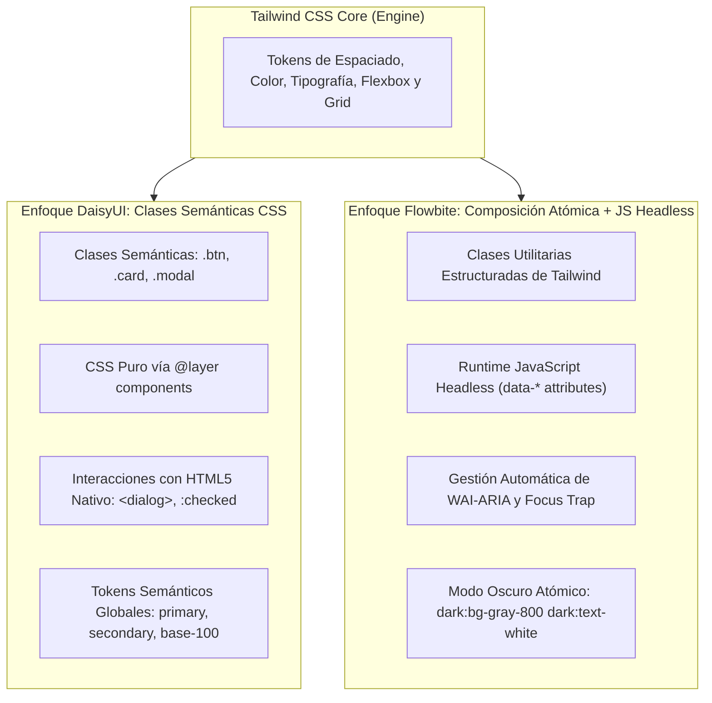
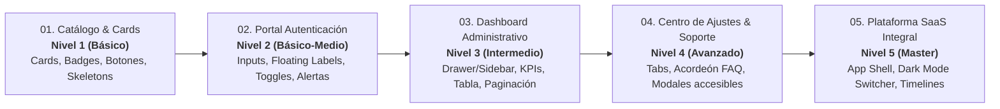

# Librerías de Componentes en Tailwind CSS · Introducción y Arquitectura

<div class="badges">
  <span class="badge badge-html">HTML5</span>
  <span class="badge badge-css">Tailwind CSS</span>
  <span class="badge badge-blue">DaisyUI 4.x</span>
  <span class="badge badge-purple">Flowbite 2.x</span>
  <span class="badge badge-ra">DIW RA 2 / RA 3</span>
</div>

En el desarrollo frontend moderno, **Tailwind CSS** se ha consolidado como el estándar *utility-first* de referencia. Sin embargo, construir interfaces complejas exclusivamente a base de micro-utilidades atómicas puede generar una excesiva verbosidad en el marcado HTML (*«class soup»* o «sopa de clases»), dificultando el mantenimiento y la consistencia en equipos grandes.

Para resolver este desafío surgen las **librerías de componentes basadas en Tailwind**, capas de abstracción que empaquetan patrones visuales recurrentes sin renunciar a la flexibilidad de Tailwind. En este módulo compararemos a fondo las dos soluciones más adoptadas del ecosistema: **DaisyUI** y **Flowbite**.

!!! info "Objetivo pedagógico"

    Analizar, comparar y construir proyectos frontend completos con **DaisyUI** y **Flowbite**, comprendiendo sus diferencias de arquitectura interna (clases semánticas CSS puras vs composición de utilidades con JavaScript interactivo), sistemas de diseño, accesibilidad y experiencia de desarrollo (DX).

---

## 1. El Dilema Arquitectónico: Utility-First vs Componentes

A la hora de maquetar un botón con estado de carga en Tailwind puro, el código resultante suele ser similar a este:

```html title="Tailwind CSS puro (Utility-First)"
<!-- Un botón requiere más de 12 clases individuales -->
<button class="inline-flex items-center justify-center px-4 py-2 font-medium text-white transition-all duration-200 bg-blue-600 rounded-lg hover:bg-blue-700 active:scale-95 focus:outline-none focus:ring-2 focus:ring-blue-500 focus:ring-offset-2 disabled:opacity-50 disabled:pointer-events-none">
  Guardar cambios
</button>
```

Aunque ofrece un control milimétrico, presenta tres inconvenientes en proyectos colaborativos:

1. **Duplicación de código:** El desarrollador debe replicar estas 12 clases en cada botón o crear abstracciones manuales (`@apply` o componentes de framework).
2. **Fatiga cognitiva:** Es difícil discernir la intención semántica del elemento al inspeccionar el DOM.
3. **Inconsistencia de diseño:** Un compañero puede usar `px-5 py-2.5` y `rounded-md`, rompiendo la guía de estilo institucional.

Las librerías de componentes abordan este problema desde dos filosofías arquitectónicas radicalmente distintas:



---

## 2. Anatomía de DaisyUI: Semántica y CSS Puro

**DaisyUI** es un plugin de Tailwind que inyecta nombres de clase semánticos directamente en la directiva `@layer components` de CSS.

### Principios Fundamentales de DaisyUI:
1. **Nombres concisos y semánticos:** En lugar de 12 clases de utilidad, defines `class="btn btn-primary"`.
2. **Cero JavaScript obligatorio:** La mayoría de sus componentes interactivos (menús desplegables, acordeones, modales, drawers) funcionan mediante **CSS puro** apoyándose en elementos estándar de HTML5 (como `<dialog>`, `<details>` o el truco del checkbox `:checked`).
3. **Tematización basada en CSS Variables (Tokens Semánticos):** DaisyUI no utiliza nombres de colores estáticos como `blue-600` o `gray-900`. En su lugar, emplea tokens semánticos:
   - `primary`: Color principal de acción.
   - `secondary`: Color de apoyo.
   - `accent`: Color de contraste o llamada a la atención.
   - `neutral`: Color de fondos neutros oscuros.
   - `base-100`, `base-200`, `base-300`: Fondos escalonados de tarjetas y contenedores.
   - `info`, `success`, `warning`, `error`: Estados del sistema.
4. **Soporte multitema con un solo atributo:** Permite alternar entre más de 30 temas preconstruidos (`light`, `dark`, `cupcake`, `retro`, `cyberpunk`, `synthwave`, etc.) simplemente cambiando el atributo `data-theme="nombre"` en el elemento raíz `<html>` o en cualquier contenedor.

```html title="Botón y Tarjeta en DaisyUI"
<!-- Botón semántico con variante de color y tamaño -->
<button class="btn btn-primary btn-sm">Guardar cambios</button>

<!-- Tarjeta desacoplada de colores fijos -->
<div class="card bg-base-100 shadow-xl border border-base-200">
  <div class="card-body">
    <h2 class="card-title text-base-content">Título del Proyecto</h2>
    <p>Descripción adaptada automáticamente al tema activo.</p>
  </div>
</div>
```

---

## 3. Anatomía de Flowbite: Utilidades Explícitas y JavaScript WAI-ARIA

**Flowbite** es una biblioteca de componentes de código abierto que combina clases de utilidad nativas de Tailwind con una biblioteca de control en JavaScript (*headless controller*) orientada a la accesibilidad.

### Principios Fundamentales de Flowbite:
1. **Marcado explícito con utilidades de Tailwind:** No oculta el CSS tras clases abstractas; los componentes están escritos con combinaciones estándar de Tailwind (`text-white bg-blue-700 hover:bg-blue-800 ...`), lo que permite modificar cualquier detalle con utilidades directas.
2. **Interactividad gobernada por atributos `data-*`:** Los componentes complejos (modales, tooltips, dropdowns, pestañas, acordeones, drawers) se controlan mediante atributos HTML como:
   - `data-modal-target="modalId"`
   - `data-modal-toggle="modalId"`
   - `data-collapse-toggle="navbarId"`
   - `data-tabs-target="#tabId"`
3. **Accesibilidad WAI-ARIA preconstruida:** El script de Flowbite gestiona automáticamente los estados `aria-expanded="true/false"`, `aria-hidden`, el atrapamiento de foco (*focus trap*) en diálogos y el cierre con la tecla `Escape`.
4. **Modo Oscuro elemento a elemento:** Aplica la variante estándar `dark:` de Tailwind (ej. `bg-white dark:bg-gray-800 text-gray-900 dark:text-white`).

```html title="Botón y Tarjeta en Flowbite"
<!-- Botón compuesto con utilidades de Tailwind y focus ring accesible -->
<button type="button" class="text-white bg-blue-700 hover:bg-blue-800 focus:ring-4 focus:ring-blue-300 font-medium rounded-lg text-sm px-5 py-2.5 dark:bg-blue-600 dark:hover:bg-blue-700 focus:outline-none dark:focus:ring-blue-800">
  Guardar cambios
</button>

<!-- Tarjeta con clases utilitarias y modo oscuro explícito -->
<div class="max-w-sm p-6 bg-white border border-gray-200 rounded-lg shadow-sm dark:bg-gray-800 dark:border-gray-700">
  <h5 class="mb-2 text-2xl font-bold tracking-tight text-gray-900 dark:text-white">Título del Proyecto</h5>
  <p class="font-normal text-gray-700 dark:text-gray-400">Descripción con contraste calibrado.</p>
</div>
```

---

## 4. Cuadro Comparativo de Arquitectura

| Criterio de Análisis | DaisyUI | Flowbite |
|---|---|---|
| **Paradigma** | Clases de componentes semánticos (`.btn`, `.card`, `.badge`). | Composición explícita de utilidades Tailwind + Atributos `data-*`. |
| **Dependencia de JavaScript** | **Ninguna obligatoria** para la mayoría de componentes (CSS puro + HTML5). | **Biblioteca JS incluida** (para modales, collapse, tabs, dropdowns). |
| **Longitud del HTML** | Muy reducida (1 a 4 clases por elemento). | Extensa (6 a 15 clases por elemento). |
| **Tematización y Dark Mode** | `data-theme` con tokens CSS globales (`primary`, `base-100`). Más de 30 temas listos. | Variante `dark:` explícita en cada elemento (`dark:bg-gray-900`). |
| **Accesibilidad (a11y)** | Delegada al estándar HTML5 (`<dialog>`, `<details>`, `aria-*` manuales). | Gestionada automáticamente por el motor JS (`aria-expanded`, focus trap). |
| **Personalización fina** | Requiere sobrescribir con utilidades de Tailwind o redefinir tokens en config. | Inmediata cambiando las utilidades directamente en el HTML. |
| **Curva de Aprendizaje** | Muy baja: similar a Bootstrap pero con el poder de Tailwind. | Media: exige comprender la sintaxis de utilidades y los atributos `data-*`. |
| **Compatibilidad con Frameworks** | Universal (HTML puro, React, Vue, Svelte, Angular, Astro). | Universal (HTML nativo + adaptadores dedicados en React, Vue, Svelte). |

---

## 5. Entornos de Trabajo: ¿Cómo empezar en el Aula?

Para que el alumnado experimente de inmediato sin fricciones de instalación, existen dos métodos de configuración:

### Método A: Prototipado Rápido con CDN (Sin Node.js)

Ideal para ejercicios de clase en un solo archivo `.html`:

=== "Plantilla Base DaisyUI (CDN)"

    ```html title="daisyui-starter.html"
    <!DOCTYPE html>
    <html lang="es" data-theme="light">
    <head>
      <meta charset="UTF-8">
      <meta name="viewport" content="width=device-width, initial-scale=1.0">
      <title>DaisyUI Starter</title>
      <!-- 1. DaisyUI CSS -->
      <link href="https://cdn.jsdelivr.net/npm/daisyui@4.12.14/dist/full.min.css" rel="stylesheet" type="text/css" />
      <!-- 2. Tailwind CSS CDN -->
      <script src="https://cdn.tailwindcss.com"></script>
    </head>
    <body class="bg-base-200 min-h-screen p-8 text-base-content">
      <div class="max-w-md mx-auto card bg-base-100 shadow-xl p-6">
        <h1 class="text-2xl font-bold mb-4">¡Hola, DaisyUI!</h1>
        <button class="btn btn-primary">Botón Semántico</button>
      </div>
    </body>
    </html>
    ```

=== "Plantilla Base Flowbite (CDN)"

    ```html title="flowbite-starter.html"
    <!DOCTYPE html>
    <html lang="es">
    <head>
      <meta charset="UTF-8">
      <meta name="viewport" content="width=device-width, initial-scale=1.0">
      <title>Flowbite Starter</title>
      <!-- 1. Flowbite CSS -->
      <link href="https://cdn.jsdelivr.net/npm/flowbite@2.5.2/dist/flowbite.min.css" rel="stylesheet" />
      <!-- 2. Tailwind CSS CDN -->
      <script src="https://cdn.tailwindcss.com"></script>
    </head>
    <body class="bg-gray-50 dark:bg-gray-900 min-h-screen p-8 text-gray-900 dark:text-white">
      <div class="max-w-md mx-auto p-6 bg-white border border-gray-200 rounded-lg shadow-sm dark:bg-gray-800 dark:border-gray-700">
        <h1 class="text-2xl font-bold mb-4">¡Hola, Flowbite!</h1>
        <button class="text-white bg-blue-700 hover:bg-blue-800 font-medium rounded-lg text-sm px-5 py-2.5">
          Botón Atómico
        </button>
      </div>
      <!-- 3. Flowbite JS (para componentes interactivos) -->
      <script src="https://cdn.jsdelivr.net/npm/flowbite@2.5.2/dist/flowbite.min.js"></script>
    </body>
    </html>
    ```

### Método B: Configuración Profesional con Node.js / Vite / Tailwind CLI

En proyectos profesionales de desarrollo (ciclos DAW / DAM), ambas librerías se integran como plugins en el archivo `tailwind.config.js`:

```bash title="Terminal (Instalación de paquetes)"
npm install -D tailwindcss postcss autoprefixer
npm install -D daisyui@latest
npm install flowbite
```

```javascript title="tailwind.config.js"
/** @type {import('tailwindcss').Config} */
module.exports = {
  darkMode: 'class', // Necesario para Flowbite dark mode
  content: [
    "./src/**/*.{html,js,ts,jsx,tsx}",
    "./node_modules/flowbite/**/*.js" // Escaneo obligatorio de clases de Flowbite
  ],
  theme: {
    extend: {},
  },
  plugins: [
    require('daisyui'),  // Plugin DaisyUI
    require('flowbite/plugin') // Plugin Flowbite
  ],
  daisyui: {
    themes: ["light", "dark", "corporate", "synthwave"], // Temas activos
  },
}
```

---

## 6. Itinerario de Proyectos Incrementales

A continuación se presentan **5 proyectos frontend completos y funcionales**, ordenados por dificultad incremental. Cada proyecto implementa exactamente los **mismos componentes y funcionalidades** en ambas librerías para permitir una comparación técnica, estética y arquitectónica inmediata:



1. [**Proyecto 1: Catálogo de Productos y Tarjetas de Perfil**](01-proyecto-tarjeta-catalogo.md) — Grid responsive, anatomía de Cards, badges de estado, estados de botón (normal, hover, disabled, loading/spinner), skeletons y gestión de desbordamiento de texto.
2. [**Proyecto 2: Portal de Autenticación y Registro con Validación**](02-proyecto-formulario-autenticacion.md) — Floating labels, inputs con iconos, toggles de activación, selects y tratamiento de estados de error/éxito accesibles.
3. [**Proyecto 3: Dashboard Administrativo con KPIs, Tablas y Sidebar**](03-proyecto-dashboard-metricas-tablas.md) — Drawer responsive (CSS vs JS), Stat cards de métricas, tabla con filas cebra, checkboxes de fila, paginador y empty states.
4. [**Proyecto 4: Centro de Configuración y Soporte con Modales y Tabs**](04-proyecto-modales-tabs-acordeon.md) — Pestañas dinámicas, acordeones colapsables animados y modales interactivos con focus trap.
5. [**Proyecto 5: Plataforma SaaS Completa con Modo Oscuro y Temas Dinámicos**](05-proyecto-saas-layout-multitema.md) — App Shell de producción, switcher de temas dinámico (`data-theme` vs `class="dark"`), barra de progreso, timeline de actividad y atajos de teclado (`Kbd`).
6. [**Guía Comparativa, Elección Arquitectónica y Rúbrica**](06-comparativa-tecnica-y-guia.md) — Matriz de decisión técnica, bundle size, rendimiento y criterios de evaluación de proyectos para el aula.
