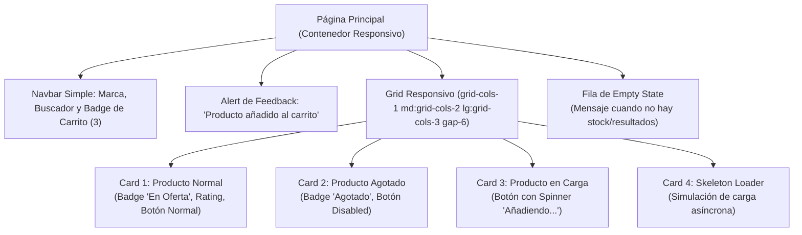

# Proyecto 01 · Catálogo de Productos y Tarjetas de Perfil

<div class="badges">
  <span class="badge badge-css">Nivel 1: Básico</span>
  <span class="badge badge-blue">DaisyUI 4.x</span>
  <span class="badge badge-purple">Flowbite 2.x</span>
  <span class="badge badge-ra">DIW RA 2 / RA 3</span>
</div>

En este primer proyecto práctico, los alumnos construirán un **catálogo interactivo de productos (E-Commerce Showcase)**. Es el punto de partida ideal para comparar la anatomía de los componentes más utilizados en cualquier interfaz web: **tarjetas (*cards*)**, **etiquetas de estado (*badges*)**, **botones de acción con variantes** y **notificaciones flotantes de feedback**.

!!! note "Objetivos Técnicos"

    1. Maquetar un catálogo responsivo en Grid (1 columna en móvil, 2 en tablet, 3 o 4 en escritorio).
    2. Dominar la construcción de componentes tipo **Card** (contenedor, cabecera de imagen, cuerpo y pie con acciones).
    3. Implementar **badges semánticos** para estados de disponibilidad, descuentos y categorías.
    4. Aplicar los **estados interactivos del botón**: normal, hover, activo, deshabilitado y en carga (*loading spinner*).
    5. Gestionar la **resiliencia visual**: estado de carga con *skeleton loaders*, estado vacío (*empty state*) y desbordamiento controlado de texto (*truncation*).

---

## 1. Esquema del Proyecto y Componentes a Construir

Ambas versiones implementarán la misma arquitectura de componentes:



---

## 2. Implementación Paso a Paso: DaisyUI vs Flowbite

### A. Barra de Navegación con Badge Contador

=== "DaisyUI"

    ```html title="navbar-daisyui.html"
    <!-- DaisyUI: navbar semántica con dropdown y badge en el icono -->
    <header class="navbar bg-base-100 shadow-md px-4 lg:px-8 rounded-box mb-8">
      <div class="flex-1">
        <a class="btn btn-ghost text-xl font-bold text-primary">TechStore</a>
      </div>
      <div class="flex-none gap-4">
        <!-- Botón de carrito con badge integrado -->
        <button class="btn btn-ghost btn-circle" aria-label="Ver carrito">
          <div class="indicator">
            <svg class="h-6 w-6" fill="none" viewBox="0 0 24 24" stroke="currentColor">
              <path stroke-linecap="round" stroke-linejoin="round" stroke-width="2" d="M3 3h2l.4 2M7 13h10l4-8H5.4M7 13L5.4 5M7 13l-2.293 2.293c-.63.63-.184 1.707.707 1.707H17m0 0a2 2 0 100 4 2 2 0 000-4zm-8 2a2 2 0 11-4 0 2 2 0 014 0z" />
            </svg>
            <span class="badge badge-sm badge-secondary indicator-item">3</span>
          </div>
        </button>
      </div>
    </header>
    ```

=== "Flowbite"

    ```html title="navbar-flowbite.html"
    <!-- Flowbite: navbar con utilidades explícitas y badge flotante -->
    <header class="bg-white border-b border-gray-200 dark:bg-gray-800 dark:border-gray-700 rounded-lg shadow-sm px-4 lg:px-6 py-3 mb-8">
      <div class="flex flex-wrap justify-between items-center">
        <a href="#" class="flex items-center text-xl font-bold text-blue-600 dark:text-blue-400">
          TechStore
        </a>
        <div class="flex items-center gap-4">
          <!-- Botón de carrito con badge relativo -->
          <button type="button" class="relative inline-flex items-center p-2 text-sm font-medium text-center text-gray-500 rounded-lg hover:bg-gray-100 focus:ring-4 focus:outline-none focus:ring-gray-200 dark:text-gray-400 dark:hover:bg-gray-700 dark:focus:ring-gray-700" aria-label="Ver carrito">
            <svg class="w-6 h-6" fill="none" stroke="currentColor" viewBox="0 0 24 24">
              <path stroke-linecap="round" stroke-linejoin="round" stroke-width="2" d="M3 3h2l.4 2M7 13h10l4-8H5.4M7 13L5.4 5M7 13l-2.293 2.293c-.63.63-.184 1.707.707 1.707H17m0 0a2 2 0 100 4 2 2 0 000-4zm-8 2a2 2 0 11-4 0 2 2 0 014 0z"/>
            </svg>
            <span class="absolute top-0 right-0 inline-flex items-center justify-center px-2 py-1 text-xs font-bold leading-none text-red-100 transform translate-x-1/4 -translate-y-1/4 bg-red-600 rounded-full">
              3
            </span>
          </button>
        </div>
      </div>
    </header>
    ```

---

### B. Tarjeta de Producto (Card UI con Badges y Rating)

=== "DaisyUI"

    ```html title="card-daisyui.html"
    <!-- DaisyUI: .card, .card-body, .card-title, .badge -->
    <article class="card bg-base-100 shadow-xl border border-base-200 hover:shadow-2xl transition-shadow">
      <figure class="relative aspect-video overflow-hidden">
        
        <!-- Badge flotante de oferta -->
        <span class="badge badge-accent absolute top-3 right-3 font-semibold">-25% OFF</span>
      </figure>

      <div class="card-body p-6">
        <div class="flex items-center justify-between mb-1">
          <span class="badge badge-outline badge-primary text-xs">Audio Pro</span>
          <div class="rating rating-xs">
            <input type="radio" name="rating-1" class="mask mask-star-2 bg-warning" checked disabled />
            <span class="text-xs ml-1 text-base-content/70">4.8</span>
          </div>
        </div>

        <h2 class="card-title text-base-content font-bold text-lg line-clamp-1">
          Auriculares Noise-Cancelling Studio Pro Max
        </h2>

        <p class="text-sm text-base-content/70 line-clamp-2">
          Cancelación activa de ruido inteligente con transductores de 40mm y batería para 30 horas continuas.
        </p>

        <div class="card-actions justify-between items-center mt-4 pt-4 border-t border-base-200">
          <div>
            <span class="text-xs text-base-content/50 block line-through">199,99 €</span>
            <span class="text-xl font-extrabold text-primary">149,99 €</span>
          </div>
          <!-- Botón con variante primaria -->
          <button class="btn btn-primary btn-sm gap-2">
            <svg class="w-4 h-4" fill="none" stroke="currentColor" viewBox="0 0 24 24"><path stroke-linecap="round" stroke-linejoin="round" stroke-width="2" d="M12 4v16m8-8H4"/></svg>
            Añadir
          </button>
        </div>
      </div>
    </article>
    ```

=== "Flowbite"

    ```html title="card-flowbite.html"
    <!-- Flowbite: clases utilitarias de Tailwind + badges y buttons Flowbite -->
    <article class="bg-white border border-gray-200 rounded-lg shadow-sm hover:shadow-lg transition-shadow dark:bg-gray-800 dark:border-gray-700 overflow-hidden flex flex-col justify-between">
      <div class="relative aspect-video overflow-hidden">
        
        <!-- Badge flotante de oferta -->
        <span class="absolute top-3 right-3 bg-red-100 text-red-800 text-xs font-semibold px-2.5 py-0.5 rounded-sm dark:bg-red-900 dark:text-red-300">
          -25% OFF
        </span>
      </div>

      <div class="p-5 flex-1 flex flex-col justify-between">
        <div>
          <div class="flex items-center justify-between mb-2">
            <span class="bg-blue-100 text-blue-800 text-xs font-medium px-2.5 py-0.5 rounded-sm dark:bg-blue-900 dark:text-blue-300">
              Audio Pro
            </span>
            <div class="flex items-center text-yellow-400 text-xs font-bold">
              ★ <span class="ml-1 text-gray-500 dark:text-gray-400">4.8</span>
            </div>
          </div>

          <h5 class="text-lg font-bold tracking-tight text-gray-900 dark:text-white line-clamp-1 mb-2">
            Auriculares Noise-Cancelling Studio Pro Max
          </h5>

          <p class="font-normal text-sm text-gray-700 dark:text-gray-400 line-clamp-2">
            Cancelación activa de ruido inteligente con transductores de 40mm y batería para 30 horas continuas.
          </p>
        </div>

        <div class="flex items-center justify-between pt-4 mt-4 border-t border-gray-100 dark:border-gray-700">
          <div>
            <span class="text-xs text-gray-400 block line-through">199,99 €</span>
            <span class="text-xl font-bold text-gray-900 dark:text-white">149,99 €</span>
          </div>
          <!-- Botón de acción Flowbite -->
          <button type="button" class="text-white bg-blue-700 hover:bg-blue-800 focus:ring-4 focus:ring-blue-300 font-medium rounded-lg text-sm px-4 py-2 dark:bg-blue-600 dark:hover:bg-blue-700 focus:outline-none dark:focus:ring-blue-800 inline-flex items-center gap-1.5">
            <svg class="w-4 h-4" fill="none" stroke="currentColor" viewBox="0 0 24 24"><path stroke-linecap="round" stroke-linejoin="round" stroke-width="2" d="M12 4v16m8-8H4"/></svg>
            Añadir
          </button>
        </div>
      </div>
    </article>
    ```

---

### C. Estados del Botón: Agotado (Disabled) y En Carga (Loading)

La robustez de una interfaz depende de cómo comunica estados transitorios:

=== "DaisyUI"

    ```html title="button-states-daisyui.html"
    <!-- Estado Agotado: disabled nativo -->
    <button class="btn btn-neutral btn-sm" disabled>
      Agotado
    </button>

    <!-- Estado Cargando: clase .loading-spinner integrada -->
    <button class="btn btn-primary btn-sm">
      <span class="loading loading-spinner loading-xs"></span>
      Añadiendo...
    </button>
    ```

=== "Flowbite"

    ```html title="button-states-flowbite.html"
    <!-- Estado Agotado: cursor-not-allowed y opacidad -->
    <button type="button" disabled class="py-2 px-4 text-sm font-medium text-gray-400 bg-gray-200 rounded-lg cursor-not-allowed dark:bg-gray-700 dark:text-gray-500">
      Agotado
    </button>

    <!-- Estado Cargando: spinner SVG explícito animate-spin -->
    <button type="button" class="text-white bg-blue-700 font-medium rounded-lg text-sm px-4 py-2 text-center inline-flex items-center">
      <svg aria-hidden="true" role="status" class="inline w-4 h-4 me-2 text-white animate-spin" viewBox="0 0 100 101" fill="none" xmlns="http://www.w3.org/2000/svg">
        <path d="M100 50.5908C100 78.2051 77.6142 100.591 50 100.591C22.3858 100.591 0 78.2051 0 50.5908C0 22.9766 22.3858 0.59082 50 0.59082C77.6142 0.59082 100 22.9766 100 50.5908ZM9.08144 50.5908C9.08144 73.1895 27.4013 91.5094 50 91.5094C72.5987 91.5094 90.9186 73.1895 90.9186 50.5908C90.9186 27.9921 72.5987 9.67226 50 9.67226C27.4013 9.67226 9.08144 27.9921 9.08144 50.5908Z" fill="#E5E7EB"/>
        <path d="M93.9676 39.0409C96.393 38.4038 97.8624 35.9116 97.0079 33.5539C95.2932 28.8227 92.871 24.3692 89.8167 20.348C85.8452 15.1192 80.8826 10.7238 75.2124 7.41289C69.5422 4.10194 63.2754 1.94025 56.7698 1.05124C51.7666 0.367541 46.6976 0.446843 41.7345 1.27873C39.2613 1.69328 37.813 4.19778 38.4501 6.62326C39.0873 9.04874 41.5694 10.4717 44.0505 10.1071C47.8511 9.54855 51.7191 9.52689 55.5402 10.0491C60.8642 10.7766 65.9928 12.5457 70.6331 15.2552C75.2735 17.9648 79.3347 21.5619 82.5849 25.841C84.9175 28.9121 86.7997 32.2913 88.1811 35.8758C89.083 38.2158 91.5421 39.6781 93.9676 39.0409Z" fill="currentColor"/>
      </svg>
      Añadiendo...
    </button>
    ```

---

### D. Resiliencia de UI: Skeleton Loader y Empty State

Un diseño profesional siempre anticipa qué ocurre cuando los datos no han llegado aún o cuando la búsqueda arroja 0 resultados:

=== "DaisyUI"

    ```html title="resilience-daisyui.html"
    <!-- 1. Skeleton Loader con .skeleton de DaisyUI -->
    <div class="card bg-base-100 shadow-xl border border-base-200">
      <div class="skeleton h-48 w-full rounded-b-none"></div>
      <div class="card-body p-6 gap-3">
        <div class="skeleton h-4 w-24"></div>
        <div class="skeleton h-6 w-3/4"></div>
        <div class="skeleton h-4 w-full"></div>
        <div class="skeleton h-4 w-5/6"></div>
        <div class="flex justify-between items-center pt-4">
          <div class="skeleton h-6 w-16"></div>
          <div class="skeleton h-8 w-24 rounded-btn"></div>
        </div>
      </div>
    </div>

    <!-- 2. Empty State -->
    <div class="col-span-full py-16 text-center bg-base-100 rounded-box border border-dashed border-base-300">
      <div class="text-4xl mb-3">🔍</div>
      <h3 class="text-lg font-bold text-base-content">No se encontraron productos</h3>
      <p class="text-sm text-base-content/60 max-w-sm mx-auto mt-1">
        Prueba a ajustar tus filtros de búsqueda o categoría seleccionada.
      </p>
      <button class="btn btn-outline btn-sm mt-4">Restablecer filtros</button>
    </div>
    ```

=== "Flowbite"

    ```html title="resilience-flowbite.html"
    <!-- 1. Skeleton Loader con animate-pulse de Flowbite / Tailwind -->
    <div role="status" class="bg-white border border-gray-200 rounded-lg p-5 shadow-sm dark:bg-gray-800 dark:border-gray-700 animate-pulse">
      <div class="flex items-center justify-center h-48 mb-4 bg-gray-300 rounded-sm dark:bg-gray-700">
        <svg class="w-10 h-10 text-gray-200 dark:text-gray-600" aria-hidden="true" xmlns="http://www.w3.org/2000/svg" fill="currentColor" viewBox="0 0 20 18"><path d="M18 0H2a2 2 0 0 0-2 2v14a2 2 0 0 0 2 2h16a2 2 0 0 0 2-2V2a2 2 0 0 0-2-2Zm-5.5 4a1.5 1.5 0 1 1 0 3 1.5 1.5 0 0 1 0-3Zm4.376 10.481A1 1 0 0 1 16 15H4a1 1 0 0 1-.895-1.447l3.5-7A1 1 0 0 1 7.468 6a.965.965 0 0 1 .9.5l2.175 4.35 1.473-2.946a1 1 0 0 1 1.764-.029l3.5 7a1 1 0 0 1 .066.526Z"/></svg>
      </div>
      <div class="h-2.5 bg-gray-200 rounded-full dark:bg-gray-700 w-24 mb-4"></div>
      <div class="h-4 bg-gray-200 rounded-full dark:bg-gray-700 w-3/4 mb-2.5"></div>
      <div class="h-3 bg-gray-200 rounded-full dark:bg-gray-700 mb-2"></div>
      <div class="h-3 bg-gray-200 rounded-full dark:bg-gray-700 w-5/6 mb-4"></div>
      <div class="flex justify-between items-center pt-2">
        <div class="h-5 bg-gray-200 rounded-full dark:bg-gray-700 w-16"></div>
        <div class="h-8 bg-gray-300 rounded-lg dark:bg-gray-700 w-24"></div>
      </div>
      <span class="sr-only">Cargando producto...</span>
    </div>

    <!-- 2. Empty State -->
    <div class="col-span-full py-16 text-center bg-white dark:bg-gray-800 rounded-lg border-2 border-dashed border-gray-200 dark:border-gray-700">
      <div class="text-4xl mb-3">🔍</div>
      <h3 class="text-lg font-bold text-gray-900 dark:text-white">No se encontraron productos</h3>
      <p class="text-sm text-gray-500 dark:text-gray-400 max-w-sm mx-auto mt-1">
        Prueba a ajustar tus filtros de búsqueda o categoría seleccionada.
      </p>
      <button type="button" class="py-2 px-4 text-xs font-medium text-gray-900 focus:outline-none bg-white rounded-lg border border-gray-200 hover:bg-gray-100 hover:text-blue-700 focus:z-10 focus:ring-4 focus:ring-gray-100 dark:focus:ring-gray-700 dark:bg-gray-800 dark:text-gray-400 dark:border-gray-600 dark:hover:text-white dark:hover:bg-gray-700 mt-4">
        Restablecer filtros
      </button>
    </div>
    ```

---

## 3. Comparativa Técnica y Arquitectónica

| Elemento Analizado | DaisyUI | Flowbite | Conclusión Técnica |
|---|---|---|---|
| **Estructura del Card** | 3 clases base (`card`, `card-body`, `card-title`). | 10+ clases utilitarias (`border`, `rounded-lg`, `p-5`, etc.). | DaisyUI es mucho más conciso; Flowbite da control directo sin CSS extra. |
| **Spinner en Botón** | 1 etiqueta con clase semántica `loading loading-spinner`. | Requiere inyectar un SVG con 2 `<path>` y clase `animate-spin`. | DaisyUI abstrae la complejidad del SVG; Flowbite es autocontenido en HTML. |
| **Skeleton Loader** | Clase semántica nativa `.skeleton` con animación CSS integrada. | Requiere maquetar rectángulos grises con `animate-pulse` y `role="status"`. | Flowbite exige mayor atención a la accesibilidad manual (`sr-only`). |
| **Dark Mode** | Automático cambiando `data-theme="dark"`. | Requiere prefijos explícitos `dark:bg-*` y `dark:text-*` en cada nodo. | Flowbite es más verboso pero independiente de CSS variables de tema. |

---

## 4. Archivos de Código Completos para el Alumnado

Los alumnos pueden abrir directamente los siguientes archivos en su navegador web para comparar el renderizado en tiempo real:

- 📄 [01-catalogo-cards-daisyui.html](ejemplos-html/01-catalogo-cards-daisyui.html) — Implementación integral con DaisyUI.
- 📄 [01-catalogo-cards-flowbite.html](ejemplos-html/01-catalogo-cards-flowbite.html) — Implementación integral con Flowbite.

---

## 5. Retos de Ampliación para el Alumnado

1. **Reto 1 (Badges condicionales):** Añade un producto con un badge de *"Últimas 2 unidades"* que use color de advertencia (`badge-warning` en DaisyUI vs clases `bg-yellow-100 text-yellow-800` en Flowbite).
2. **Reto 2 (Interacción Toast/Alert):** Haz que al pulsar el botón "Añadir", aparezca un alert flotante con animación que desaparezca a los 3 segundos.
3. **Reto 3 (Truncado responsivo):** Prueba a poner un título de 120 caracteres y verifica que `line-clamp-1` o `truncate` evite que la tarjeta rompa la altura de la fila del Grid.
