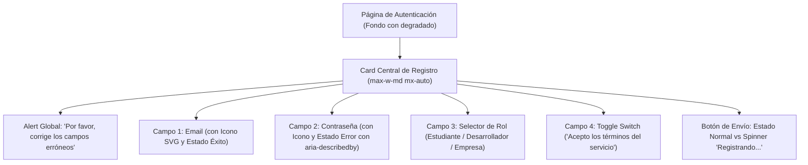

# Proyecto 02 · Portal de Autenticación y Registro con Validación

<div class="badges">
  <span class="badge badge-css">Nivel 2: Básico-Intermedio</span>
  <span class="badge badge-blue">DaisyUI 4.x</span>
  <span class="badge badge-purple">Flowbite 2.x</span>
  <span class="badge badge-ra">LMH RA 6 / DIW RA 2</span>
</div>

En este segundo proyecto, los alumnos se enfrentan a un desafío central del desarrollo web: **los formularios interactivos**. Construirán un **portal de registro de usuario** con validación en tiempo real, inputs con iconos integrados, etiquetas flotantes (*floating labels*), selectores de rol, interruptores de activación (*toggles*) y gestión rigurosa de la accesibilidad (WCAG 2.2).

!!! note "Objetivos Técnicos"

    1. Maquetar un formulario centrado con contenedor tipo Card y estética moderna.
    2. Integrar iconos SVG directamente dentro de los campos de texto (`input`).
    3. Construir etiquetas flotantes (*floating labels*) aprovechando la pseudoclase `:placeholder-shown` y el selector `peer`.
    4. Implementar selectores desplegables personalizados e interruptores (*toggles*).
    5. Comunicar **estados de validación accesibles**:
       - Estado de éxito: borde verde, icono de confirmación y texto positivo.
       - Estado de error: borde rojo, icono de advertencia, atributo `aria-invalid="true"` y texto descriptivo enlazado mediante `aria-describedby`.
       - Estado deshabilitado (*disabled*) y estado de envío (*loading*).

---

## 1. Arquitectura del Formulario



---

## 2. Implementación Paso a Paso: DaisyUI vs Flowbite

### A. Campo de Entrada con Icono y Estado de Éxito

=== "DaisyUI"

    ```html title="input-success-daisyui.html"
    <!-- DaisyUI: .form-control, .input, .input-success -->
    <div class="form-control w-full">
      <label class="label" for="email-daisy">
        <span class="label-text font-semibold">Correo Electrónico</span>
        <span class="label-text-alt text-success font-medium">✓ Válido</span>
      </label>
      <label class="input input-bordered input-success flex items-center gap-2">
        <svg class="w-4 h-4 text-success" fill="none" stroke="currentColor" viewBox="0 0 24 24">
          <path stroke-linecap="round" stroke-linejoin="round" stroke-width="2" d="M16 12a4 4 0 10-8 0 4 4 0 008 0zm0 0v1.5a2.5 2.5 0 005 0V12a9 9 0 10-9 9m4.5-1.206a8.959 8.959 0 01-4.5 1.207" />
        </svg>
        <input type="email" id="email-daisy" class="grow" value="alumno@dominia.es" />
      </label>
      <label class="label">
        <span class="label-text-alt text-success">Dirección de correo verificada correctamente.</span>
      </label>
    </div>
    ```

=== "Flowbite"

    ```html title="input-success-flowbite.html"
    <!-- Flowbite: clases utilitarias de estado verde con icono relativo -->
    <div>
      <label for="email-flowbite" class="block mb-2 text-sm font-semibold text-green-700 dark:text-green-500">
        Correo Electrónico
      </label>
      <div class="relative">
        <div class="absolute inset-y-0 start-0 flex items-center ps-3.5 pointer-events-none">
          <svg class="w-4 h-4 text-green-500" fill="currentColor" viewBox="0 0 20 20"><path d="M2.003 5.884L10 9.882l7.997-3.998A2 2 0 0016 4H4a2 2 0 00-1.997 1.884z"/><path d="M18 8.118l-8 4-8-4V14a2 2 0 002 2h12a2 2 0 002-2V8.118z"/></svg>
        </div>
        <input type="email" id="email-flowbite" value="alumno@dominia.es" class="bg-green-50 border border-green-500 text-green-900 dark:text-green-400 placeholder-green-700 dark:placeholder-green-500 text-sm rounded-lg focus:ring-green-500 focus:border-green-500 block w-full ps-10 p-2.5 dark:bg-gray-700 dark:border-green-500" />
      </div>
      <p class="mt-2 text-xs text-green-600 dark:text-green-500">
        <span class="font-medium">¡Correcto!</span> Dirección de correo verificada.
      </p>
    </div>
    ```

---

### B. Campo de Contraseña con Validación de Error y Accesibilidad (ARIA)

El estándar WAI-ARIA exige que cuando un campo esté en error, incluya `aria-invalid="true"` y un identificador `aria-describedby` que apunte al texto explicativo para los lectores de pantalla:

=== "DaisyUI"

    ```html title="input-error-daisyui.html"
    <!-- DaisyUI: .input-error con enlace accesible -->
    <div class="form-control w-full">
      <label class="label" for="password-daisy">
        <span class="label-text font-semibold">Contraseña</span>
        <span class="label-text-alt text-error font-medium">Mínimo 8 caracteres</span>
      </label>
      <label class="input input-bordered input-error flex items-center gap-2">
        <svg class="w-4 h-4 text-error" fill="none" stroke="currentColor" viewBox="0 0 24 24">
          <path stroke-linecap="round" stroke-linejoin="round" stroke-width="2" d="M12 15v2m-6 4h12a2 2 0 002-2v-6a2 2 0 00-2-2H6a2 2 0 00-2 2v6a2 2 0 002 2zm10-10V7a4 4 0 00-8 0v4h8z"/>
        </svg>
        <input type="password" id="password-daisy" class="grow" value="1234" aria-invalid="true" aria-describedby="pass-error-daisy" />
      </label>
      <label class="label" id="pass-error-daisy">
        <span class="label-text-alt text-error font-medium">La contraseña debe contener al menos 8 caracteres, un número y una mayúscula.</span>
      </label>
    </div>
    ```

=== "Flowbite"

    ```html title="input-error-flowbite.html"
    <!-- Flowbite: clases de error rojas con aria-describedby -->
    <div>
      <label for="password-flowbite" class="block mb-2 text-sm font-semibold text-red-700 dark:text-red-500">
        Contraseña
      </label>
      <div class="relative">
        <div class="absolute inset-y-0 start-0 flex items-center ps-3.5 pointer-events-none">
          <svg class="w-4 h-4 text-red-500" fill="currentColor" viewBox="0 0 20 20"><path fill-rule="evenodd" d="M5 9V7a5 5 0 0110 0v2a2 2 0 012 2v5a2 2 0 01-2 2H5a2 2 0 01-2-2v-5a2 2 0 012-2zm8-2v2H7V7a3 3 0 016 0z" clip-rule="evenodd"/></svg>
        </div>
        <input type="password" id="password-flowbite" value="1234" aria-invalid="true" aria-describedby="pass-error-flowbite" class="bg-red-50 border border-red-500 text-red-900 placeholder-red-700 text-sm rounded-lg focus:ring-red-500 focus:border-red-500 block w-full ps-10 p-2.5 dark:bg-gray-700 dark:text-red-500 dark:placeholder-red-500 dark:border-red-500" />
      </div>
      <p id="pass-error-flowbite" class="mt-2 text-xs text-red-600 dark:text-red-500">
        <span class="font-medium">Error de seguridad:</span> La contraseña debe contener al menos 8 caracteres.
      </p>
    </div>
    ```

---

### C. Floating Labels (Etiquetas Flotantes Modernas)

Las etiquetas flotantes se elevan sobre el campo cuando el usuario escribe o hace foco, ahorrando espacio vertical:

=== "DaisyUI"

    ```html title="floating-daisyui.html"
    <!-- DaisyUI utiliza el pseudo-selector :focus y :placeholder-shown con clases utilitarias -->
    <div class="relative w-full">
      <input type="text" id="nombre-daisy" placeholder=" " class="input input-bordered w-full pt-4 pb-1 peer" />
      <label for="nombre-daisy" class="absolute text-xs duration-200 transform -translate-y-2 scale-75 top-3 z-10 origin-[0] start-4 text-base-content/60 peer-placeholder-shown:scale-100 peer-placeholder-shown:translate-y-0 peer-placeholder-shown:text-sm peer-focus:scale-75 peer-focus:-translate-y-2 peer-focus:text-primary">
        Nombre Completo
      </label>
    </div>
    ```

=== "Flowbite"

    ```html title="floating-flowbite.html"
    <!-- Flowbite ofrece un patrón nativo de Floating Label documentado -->
    <div class="relative z-0 w-full group">
      <input type="text" name="nombre-flowbite" id="nombre-flowbite" class="block py-2.5 px-0 w-full text-sm text-gray-900 bg-transparent border-0 border-b-2 border-gray-300 appearance-none dark:text-white dark:border-gray-600 dark:focus:border-blue-500 focus:outline-none focus:ring-0 focus:border-blue-600 peer" placeholder=" " required />
      <label for="nombre-flowbite" class="peer-focus:font-medium absolute text-sm text-gray-500 dark:text-gray-400 duration-300 transform -translate-y-6 scale-75 top-3 -z-10 origin-[0] peer-focus:start-0 peer-focus:text-blue-600 peer-focus:dark:text-blue-500 peer-placeholder-shown:scale-100 peer-placeholder-shown:translate-y-0 peer-focus:scale-75 peer-focus:-translate-y-6">
        Nombre Completo
      </label>
    </div>
    ```

---

### D. Toggle Switch e Interruptores de Términos

=== "DaisyUI"

    ```html title="toggle-daisyui.html"
    <!-- DaisyUI: .toggle, .toggle-primary (CSS puro con checkbox) -->
    <div class="form-control">
      <label class="label cursor-pointer justify-start gap-4">
        <input type="checkbox" class="toggle toggle-primary" checked />
        <span class="label-text font-medium">Deseo recibir el boletín técnico mensual</span>
      </label>
    </div>
    ```

=== "Flowbite"

    ```html title="toggle-flowbite.html"
    <!-- Flowbite: checkbox accesible con estilo de pastilla deslizante -->
    <label class="inline-flex items-center cursor-pointer">
      <input type="checkbox" value="" class="sr-only peer" checked>
      <div class="relative w-11 h-6 bg-gray-200 peer-focus:outline-none peer-focus:ring-4 peer-focus:ring-blue-300 dark:peer-focus:ring-blue-800 rounded-full peer dark:bg-gray-700 peer-checked:after:translate-x-full rtl:peer-checked:after:-translate-x-full peer-checked:after:border-white after:content-[''] after:absolute after:top-[2px] after:start-[2px] after:bg-white after:border-gray-300 after:border after:rounded-full after:h-5 after:w-5 after:transition-all dark:border-gray-600 peer-checked:bg-blue-600"></div>
      <span class="ms-3 text-sm font-medium text-gray-900 dark:text-gray-300">Deseo recibir el boletín técnico mensual</span>
    </label>
    ```

---

## 3. Comparativa Técnica de Formularios

| Característica | DaisyUI | Flowbite | Conclusión Técnica |
|---|---|---|---|
| **Estructura del Form Field** | Usa envoltorio `.form-control` y etiquetas `.label`. | Usa etiquetas `<label>` semánticas con espaciado utilitario. | DaisyUI estandariza la separación de etiquetas superiores e inferiores. |
| **Colores de Validación** | `.input-success`, `.input-error`, `.input-warning`. | Clases utilitarias (`border-green-500`, `bg-green-50`, `text-green-900`). | DaisyUI aplica estados completos con una sola clase semántica. |
| **Interruptor (Toggle)** | 1 sola etiqueta `<input type="checkbox" class="toggle toggle-primary">`. | Requiere un `<input class="sr-only">` seguido de un `<div>` con 15 utilidades pseudo-elementos (`after:`). | DaisyUI es infinitamente más limpio y fácil de mantener. |
| **Floating Labels** | Requiere clases de utilidad Tailwind (`peer-placeholder-shown`). | Patrón oficial y pulido con variantes *outlined* o *standard*. | Flowbite tiene mejor documentación y variantes listas para floating labels. |

---

## 4. Archivos de Código Completos para el Alumnado

- 📄 [02-formulario-autenticacion-daisyui.html](ejemplos-html/02-formulario-autenticacion-daisyui.html) — Portal completo con DaisyUI.
- 📄 [02-formulario-autenticacion-flowbite.html](ejemplos-html/02-formulario-autenticacion-flowbite.html) — Portal completo con Flowbite.

---

## 5. Retos de Ampliación para el Alumnado

1. **Reto 1 (Indicador de fortaleza de contraseña):** Añade una barra de progreso que cambie de color (rojo/amarillo/verde) a medida que el usuario escribe la contraseña.
2. **Reto 2 (Botón de visibilidad):** Implementa un botón con icono de ojo para conmutar entre `type="password"` y `type="text"`.
3. **Reto 3 (Validación interactiva JS):** Crea una función que impida enviar el formulario si el toggle de términos no está marcado, mostrando una alerta contextual animada.
