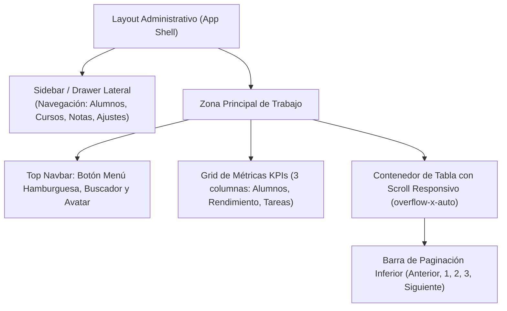

# Proyecto 03 · Dashboard Administrativo con KPIs, Tablas y Sidebar

<div class="badges">
  <span class="badge badge-css">Nivel 3: Intermedio</span>
  <span class="badge badge-blue">DaisyUI 4.x</span>
  <span class="badge badge-purple">Flowbite 2.x</span>
  <span class="badge badge-ra">DIW RA 2 / RA 4 / LMH RA 5</span>
</div>

En este tercer proyecto, el alumnado dará el salto a una aplicación frontend de gestión real: un **Dashboard Académico de Alumnos y Calificaciones**. Aquí se abordarán componentes de mayor complejidad estructural: **barras laterales desplegables (*Drawer / Offcanvas*)**, **tarjetas de métricas estadísticas (*KPI Stat Cards*)**, y **tablas de datos complejas** con checkboxes de selección masiva, insignias de estado y paginación.

!!! note "Objetivos Técnicos"

    1. Construir un layout administrativo con barra lateral (*Sidebar*) colapsable en móvil y fija en escritorio.
    2. Comparar el mecanismo de apertura del Sidebar: **CSS puro** (DaisyUI) vs **Controlador JavaScript** (Flowbite).
    3. Diseñar tarjetas de métricas estadísticas (*KPIs*) con valores numéricos destacados, iconos y badges de tendencia porcentual.
    4. Maquetar una **tabla de datos accesible** con selector de fila, estilos de fila alterna (*zebra*), efectos *hover* y badges de estado.
    5. Implementar una barra de **paginación semántica** y contemplar estados de carga (*table skeletons*) y tablas vacías (*empty states*).

---

## 1. Arquitectura del Layout y Componentes



---

## 2. Implementación Paso a Paso: DaisyUI vs Flowbite

### A. Sidebar / Drawer: CSS Puro vs JavaScript Headless

El menú lateral ilustra una de las diferencias conceptuales más fascinantes entre ambas librerías:

=== "DaisyUI (CSS Puro con Checkbox Hack)"

    ```html title="drawer-daisyui.html"
    <!-- DaisyUI utiliza el componente .drawer apoyado en un <input type="checkbox"> -->
    <div class="drawer lg:drawer-open min-h-screen bg-base-200">
      <!-- Input invisible que controla el estado abierto/cerrado sin una sola línea de JS -->
      <input id="admin-drawer" type="checkbox" class="drawer-toggle" />
      
      <div class="drawer-content flex flex-col">
        <!-- Barra superior con botón hamburguesa para pantallas móviles -->
        <header class="navbar bg-base-100 shadow-sm lg:hidden px-4">
          <label for="admin-drawer" class="btn btn-square btn-ghost" aria-label="Abrir menú">
            <svg class="w-6 h-6" fill="none" stroke="currentColor" viewBox="0 0 24 24"><path stroke-linecap="round" stroke-linejoin="round" stroke-width="2" d="M4 6h16M4 12h16M4 18h16"/></svg>
          </label>
          <span class="font-bold text-lg ml-2">Panel de Control</span>
        </header>

        <!-- Contenido principal -->
        <main class="p-6"> ... </main>
      </div>

      <!-- Menú lateral que se desliza automáticamente en móviles -->
      <aside class="drawer-side z-40">
        <label for="admin-drawer" aria-label="Cerrar menú" class="drawer-overlay"></label>
        <ul class="menu p-4 w-72 min-h-full bg-base-100 text-base-content font-medium gap-1">
          <li class="menu-title text-primary font-bold text-lg mb-2">🎓 Aula Virtual</li>
          <li><a class="active">📊 Resumen General</a></li>
          <li><a>👥 Gestión de Alumnos</a></li>
          <li><a>📝 Evaluaciones</a></li>
          <li><a>⚙️ Configuración</a></li>
        </ul>
      </aside>
    </div>
    ```

=== "Flowbite (Controlado con data-drawer-target)"

    ```html title="drawer-flowbite.html"
    <!-- Flowbite requiere atributos data-* y el script flowbite.js para gestionar el DOM -->
    <header class="bg-white border-b border-gray-200 dark:bg-gray-800 dark:border-gray-700 px-4 py-3 lg:hidden flex items-center">
      <!-- Botón que activa el drawer mediante JavaScript -->
      <button data-drawer-target="admin-sidebar" data-drawer-toggle="admin-sidebar" aria-controls="admin-sidebar" type="button" class="inline-flex items-center p-2 text-sm text-gray-500 rounded-lg hover:bg-gray-100 focus:outline-none focus:ring-2 focus:ring-gray-200 dark:text-gray-400 dark:hover:bg-gray-700 dark:focus:ring-gray-600">
        <span class="sr-only">Abrir menú</span>
        <svg class="w-6 h-6" fill="currentColor" viewBox="0 0 20 20"><path clip-rule="evenodd" fill-rule="evenodd" d="M2 4.75A.75.75 0 012.75 4h14.5a.75.75 0 010 1.5H2.75A.75.75 0 012 4.75zm0 10.5a.75.75 0 01.75-.75h14.5a.75.75 0 010 1.5H2.75a.75.75 0 01-.75-.75zM2 10a.75.75 0 01.75-.75h14.5a.75.75 0 010 1.5H2.75A.75.75 0 012 10z"/></svg>
      </button>
      <span class="font-bold text-lg ml-2 text-gray-900 dark:text-white">Panel de Control</span>
    </header>

    <!-- Sidebar lateral de Flowbite -->
    <aside id="admin-sidebar" class="fixed top-0 left-0 z-40 w-64 h-screen transition-transform -translate-x-full lg:translate-x-0" aria-label="Sidebar">
      <div class="h-full px-3 py-4 overflow-y-auto bg-gray-50 dark:bg-gray-800 border-r border-gray-200 dark:border-gray-700">
        <div class="font-bold text-lg text-blue-600 dark:text-blue-400 px-2 mb-5">🎓 Aula Virtual</div>
        <ul class="space-y-2 font-medium">
          <li>
            <a href="#" class="flex items-center p-2 text-blue-700 bg-blue-100 rounded-lg dark:text-white dark:bg-blue-900/50">
              📊 <span class="ms-3">Resumen General</span>
            </a>
          </li>
          <li>
            <a href="#" class="flex items-center p-2 text-gray-900 rounded-lg dark:text-white hover:bg-gray-100 dark:hover:bg-gray-700">
              👥 <span class="ms-3">Gestión de Alumnos</span>
            </a>
          </li>
        </ul>
      </div>
    </aside>
    ```

---

### B. Tarjetas de Métricas Estadísticas (KPIs)

=== "DaisyUI"

    ```html title="stats-daisyui.html"
    <!-- DaisyUI: .stats, .stat, .stat-title, .stat-value, .stat-desc -->
    <div class="grid grid-cols-1 md:grid-cols-3 gap-6 mb-8">
      <div class="stats shadow bg-base-100 border border-base-200">
        <div class="stat">
          <div class="stat-figure text-primary">
            <svg class="w-8 h-8" fill="none" stroke="currentColor" viewBox="0 0 24 24"><path stroke-linecap="round" stroke-linejoin="round" stroke-width="2" d="M17 20h5v-2a3 3 0 00-5.356-1.857M17 20H7m10 0v-2c0-.656-.126-1.283-.356-1.857M7 20H2v-2a3 3 0 015.356-1.857M7 20v-2c0-.656.126-1.283.356-1.857m0 0a5.002 5.002 0 019.288 0M15 7a3 3 0 11-6 0 3 3 0 016 0zm6 3a2 2 0 11-4 0 2 2 0 014 0zM7 10a2 2 0 11-4 0 2 2 0 014 0z"/></svg>
          </div>
          <div class="stat-title text-xs font-semibold">Alumnos Matriculados</div>
          <div class="stat-value text-primary">128</div>
          <div class="stat-desc text-success font-semibold">↗︎ +8% respecto al mes pasado</div>
        </div>
      </div>
    </div>
    ```

=== "Flowbite"

    ```html title="stats-flowbite.html"
    <!-- Flowbite: Maquetación con utilidades de Tailwind -->
    <div class="grid grid-cols-1 md:grid-cols-3 gap-6 mb-8">
      <div class="p-5 bg-white border border-gray-200 rounded-lg shadow-sm dark:bg-gray-800 dark:border-gray-700 flex justify-between items-center">
        <div>
          <p class="text-xs font-semibold text-gray-500 uppercase tracking-wider dark:text-gray-400">Alumnos Matriculados</p>
          <p class="text-3xl font-extrabold text-gray-900 dark:text-white mt-1">128</p>
          <span class="inline-flex items-center text-xs font-semibold text-green-500 mt-2">
            ↗︎ +8% respecto al mes pasado
          </span>
        </div>
        <div class="p-3 bg-blue-100 text-blue-600 rounded-xl dark:bg-blue-900/50 dark:text-blue-400">
          <svg class="w-8 h-8" fill="none" stroke="currentColor" viewBox="0 0 24 24"><path stroke-linecap="round" stroke-linejoin="round" stroke-width="2" d="M17 20h5v-2a3 3 0 00-5.356-1.857M17 20H7m10 0v-2c0-.656-.126-1.283-.356-1.857M7 20H2v-2a3 3 0 015.356-1.857M7 20v-2c0-.656.126-1.283.356-1.857m0 0a5.002 5.002 0 019.288 0M15 7a3 3 0 11-6 0 3 3 0 016 0z"/></svg>
        </div>
      </div>
    </div>
    ```

---

### C. Tabla de Datos Paginada y Accesible

=== "DaisyUI"

    ```html title="table-daisyui.html"
    <!-- DaisyUI: .table, .table-zebra con contenedor overflow-x-auto -->
    <div class="overflow-x-auto bg-base-100 rounded-box shadow-md border border-base-200">
      <table class="table table-zebra w-full text-sm">
        <thead class="bg-base-200/50">
          <tr>
            <th>
              <label><input type="checkbox" class="checkbox checkbox-sm checkbox-primary" /></label>
            </th>
            <th>Alumno</th>
            <th>Módulo</th>
            <th>Estado</th>
            <th>Progreso</th>
            <th class="text-end">Acciones</th>
          </tr>
        </thead>
        <tbody>
          <tr>
            <th><label><input type="checkbox" class="checkbox checkbox-sm" /></label></th>
            <td>
              <div class="flex items-center gap-3">
                <div class="avatar placeholder">
                  <div class="bg-neutral text-neutral-content rounded-full w-8">
                    <span class="text-xs">MG</span>
                  </div>
                </div>
                <div>
                  <div class="font-bold">María García</div>
                  <div class="text-xs opacity-50">maria@fp.es</div>
                </div>
              </div>
            </td>
            <td>Desarrollo Web (DAW)</td>
            <td><span class="badge badge-success badge-sm text-white">Activo</span></td>
            <td>
              <div class="flex items-center gap-2">
                <progress class="progress progress-primary w-20" value="85" max="100"></progress>
                <span class="text-xs font-semibold">85%</span>
              </div>
            </td>
            <td class="text-end">
              <button class="btn btn-ghost btn-xs text-primary">Editar</button>
            </td>
          </tr>
        </tbody>
      </table>

      <!-- Paginación con .join -->
      <div class="flex justify-between items-center p-4 border-t border-base-200">
        <span class="text-xs opacity-70">Mostrando 1 a 10 de 128 registros</span>
        <div class="join">
          <button class="join-item btn btn-sm">«</button>
          <button class="join-item btn btn-sm btn-active">1</button>
          <button class="join-item btn btn-sm">2</button>
          <button class="join-item btn btn-sm">3</button>
          <button class="join-item btn btn-sm">»</button>
        </div>
      </div>
    </div>
    ```

=== "Flowbite"

    ```html title="table-flowbite.html"
    <!-- Flowbite: Estructura de tabla con utilidades explícitas de hover y dark mode -->
    <div class="relative overflow-x-auto shadow-md sm:rounded-lg border border-gray-200 dark:border-gray-700">
      <table class="w-full text-sm text-left rtl:text-right text-gray-500 dark:text-gray-400">
        <thead class="text-xs text-gray-700 uppercase bg-gray-50 dark:bg-gray-700 dark:text-gray-400">
          <tr>
            <th scope="col" class="p-4">
              <input type="checkbox" class="w-4 h-4 text-blue-600 bg-gray-100 border-gray-300 rounded-sm focus:ring-blue-500 dark:focus:ring-blue-600 dark:ring-offset-gray-800 dark:bg-gray-700 dark:border-gray-600">
            </th>
            <th scope="col" class="px-6 py-3">Alumno</th>
            <th scope="col" class="px-6 py-3">Módulo</th>
            <th scope="col" class="px-6 py-3">Estado</th>
            <th scope="col" class="px-6 py-3">Progreso</th>
            <th scope="col" class="px-6 py-3 text-right">Acciones</th>
          </tr>
        </thead>
        <tbody>
          <tr class="bg-white border-b dark:bg-gray-800 dark:border-gray-700 hover:bg-gray-50 dark:hover:bg-gray-600">
            <td class="w-4 p-4">
              <input type="checkbox" class="w-4 h-4 text-blue-600 bg-gray-100 border-gray-300 rounded-sm focus:ring-blue-500 dark:focus:ring-blue-600">
            </td>
            <th scope="row" class="flex items-center px-6 py-4 text-gray-900 whitespace-nowrap dark:text-white">
              <div class="w-8 h-8 rounded-full bg-gray-200 flex items-center justify-center text-xs font-bold me-3">MG</div>
              <div class="ps-1">
                <div class="text-base font-semibold">María García</div>
                <div class="font-normal text-xs text-gray-500">maria@fp.es</div>
              </div>
            </th>
            <td class="px-6 py-4">Desarrollo Web (DAW)</td>
            <td class="px-6 py-4">
              <span class="bg-green-100 text-green-800 text-xs font-medium px-2.5 py-0.5 rounded-sm dark:bg-green-900 dark:text-green-300">Activo</span>
            </td>
            <td class="px-6 py-4">
              <div class="w-full bg-gray-200 rounded-full h-2.5 dark:bg-gray-700 max-w-[100px]">
                <div class="bg-blue-600 h-2.5 rounded-full" style="width: 85%"></div>
              </div>
            </td>
            <td class="px-6 py-4 text-right">
              <a href="#" class="font-medium text-blue-600 dark:text-blue-500 hover:underline">Editar</a>
            </td>
          </tr>
        </tbody>
      </table>

      <!-- Paginación Flowbite -->
      <nav class="flex items-center flex-column flex-wrap md:flex-row justify-between pt-4 p-4 bg-white dark:bg-gray-800" aria-label="Navegación de tabla">
        <span class="text-xs text-gray-500 dark:text-gray-400 mb-4 md:mb-0">Mostrando 1 a 10 de 128 registros</span>
        <ul class="inline-flex -space-x-px rtl:space-x-reverse text-xs h-8">
          <li><a href="#" class="flex items-center justify-center px-3 h-8 leading-tight text-gray-500 bg-white border border-gray-300 rounded-s-lg hover:bg-gray-100">«</a></li>
          <li><a href="#" aria-current="page" class="flex items-center justify-center px-3 h-8 text-blue-600 border border-gray-300 bg-blue-50 hover:bg-blue-100">1</a></li>
          <li><a href="#" class="flex items-center justify-center px-3 h-8 leading-tight text-gray-500 bg-white border border-gray-300 hover:bg-gray-100">2</a></li>
          <li><a href="#" class="flex items-center justify-center px-3 h-8 leading-tight text-gray-500 bg-white border border-gray-300 rounded-e-lg hover:bg-gray-100">»</a></li>
        </ul>
      </nav>
    </div>
    ```

---

## 3. Comparativa Técnica del Dashboard

| Característica | DaisyUI | Flowbite | Conclusión Técnica |
|---|---|---|---|
| **Mecanismo Drawer** | CSS Puro con `<input type="checkbox" class="drawer-toggle">`. | Requiere JavaScript (`data-drawer-target` + Flowbite JS runtime). | DaisyUI funciona incluso si el usuario tiene JavaScript deshabilitado. |
| **KPIs (Stats)** | Clases semánticas dedicadas (`.stats`, `.stat`, `.stat-value`). | Composición de Flexbox + espaciados estándar de Tailwind. | DaisyUI unifica la cuadrícula de métricas con un diseño coherente inmediato. |
| **Paginación** | Componente contenedor `.join` que agrupa botones sin colisión de bordes. | Lista `<ul>` tradicional con clases de redondeo en primer y último hijo. | DaisyUI elimina el problema de bordes dobles con la utilidad `.join`. |
| **Filas Cebra (Zebra rows)** | 1 sola clase en el elemento `<table>`: `.table-zebra`. | Requiere clases de utilidad en el `<tbody>` (`odd:bg-white even:bg-gray-50`). | DaisyUI es mucho más limpio y configurable por tema. |

---

## 4. Archivos de Código Completos para el Alumnado

- 📄 [03-dashboard-tablas-daisyui.html](ejemplos-html/03-dashboard-tablas-daisyui.html) — Panel de control completo con DaisyUI.
- 📄 [03-dashboard-tablas-flowbite.html](ejemplos-html/03-dashboard-tablas-flowbite.html) — Panel de control completo con Flowbite.

---

## 5. Retos de Ampliación para el Alumnado

1. **Reto 1 (Selección múltiple reactiva):** Implementa un script que, al marcar el checkbox de la cabecera, seleccione automáticamente todas las filas de la tabla.
2. **Reto 2 (Acción destructiva con confirmación):** Añade un botón "Eliminar" con estilo de advertencia que solicite confirmación antes de borrar una fila.
3. **Reto 3 (Skeleton loader en tabla):** Diseña un estado de carga en el que las 5 filas de la tabla muestren barras parpadeantes mientras se simula la carga asíncrona de datos desde una API.
