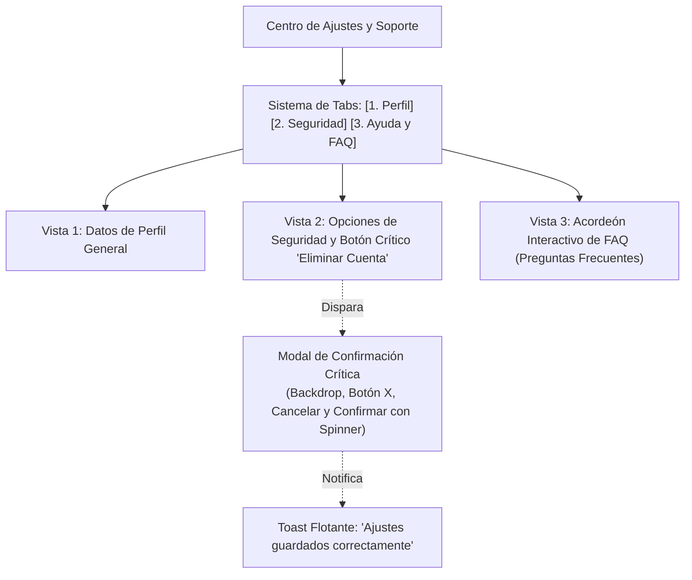

# Proyecto 04 · Centro de Soporte, Modales, Tabs y Acordeón

<div class="badges">
  <span class="badge badge-css">Nivel 4: Avanzado</span>
  <span class="badge badge-blue">DaisyUI 4.x</span>
  <span class="badge badge-purple">Flowbite 2.x</span>
  <span class="badge badge-ra">DIW RA 2 / RA 3 / LMH RA 7</span>
</div>

En este cuarto proyecto, los estudiantes abordarán componentes con **interactividad de estado y superposición (*overlays*)**: un **Centro de Ajustes de Usuario y Soporte Técnico**. Este escenario reúne tres de los patrones más exigentes en usabilidad: **sistemas de pestañas (*Tabs*)**, **acordeones colapsables (*Accordions / Collapse*)** y **ventanas modales de confirmación (*Dialog Modals*)**.

!!! note "Objetivos Técnicos"

    1. Maquetar un sistema de **Tabs navegables** para alternar vistas sin recargar la página.
    2. Construir un **acordeón accesible** para preguntas frecuentes (FAQ) con animaciones suaves de apertura/cierre.
    3. Implementar un **modal interactivo** para acciones críticas (ej. confirmación de borrado de cuenta) con oscurecimiento de fondo (*backdrop*).
    4. Analizar la diferencia arquitectónica fundamental:
       - **DaisyUI:** Aprovecha el elemento nativo HTML5 `<dialog>` y `form method="dialog"`, minimizando el JavaScript.
       - **Flowbite:** Utiliza un motor de gestión del DOM mediante atributos `data-*` y la API de JavaScript de Flowbite con atrapamiento de foco (*focus trap*).
    5. Disparar notificaciones flotantes (*Toasts*) de confirmación de acciones.

---

## 1. Arquitectura de Navegación y Modales



---

## 2. Implementación Paso a Paso: DaisyUI vs Flowbite

### A. Sistema de Pestañas (Tabs)

=== "DaisyUI"

    ```html title="tabs-daisyui.html"
    <!-- DaisyUI: .tabs, .tabs-boxed o .tabs-lifted con CSS puro -->
    <div role="tablist" class="tabs tabs-boxed bg-base-200 p-1 mb-6">
      <a role="tab" class="tab tab-active font-semibold" onclick="switchTab(1)">Perfil General</a>
      <a role="tab" class="tab font-semibold" onclick="switchTab(2)">Seguridad</a>
      <a role="tab" class="tab font-semibold" onclick="switchTab(3)">Preguntas Frecuentes</a>
    </div>
    ```

=== "Flowbite"

    ```html title="tabs-flowbite.html"
    <!-- Flowbite: utiliza data-tabs-toggle con selectores de destino -->
    <div class="mb-4 border-b border-gray-200 dark:border-gray-700">
      <ul class="flex flex-wrap -mb-px text-sm font-medium text-center" data-tabs-toggle="#tab-content" role="tablist">
        <li class="me-2" role="presentation">
          <button class="inline-block p-4 border-b-2 rounded-t-lg" id="profile-tab" data-tabs-target="#profile" type="button" role="tab" aria-controls="profile" aria-selected="true">
            Perfil General
          </button>
        </li>
        <li class="me-2" role="presentation">
          <button class="inline-block p-4 border-b-2 rounded-t-lg hover:text-gray-600 hover:border-gray-300" id="security-tab" data-tabs-target="#security" type="button" role="tab" aria-controls="security" aria-selected="false">
            Seguridad
          </button>
        </li>
        <li role="presentation">
          <button class="inline-block p-4 border-b-2 rounded-t-lg hover:text-gray-600 hover:border-gray-300" id="faq-tab" data-tabs-target="#faq" type="button" role="tab" aria-controls="faq" aria-selected="false">
            Preguntas Frecuentes
          </button>
        </li>
      </ul>
    </div>
    ```

---

### B. Acordeón de Soporte (FAQ)

=== "DaisyUI (CSS Puro con Details o Checkbox)"

    ```html title="accordion-daisyui.html"
    <!-- DaisyUI: .collapse, .collapse-arrow con CSS transitions nativas -->
    <div class="space-y-3">
      <!-- Item 1 -->
      <div class="collapse collapse-arrow bg-base-100 border border-base-300 rounded-box shadow-sm">
        <input type="radio" name="faq-accordion" checked="checked" />
        <div class="collapse-title text-base font-bold text-base-content">
          ¿Cómo se evalúan los Resultados de Aprendizaje (RA)?
        </div>
        <div class="collapse-content text-sm text-base-content/70">
          <p>Cada RA se pondera según la normativa curricular oficial de FP Andalucía mediante rúbricas objetivas aplicadas a las prácticas de aula.</p>
        </div>
      </div>

      <!-- Item 2 -->
      <div class="collapse collapse-arrow bg-base-100 border border-base-300 rounded-box shadow-sm">
        <input type="radio" name="faq-accordion" />
        <div class="collapse-title text-base font-bold text-base-content">
          ¿Puedo entregar las prácticas en DaisyUI o Flowbite indistintamente?
        </div>
        <div class="collapse-content text-sm text-base-content/70">
          <p>Sí, siempre que el código respete la accesibilidad semántica, el diseño responsive y no existan errores en la consola del navegador.</p>
        </div>
      </div>
    </div>
    ```

=== "Flowbite (Controlado por JavaScript con data-accordion)"

    ```html title="accordion-flowbite.html"
    <!-- Flowbite: data-accordion="collapse" con control automático de aria-expanded -->
    <div id="accordion-faq" data-accordion="collapse" data-active-classes="bg-blue-100 dark:bg-gray-800 text-blue-600 dark:text-white" class="space-y-2">
      <!-- Item 1 -->
      <h2 id="accordion-heading-1">
        <button type="button" class="flex items-center justify-between w-full p-4 font-bold text-left text-gray-900 border border-gray-200 rounded-lg focus:ring-4 focus:ring-blue-100 dark:focus:ring-gray-800 dark:border-gray-700 dark:text-white hover:bg-gray-100 dark:hover:bg-gray-700 gap-3" data-accordion-target="#accordion-body-1" aria-expanded="true" aria-controls="accordion-body-1">
          <span>¿Cómo se evalúan los Resultados de Aprendizaje (RA)?</span>
          <svg data-accordion-icon class="w-3 h-3 rotate-180 shrink-0" aria-hidden="true" xmlns="http://www.w3.org/2000/svg" fill="none" viewBox="0 0 10 6"><path stroke="currentColor" stroke-linecap="round" stroke-linejoin="round" stroke-width="2" d="M9 5 5 1 1 5"/></svg>
        </button>
      </h2>
      <div id="accordion-body-1" class="hidden p-4 border border-t-0 border-gray-200 dark:border-gray-700 rounded-b-lg text-sm text-gray-500 dark:text-gray-400" aria-labelledby="accordion-heading-1">
        <p>Cada RA se pondera según la normativa curricular oficial de FP Andalucía mediante rúbricas objetivas aplicadas a las prácticas de aula.</p>
      </div>
    </div>
    ```

---

### C. Ventana Modal de Confirmación Crítica

La comparativa del modal expone la evolución moderna de los navegadores:

=== "DaisyUI (Elemento Nativo HTML5 &lt;dialog&gt;)"

    ```html title="modal-daisyui.html"
    <!-- 1. Botón que abre el modal mediante la API nativa de JS: showModal() -->
    <button class="btn btn-error btn-sm text-white" onclick="delete_modal.showModal()">
      Eliminar Cuenta
    </button>

    <!-- 2. Modal nativo <dialog> con backdrop integrado y cierre con ESC -->
    <dialog id="delete_modal" class="modal modal-bottom sm:modal-middle">
      <div class="modal-box">
        <h3 class="font-extrabold text-lg text-error">¿Eliminar cuenta permanentemente?</h3>
        <p class="py-3 text-sm opacity-70">
          Esta acción no se puede deshacer. Se borrarán todas tus notas, prácticas entregadas y expedientes asociados.
        </p>
        <div class="modal-action">
          <!-- El formulario nativo con method="dialog" cierra el modal automáticamente -->
          <form method="dialog" class="flex gap-2">
            <button class="btn btn-ghost btn-sm">Cancelar</button>
            <button class="btn btn-error btn-sm text-white" onclick="confirmDeletion()">Confirmar Eliminación</button>
          </form>
        </div>
      </div>
      <!-- Backdrop que cierra al hacer clic fuera -->
      <form method="dialog" class="modal-backdrop">
        <button>cerrar</button>
      </form>
    </dialog>
    ```

=== "Flowbite (Modal con Atributos data-modal-*)"

    ```html title="modal-flowbite.html"
    <!-- 1. Botón con data-modal-target -->
    <button data-modal-target="delete-modal" data-modal-toggle="delete-modal" class="text-white bg-red-600 hover:bg-red-700 focus:ring-4 focus:outline-none focus:ring-red-300 font-medium rounded-lg text-sm px-4 py-2 text-center" type="button">
      Eliminar Cuenta
    </button>

    <!-- 2. Modal de Flowbite gestionado por el runtime JS -->
    <div id="delete-modal" tabindex="-1" class="hidden overflow-y-auto overflow-x-hidden fixed top-0 right-0 left-0 z-50 justify-center items-center w-full md:inset-0 h-[calc(100%-1rem)] max-h-full">
      <div class="relative p-4 w-full max-w-md max-h-full">
        <div class="relative bg-white rounded-lg shadow-xl dark:bg-gray-700">
          <button type="button" class="absolute top-3 end-2.5 text-gray-400 bg-transparent hover:bg-gray-200 hover:text-gray-900 rounded-lg text-sm w-8 h-8 ms-auto inline-flex justify-center items-center dark:hover:bg-gray-600 dark:hover:text-white" data-modal-hide="delete-modal">
            <svg class="w-3 h-3" fill="none" viewBox="0 0 14 14"><path stroke="currentColor" stroke-linecap="round" stroke-linejoin="round" stroke-width="2" d="m1 1 6 6m0 0 6 6M7 7l6-6M7 7l-6 6"/></svg>
            <span class="sr-only">Cerrar modal</span>
          </button>
          <div class="p-6 text-center">
            <svg class="mx-auto mb-4 text-red-500 w-12 h-12" fill="none" stroke="currentColor" viewBox="0 0 24 24"><path stroke-linecap="round" stroke-linejoin="round" stroke-width="2" d="M12 9v2m0 4h.01m-6.938 4h13.856c1.54 0 2.502-1.667 1.732-3L13.732 4c-.77-1.333-2.694-1.333-3.464 0L3.34 16c-.77 1.333.192 3 1.732 3z"/></svg>
            <h3 class="mb-5 text-lg font-bold text-gray-900 dark:text-white">¿Eliminar cuenta permanentemente?</h3>
            <p class="text-sm text-gray-500 dark:text-gray-400 mb-6">Esta acción borrará todas tus prácticas y datos.</p>
            <button data-modal-hide="delete-modal" type="button" class="text-white bg-red-600 hover:bg-red-800 focus:ring-4 focus:outline-none focus:ring-red-300 font-medium rounded-lg text-sm inline-flex items-center px-4 py-2 text-center me-2" onclick="confirmDeletion()">
              Confirmar Eliminación
            </button>
            <button data-modal-hide="delete-modal" type="button" class="text-gray-500 bg-white hover:bg-gray-100 focus:ring-4 focus:outline-none focus:ring-gray-200 rounded-lg border border-gray-200 text-sm font-medium px-4 py-2 hover:text-gray-900 focus:z-10 dark:bg-gray-700 dark:text-gray-300 dark:border-gray-500 dark:hover:text-white dark:hover:bg-gray-600">
              Cancelar
            </button>
          </div>
        </div>
      </div>
    </div>
    ```

---

## 3. Comparativa Técnica de Componentes Interactivos

| Dimensión | DaisyUI | Flowbite | Conclusión Técnica |
|---|---|---|---|
| **Tecnología del Modal** | Estándar HTML5 `<dialog>` nativo. | Capas `<div>` fijas con manipulación de clases por JS. | DaisyUI delega el apilamiento `::backdrop` y el aislamiento en el navegador. |
| **Cierre con tecla ESC** | **Nativo y automático** gracias al elemento `<dialog>`. | Gestionado por un *event listener* global del runtime de Flowbite. | DaisyUI requiere cero código adicional para accesibilidad de teclado. |
| **Atrapamiento de foco (Focus Trap)** | Nativo en el navegador al invocar `.showModal()`. | Implementado mediante lógica JavaScript en el script de Flowbite. | Ambos garantizan que el lector de pantalla no escape del modal. |
| **Acordeón (FAQ)** | CSS puro con `<input type="radio">` o elemento `<details>`. | Atributos `data-accordion-target` con animación JS. | DaisyUI es más ligero; Flowbite facilita integraciones con frameworks JS. |

---

## 4. Archivos de Código Completos para el Alumnado

- 📄 [04-modales-tabs-daisyui.html](ejemplos-html/04-modales-tabs-daisyui.html) — Interfaz interactiva completa con DaisyUI.
- 📄 [04-modales-tabs-flowbite.html](ejemplos-html/04-modales-tabs-flowbite.html) — Interfaz interactiva completa con Flowbite.

---

## 5. Retos de Ampliación para el Alumnado

1. **Reto 1 (Modal anidado o multistep):** Modifica el modal para que incluya un campo donde el usuario deba escribir `"ELIMINAR"` para habilitar el botón de confirmación.
2. **Reto 2 (Persistencia de Tab activo):** Haz que la pestaña activa se guarde en `localStorage` o en el hash de la URL (`#seguridad`) para que no se pierda al recargar.
3. **Reto 3 (Acordeón con búsqueda en tiempo real):** Añade un input de texto que filtre las preguntas del acordeón según el término tecleado.
