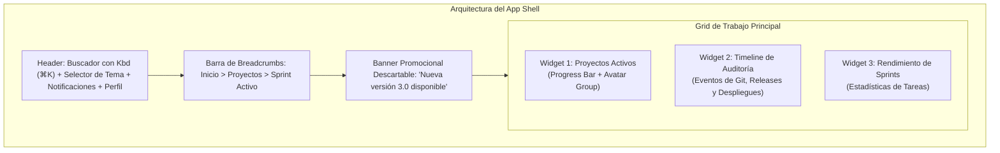
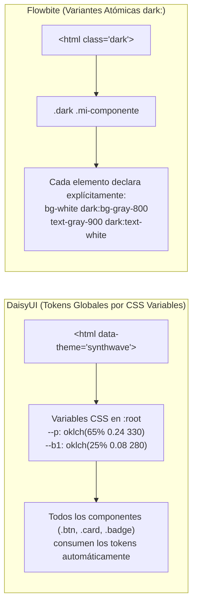

# Proyecto 05 · Plataforma SaaS Completa con Modo Oscuro y Temas Dinámicos

<div class="badges">
  <span class="badge badge-css">Nivel 5: Proyecto Master</span>
  <span class="badge badge-blue">DaisyUI 4.x</span>
  <span class="badge badge-purple">Flowbite 2.x</span>
  <span class="badge badge-ra">DIW RA 1 / RA 2 / RA 3 / RA 4</span>
</div>

Como culminación de este bloque práctico, los alumnos desarrollarán un proyecto integral de nivel profesional: una **Plataforma SaaS de Gestión de Proyectos de Software (DevPortal)**. Este ejercicio integra todos los patrones anteriores en una aplicación cohesiva y profundiza en el aspecto más crítico del diseño web contemporáneo: **la arquitectura de sistemas de color, tematización dinámica y modo oscuro**.

!!! note "Objetivos Técnicos"

    1. Maquetar un **App Shell de producción** con estructura semántica: barra de navegación, migas de pan (*Breadcrumbs*), barra de búsqueda con atajos de teclado visuales (`Kbd`) y cuadrícula de widgets.
    2. Construir **grupos de avatares superpuestos (*Avatar Groups*)** para los equipos de desarrollo.
    3. Implementar una **línea de tiempo vertical (*Timeline*)** para auditar eventos recientes del repositorio.
    4. Analizar la diferencia de arquitectura de tematización:
       - **DaisyUI:** Tokens semánticos globales basados en variables CSS (`primary`, `secondary`, `neutral`, `base-100`) con soporte para más de 30 temas preconstruidos mediante `data-theme`.
       - **Flowbite:** Conmutación binaria claro/oscuro mediante la clase `.dark` en la etiqueta raíz `<html>` con clases explícitas `dark:bg-*` y `dark:text-*` en cada elemento.
    5. Desarrollar un conmutador de temas 100% interactivo con persistencia en `localStorage`.

---

## 1. Arquitectura del App Shell y Flujo de Temas



---

## 2. El Duelo de Arquitecturas: `data-theme` vs `class="dark"`

Uno de los mayores debates en ingeniería frontend es cómo modelar el soporte multitema:



### ¿Qué implica esto para el equipo de desarrollo?
- **DaisyUI:** Cambiar la paleta corporativa requiere alterar 5 variables en `tailwind.config.js`. Puedes ofrecer temas festivos (Halloween, Navidad, Alto Contraste) instantáneamente.
- **Flowbite:** Control quirúrgico elemento por elemento. Evita efectos secundarios no deseados en componentes aislados, pero exige escribir el doble de clases en el HTML.

---

## 3. Implementación Paso a Paso: DaisyUI vs Flowbite

### A. Barra de Búsqueda con Atajo Kbd y Breadcrumbs

=== "DaisyUI"

    ```html title="breadcrumbs-daisyui.html"
    <!-- Breadcrumbs semánticos de DaisyUI -->
    <div class="breadcrumbs text-sm mb-4">
      <ul>
        <li><a class="text-primary font-medium">Dashboard</a></li>
        <li><a>Proyectos Web</a></li>
        <li class="font-bold">Sprint 24 · E-Commerce</li>
      </ul>
    </div>

    <!-- Buscador con atajo visual .kbd -->
    <label class="input input-bordered input-sm flex items-center gap-2 max-w-xs">
      <svg class="w-4 h-4 opacity-50" fill="none" stroke="currentColor" viewBox="0 0 24 24"><path stroke-linecap="round" stroke-linejoin="round" stroke-width="2" d="M21 21l-6-6m2-5a7 7 0 11-14 0 7 7 0 0114 0z"/></svg>
      <input type="text" placeholder="Buscar commits..." class="grow" />
      <kbd class="kbd kbd-sm font-sans">⌘K</kbd>
    </label>
    ```

=== "Flowbite"

    ```html title="breadcrumbs-flowbite.html"
    <!-- Breadcrumbs de Flowbite con iconos delimitadores -->
    <nav class="flex mb-4" aria-label="Breadcrumb">
      <ol class="inline-flex items-center space-x-1 md:space-x-3 rtl:space-x-reverse text-sm">
        <li class="inline-flex items-center">
          <a href="#" class="inline-flex items-center font-medium text-blue-600 dark:text-blue-400 hover:underline">
            Dashboard
          </a>
        </li>
        <li>
          <div class="flex items-center">
            <svg class="rtl:rotate-180 w-3 h-3 text-gray-400 mx-1" fill="none" viewBox="0 0 6 10"><path stroke="currentColor" stroke-linecap="round" stroke-linejoin="round" stroke-width="2" d="m1 9 4-4-4-4"/></svg>
            <a href="#" class="ms-1 text-gray-700 hover:text-blue-600 dark:text-gray-400 dark:hover:text-white">Proyectos Web</a>
          </div>
        </li>
        <li aria-current="page">
          <div class="flex items-center">
            <svg class="rtl:rotate-180 w-3 h-3 text-gray-400 mx-1" fill="none" viewBox="0 0 6 10"><path stroke="currentColor" stroke-linecap="round" stroke-linejoin="round" stroke-width="2" d="m1 9 4-4-4-4"/></svg>
            <span class="ms-1 font-bold text-gray-500 dark:text-gray-400">Sprint 24 · E-Commerce</span>
          </div>
        </li>
      </ol>
    </nav>

    <!-- Buscador con Kbd en Flowbite -->
    <div class="relative max-w-xs">
      <div class="absolute inset-y-0 start-0 flex items-center ps-3 pointer-events-none text-gray-400">
        <svg class="w-4 h-4" fill="none" stroke="currentColor" viewBox="0 0 24 24"><path stroke-linecap="round" stroke-linejoin="round" stroke-width="2" d="M21 21l-6-6m2-5a7 7 0 11-14 0 7 7 0 0114 0z"/></svg>
      </div>
      <input type="text" placeholder="Buscar commits..." class="bg-gray-50 border border-gray-300 text-gray-900 text-xs rounded-lg block w-full ps-9 pe-12 p-2 dark:bg-gray-700 dark:border-gray-600 dark:text-white" />
      <div class="absolute inset-y-0 end-0 flex items-center pe-2 pointer-events-none">
        <kbd class="px-1.5 py-0.5 text-[10px] font-semibold text-gray-800 bg-gray-100 border border-gray-200 rounded-md dark:bg-gray-600 dark:text-gray-100 dark:border-gray-500">⌘K</kbd>
      </div>
    </div>
    ```

---

### B. Grupos de Avatares y Barra de Progreso

=== "DaisyUI"

    ```html title="avatars-daisyui.html"
    <!-- Avatar Group de DaisyUI con apilamiento automático -->
    <div class="avatar-group -space-x-4 rtl:space-x-reverse">
      <div class="avatar">
        <div class="w-8"></div>
      </div>
      <div class="avatar">
        <div class="w-8"></div>
      </div>
      <div class="avatar placeholder">
        <div class="w-8 bg-neutral text-neutral-content font-bold text-xs"><span>+3</span></div>
      </div>
    </div>

    <!-- Barra de progreso con color del tema -->
    <progress class="progress progress-primary w-full" value="70" max="100"></progress>
    ```

=== "Flowbite"

    ```html title="avatars-flowbite.html"
    <!-- Avatar Group en Flowbite mediante flexbox e inversión de márgenes -->
    <div class="flex -space-x-3 rtl:space-x-reverse">
      
      
      <div class="flex items-center justify-center w-8 h-8 text-xs font-medium text-white bg-gray-700 border-2 border-white rounded-full dark:border-gray-800">+3</div>
    </div>

    <!-- Barra de progreso Flowbite -->
    <div class="w-full bg-gray-200 rounded-full h-2.5 dark:bg-gray-700">
      <div class="bg-blue-600 h-2.5 rounded-full" style="width: 70%"></div>
    </div>
    ```

---

### C. Línea de Tiempo de Auditoría (Timeline)

=== "DaisyUI"

    ```html title="timeline-daisyui.html"
    <!-- DaisyUI .timeline vertical con estados de éxito -->
    <ul class="timeline timeline-vertical timeline-compact">
      <li>
        <div class="timeline-middle text-primary">
          <svg class="w-4 h-4" fill="currentColor" viewBox="0 0 20 20"><path fill-rule="evenodd" d="M10 18a8 8 0 100-16 8 8 0 000 16zm3.707-9.293a1 1 0 00-1.414-1.414L9 10.586 7.707 9.293a1 1 0 00-1.414 1.414l2 2a1 1 0 001.414 0l4-4z" clip-rule="evenodd"/></svg>
        </div>
        <div class="timeline-end timeline-box text-xs">
          <span class="font-bold text-primary">v2.4.0 desplegada</span> a producción (hace 10m)
        </div>
        <hr class="bg-primary"/>
      </li>
      <li>
        <hr class="bg-primary"/>
        <div class="timeline-middle text-primary">
          <svg class="w-4 h-4" fill="currentColor" viewBox="0 0 20 20"><path fill-rule="evenodd" d="M10 18a8 8 0 100-16 8 8 0 000 16zm3.707-9.293a1 1 0 00-1.414-1.414L9 10.586 7.707 9.293a1 1 0 00-1.414 1.414l2 2a1 1 0 001.414 0l4-4z" clip-rule="evenodd"/></svg>
        </div>
        <div class="timeline-end timeline-box text-xs">
          <span class="font-bold">Pull Request #42</span> fusionado por Alejandro Ruiz (hace 1h)
        </div>
      </li>
    </ul>
    ```

=== "Flowbite"

    ```html title="timeline-flowbite.html"
    <!-- Flowbite: Línea de tiempo ordenada con lista <ol> -->
    <ol class="relative border-s border-gray-200 dark:border-gray-700 ms-3 space-y-6">
      <li class="ms-6">
        <span class="absolute flex items-center justify-center w-6 h-6 bg-blue-100 rounded-full -start-3 ring-8 ring-white dark:ring-gray-900 dark:bg-blue-900 text-blue-600 dark:text-blue-300">
          <svg class="w-3 h-3" fill="currentColor" viewBox="0 0 20 20"><path fill-rule="evenodd" d="M16.707 5.293a1 1 0 010 1.414l-8 8a1 1 0 01-1.414 0l-4-4a1 1 0 011.414-1.414L8 12.586l7.293-7.293a1 1 0 011.414 0z" clip-rule="evenodd"/></svg>
        </span>
        <h4 class="text-xs font-semibold text-gray-900 dark:text-white">v2.4.0 desplegada a producción</h4>
        <time class="block mb-1 text-[10px] text-gray-400">Hace 10 minutos por CI/CD Runner</time>
      </li>
      <li class="ms-6">
        <span class="absolute flex items-center justify-center w-6 h-6 bg-gray-100 rounded-full -start-3 ring-8 ring-white dark:ring-gray-900 dark:bg-gray-700 text-gray-500">
          <svg class="w-3 h-3" fill="currentColor" viewBox="0 0 20 20"><path fill-rule="evenodd" d="M6 2a1 1 0 00-1 1v1H4a2 2 0 00-2 2v10a2 2 0 002 2h12a2 2 0 002-2V6a2 2 0 00-2-2h-1V3a1 1 0 10-2 0v1H7V3a1 1 0 00-1-1zm0 5a1 1 0 000 2h8a1 1 0 100-2H6z" clip-rule="evenodd"/></svg>
        </span>
        <h4 class="text-xs font-semibold text-gray-900 dark:text-white">Pull Request #42 fusionado</h4>
        <time class="block mb-1 text-[10px] text-gray-400">Hace 1 hora por Alejandro Ruiz</time>
      </li>
    </ol>
    ```

---

## 4. Comparativa Técnica de Tematización

| Aspecto | DaisyUI | Flowbite |
|---|---|---|
| **Estrategia** | Variables CSS dinámicas vinculadas a tokens semánticos. | Clases utilitarias condicionales con prefijo `dark:`. |
| **Cambio de tema en JS** | `document.documentElement.dataset.theme = 'nombre'` | `document.documentElement.classList.toggle('dark')` |
| **Número de temas posibles** | Ilimitado (viene con 32 temas listos). | Típicamente 2 (Claro y Oscuro). |
| **Mantenibilidad a gran escala** | Muy alta: cambiar el branding no toca el HTML. | Media: exige revisar cada componente si cambian las tonalidades. |
| **Aislamiento visual** | Cada elemento se adapta según el contenedor con `data-theme`. | El modo oscuro afecta a toda la jerarquía bajo la clase `.dark`. |

---

## 5. Archivos de Código Completos para el Alumnado

- 📄 [05-saas-layout-daisyui.html](ejemplos-html/05-saas-layout-daisyui.html) — Portal SaaS completo con DaisyUI y selector de 6 temas.
- 📄 [05-saas-layout-flowbite.html](ejemplos-html/05-saas-layout-flowbite.html) — Portal SaaS completo con Flowbite y Dark Mode persistente.

---

## 6. Retos de Ampliación para el Alumnado

1. **Reto 1 (Personalización de tema propio en DaisyUI):** Define un nuevo tema `"fp-andalucia"` con tonos verdes institucionales y pruébalo en el selector.
2. **Reto 2 (Atajo de teclado interactivo con JS):** Haz que al pulsar `Ctrl + K` (o `Cmd + K`), el foco del cursor se coloque automáticamente en el input de búsqueda.
3. **Reto 3 (Timeline dinámico):** Crea un formulario sencillo que permita agregar nuevos hitos a la línea de tiempo en tiempo real.
