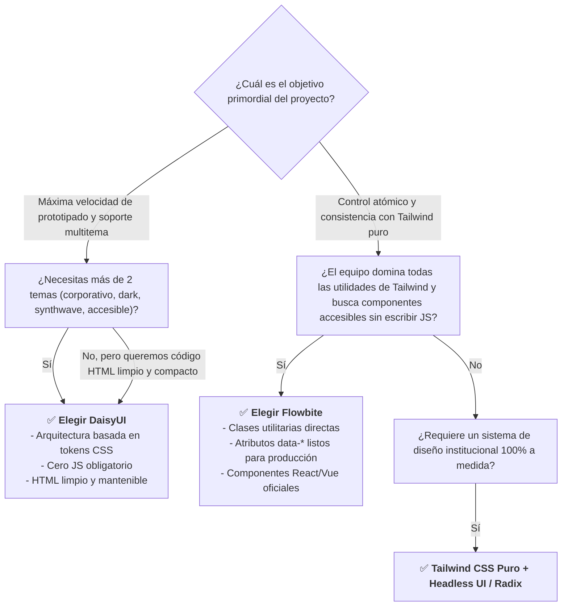

# Guía Comparativa, Elección Arquitectónica y Rúbrica

<div class="badges">
  <span class="badge badge-html">HTML5</span>
  <span class="badge badge-css">Tailwind CSS</span>
  <span class="badge badge-blue">DaisyUI</span>
  <span class="badge badge-purple">Flowbite</span>
  <span class="badge badge-ra">DIW RA 1 / RA 2 / RA 4</span>
</div>

Tras haber desarrollado los **cinco proyectos frontend incrementales** con ambas librerías, este documento consolida el análisis crítico necesario para que el alumnado actúe como un **Arquitecto de Sistemas Frontend**. Se presenta una **matriz comparativa exhaustiva**, un **árbol de decisión técnica**, los **principios de arquitectura limpia y desacoplamiento**, y la **rúbrica de evaluación** para el profesorado.

---

## 1. Gran Matriz Comparativa Técnica: DaisyUI vs Flowbite

| Criterio | DaisyUI 4.x | Flowbite 2.x | Evaluación del Arquitecto |
|---|---|---|---|
| **Filosofía de Diseño** | **Semántica de componentes:** Clases de alto nivel (`.btn`, `.card`, `.badge`, `.modal`). | **Utility-first estructurado:** Composición explícita de utilidades estándar de Tailwind. | DaisyUI reduce el ruido visual en el HTML; Flowbite ofrece visibilidad total del CSS aplicado. |
| **Dependencia de JavaScript** | **Cero obligatoria:** Emplea estándares HTML5 (`<dialog>`, `<details>`, checkbox `:checked`). | **Obligatoria para componentes interactivos:** Requiere `flowbite.min.js`. | DaisyUI es más resiliente y ligero; Flowbite simplifica la integración en arquitecturas SPA tradicionales. |
| **Concisión del Marcado HTML** | **Extremadamente conciso:** 1 a 4 clases por elemento. | **Extenso:** 8 a 18 clases por elemento interactivo. | DaisyUI acelera el desarrollo inicial y la lectura del DOM; Flowbite evita la abstracción de clases CSS. |
| **Sistema de Theming / Dark Mode** | **Tokens Semánticos Globales:** Basado en variables CSS (`data-theme="dark"`). +30 temas incluidos. | **Variantes Atómicas:** Requiere `dark:` en cada nodo y clase `.dark` en `<html>`. | DaisyUI es infinitamente superior en escalabilidad multitema; Flowbite es más predecible si solo hay modo oscuro. |
| **Accesibilidad (WAI-ARIA)** | Delegada al estándar HTML5 nativo (`<dialog>`, `aria-*` declarados manualmente). | Gestionada activamente por el runtime JS (`aria-expanded`, `aria-hidden`, focus trap). | Flowbite garantiza atributos ARIA dinámicos sin programar JS propio; DaisyUI exige conocer HTML5 semántico. |
| **Rendimiento y Bundle Size** | Solo inyecta reglas CSS compiladas en `@layer components`. Cero JS en tiempo de ejecución. | Añade el peso de la librería JavaScript (~35 KB gzipped) además de las clases de Tailwind. | DaisyUI ofrece mejores métricas en Core Web Vitals (INP y LCP al no tener hilo JS bloqueado). |
| **Soporte con Frameworks Modernos** | Universal directo: React, Vue, Svelte, Angular, Astro, Blazor, Laravel Blade, Django. | Universal en HTML + bibliotecas envolventes oficiales (`flowbite-react`, `flowbite-svelte`, `flowbite-vue`). | Flowbite dispone de componentes React/Vue listos con props tipadas; DaisyUI se consume como clases CSS estándar. |
| **Curva de Aprendizaje** | **Muy baja:** Transición inmediata para quienes provienen de Bootstrap o CSS tradicional. | **Media:** Exige conocer bien el catálogo de utilidades de Tailwind y los atributos `data-*`. | DaisyUI es ideal para iniciarse; Flowbite consolida el dominio de Tailwind CSS en profundidad. |

---

## 2. Árbol de Decisión Técnica: ¿Cuándo elegir cuál?



---

## 3. Principios de Arquitectura Limpia para el Alumnado

Todo proyecto presentado debe adherirse a los estándares de ingeniería de software profesional:

### I. Separación Estricta de Responsabilidades (SoC)
- **La UI es «tonta»:** Los componentes HTML solo renderizan datos y emiten eventos. No contienen lógica de negocio ni cálculos matemáticos embebidos.
- **La Lógica es «ciega»:** Las funciones JavaScript que calculan descuentos, validan expedientes o consultan APIs no manipulan directamente estilos CSS ni asumen estructuras rígidas del DOM.

### II. Principio de Inmutabilidad y Desacoplamiento (Wrappers)
- Al conectar librerías externas o peticiones asíncronas, crea siempre un servicio o función intermedia (*wrapper*). Si el día de mañana se migra de Flowbite a DaisyUI (o a una librería basada en Web Components), solo se actualiza la capa intermedia sin reescribir la lógica de la aplicación.

### III. Resiliencia Visual en Todos los Componentes
Nunca entregues un componente que solo funcione en el «camino feliz». Cada módulo debe contemplar:
1. **Estado Cargando (`Loading`):** Mostrar *skeletons* o *spinners* accesibles mientras se resuelven las promesas.
2. **Estado Vacío (`Empty`):** Mensaje claro, icono y llamada a la acción cuando una tabla o catálogo no tiene datos.
3. **Estado de Error (`Error`):** Notificación visual contextual con enlace accesible (`aria-describedby`).
4. **Desbordamiento de Datos (`Data Overflow`):** Títulos y descripciones largas controladas mediante `truncate` o `line-clamp-2` para no quebrar la maquetación.

---

## 4. Índice de Descarga de Proyectos Completos (HTML Autónomo)

Para facilitar la experimentación en clase y el autoaprendizaje, todos los proyectos cuentan con archivos HTML completos y funcionales vía CDN, listos para ejecutar con doble clic en cualquier navegador:

| Nivel | Proyecto Práctico | Versión DaisyUI | Versión Flowbite |
|---|---|:---:|:---:|
| **Nivel 1** | Catálogo de Productos y Tarjetas de Perfil | [01-catalogo-cards-daisyui.html](ejemplos-html/01-catalogo-cards-daisyui.html) | [01-catalogo-cards-flowbite.html](ejemplos-html/01-catalogo-cards-flowbite.html) |
| **Nivel 2** | Portal de Autenticación y Registro con Validación | [02-formulario-autenticacion-daisyui.html](ejemplos-html/02-formulario-autenticacion-daisyui.html) | [02-formulario-autenticacion-flowbite.html](ejemplos-html/02-formulario-autenticacion-flowbite.html) |
| **Nivel 3** | Dashboard Administrativo con KPIs y Tablas | [03-dashboard-tablas-daisyui.html](ejemplos-html/03-dashboard-tablas-daisyui.html) | [03-dashboard-tablas-flowbite.html](ejemplos-html/03-dashboard-tablas-flowbite.html) |
| **Nivel 4** | Centro de Soporte, Modales, Tabs y Acordeón | [04-modales-tabs-daisyui.html](ejemplos-html/04-modales-tabs-daisyui.html) | [04-modales-tabs-flowbite.html](ejemplos-html/04-modales-tabs-flowbite.html) |
| **Nivel 5** | Plataforma SaaS Completa con Modo Oscuro y Temas | [05-saas-layout-daisyui.html](ejemplos-html/05-saas-layout-daisyui.html) | [05-saas-layout-flowbite.html](ejemplos-html/05-saas-layout-flowbite.html) |

---

## 5. Rúbrica de Evaluación Curricular (DAW / DAM / FP)

Esta rúbrica permite al profesorado calificar objetivamente los proyectos desarrollados por los alumnos según los Resultados de Aprendizaje de los módulos profesionales:
- **LMH (0373):** RA 5 (Tablas), RA 6 (Formularios) y RA 7 (Accesibilidad e interactividad).
- **DIW (0615):** RA 1 (Guía de estilo), RA 2 (Interfaces web homogéneas), RA 3 (Contenido multimedia y responsive) y RA 4 (Calidad y accesibilidad).

```markdown
### Rúbrica de Calificación de Proyectos Frontend con Tailwind UI

| Criterio de Evaluación | Ponderación | Nivel Inicial (1-4) | Nivel Medio (5-7) | Nivel Avanzado (8-10) |
|---|:---:|---|---|---|
| **1. Arquitectura y Semántica HTML5** | 20% | Marcado con etiquetas genéricas `<div>` y `<span>` sin jerarquía. | Empleo correcto de `<header>`, `<main>`, `<article>`, `<dialog>` y `<table>`. | Semántica estricta WHATWG, landmarks WAI-ARIA coherentes y validación W3C impecable. |
| **2. Aplicación de la Librería de Componentes** | 25% | Mezcla caótica de estilos inline con utilidades rotas. | Uso adecuado de los componentes base (cards, buttons, badges, tables). | Dominio profundo de las convenciones de la librería (semántica de DaisyUI o utilidades de Flowbite) sin duplicidades. |
| **3. Responsividad y Diseño Adaptativo** | 20% | La interfaz se desborda o se solapa en resoluciones móviles. | Diseño adaptable funcional en móvil, tablet y escritorio con breakpoints estándar. | Maquetación fluida mobile-first, tablas con scroll horizontal seguro y menús Drawer optimizados para táctil. |
| **4. Resiliencia Visual y Estados de Borde** | 15% | No contempla estados de carga ni errores; datos largos rompen el grid. | Incluye spinners básicos y alertas de error en formularios. | Gestión integral de los 4 estados: Loading (skeletons), Error (accesible), Empty State y Data Overflow (`truncate`/`line-clamp`). |
| **5. Accesibilidad (WCAG 2.2) y Usabilidad** | 10% | Sin contraste cromático, inputs sin etiqueta asociada, modales sin focus trap. | Contraste adecuado y labels asociados mediante `for`/`id`. | Cumplimiento nivel AA: `aria-invalid`, `aria-describedby`, navegación por teclado (Tab/Escape) y soporte para lectores de pantalla. |
| **6. Tematización y Dark Mode** | 10% | Sin modo oscuro o con parpadeos visuales al cambiar de tema. | Modo oscuro implementado pero sin persistencia entre recargas. | Switcher dinámico fluido, sin flash visual (*FOIC*), con persistencia en `localStorage` y tokens de color semánticos. |
```
